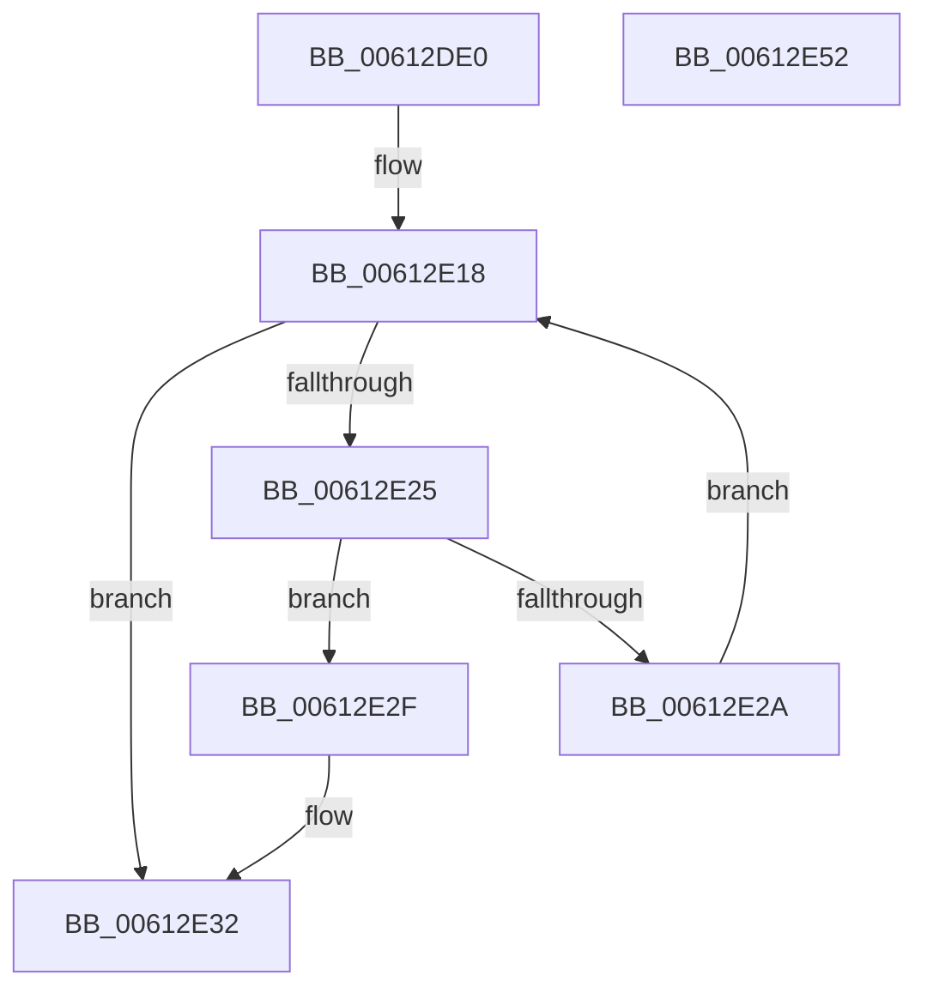

# ViIsActiveChannelWcb

- RVA: `0x00612DE0`–`0x00612E53` (길이 `115` bytes)
- VA: `0x0000000140612DE0`
- 실행 섹션: `.text`
- PDB 이름 있음: `예`; PDB Function 태그: `아니요`
- unwind 정보 RVA: `0x0005C954`
- 디코드: `33`개 명령, `115/115` bytes 표시
- 미해석 바이트: `0` (있으면 어셈블리에 `.byte`로 보존)

> 이 문서는 커널 이미지의 기계어와 PDB 기호를 분석해 생성했습니다. 4번과 5번은 함수 원형과 자료형을 바이너리 사용 방식에서 추정한 C 해석이며 원본 소스 복구 결과는 아닙니다.

## 1. Dependencies

- 직접 호출 지점: **2**; 고유 호출 대상: **2**
- 직접 호출자로 확인된 함수: **3**
- RIP 상대 이미지 참조: **0**

### Outgoing calls
- `0x00612E07` → [KeAcquireSpinLockRaiseToDpc](../20/KeAcquireSpinLockRaiseToDpc_function_00208470.md) (function, `0x00208470`)
- `0x00612E35` → [KeReleaseSpinLock](../39/KeReleaseSpinLock_function_00392BA0.md) (function, `0x00392BA0`)

### Direct callers
- [VfAllocateAdapterChannel](../../pagevrfy/B9/VfAllocateAdapterChannel_function_00B95180.md) at `0x00B952BE`
- [VfAllocateAdapterChannelEx](../../pagevrfy/B9/VfAllocateAdapterChannelEx_function_00B95360.md) at `0x00B954C0`
- [ViAdapterCallback](../../pagevrfy/B9/ViAdapterCallback_function_00B97B40.md) at `0x00B97BDB`

### Static image references
- 디코드된 RIP-relative 메모리 참조가 없습니다.

## 2. Other-region calls and transfers

- 다른 실행 섹션으로 향하는 call: **0**
- 별도 외부 분기/꼬리 이동을 확인하지 못했습니다.

## 3. Assembly (complete function range)

```asm
00612DE0  48 89 5C 24 08                  mov qword ptr [rsp + 8], rbx
00612DE5  48 89 6C 24 10                  mov qword ptr [rsp + 0x10], rbp
00612DEA  48 89 74 24 18                  mov qword ptr [rsp + 0x18], rsi
00612DEF  57                              push rdi
00612DF0  48 83 EC 20                     sub rsp, 0x20
00612DF4  48 8D B1 B0 00 00 00            lea rsi, [rcx + 0xb0]
00612DFB  48 8B D9                        mov rbx, rcx
00612DFE  48 8B CE                        mov rcx, rsi
00612E01  48 8B EA                        mov rbp, rdx
00612E04  40 32 FF                        xor dil, dil
00612E07  E8 64 56 BF FF                  call 0x140208470
00612E0C  48 81 C3 A0 00 00 00            add rbx, 0xa0
00612E13  8A D0                           mov dl, al
00612E15  48 8B 03                        mov rax, qword ptr [rbx]
00612E18  48 83 E8 48                     sub rax, 0x48
00612E1C  48 8D 48 48                     lea rcx, [rax + 0x48]
00612E20  48 3B D9                        cmp rbx, rcx
00612E23  74 0D                           je 0x140612e32
00612E25  48 3B E8                        cmp rbp, rax
00612E28  74 05                           je 0x140612e2f
00612E2A  48 8B 01                        mov rax, qword ptr [rcx]
00612E2D  EB E9                           jmp 0x140612e18
00612E2F  40 B7 01                        mov dil, 1
00612E32  48 8B CE                        mov rcx, rsi
00612E35  E8 66 FD D7 FF                  call 0x140392ba0
00612E3A  48 8B 5C 24 30                  mov rbx, qword ptr [rsp + 0x30]
00612E3F  40 8A C7                        mov al, dil
00612E42  48 8B 6C 24 38                  mov rbp, qword ptr [rsp + 0x38]
00612E47  48 8B 74 24 40                  mov rsi, qword ptr [rsp + 0x40]
00612E4C  48 83 C4 20                     add rsp, 0x20
00612E50  5F                              pop rdi
00612E51  C3                              ret
00612E52  CC                              int3
```

## 4. C-style interpretation (structured pseudocode)

```c
__int64 __fastcall ViIsActiveChannelWcb(__int64 a1, __int64 a2)
{
    __int64 result;
    __int64 v_rbx;
    __int64 v_rdi;
    __int64 v_rsp;
    unsigned __int64 v_stack_p10;
    unsigned __int64 v_stack_p18;
    unsigned __int64 v_stack_p8;

    v_stack_p8 = v_rbx;
    v_stack_p10 = v_rbp;
    v_stack_p18 = v_rsi;
    v_rsp = (v_rsp) - (32);
    v_rdi = 0;
    result = KeAcquireSpinLockRaiseToDpc(a1 + 176, a2, a3, a4);
    v_rbx = (a1) + (160);
loc_00612E18:
    result = (*(unsigned __int64 *)(v_rbx)) - (72);
    if (v_rbx == (result + 72)) goto loc_00612E32;
    if (a2 == result) goto loc_00612E2F;
    goto loc_00612E18;
loc_00612E2F:
loc_00612E32:
    result = KeReleaseSpinLock(a1 + 176, (unsigned __int8)(result), a3, a4);
    v_rsp = (v_rsp) + (32);
    return 1;
}
```

## 5. (Beta) C Style

```c
int64_t ViIsActiveChannelWcb(void *Arg1, int64_t Arg2)
{
    uint8_t *arg1 = (uint8_t *)Arg1;

    int64_t result;
    int64_t local_rbx;
    int64_t local_rdi;
    int64_t local_rsp;
    uint64_t v_stack_p10;
    uint64_t v_stack_p18;
    uint64_t v_stack_p8;

    v_stack_p8 = local_rbx;
    v_stack_p10 = local_rbp;
    v_stack_p18 = local_rsi;
    local_rsp = (local_rsp) - (32);
    local_rdi = 0;
    result = KeAcquireSpinLockRaiseToDpc(Arg1 + 176, Arg2, a3, a4);
    local_rbx = (Arg1) + (160);
loc_00612E18:
    result = (*(uint64_t *)(local_rbx)) - (72);
    if (local_rbx == (result + 72)) goto loc_00612E32;
    if (Arg2 == result) goto loc_00612E2F;
    goto loc_00612E18;
loc_00612E2F:
loc_00612E32:
    result = KeReleaseSpinLock(Arg1 + 176, (uint8_t)(result), a3, a4);
    local_rsp = (local_rsp) + (32);
    return 1;
}
```

### 관측된 메모리 오프셋

구조체 형식이 확인되지 않은 접근은 인자 기준의 오프셋으로만 기록했습니다.

| 기준 인자 | 오프셋 표현 | 폭 (bit) | 접근 |
|---|---:|---:|---|
| `Arg1` | `+ 0x0` | `64` | `R` |
| `Arg1` | `+ 0xB0` | `64` | `R` |

## 6. Execution-region graph

[열기: 2D/3D 그래프와 함수 탐색 컨트롤 패널](../../../control-panel.html?section=text&rva=0x00612DE0&view=graph)

- 2D 그래프는 위에서 아래로 흐르고, 3D 그래프는 빈 공간을 드래그해 회전합니다. Shift+드래그는 이동, 휠은 확대·축소, 함수 노드 선택은 대상 보고서 이동입니다.

### Static fallback


