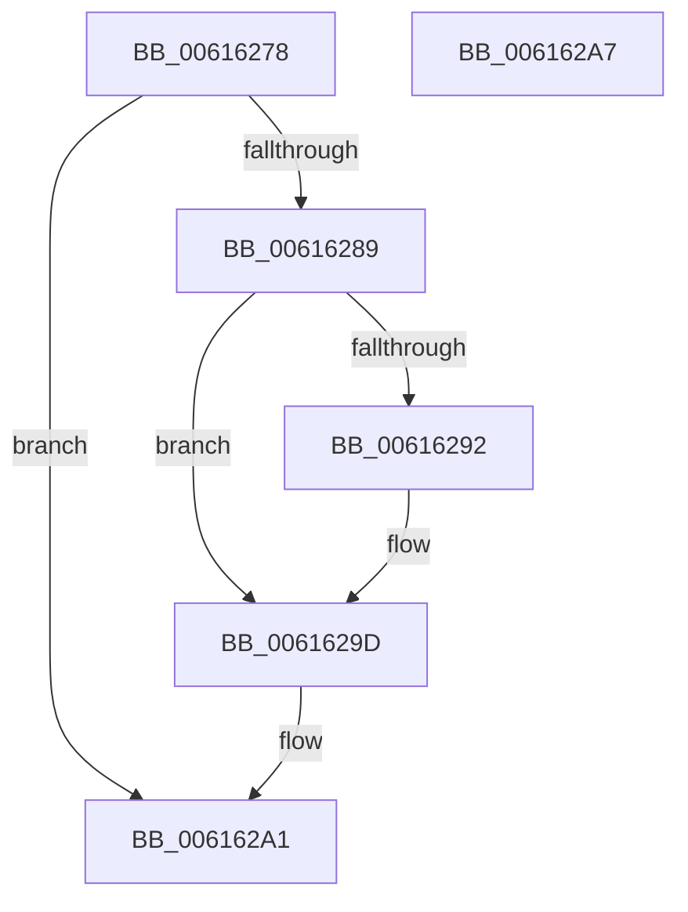

# ViLowerIrql

- RVA: `0x00616278`–`0x006162A8` (길이 `48` bytes)
- VA: `0x0000000140616278`
- 실행 섹션: `.text`
- PDB 이름 있음: `예`; PDB Function 태그: `아니요`
- unwind 정보 RVA: `0x0005CF00`
- 디코드: `16`개 명령, `48/48` bytes 표시
- 미해석 바이트: `0` (있으면 어셈블리에 `.byte`로 보존)

> 이 문서는 커널 이미지의 기계어와 PDB 기호를 분석해 생성했습니다. 4번과 5번은 함수 원형과 자료형을 바이너리 사용 방식에서 추정한 C 해석이며 원본 소스 복구 결과는 아닙니다.

## 1. Dependencies

- 직접 호출 지점: **1**; 고유 호출 대상: **1**
- 직접 호출자로 확인된 함수: **8**
- RIP 상대 이미지 참조: **1**

### Outgoing calls
- `0x00616298` → [KiLowerIrqlProcessIrqlFlags](../4F/KiLowerIrqlProcessIrqlFlags_function_004F5698.md) (function, `0x004F5698`)

### Direct callers
- [ViDeadlockRemoveMemoryRangeResources](ViDeadlockRemoveMemoryRangeResources_function_00615FE8.md) at `0x006160E5`
- [ViDeadlockRemoveMemoryRangeThreads](ViDeadlockRemoveMemoryRangeThreads_function_00616148.md) at `0x0061623A`
- [VfDeadlockInitializeResource](../../pagevrfy/BA/VfDeadlockInitializeResource_function_00BA80A0.md) at `0x00BA81B0`
- [ViDeadlockDetectionApplySettings](../../pagevrfy/BA/ViDeadlockDetectionApplySettings_function_00BA9178.md) at `0x00BA91A9`
- [ViDeadlockEmptyDatabase](../../pagevrfy/BA/ViDeadlockEmptyDatabase_function_00BA922C.md) at `0x00BA933B`
- [ViIsThreadInsidePagingCodePaths](../../pagevrfy/BA/ViIsThreadInsidePagingCodePaths_function_00BAA2D4.md) at `0x00BAA31F`
- [VfDeadlockReleaseResource](../../pagevrfy/BB/VfDeadlockReleaseResource_function_00BB759C.md) at `0x00BB7A04`
- [VfDeadlockAcquireResource](../../pagevrfy/BB/VfDeadlockAcquireResource_function_00BB83B4.md) at `0x00BB89C3`

### Static image references
- `0x00616289` → RVA `0x00FC6D20` (`ALMOSTRO`; read)

## 2. Other-region calls and transfers

- 다른 실행 섹션으로 향하는 call: **0**
- 별도 외부 분기/꼬리 이동을 확인하지 못했습니다.

## 3. Assembly (complete function range)

```asm
00616278  40 53                           push rbx
0061627A  48 83 EC 20                     sub rsp, 0x20
0061627E  0F B6 D9                        movzx ebx, cl
00616281  44 0F 20 C0                     mov rax, cr8
00616285  3A D8                           cmp bl, al
00616287  73 18                           jae 0x1406162a1
00616289  83 3D 90 0A 9B 00 00            cmp dword ptr [rip + 0x9b0a90], 0
00616290  74 0B                           je 0x14061629d
00616292  44 0F 20 C1                     mov rcx, cr8
00616296  8A D3                           mov dl, bl
00616298  E8 FB F3 ED FF                  call 0x1404f5698
0061629D  44 0F 22 C3                     mov cr8, rbx
006162A1  48 83 C4 20                     add rsp, 0x20
006162A5  5B                              pop rbx
006162A6  C3                              ret
006162A7  CC                              int3
```

## 4. C-style interpretation (structured pseudocode)

```c
__int64 __fastcall ViLowerIrql(unsigned __int8 a1)
{
    __int64 result;
    __int64 v_rsp;

    v_rsp = (v_rsp) - (32);
    if (a1 >= ((unsigned __int8)(v_cr8))) goto loc_006162A1;
    result = v_cr8;
    if ((*(unsigned int *)(v_rip + 10160784)) != 0) {
        a1 = v_cr8;
        a2 = a1;
        result = KiLowerIrqlProcessIrqlFlags(a1, a2, a3, a4);
    }
loc_006162A1:
    v_rsp = (v_rsp) + (32);
    return result;
}
```

## 5. (Beta) C Style

```c
int64_t ViLowerIrql(uint8_t Arg1)
{
    int64_t result;
    int64_t local_rsp;

    local_rsp = (local_rsp) - (32);
    if (Arg1 >= ((uint8_t)(v_cr8))) goto loc_006162A1;
    result = v_cr8;
    if ((*(uint32_t *)(v_rip + 0x9B0A90)) != 0) {
        Arg1 = v_cr8;
        a2 = Arg1;
        result = KiLowerIrqlProcessIrqlFlags(Arg1, a2, a3, a4);
    }
loc_006162A1:
    local_rsp = (local_rsp) + (32);
    return result;
}
```

## 6. Execution-region graph

[열기: 2D/3D 그래프와 함수 탐색 컨트롤 패널](../../../control-panel.html?section=text&rva=0x00616278&view=graph)

- 2D 그래프는 위에서 아래로 흐르고, 3D 그래프는 빈 공간을 드래그해 회전합니다. Shift+드래그는 이동, 휠은 확대·축소, 함수 노드 선택은 대상 보고서 이동입니다.

### Static fallback


