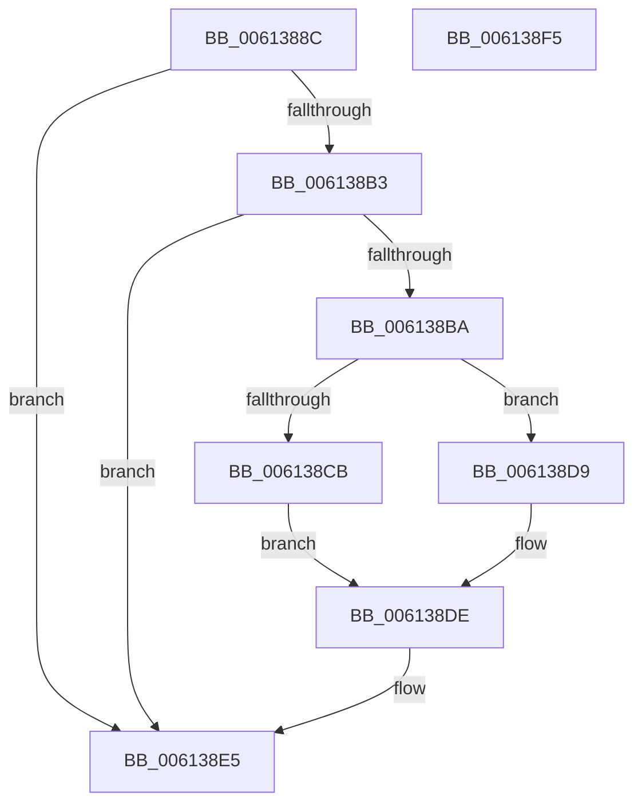

# ViPtAcquireTreeLockAtDpcLevelSafe

- RVA: `0x0061388C`–`0x006138F6` (길이 `106` bytes)
- VA: `0x000000014061388C`
- 실행 섹션: `.text`
- PDB 이름 있음: `예`; PDB Function 태그: `아니요`
- unwind 정보 RVA: `0x00060BC4`
- 디코드: `28`개 명령, `106/106` bytes 표시
- 미해석 바이트: `0` (있으면 어셈블리에 `.byte`로 보존)

> 이 문서는 커널 이미지의 기계어와 PDB 기호를 분석해 생성했습니다. 4번과 5번은 함수 원형과 자료형을 바이너리 사용 방식에서 추정한 C 해석이며 원본 소스 복구 결과는 아닙니다.

## 1. Dependencies

- 직접 호출 지점: **2**; 고유 호출 대상: **2**
- 직접 호출자로 확인된 함수: **5**
- RIP 상대 이미지 참조: **0**

### Outgoing calls
- `0x006138CB` → [ExAcquireSpinLockExclusiveAtDpcLevel](../24/ExAcquireSpinLockExclusiveAtDpcLevel_function_00248E80.md) (function, `0x00248E80`)
- `0x006138D9` → [ExAcquireSpinLockSharedAtDpcLevel](../24/ExAcquireSpinLockSharedAtDpcLevel_function_00248E30.md) (function, `0x00248E30`)

### Direct callers
- [VfPtAddStackInfoIfNotExist](../../pagevrfy/B9/VfPtAddStackInfoIfNotExist_function_00B9BD74.md) at `0x00B9BE68`
- [VfPtGenerateTraceInformation](../../pagevrfy/B9/VfPtGenerateTraceInformation_function_00B9BF5C.md) at `0x00B9BFE7`
- [VfPtProcessAllocPoolInfo](../../pagevrfy/B9/VfPtProcessAllocPoolInfo_function_00B9C54C.md) at `0x00B9C59E`
- [VfPtProcessFreePoolInfo](../../pagevrfy/B9/VfPtProcessFreePoolInfo_function_00B9C604.md) at `0x00B9C65B`
- [ViPtDeleteAvlTrees](../../pagevrfy/B9/ViPtDeleteAvlTrees_function_00B9C730.md) at `0x00B9C785`
- [ViPtDeleteAvlTrees](../../pagevrfy/B9/ViPtDeleteAvlTrees_function_00B9C730.md) at `0x00B9C809`

### Static image references
- 디코드된 RIP-relative 메모리 참조가 없습니다.

## 2. Other-region calls and transfers

- 다른 실행 섹션으로 향하는 call: **0**
- 별도 외부 분기/꼬리 이동을 확인하지 못했습니다.

## 3. Assembly (complete function range)

```asm
0061388C  48 89 5C 24 08                  mov qword ptr [rsp + 8], rbx
00613891  48 89 74 24 10                  mov qword ptr [rsp + 0x10], rsi
00613896  57                              push rdi
00613897  48 83 EC 20                     sub rsp, 0x20
0061389B  65 48 8B 04 25 88 01 00 00      mov rax, qword ptr gs:[0x188]
006138A4  48 8B DA                        mov rbx, rdx
006138A7  48 8B F9                        mov rdi, rcx
006138AA  48 39 81 88 00 00 00            cmp qword ptr [rcx + 0x88], rax
006138B1  74 32                           je 0x1406138e5
006138B3  8A 42 09                        mov al, byte ptr [rdx + 9]
006138B6  A8 02                           test al, 2
006138B8  75 2B                           jne 0x1406138e5
006138BA  65 48 8B 34 25 88 01 00 00      mov rsi, qword ptr gs:[0x188]
006138C3  48 83 E9 80                     sub rcx, -0x80
006138C7  A8 04                           test al, 4
006138C9  74 0E                           je 0x1406138d9
006138CB  E8 B0 55 C3 FF                  call 0x140248e80
006138D0  48 89 B7 88 00 00 00            mov qword ptr [rdi + 0x88], rsi
006138D7  EB 05                           jmp 0x1406138de
006138D9  E8 52 55 C3 FF                  call 0x140248e30
006138DE  80 4B 09 02                     or byte ptr [rbx + 9], 2
006138E2  48 89 3B                        mov qword ptr [rbx], rdi
006138E5  48 8B 5C 24 30                  mov rbx, qword ptr [rsp + 0x30]
006138EA  48 8B 74 24 38                  mov rsi, qword ptr [rsp + 0x38]
006138EF  48 83 C4 20                     add rsp, 0x20
006138F3  5F                              pop rdi
006138F4  C3                              ret
006138F5  CC                              int3
```

## 4. C-style interpretation (structured pseudocode)

```c
__int64 __fastcall ViPtAcquireTreeLockAtDpcLevelSafe(__int64 a1, __int64 a2)
{
    __int64 result;
    __int64 v_rsp;
    unsigned __int64 v_stack_p10;
    unsigned __int64 v_stack_p8;

    v_stack_p8 = v_rbx;
    v_stack_p10 = v_rsi;
    v_rsp = (v_rsp) - (32);
    if ((*(unsigned __int64 *)(a1 + 136)) == (*(unsigned __int64 *)(gs_base + (0 + 392)))) goto loc_006138E5;
    if ((((unsigned __int8)(*(unsigned __int8 *)(a2 + 9))) & (2)) != 0) goto loc_006138E5;
    a1 = (a1) - (-128);
    if ((((unsigned __int8)(*(unsigned __int8 *)(a2 + 9))) & (4)) == 0) goto loc_006138D9;
    result = ExAcquireSpinLockExclusiveAtDpcLevel(a1, a2, a3, a4);
    *(unsigned __int64 *)(a1 + 136) = *(unsigned __int64 *)(gs_base + (0 + 392));
    goto loc_006138DE;
loc_006138D9:
    result = ExAcquireSpinLockSharedAtDpcLevel(a1, a2, a3, a4);
loc_006138DE:
    *(unsigned __int64 *)(a2) = a1;
loc_006138E5:
    v_rsp = (v_rsp) + (32);
    return result;
}
```

## 5. (Beta) C Style

```c
int64_t ViPtAcquireTreeLockAtDpcLevelSafe(void *Arg1, void *Arg2)
{
    uint8_t *arg1 = (uint8_t *)Arg1;
    uint8_t *arg2 = (uint8_t *)Arg2;

    int64_t result;
    int64_t local_rsp;
    uint64_t v_stack_p10;
    uint64_t v_stack_p8;

    v_stack_p8 = local_rbx;
    v_stack_p10 = local_rsi;
    local_rsp = (local_rsp) - (32);
    if ((*(uint64_t *)(arg1 + 0x88)) == (*(uint64_t *)(gs_base + (0 + 0x188)))) goto loc_006138E5;
    if ((((uint8_t)(*(uint8_t *)(arg2 + 0x9))) & (2)) != 0) goto loc_006138E5;
    Arg1 = (Arg1) - (-128);
    if ((((uint8_t)(*(uint8_t *)(arg2 + 0x9))) & (4)) == 0) goto loc_006138D9;
    result = ExAcquireSpinLockExclusiveAtDpcLevel(Arg1, Arg2, a3, a4);
    *(uint64_t *)(arg1 + 0x88) = *(uint64_t *)(gs_base + (0 + 0x188));
    goto loc_006138DE;
loc_006138D9:
    result = ExAcquireSpinLockSharedAtDpcLevel(Arg1, Arg2, a3, a4);
loc_006138DE:
    *(void **)(arg2) = Arg1;
loc_006138E5:
    local_rsp = (local_rsp) + (32);
    return result;
}
```

### 관측된 메모리 오프셋

구조체 형식이 확인되지 않은 접근은 인자 기준의 오프셋으로만 기록했습니다.

| 기준 인자 | 오프셋 표현 | 폭 (bit) | 접근 |
|---|---:|---:|---|
| `Arg1` | `+ 0x88` | `64` | `R` |
| `Arg1` | `+ 0x88` | `64` | `W` |
| `Arg2` | `+ 0x0` | `64` | `W` |
| `Arg2` | `+ 0x9` | `8` | `R` |
| `Arg2` | `+ 0x9` | `8` | `R/W` |

## 6. Execution-region graph

[열기: 2D/3D 그래프와 함수 탐색 컨트롤 패널](../../../control-panel.html?section=text&rva=0x0061388C&view=graph)

- 2D 그래프는 위에서 아래로 흐르고, 3D 그래프는 빈 공간을 드래그해 회전합니다. Shift+드래그는 이동, 휠은 확대·축소, 함수 노드 선택은 대상 보고서 이동입니다.

### Static fallback


