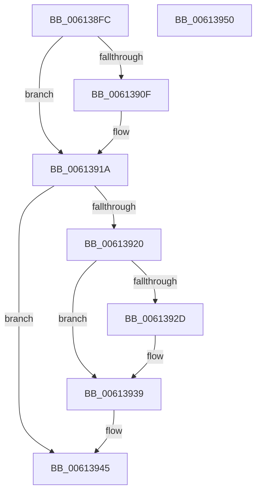

# ViPtCleanupLockContext

- RVA: `0x006138FC`–`0x00613951` (길이 `85` bytes)
- VA: `0x00000001406138FC`
- 실행 섹션: `.text`
- PDB 이름 있음: `예`; PDB Function 태그: `아니요`
- unwind 정보 RVA: `0x0005CAAC`
- 디코드: `25`개 명령, `85/85` bytes 표시
- 미해석 바이트: `0` (있으면 어셈블리에 `.byte`로 보존)

> 이 문서는 커널 이미지의 기계어와 PDB 기호를 분석해 생성했습니다. 4번과 5번은 함수 원형과 자료형을 바이너리 사용 방식에서 추정한 C 해석이며 원본 소스 복구 결과는 아닙니다.

## 1. Dependencies

- 직접 호출 지점: **2**; 고유 호출 대상: **2**
- 직접 호출자로 확인된 함수: **5**
- RIP 상대 이미지 참조: **1**

### Outgoing calls
- `0x00613915` → [ViPtReleaseTreeLockFromDpcLevel](ViPtReleaseTreeLockFromDpcLevel_function_006139C0.md) (function, `0x006139C0`)
- `0x00613934` → [KiLowerIrqlProcessIrqlFlags](../4F/KiLowerIrqlProcessIrqlFlags_function_004F5698.md) (function, `0x004F5698`)

### Direct callers
- [VfPtAddStackInfoIfNotExist](../../pagevrfy/B9/VfPtAddStackInfoIfNotExist_function_00B9BD74.md) at `0x00B9BEE6`
- [VfPtGenerateTraceInformation](../../pagevrfy/B9/VfPtGenerateTraceInformation_function_00B9BF5C.md) at `0x00B9C103`
- [VfPtGenerateTraceInformation](../../pagevrfy/B9/VfPtGenerateTraceInformation_function_00B9BF5C.md) at `0x00B9C186`
- [VfPtProcessAllocPoolInfo](../../pagevrfy/B9/VfPtProcessAllocPoolInfo_function_00B9C54C.md) at `0x00B9C5E9`
- [VfPtProcessFreePoolInfo](../../pagevrfy/B9/VfPtProcessFreePoolInfo_function_00B9C604.md) at `0x00B9C69B`
- [ViPtDeleteAvlTrees](../../pagevrfy/B9/ViPtDeleteAvlTrees_function_00B9C730.md) at `0x00B9C7C7`
- [ViPtDeleteAvlTrees](../../pagevrfy/B9/ViPtDeleteAvlTrees_function_00B9C730.md) at `0x00B9C84B`

### Static image references
- `0x00613920` → RVA `0x00FC6D20` (`ALMOSTRO`; read)

## 2. Other-region calls and transfers

- 다른 실행 섹션으로 향하는 call: **0**
- 별도 외부 분기/꼬리 이동을 확인하지 못했습니다.

## 3. Assembly (complete function range)

```asm
006138FC  48 89 5C 24 08                  mov qword ptr [rsp + 8], rbx
00613901  57                              push rdi
00613902  48 83 EC 20                     sub rsp, 0x20
00613906  F6 41 09 02                     test byte ptr [rcx + 9], 2
0061390A  48 8B D9                        mov rbx, rcx
0061390D  74 0B                           je 0x14061391a
0061390F  48 8B D1                        mov rdx, rcx
00613912  48 8B 09                        mov rcx, qword ptr [rcx]
00613915  E8 A6 00 00 00                  call 0x1406139c0
0061391A  F6 43 09 01                     test byte ptr [rbx + 9], 1
0061391E  74 25                           je 0x140613945
00613920  83 3D F9 33 9B 00 00            cmp dword ptr [rip + 0x9b33f9], 0
00613927  0F B6 7B 08                     movzx edi, byte ptr [rbx + 8]
0061392B  74 0C                           je 0x140613939
0061392D  44 0F 20 C1                     mov rcx, cr8
00613931  40 8A D7                        mov dl, dil
00613934  E8 5F 1D EE FF                  call 0x1404f5698
00613939  44 0F 22 C7                     mov cr8, rdi
0061393D  80 63 09 FE                     and byte ptr [rbx + 9], 0xfe
00613941  C6 43 08 00                     mov byte ptr [rbx + 8], 0
00613945  48 8B 5C 24 30                  mov rbx, qword ptr [rsp + 0x30]
0061394A  48 83 C4 20                     add rsp, 0x20
0061394E  5F                              pop rdi
0061394F  C3                              ret
00613950  CC                              int3
```

## 4. C-style interpretation (structured pseudocode)

```c
__int64 __fastcall ViPtCleanupLockContext(__int64 a1)
{
    __int64 result;
    __int64 v_rsp;
    unsigned __int64 v_stack_p8;

    v_stack_p8 = v_rbx;
    v_rsp = (v_rsp) - (32);
    if (((*(unsigned __int8 *)(a1 + 9)) & (2)) != 0) {
        a2 = a1;
        a1 = *(unsigned __int64 *)(a1);
        result = ViPtReleaseTreeLockFromDpcLevel(a1, a2, a3, a4);
    }
    if (((*(unsigned __int8 *)(a1 + 9)) & (1)) == 0) goto loc_00613945;
    if ((*(unsigned int *)(v_rip + 10171385)) != 0) {
        a1 = v_cr8;
        a2 = (unsigned __int8)(*(unsigned __int8 *)(a1 + 8));
        result = KiLowerIrqlProcessIrqlFlags(a1, a2, a3, a4);
    }
    *(unsigned __int8 *)(a1 + 8) = 0;
loc_00613945:
    v_rsp = (v_rsp) + (32);
    return result;
}
```

## 5. (Beta) C Style

```c
int64_t ViPtCleanupLockContext(void *Arg1)
{
    uint8_t *arg1 = (uint8_t *)Arg1;

    int64_t result;
    int64_t local_rsp;
    uint64_t v_stack_p8;

    v_stack_p8 = local_rbx;
    local_rsp = (local_rsp) - (32);
    if (((*(uint8_t *)(arg1 + 0x9)) & (2)) != 0) {
        a2 = Arg1;
        Arg1 = *(uint64_t *)(arg1);
        result = ViPtReleaseTreeLockFromDpcLevel(Arg1, a2, a3, a4);
    }
    if (((*(uint8_t *)(arg1 + 0x9)) & (1)) == 0) goto loc_00613945;
    if ((*(uint32_t *)(v_rip + 0x9B33F9)) != 0) {
        Arg1 = v_cr8;
        a2 = (uint8_t)(*(uint8_t *)(arg1 + 0x8));
        result = KiLowerIrqlProcessIrqlFlags(Arg1, a2, a3, a4);
    }
    *(uint8_t *)(arg1 + 0x8) = 0;
loc_00613945:
    local_rsp = (local_rsp) + (32);
    return result;
}
```

### 관측된 메모리 오프셋

구조체 형식이 확인되지 않은 접근은 인자 기준의 오프셋으로만 기록했습니다.

| 기준 인자 | 오프셋 표현 | 폭 (bit) | 접근 |
|---|---:|---:|---|
| `Arg1` | `+ 0x0` | `64` | `R` |
| `Arg1` | `+ 0x8` | `8` | `R` |
| `Arg1` | `+ 0x8` | `8` | `W` |
| `Arg1` | `+ 0x9` | `8` | `R` |
| `Arg1` | `+ 0x9` | `8` | `R/W` |

## 6. Execution-region graph

[열기: 2D/3D 그래프와 함수 탐색 컨트롤 패널](../../../control-panel.html?section=text&rva=0x006138FC&view=graph)

- 2D 그래프는 위에서 아래로 흐르고, 3D 그래프는 빈 공간을 드래그해 회전합니다. Shift+드래그는 이동, 휠은 확대·축소, 함수 노드 선택은 대상 보고서 이동입니다.

### Static fallback


