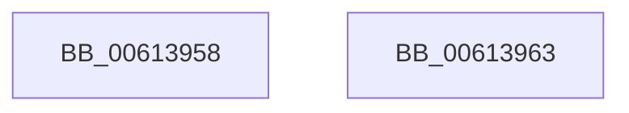

# ViPtInitializeLockContext

- RVA: `0x00613958`–`0x00613964` (길이 `12` bytes)
- VA: `0x0000000140613958`
- 실행 섹션: `.text`
- PDB 이름 있음: `예`; PDB Function 태그: `아니요`
- unwind 정보 RVA: `0x000DB714`
- 디코드: `5`개 명령, `12/12` bytes 표시
- 미해석 바이트: `0` (있으면 어셈블리에 `.byte`로 보존)

> 이 문서는 커널 이미지의 기계어와 PDB 기호를 분석해 생성했습니다. 4번과 5번은 함수 원형과 자료형을 바이너리 사용 방식에서 추정한 C 해석이며 원본 소스 복구 결과는 아닙니다.

## 1. Dependencies

- 직접 호출 지점: **0**; 고유 호출 대상: **0**
- 직접 호출자로 확인된 함수: **5**
- RIP 상대 이미지 참조: **0**

### Outgoing calls
- 직접 디코드된 call 명령이 없습니다.

### Direct callers
- [VfPtAddStackInfoIfNotExist](../../pagevrfy/B9/VfPtAddStackInfoIfNotExist_function_00B9BD74.md) at `0x00B9BE4A`
- [VfPtGenerateTraceInformation](../../pagevrfy/B9/VfPtGenerateTraceInformation_function_00B9BF5C.md) at `0x00B9BFCB`
- [VfPtProcessAllocPoolInfo](../../pagevrfy/B9/VfPtProcessAllocPoolInfo_function_00B9C54C.md) at `0x00B9C585`
- [VfPtProcessFreePoolInfo](../../pagevrfy/B9/VfPtProcessFreePoolInfo_function_00B9C604.md) at `0x00B9C640`
- [ViPtDeleteAvlTrees](../../pagevrfy/B9/ViPtDeleteAvlTrees_function_00B9C730.md) at `0x00B9C767`
- [ViPtDeleteAvlTrees](../../pagevrfy/B9/ViPtDeleteAvlTrees_function_00B9C730.md) at `0x00B9C7EB`

### Static image references
- 디코드된 RIP-relative 메모리 참조가 없습니다.

## 2. Other-region calls and transfers

- 다른 실행 섹션으로 향하는 call: **0**
- 별도 외부 분기/꼬리 이동을 확인하지 못했습니다.

## 3. Assembly (complete function range)

```asm
00613958  0F 57 C0                        xorps xmm0, xmm0
0061395B  0F 11 01                        movups xmmword ptr [rcx], xmm0
0061395E  C6 41 09 04                     mov byte ptr [rcx + 9], 4
00613962  C3                              ret
00613963  CC                              int3
```

## 4. C-style interpretation (structured pseudocode)

```c
void __fastcall ViPtInitializeLockContext(__int64 a1)
{
    *(unsigned __int64 *)(a1) = v_xmm0;
    *(unsigned __int8 *)(a1 + 9) = 4;
    return;
}
```

## 5. (Beta) C Style

```c
void ViPtInitializeLockContext(void *Arg1)
{
    uint8_t *arg1 = (uint8_t *)Arg1;

    *(uint64_t *)(arg1) = v_xmm0;
    *(uint8_t *)(arg1 + 0x9) = 4;
    return;
}
```

### 관측된 메모리 오프셋

구조체 형식이 확인되지 않은 접근은 인자 기준의 오프셋으로만 기록했습니다.

| 기준 인자 | 오프셋 표현 | 폭 (bit) | 접근 |
|---|---:|---:|---|
| `Arg1` | `+ 0x0` | `128` | `R` |
| `Arg1` | `+ 0x9` | `8` | `W` |

## 6. Execution-region graph

[열기: 2D/3D 그래프와 함수 탐색 컨트롤 패널](../../../control-panel.html?section=text&rva=0x00613958&view=graph)

- 2D 그래프는 위에서 아래로 흐르고, 3D 그래프는 빈 공간을 드래그해 회전합니다. Shift+드래그는 이동, 휠은 확대·축소, 함수 노드 선택은 대상 보고서 이동입니다.

### Static fallback


