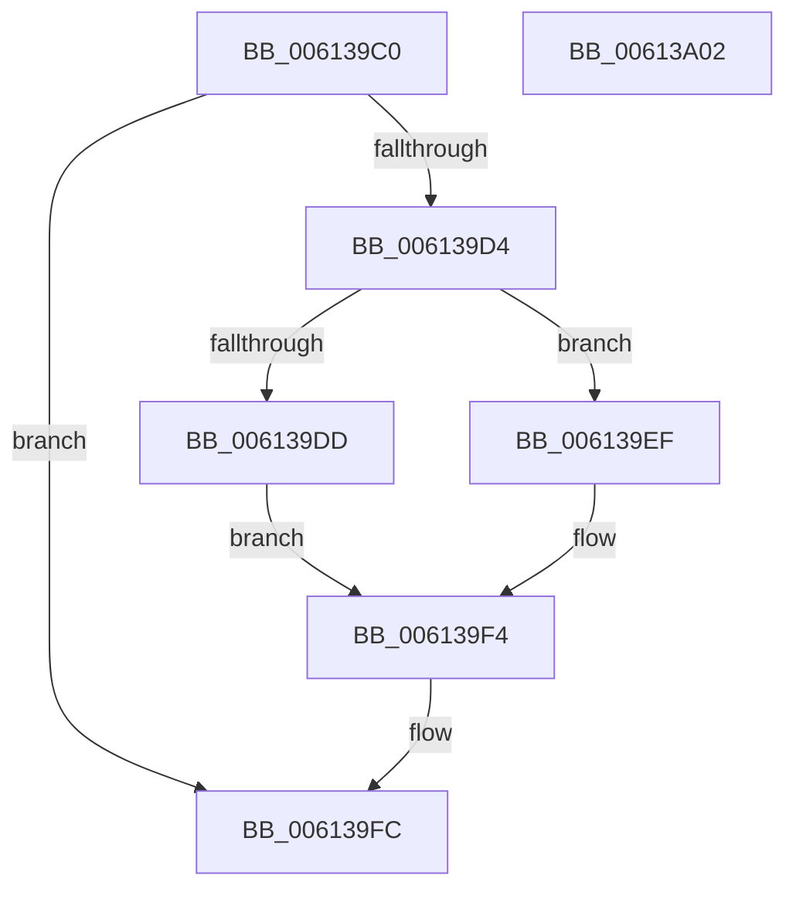

# ViPtReleaseTreeLockFromDpcLevel

- RVA: `0x006139C0`–`0x00613A03` (길이 `67` bytes)
- VA: `0x00000001406139C0`
- 실행 섹션: `.text`
- PDB 이름 있음: `예`; PDB Function 태그: `아니요`
- unwind 정보 RVA: `0x0005CF00`
- 디코드: `20`개 명령, `67/67` bytes 표시
- 미해석 바이트: `0` (있으면 어셈블리에 `.byte`로 보존)

> 이 문서는 커널 이미지의 기계어와 PDB 기호를 분석해 생성했습니다. 4번과 5번은 함수 원형과 자료형을 바이너리 사용 방식에서 추정한 C 해석이며 원본 소스 복구 결과는 아닙니다.

## 1. Dependencies

- 직접 호출 지점: **2**; 고유 호출 대상: **2**
- 직접 호출자로 확인된 함수: **6**
- RIP 상대 이미지 참조: **0**

### Outgoing calls
- `0x006139E8` → [ExReleaseSpinLockExclusiveFromDpcLevel](../24/ExReleaseSpinLockExclusiveFromDpcLevel_function_002497E0.md) (function, `0x002497E0`)
- `0x006139EF` → [ExReleaseSpinLockSharedFromDpcLevel](../24/ExReleaseSpinLockSharedFromDpcLevel_function_0024A590.md) (function, `0x0024A590`)

### Direct callers
- [ViPtCleanupLockContext](ViPtCleanupLockContext_function_006138FC.md) at `0x00613915`
- [VfPtAddStackInfoIfNotExist](../../pagevrfy/B9/VfPtAddStackInfoIfNotExist_function_00B9BD74.md) at `0x00B9BEDC`
- [VfPtGenerateTraceInformation](../../pagevrfy/B9/VfPtGenerateTraceInformation_function_00B9BF5C.md) at `0x00B9C0FA`
- [VfPtGenerateTraceInformation](../../pagevrfy/B9/VfPtGenerateTraceInformation_function_00B9BF5C.md) at `0x00B9C17D`
- [VfPtProcessAllocPoolInfo](../../pagevrfy/B9/VfPtProcessAllocPoolInfo_function_00B9C54C.md) at `0x00B9C5E0`
- [VfPtProcessFreePoolInfo](../../pagevrfy/B9/VfPtProcessFreePoolInfo_function_00B9C604.md) at `0x00B9C691`
- [ViPtDeleteAvlTrees](../../pagevrfy/B9/ViPtDeleteAvlTrees_function_00B9C730.md) at `0x00B9C7BD`
- [ViPtDeleteAvlTrees](../../pagevrfy/B9/ViPtDeleteAvlTrees_function_00B9C730.md) at `0x00B9C841`

### Static image references
- 디코드된 RIP-relative 메모리 참조가 없습니다.

## 2. Other-region calls and transfers

- 다른 실행 섹션으로 향하는 call: **0**
- 별도 외부 분기/꼬리 이동을 확인하지 못했습니다.

## 3. Assembly (complete function range)

```asm
006139C0  40 53                           push rbx
006139C2  48 83 EC 20                     sub rsp, 0x20
006139C6  48 8B DA                        mov rbx, rdx
006139C9  48 8B C1                        mov rax, rcx
006139CC  8A 52 09                        mov dl, byte ptr [rdx + 9]
006139CF  F6 C2 02                        test dl, 2
006139D2  74 28                           je 0x1406139fc
006139D4  48 83 E9 80                     sub rcx, -0x80
006139D8  F6 C2 04                        test dl, 4
006139DB  74 12                           je 0x1406139ef
006139DD  48 C7 80 88 00 00 00 00 00 00 00  mov qword ptr [rax + 0x88], 0
006139E8  E8 F3 5D C3 FF                  call 0x1402497e0
006139ED  EB 05                           jmp 0x1406139f4
006139EF  E8 9C 6B C3 FF                  call 0x14024a590
006139F4  80 63 09 FD                     and byte ptr [rbx + 9], 0xfd
006139F8  48 83 23 00                     and qword ptr [rbx], 0
006139FC  48 83 C4 20                     add rsp, 0x20
00613A00  5B                              pop rbx
00613A01  C3                              ret
00613A02  CC                              int3
```

## 4. C-style interpretation (structured pseudocode)

```c
__int64 __fastcall ViPtReleaseTreeLockFromDpcLevel(__int64 a1, __int64 a2)
{
    __int64 result;
    __int64 v_rsp;

    v_rsp = (v_rsp) - (32);
    if ((((unsigned __int8)(*(unsigned __int8 *)(a2 + 9))) & (2)) == 0) goto loc_006139FC;
    a1 = (a1) - (-128);
    if ((((unsigned __int8)(*(unsigned __int8 *)(a2 + 9))) & (4)) == 0) goto loc_006139EF;
    *(unsigned __int64 *)(a1 + 136) = 0;
    result = ExReleaseSpinLockExclusiveFromDpcLevel(a1, *(unsigned __int8 *)(a2 + 9), a3, a4);
    goto loc_006139F4;
loc_006139EF:
    result = ExReleaseSpinLockSharedFromDpcLevel(a1, *(unsigned __int8 *)(a2 + 9), a3, a4);
loc_006139F4:
loc_006139FC:
    v_rsp = (v_rsp) + (32);
    return result;
}
```

## 5. (Beta) C Style

```c
int64_t ViPtReleaseTreeLockFromDpcLevel(void *Arg1, void *Arg2)
{
    uint8_t *arg1 = (uint8_t *)Arg1;
    uint8_t *arg2 = (uint8_t *)Arg2;

    int64_t result;
    int64_t local_rsp;

    local_rsp = (local_rsp) - (32);
    if ((((uint8_t)(*(uint8_t *)(arg2 + 0x9))) & (2)) == 0) goto loc_006139FC;
    Arg1 = (Arg1) - (-128);
    if ((((uint8_t)(*(uint8_t *)(arg2 + 0x9))) & (4)) == 0) goto loc_006139EF;
    *(uint64_t *)(arg1 + 0x88) = 0;
    result = ExReleaseSpinLockExclusiveFromDpcLevel(Arg1, *(uint8_t *)(arg2 + 0x9), a3, a4);
    goto loc_006139F4;
loc_006139EF:
    result = ExReleaseSpinLockSharedFromDpcLevel(Arg1, *(uint8_t *)(arg2 + 0x9), a3, a4);
loc_006139F4:
loc_006139FC:
    local_rsp = (local_rsp) + (32);
    return result;
}
```

### 관측된 메모리 오프셋

구조체 형식이 확인되지 않은 접근은 인자 기준의 오프셋으로만 기록했습니다.

| 기준 인자 | 오프셋 표현 | 폭 (bit) | 접근 |
|---|---:|---:|---|
| `Arg1` | `+ 0x88` | `64` | `W` |
| `Arg2` | `+ 0x0` | `64` | `R/W` |
| `Arg2` | `+ 0x9` | `8` | `R` |
| `Arg2` | `+ 0x9` | `8` | `R/W` |

## 6. Execution-region graph

[열기: 2D/3D 그래프와 함수 탐색 컨트롤 패널](../../../control-panel.html?section=text&rva=0x006139C0&view=graph)

- 2D 그래프는 위에서 아래로 흐르고, 3D 그래프는 빈 공간을 드래그해 회전합니다. Shift+드래그는 이동, 휠은 확대·축소, 함수 노드 선택은 대상 보고서 이동입니다.

### Static fallback


