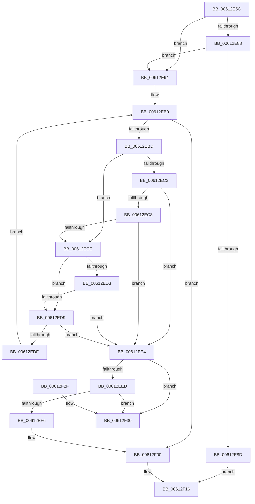

# ViRemoveChannelWcb

- RVA: `0x00612E5C`–`0x00612F37` (길이 `219` bytes)
- VA: `0x0000000140612E5C`
- 실행 섹션: `.text`
- PDB 이름 있음: `예`; PDB Function 태그: `아니요`
- unwind 정보 RVA: `0x00075210`
- 디코드: `68`개 명령, `219/219` bytes 표시
- 미해석 바이트: `0` (있으면 어셈블리에 `.byte`로 보존)

> 이 문서는 커널 이미지의 기계어와 PDB 기호를 분석해 생성했습니다. 4번과 5번은 함수 원형과 자료형을 바이너리 사용 방식에서 추정한 C 해석이며 원본 소스 복구 결과는 아닙니다.

## 1. Dependencies

- 직접 호출 지점: **2**; 고유 호출 대상: **2**
- 직접 호출자로 확인된 함수: **3**
- RIP 상대 이미지 참조: **0**

### Outgoing calls
- `0x00612E9E` → [KeAcquireSpinLockRaiseToDpc](../20/KeAcquireSpinLockRaiseToDpc_function_00208470.md) (function, `0x00208470`)
- `0x00612F06` → [KeReleaseSpinLock](../39/KeReleaseSpinLock_function_00392BA0.md) (function, `0x00392BA0`)

### Direct callers
- [VfCancelAdapterChannel](../../pagevrfy/B9/VfCancelAdapterChannel_function_00B95FD0.md) at `0x00B96034`
- [VfFreeAdapterChannel](../../pagevrfy/B9/VfFreeAdapterChannel_function_00B96480.md) at `0x00B964D1`
- [VfFreeMapRegisters](../../pagevrfy/B9/VfFreeMapRegisters_function_00B967D0.md) at `0x00B96871`

### Static image references
- 디코드된 RIP-relative 메모리 참조가 없습니다.

## 2. Other-region calls and transfers

- 다른 실행 섹션으로 향하는 call: **0**
- 별도 외부 분기/꼬리 이동을 확인하지 못했습니다.

## 3. Assembly (complete function range)

```asm
00612E5C  48 89 5C 24 08                  mov qword ptr [rsp + 8], rbx
00612E61  48 89 6C 24 10                  mov qword ptr [rsp + 0x10], rbp
00612E66  48 89 74 24 18                  mov qword ptr [rsp + 0x18], rsi
00612E6B  57                              push rdi
00612E6C  41 56                           push r14
00612E6E  41 57                           push r15
00612E70  48 83 EC 20                     sub rsp, 0x20
00612E74  45 33 FF                        xor r15d, r15d
00612E77  49 8B F0                        mov rsi, r8
00612E7A  48 8B FA                        mov rdi, rdx
00612E7D  48 8B D9                        mov rbx, rcx
00612E80  41 8A EF                        mov bpl, r15b
00612E83  48 85 D2                        test rdx, rdx
00612E86  74 0C                           je 0x140612e94
00612E88  4D 85 C0                        test r8, r8
00612E8B  74 07                           je 0x140612e94
00612E8D  33 C0                           xor eax, eax
00612E8F  E9 82 00 00 00                  jmp 0x140612f16
00612E94  4C 8D B1 B0 00 00 00            lea r14, [rcx + 0xb0]
00612E9B  49 8B CE                        mov rcx, r14
00612E9E  E8 CD 55 BF FF                  call 0x140208470
00612EA3  48 8D 93 A0 00 00 00            lea rdx, [rbx + 0xa0]
00612EAA  44 8A C0                        mov r8b, al
00612EAD  48 8B 1A                        mov rbx, qword ptr [rdx]
00612EB0  48 83 EB 48                     sub rbx, 0x48
00612EB4  48 8D 4B 48                     lea rcx, [rbx + 0x48]
00612EB8  48 3B D1                        cmp rdx, rcx
00612EBB  74 43                           je 0x140612f00
00612EBD  48 85 FF                        test rdi, rdi
00612EC0  74 0C                           je 0x140612ece
00612EC2  48 39 7B 60                     cmp qword ptr [rbx + 0x60], rdi
00612EC6  74 1C                           je 0x140612ee4
00612EC8  48 39 7B 58                     cmp qword ptr [rbx + 0x58], rdi
00612ECC  74 16                           je 0x140612ee4
00612ECE  48 85 F6                        test rsi, rsi
00612ED1  74 06                           je 0x140612ed9
00612ED3  48 39 73 28                     cmp qword ptr [rbx + 0x28], rsi
00612ED7  74 0B                           je 0x140612ee4
00612ED9  83 7B 34 01                     cmp dword ptr [rbx + 0x34], 1
00612EDD  76 05                           jbe 0x140612ee4
00612EDF  48 8B 19                        mov rbx, qword ptr [rcx]
00612EE2  EB CC                           jmp 0x140612eb0
00612EE4  48 8B 11                        mov rdx, qword ptr [rcx]
00612EE7  48 39 4A 08                     cmp qword ptr [rdx + 8], rcx
00612EEB  75 43                           jne 0x140612f30
00612EED  48 8B 41 08                     mov rax, qword ptr [rcx + 8]
00612EF1  48 39 08                        cmp qword ptr [rax], rcx
00612EF4  75 3A                           jne 0x140612f30
00612EF6  48 89 10                        mov qword ptr [rax], rdx
00612EF9  40 B5 01                        mov bpl, 1
00612EFC  48 89 42 08                     mov qword ptr [rdx + 8], rax
00612F00  41 8A D0                        mov dl, r8b
00612F03  49 8B CE                        mov rcx, r14
00612F06  E8 95 FC D7 FF                  call 0x140392ba0
00612F0B  40 80 FD 01                     cmp bpl, 1
00612F0F  49 0F 45 DF                     cmovne rbx, r15
00612F13  48 8B C3                        mov rax, rbx
00612F16  48 8B 5C 24 40                  mov rbx, qword ptr [rsp + 0x40]
00612F1B  48 8B 6C 24 48                  mov rbp, qword ptr [rsp + 0x48]
00612F20  48 8B 74 24 50                  mov rsi, qword ptr [rsp + 0x50]
00612F25  48 83 C4 20                     add rsp, 0x20
00612F29  41 5F                           pop r15
00612F2B  41 5E                           pop r14
00612F2D  5F                              pop rdi
00612F2E  C3                              ret
00612F2F  CC                              int3
00612F30  B9 03 00 00 00                  mov ecx, 3
00612F35  CD 29                           int 0x29
```

## 4. C-style interpretation (structured pseudocode)

```c
__int64 __fastcall ViRemoveChannelWcb(__int64 a1, __int64 a2, __int64 a3)
{
    __int64 result;
    __int64 v_r15;
    __int64 v_rbx;
    __int64 v_rsp;
    unsigned __int64 v_stack_p10;
    unsigned __int64 v_stack_p18;
    unsigned __int64 v_stack_p8;

    v_stack_p8 = v_rbx;
    v_stack_p10 = v_rbp;
    v_stack_p18 = v_rsi;
    v_rsp = (v_rsp) - (32);
    v_r15 = 0;
    if (a2 == 0) goto loc_00612E94;
    if (a3 == 0) goto loc_00612E94;
    result = 0;
    goto loc_00612F16;
loc_00612E94:
    result = KeAcquireSpinLockRaiseToDpc(a1 + 176, a2, a3, a4);
loc_00612EB0:
    v_rbx = (*(unsigned __int64 *)(a1 + 160)) - (72);
    if ((a1 + 160) == (v_rbx + 72)) goto loc_00612F00;
    if (a2 == 0) goto loc_00612ECE;
    if ((*(unsigned __int64 *)(v_rbx + 96)) == a2) goto loc_00612EE4;
    if ((*(unsigned __int64 *)(v_rbx + 88)) == a2) goto loc_00612EE4;
loc_00612ECE:
    if (a3 == 0) goto loc_00612ED9;
    if ((*(unsigned __int64 *)(v_rbx + 40)) == a3) goto loc_00612EE4;
loc_00612ED9:
    if ((*(unsigned int *)(v_rbx + 52)) <= 1) goto loc_00612EE4;
    goto loc_00612EB0;
loc_00612EE4:
    if ((*(unsigned __int64 *)(*(unsigned __int64 *)(v_rbx + 72) + 8)) != (v_rbx + 72)) goto loc_00612F30;
    if ((*(unsigned __int64 *)(*(unsigned __int64 *)(v_rbx + 72 + 8))) != (v_rbx + 72)) goto loc_00612F30;
    *(unsigned __int64 *)(*(unsigned __int64 *)(v_rbx + 72 + 8)) = *(unsigned __int64 *)(v_rbx + 72);
    *(unsigned __int64 *)(*(unsigned __int64 *)(v_rbx + 72) + 8) = *(unsigned __int64 *)(v_rbx + 72 + 8);
loc_00612F00:
    result = KeReleaseSpinLock(a1 + 176, (unsigned __int8)((unsigned __int8)(result)), (unsigned __int8)(result), a4);
    v_rbx = *(unsigned __int64 *)(v_rbx + 72);
    if (1 != 1) { v_rbx = 0; }
loc_00612F16:
    v_rsp = (v_rsp) + (32);
    return v_rbx;
loc_00612F30:
    return v_rbx;
}
```

## 5. (Beta) C Style

```c
int64_t ViRemoveChannelWcb(void *Arg1, int64_t Arg2, int64_t Arg3)
{
    uint8_t *arg1 = (uint8_t *)Arg1;

    int64_t result;
    int64_t local_r15;
    int64_t local_rbx;
    int64_t local_rsp;
    uint64_t v_stack_p10;
    uint64_t v_stack_p18;
    uint64_t v_stack_p8;

    v_stack_p8 = local_rbx;
    v_stack_p10 = local_rbp;
    v_stack_p18 = local_rsi;
    local_rsp = (local_rsp) - (32);
    local_r15 = 0;
    if (Arg2 == 0) goto loc_00612E94;
    if (Arg3 == 0) goto loc_00612E94;
    result = 0;
    goto loc_00612F16;
loc_00612E94:
    result = KeAcquireSpinLockRaiseToDpc(Arg1 + 176, Arg2, Arg3, a4);
loc_00612EB0:
    local_rbx = (*(uint64_t *)(arg1 + 0xA0)) - (72);
    if ((Arg1 + 160) == (local_rbx + 72)) goto loc_00612F00;
    if (Arg2 == 0) goto loc_00612ECE;
    if ((*(uint64_t *)(local_rbx + 0x60)) == Arg2) goto loc_00612EE4;
    if ((*(uint64_t *)(local_rbx + 0x58)) == Arg2) goto loc_00612EE4;
loc_00612ECE:
    if (Arg3 == 0) goto loc_00612ED9;
    if ((*(uint64_t *)(local_rbx + 0x28)) == Arg3) goto loc_00612EE4;
loc_00612ED9:
    if ((*(uint32_t *)(local_rbx + 0x34)) <= 1) goto loc_00612EE4;
    goto loc_00612EB0;
loc_00612EE4:
    if ((*(uint64_t *)(*(uint64_t *)(local_rbx + 0x48) + 0x8)) != (local_rbx + 72)) goto loc_00612F30;
    if ((*(uint64_t *)(*(uint64_t *)(local_rbx + 0x48 + 0x8))) != (local_rbx + 72)) goto loc_00612F30;
    *(uint64_t *)(*(uint64_t *)(local_rbx + 0x48 + 0x8)) = *(uint64_t *)(local_rbx + 0x48);
    *(uint64_t *)(*(uint64_t *)(local_rbx + 0x48) + 0x8) = *(uint64_t *)(local_rbx + 0x48 + 0x8);
loc_00612F00:
    result = KeReleaseSpinLock(Arg1 + 176, (uint8_t)((uint8_t)(result)), (uint8_t)(result), a4);
    local_rbx = *(uint64_t *)(local_rbx + 0x48);
    if (1 != 1) { local_rbx = 0; }
loc_00612F16:
    local_rsp = (local_rsp) + (32);
    return local_rbx;
loc_00612F30:
    return local_rbx;
}
```

### 관측된 메모리 오프셋

구조체 형식이 확인되지 않은 접근은 인자 기준의 오프셋으로만 기록했습니다.

| 기준 인자 | 오프셋 표현 | 폭 (bit) | 접근 |
|---|---:|---:|---|
| `Arg1` | `+ 0x0` | `64` | `R` |
| `Arg1` | `+ 0xA0` | `64` | `R` |
| `Arg1` | `+ 0xB0` | `64` | `R` |

## 6. Execution-region graph

[열기: 2D/3D 그래프와 함수 탐색 컨트롤 패널](../../../control-panel.html?section=text&rva=0x00612E5C&view=graph)

- 2D 그래프는 위에서 아래로 흐르고, 3D 그래프는 빈 공간을 드래그해 회전합니다. Shift+드래그는 이동, 휠은 확대·축소, 함수 노드 선택은 대상 보고서 이동입니다.

### Static fallback


