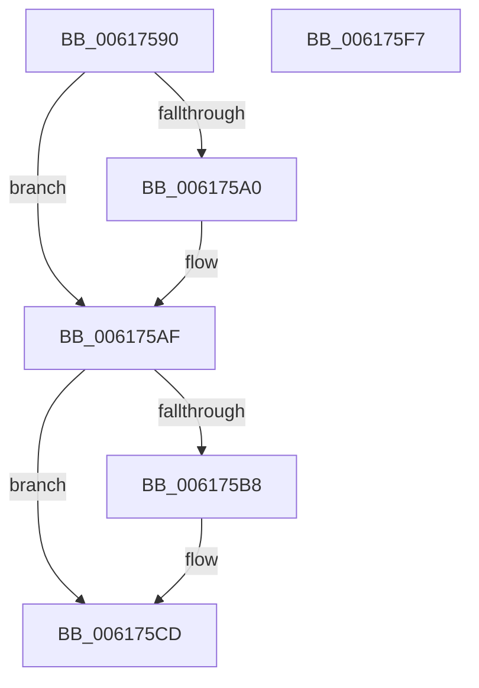

# ViRlrsUnload

- RVA: `0x00617590`–`0x006175F8` (길이 `104` bytes)
- VA: `0x0000000140617590`
- 실행 섹션: `.text`
- PDB 이름 있음: `예`; PDB Function 태그: `아니요`
- unwind 정보 RVA: `0x0005C788`
- 디코드: `21`개 명령, `104/104` bytes 표시
- 미해석 바이트: `0` (있으면 어셈블리에 `.byte`로 보존)

> 이 문서는 커널 이미지의 기계어와 PDB 기호를 분석해 생성했습니다. 4번과 5번은 함수 원형과 자료형을 바이너리 사용 방식에서 추정한 C 해석이며 원본 소스 복구 결과는 아닙니다.

## 1. Dependencies

- 직접 호출 지점: **4**; 고유 호출 대상: **4**
- 직접 호출자로 확인된 함수: **0**
- RIP 상대 이미지 참조: **8**

### Outgoing calls
- `0x006175A2` → [ExFreePoolWithTag](../../poolcode/B8/ExFreePoolWithTag_function_00B82870.md) (function, `0x00B82870`)
- `0x006175C1` → [PsSetCreateProcessNotifyRoutine](../../page/78/PsSetCreateProcessNotifyRoutine_function_00787760.md) (function, `0x00787760`)
- `0x006175E1` → [VfFaultsRemoveAllTags](../../pagevrfy/BA/VfFaultsRemoveAllTags_function_00BA6744.md) (function, `0x00BA6744`)
- `0x006175E6` → [VfFaultsRemoveAllApps](../../pagevrfy/BA/VfFaultsRemoveAllApps_function_00BA66AC.md) (function, `0x00BA66AC`)

### Direct callers
- 이 함수 시작 RVA로 연결되는 직접 call은 확인되지 않았습니다. 간접 호출은 완전히 역산할 수 없습니다.

### Static image references
- `0x00617594` → RVA `0x00FFDB18` (`PAGEVRFD`; read)
- `0x006175A7` → RVA `0x00FFDB18` (`PAGEVRFD`; read/write)
- `0x006175AF` → RVA `0x00FFDA8C` (`PAGEVRFD`; read)
- `0x006175BA` → RVA `0x00615F40` (`VfCreateProcessCallback`; read)
- `0x006175C6` → RVA `0x00FFDA8C` (`PAGEVRFD`; read/write)
- `0x006175CD` → RVA `0x00E0E938` (`.data`; write)
- `0x006175D7` → RVA `0x00E0E93C` (`.data`; write)
- `0x006175EB` → RVA `0x00FFDAB0` (`PAGEVRFD`; read/write)

## 2. Other-region calls and transfers

- 다른 실행 섹션으로 향하는 call: **4**
  - `0x006175A2` → [ExFreePoolWithTag](../../poolcode/B8/ExFreePoolWithTag_function_00B82870.md) (`.text` → `POOLCODE`)
  - `0x006175C1` → [PsSetCreateProcessNotifyRoutine](../../page/78/PsSetCreateProcessNotifyRoutine_function_00787760.md) (`.text` → `PAGE`)
  - `0x006175E1` → [VfFaultsRemoveAllTags](../../pagevrfy/BA/VfFaultsRemoveAllTags_function_00BA6744.md) (`.text` → `PAGEVRFY`)
  - `0x006175E6` → [VfFaultsRemoveAllApps](../../pagevrfy/BA/VfFaultsRemoveAllApps_function_00BA66AC.md) (`.text` → `PAGEVRFY`)
- 별도 외부 분기/꼬리 이동을 확인하지 못했습니다.

## 3. Assembly (complete function range)

```asm
00617590  48 83 EC 28                     sub rsp, 0x28
00617594  48 8B 0D 7D 65 9E 00            mov rcx, qword ptr [rip + 0x9e657d]
0061759B  48 85 C9                        test rcx, rcx
0061759E  74 0F                           je 0x1406175af
006175A0  33 D2                           xor edx, edx
006175A2  E8 C9 B2 56 00                  call 0x140b82870
006175A7  48 83 25 69 65 9E 00 00         and qword ptr [rip + 0x9e6569], 0
006175AF  83 3D D6 64 9E 00 00            cmp dword ptr [rip + 0x9e64d6], 0
006175B6  74 15                           je 0x1406175cd
006175B8  B2 01                           mov dl, 1
006175BA  48 8D 0D 7F E9 FF FF            lea rcx, [rip - 0x1681]
006175C1  E8 9A 01 17 00                  call 0x140787760
006175C6  83 25 BF 64 9E 00 00            and dword ptr [rip + 0x9e64bf], 0
006175CD  C7 05 61 73 7F 00 10 27 00 00   mov dword ptr [rip + 0x7f7361], 0x2710
006175D7  C7 05 5B 73 7F 00 58 02 00 00   mov dword ptr [rip + 0x7f735b], 0x258
006175E1  E8 5E F1 58 00                  call 0x140ba6744
006175E6  E8 C1 F0 58 00                  call 0x140ba66ac
006175EB  83 25 BE 64 9E 00 00            and dword ptr [rip + 0x9e64be], 0
006175F2  48 83 C4 28                     add rsp, 0x28
006175F6  C3                              ret
006175F7  CC                              int3
```

## 4. C-style interpretation (structured pseudocode)

```c
__int64 __fastcall ViRlrsUnload(__int64 a1, int a2)
{
    __int64 result;
    __int64 v_rsp;

    v_rsp = (v_rsp) - (40);
    if (*(unsigned __int64 *)(v_rip + 10380669) != 0) {
        a2 = 0;
        result = ExFreePoolWithTag(*(unsigned __int64 *)(v_rip + 10380669), a2, a3, a4);
    }
    if ((*(unsigned int *)(v_rip + 10380502)) != 0) {
        a2 = 1;
        a1 = v_rip - 5761;
        result = PsSetCreateProcessNotifyRoutine(a1, a2, a3, a4);
    }
    *(unsigned int *)(v_rip + 8352609) = 0x2710ULL;
    *(unsigned int *)(v_rip + 8352603) = 600;
    result = VfFaultsRemoveAllTags(a1, a2, a3, a4);
    result = VfFaultsRemoveAllApps(a1, a2, a3, a4);
    v_rsp = (v_rsp) + (40);
    return result;
}
```

## 5. (Beta) C Style

```c
int64_t ViRlrsUnload(int64_t Arg1, int32_t Arg2)
{
    int64_t result;
    int64_t local_rsp;

    local_rsp = (local_rsp) - (40);
    if (*(uint64_t *)(v_rip + 0x9E657D) != 0) {
        Arg2 = 0;
        result = ExFreePoolWithTag(*(uint64_t *)(v_rip + 0x9E657D), Arg2, a3, a4);
    }
    if ((*(uint32_t *)(v_rip + 0x9E64D6)) != 0) {
        Arg2 = 1;
        Arg1 = v_rip - 5761;
        result = PsSetCreateProcessNotifyRoutine(Arg1, Arg2, a3, a4);
    }
    *(uint32_t *)(v_rip + 0x7F7361) = 0x2710ULL;
    *(uint32_t *)(v_rip + 0x7F735B) = 600;
    result = VfFaultsRemoveAllTags(Arg1, Arg2, a3, a4);
    result = VfFaultsRemoveAllApps(Arg1, Arg2, a3, a4);
    local_rsp = (local_rsp) + (40);
    return result;
}
```

## 6. Execution-region graph

[열기: 2D/3D 그래프와 함수 탐색 컨트롤 패널](../../../control-panel.html?section=text&rva=0x00617590&view=graph)

- 2D 그래프는 위에서 아래로 흐르고, 3D 그래프는 빈 공간을 드래그해 회전합니다. Shift+드래그는 이동, 휠은 확대·축소, 함수 노드 선택은 대상 보고서 이동입니다.

### Static fallback


