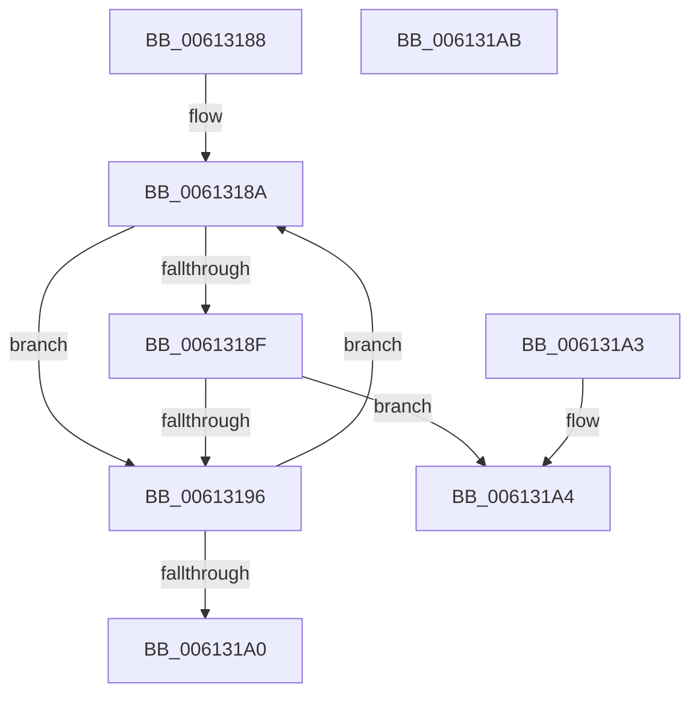

# ViUnbindDifThunk

- RVA: `0x00613188`–`0x006131AC` (길이 `36` bytes)
- VA: `0x0000000140613188`
- 실행 섹션: `.text`
- PDB 이름 있음: `예`; PDB Function 태그: `아니요`
- unwind 정보 RVA: `0x000DB714`
- 디코드: `15`개 명령, `36/36` bytes 표시
- 미해석 바이트: `0` (있으면 어셈블리에 `.byte`로 보존)

> 이 문서는 커널 이미지의 기계어와 PDB 기호를 분석해 생성했습니다. 4번과 5번은 함수 원형과 자료형을 바이너리 사용 방식에서 추정한 C 해석이며 원본 소스 복구 결과는 아닙니다.

## 1. Dependencies

- 직접 호출 지점: **0**; 고유 호출 대상: **0**
- 직접 호출자로 확인된 함수: **1**
- RIP 상대 이미지 참조: **0**

### Outgoing calls
- 직접 디코드된 call 명령이 없습니다.

### Direct callers
- [DifDeregisterPlugin](DifDeregisterPlugin_function_0061A6C8.md) at `0x0061A80C`
- [DifDeregisterPlugin](DifDeregisterPlugin_function_0061A6C8.md) at `0x0061A81C`
- [DifDeregisterPlugin](DifDeregisterPlugin_function_0061A6C8.md) at `0x0061A82C`

### Static image references
- 디코드된 RIP-relative 메모리 참조가 없습니다.

## 2. Other-region calls and transfers

- 다른 실행 섹션으로 향하는 call: **0**
- 별도 외부 분기/꼬리 이동을 확인하지 못했습니다.

## 3. Assembly (complete function range)

```asm
00613188  66 90                           nop
0061318A  39 51 30                        cmp dword ptr [rcx + 0x30], edx
0061318D  75 07                           jne 0x140613196
0061318F  48 83 79 28 00                  cmp qword ptr [rcx + 0x28], 0
00613194  75 0E                           jne 0x1406131a4
00613196  48 83 C1 38                     add rcx, 0x38
0061319A  48 83 39 00                     cmp qword ptr [rcx], 0
0061319E  75 EA                           jne 0x14061318a
006131A0  32 C0                           xor al, al
006131A2  C3                              ret
006131A3  CC                              int3
006131A4  83 61 20 FE                     and dword ptr [rcx + 0x20], 0xfffffffe
006131A8  B0 01                           mov al, 1
006131AA  C3                              ret
006131AB  CC                              int3
```

## 4. C-style interpretation (structured pseudocode)

```c
__int64 __fastcall ViUnbindDifThunk(__int64 a1, int a2)
{
    __int64 result;

loc_0061318A:
    if ((*(unsigned int *)(a1 + 48)) != a2) goto loc_00613196;
    if ((*(unsigned __int64 *)(a1 + 40)) != 0) goto loc_006131A4;
loc_00613196:
    a1 = (a1) + (56);
    if ((*(unsigned __int64 *)(a1)) != 0) goto loc_0061318A;
    result = 0;
    return result;
loc_006131A4:
    return 1;
}
```

## 5. (Beta) C Style

```c
int64_t ViUnbindDifThunk(void *Arg1, int32_t Arg2)
{
    uint8_t *arg1 = (uint8_t *)Arg1;

    int64_t result;

loc_0061318A:
    if ((*(uint32_t *)(arg1 + 0x30)) != Arg2) goto loc_00613196;
    if ((*(uint64_t *)(arg1 + 0x28)) != 0) goto loc_006131A4;
loc_00613196:
    Arg1 = (Arg1) + (56);
    if ((*(uint64_t *)(arg1)) != 0) goto loc_0061318A;
    result = 0;
    return result;
loc_006131A4:
    return 1;
}
```

### 관측된 메모리 오프셋

구조체 형식이 확인되지 않은 접근은 인자 기준의 오프셋으로만 기록했습니다.

| 기준 인자 | 오프셋 표현 | 폭 (bit) | 접근 |
|---|---:|---:|---|
| `Arg1` | `+ 0x0` | `64` | `R` |
| `Arg1` | `+ 0x20` | `32` | `R/W` |
| `Arg1` | `+ 0x28` | `64` | `R` |
| `Arg1` | `+ 0x30` | `32` | `R` |

## 6. Execution-region graph

[열기: 2D/3D 그래프와 함수 탐색 컨트롤 패널](../../../control-panel.html?section=text&rva=0x00613188&view=graph)

- 2D 그래프는 위에서 아래로 흐르고, 3D 그래프는 빈 공간을 드래그해 회전합니다. Shift+드래그는 이동, 휠은 확대·축소, 함수 노드 선택은 대상 보고서 이동입니다.

### Static fallback


