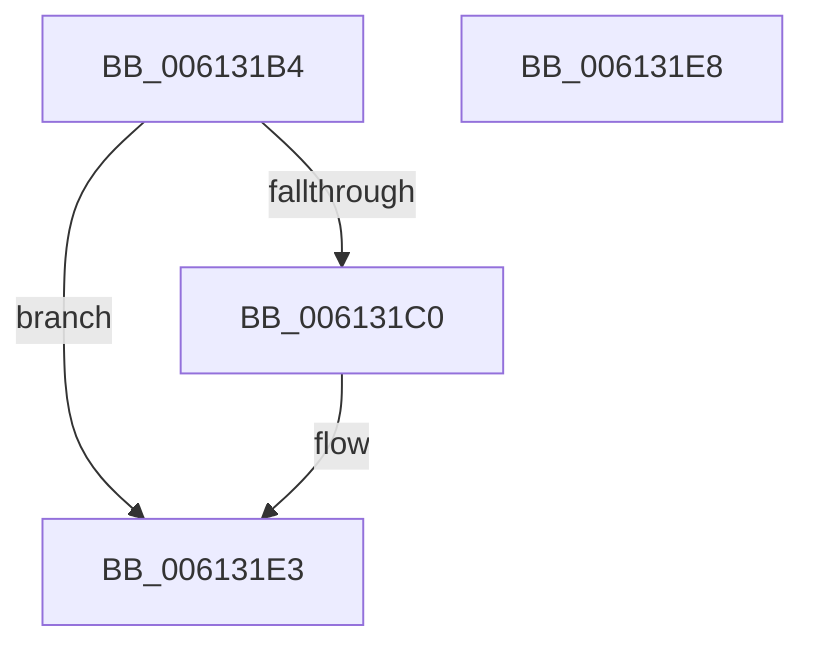

# ViXdvSetXdvKernelUtilities

- RVA: `0x006131B4`–`0x006131E9` (길이 `53` bytes)
- VA: `0x00000001406131B4`
- 실행 섹션: `.text`
- PDB 이름 있음: `예`; PDB Function 태그: `아니요`
- unwind 정보 RVA: `0x0005D2F4`
- 디코드: `13`개 명령, `53/53` bytes 표시
- 미해석 바이트: `0` (있으면 어셈블리에 `.byte`로 보존)

> 이 문서는 커널 이미지의 기계어와 PDB 기호를 분석해 생성했습니다. 4번과 5번은 함수 원형과 자료형을 바이너리 사용 방식에서 추정한 C 해석이며 원본 소스 복구 결과는 아닙니다.

## 1. Dependencies

- 직접 호출 지점: **1**; 고유 호출 대상: **1**
- 직접 호출자로 확인된 함수: **1**
- RIP 상대 이미지 참조: **4**

### Outgoing calls
- `0x006131DC` → [guard_dispatch_icall](../6B/guard_dispatch_icall_function_006BAAD0.md) (function, `0x006BAAD0`)

### Direct callers
- [ViXdvDriverLoadImage](../../pagevrfy/B9/ViXdvDriverLoadImage_function_00B9A9A0.md) at `0x00B9AA27`

### Static image references
- `0x006131C0` → RVA `0x00F04980` (`.data`; read)
- `0x006131C7` → RVA `0x00E681A0` (`.data`; read)
- `0x006131CE` → RVA `0x00EEFB6C` (`.data`; read)
- `0x006131D5` → RVA `0x00FF4180` (`PAGEVRFD`; read)

## 2. Other-region calls and transfers

- 다른 실행 섹션으로 향하는 call: **0**
- 별도 외부 분기/꼬리 이동을 확인하지 못했습니다.

## 3. Assembly (complete function range)

```asm
006131B4  48 83 EC 38                     sub rsp, 0x38
006131B8  48 8B C1                        mov rax, rcx
006131BB  48 85 C9                        test rcx, rcx
006131BE  74 23                           je 0x1406131e3
006131C0  44 8B 0D B9 17 8F 00            mov r9d, dword ptr [rip + 0x8f17b9]
006131C7  48 8D 15 D2 4F 85 00            lea rdx, [rip + 0x854fd2]
006131CE  44 8A 05 97 C9 8D 00            mov r8b, byte ptr [rip + 0x8dc997]
006131D5  48 8D 0D A4 0F 9E 00            lea rcx, [rip + 0x9e0fa4]
006131DC  E8 EF 78 0A 00                  call 0x1406baad0
006131E1  B0 01                           mov al, 1
006131E3  48 83 C4 38                     add rsp, 0x38
006131E7  C3                              ret
006131E8  CC                              int3
```

## 4. C-style interpretation (structured pseudocode)

```c
__int64 __fastcall ViXdvSetXdvKernelUtilities(__int64 a1)
{
    __int64 result;
    __int64 v_rsp;

    v_rsp = (v_rsp) - (56);
    result = a1;
    if (a1 != 0) {
        a4 = *(unsigned int *)(v_rip + 9377721);
        a2 = v_rip + 8736722;
        a3 = *(unsigned __int8 *)(v_rip + 9292183);
        a1 = v_rip + 10358692;
        result = guard_dispatch_icall(a1, a2, a3, a4);
        result = 1;
    }
    v_rsp = (v_rsp) + (56);
    return result;
}
```

## 5. (Beta) C Style

```c
int64_t ViXdvSetXdvKernelUtilities(int64_t Arg1)
{
    int64_t result;
    int64_t local_rsp;

    local_rsp = (local_rsp) - (56);
    result = Arg1;
    if (Arg1 != 0) {
        a4 = *(uint32_t *)(v_rip + 0x8F17B9);
        a2 = v_rip + 8736722;
        a3 = *(uint8_t *)(v_rip + 0x8DC997);
        Arg1 = v_rip + 10358692;
        result = guard_dispatch_icall(Arg1, a2, a3, a4);
        result = 1;
    }
    local_rsp = (local_rsp) + (56);
    return result;
}
```

## 6. Execution-region graph

[열기: 2D/3D 그래프와 함수 탐색 컨트롤 패널](../../../control-panel.html?section=text&rva=0x006131B4&view=graph)

- 2D 그래프는 위에서 아래로 흐르고, 3D 그래프는 빈 공간을 드래그해 회전합니다. Shift+드래그는 이동, 휠은 확대·축소, 함수 노드 선택은 대상 보고서 이동입니다.

### Static fallback


