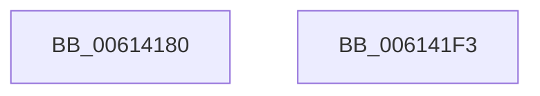

# XdvIoBuildDeviceIoControlRequest

- RVA: `0x00614180`–`0x006141F4` (길이 `116` bytes)
- VA: `0x0000000140614180`
- 실행 섹션: `.text`
- PDB 이름 있음: `예`; PDB Function 태그: `아니요`
- unwind 정보 RVA: `0x0006E5B4`
- 디코드: `24`개 명령, `116/116` bytes 표시
- 미해석 바이트: `0` (있으면 어셈블리에 `.byte`로 보존)

> 이 문서는 커널 이미지의 기계어와 PDB 기호를 분석해 생성했습니다. 4번과 5번은 함수 원형과 자료형을 바이너리 사용 방식에서 추정한 C 해석이며 원본 소스 복구 결과는 아닙니다.

## 1. Dependencies

- 직접 호출 지점: **1**; 고유 호출 대상: **1**
- 직접 호출자로 확인된 함수: **0**
- RIP 상대 이미지 참조: **0**

### Outgoing calls
- `0x006141E8` → [guard_dispatch_icall](../6B/guard_dispatch_icall_function_006BAAD0.md) (function, `0x006BAAD0`)

### Direct callers
- 이 함수 시작 RVA로 연결되는 직접 call은 확인되지 않았습니다. 간접 호출은 완전히 역산할 수 없습니다.

### Static image references
- 디코드된 RIP-relative 메모리 참조가 없습니다.

## 2. Other-region calls and transfers

- 다른 실행 섹션으로 향하는 call: **0**
- 별도 외부 분기/꼬리 이동을 확인하지 못했습니다.

## 3. Assembly (complete function range)

```asm
00614180  40 53                           push rbx
00614182  48 83 EC 60                     sub rsp, 0x60
00614186  48 8B 84 24 B8 00 00 00         mov rax, qword ptr [rsp + 0xb8]
0061418E  45 8B D9                        mov r11d, r9d
00614191  44 8B 8C 24 98 00 00 00         mov r9d, dword ptr [rsp + 0x98]
00614199  48 8B DA                        mov rbx, rdx
0061419C  4C 8B 94 24 B0 00 00 00         mov r10, qword ptr [rsp + 0xb0]
006141A4  48 8B 94 24 90 00 00 00         mov rdx, qword ptr [rsp + 0x90]
006141AC  48 89 44 24 48                  mov qword ptr [rsp + 0x48], rax
006141B1  48 8B 84 24 C0 00 00 00         mov rax, qword ptr [rsp + 0xc0]
006141B9  4C 89 54 24 40                  mov qword ptr [rsp + 0x40], r10
006141BE  4C 8B 94 24 A8 00 00 00         mov r10, qword ptr [rsp + 0xa8]
006141C6  4C 89 54 24 38                  mov qword ptr [rsp + 0x38], r10
006141CB  44 8A 94 24 A0 00 00 00         mov r10b, byte ptr [rsp + 0xa0]
006141D3  44 88 54 24 30                  mov byte ptr [rsp + 0x30], r10b
006141D8  44 89 4C 24 28                  mov dword ptr [rsp + 0x28], r9d
006141DD  45 8B CB                        mov r9d, r11d
006141E0  48 89 54 24 20                  mov qword ptr [rsp + 0x20], rdx
006141E5  48 8B D3                        mov rdx, rbx
006141E8  E8 E3 68 0A 00                  call 0x1406baad0
006141ED  48 83 C4 60                     add rsp, 0x60
006141F1  5B                              pop rbx
006141F2  C3                              ret
006141F3  CC                              int3
```

## 4. C-style interpretation (structured pseudocode)

```c
__int64 __fastcall XdvIoBuildDeviceIoControlRequest(__int64 a1, __int64 a2, __int64 a3, int a4, __int64 a5, unsigned int a6, unsigned __int8 a7, __int64 a8, __int64 a9, __int64 a10, __int64 a11)
{
    __int64 result;
    __int64 v_rsp;
    unsigned __int64 v_stack_m20;
    unsigned __int64 v_stack_m28;
    unsigned __int64 v_stack_m30;
    unsigned __int8 v_stack_m38;
    unsigned int v_stack_m40;
    unsigned __int64 v_stack_m48;

    v_rsp = (v_rsp) - (96);
    v_stack_m20 = a10;
    v_stack_m28 = a9;
    v_stack_m30 = a8;
    v_stack_m38 = a7;
    v_stack_m40 = (unsigned int)((unsigned int)(a6));
    v_stack_m48 = a5;
    result = guard_dispatch_icall(a1, a2, a3, (unsigned int)((unsigned int)((unsigned int)(a4))));
    v_rsp = (v_rsp) + (96);
    return result;
}
```

## 5. (Beta) C Style

```c
int64_t XdvIoBuildDeviceIoControlRequest(int64_t Arg1, int64_t Arg2, int64_t Arg3, int32_t Arg4, int64_t Arg5, uint32_t Arg6, uint8_t Arg7, int64_t Arg8, int64_t Arg9, int64_t Arg10, int64_t Arg11)
{
    int64_t result;
    int64_t local_rsp;
    uint64_t v_stack_m20;
    uint64_t v_stack_m28;
    uint64_t v_stack_m30;
    uint8_t v_stack_m38;
    uint32_t v_stack_m40;
    uint64_t v_stack_m48;

    local_rsp = (local_rsp) - (96);
    v_stack_m20 = Arg10;
    v_stack_m28 = Arg9;
    v_stack_m30 = Arg8;
    v_stack_m38 = Arg7;
    v_stack_m40 = (uint32_t)((uint32_t)(Arg6));
    v_stack_m48 = Arg5;
    result = guard_dispatch_icall(Arg1, Arg2, Arg3, (uint32_t)((uint32_t)((uint32_t)(Arg4))));
    local_rsp = (local_rsp) + (96);
    return result;
}
```

## 6. Execution-region graph

[열기: 2D/3D 그래프와 함수 탐색 컨트롤 패널](../../../control-panel.html?section=text&rva=0x00614180&view=graph)

- 2D 그래프는 위에서 아래로 흐르고, 3D 그래프는 빈 공간을 드래그해 회전합니다. Shift+드래그는 이동, 휠은 확대·축소, 함수 노드 선택은 대상 보고서 이동입니다.

### Static fallback


