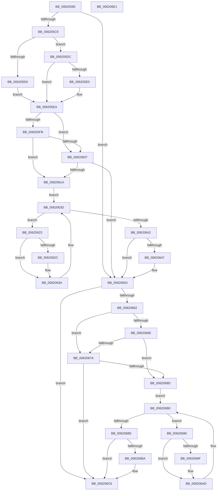

# DifExFreePoolWrapper

- RVA: `0x00620590`–`0x006206E2` (길이 `338` bytes)
- VA: `0x0000000140620590`
- 실행 섹션: `.text`
- PDB 이름 있음: `예`; PDB Function 태그: `아니요`
- unwind 정보 RVA: `0x0005D7BC`
- 디코드: `91`개 명령, `338/338` bytes 표시
- 미해석 바이트: `0` (있으면 어셈블리에 `.byte`로 보존)

> 이 문서는 커널 이미지의 기계어와 PDB 기호를 분석해 생성했습니다. 4번과 5번은 함수 원형과 자료형을 바이너리 사용 방식에서 추정한 C 해석이며 원본 소스 복구 결과는 아닙니다.

## 1. Dependencies

- 직접 호출 지점: **9**; 고유 호출 대상: **6**
- 직접 호출자로 확인된 함수: **0**
- RIP 상대 이미지 참조: **3**

### Outgoing calls
- `0x006205B8` → [DifGetAPIThunkContextById](../49/DifGetAPIThunkContextById_function_00495A34.md) (function, `0x00495A34`)
- `0x006205E0` → [DifGetReturnAddressForWrappers](../4D/DifGetReturnAddressForWrappers_function_004D3C08.md) (function, `0x004D3C08`)
- `0x0062060E` → [ExAcquireRundownProtection](../21/ExAcquireRundownProtection_function_00216620.md) (function, `0x00216620`)
- `0x00620635` → [guard_dispatch_icall](../6B/guard_dispatch_icall_function_006BAAD0.md) (function, `0x006BAAD0`)
- `0x0062064E` → [ExReleaseRundownProtection](../34/ExReleaseRundownProtection_function_00349E80.md) (function, `0x00349E80`)
- `0x00620658` → [ExFreePoolWithTag](../../poolcode/B8/ExFreePoolWithTag_function_00B82870.md) (function, `0x00B82870`)
- `0x00620681` → [ExAcquireRundownProtection](../21/ExAcquireRundownProtection_function_00216620.md) (function, `0x00216620`)
- `0x006206A8` → [guard_dispatch_icall](../6B/guard_dispatch_icall_function_006BAAD0.md) (function, `0x006BAAD0`)
- `0x006206C1` → [ExReleaseRundownProtection](../34/ExReleaseRundownProtection_function_00349E80.md) (function, `0x00349E80`)

### Direct callers
- 이 함수 시작 RVA로 연결되는 직접 call은 확인되지 않았습니다. 간접 호출은 완전히 역산할 수 없습니다.

### Static image references
- `0x006205F2` → RVA `0x00F048B8` (`.data`; read)
- `0x006205FB` → RVA `0x00F04980` (`.data`; read)
- `0x00620607` → RVA `0x00F03E80` (`.data`; read)

## 2. Other-region calls and transfers

- 다른 실행 섹션으로 향하는 call: **1**
  - `0x00620658` → [ExFreePoolWithTag](../../poolcode/B8/ExFreePoolWithTag_function_00B82870.md) (`.text` → `POOLCODE`)
- 별도 외부 분기/꼬리 이동을 확인하지 못했습니다.

## 3. Assembly (complete function range)

```asm
00620590  48 8B C4                        mov rax, rsp
00620593  48 89 58 08                     mov qword ptr [rax + 8], rbx
00620597  48 89 68 10                     mov qword ptr [rax + 0x10], rbp
0062059B  48 89 70 18                     mov qword ptr [rax + 0x18], rsi
0062059F  48 89 78 20                     mov qword ptr [rax + 0x20], rdi
006205A3  41 56                           push r14
006205A5  48 83 EC 30                     sub rsp, 0x30
006205A9  48 8B E9                        mov rbp, rcx
006205AC  0F 57 C0                        xorps xmm0, xmm0
006205AF  B9 91 01 00 00                  mov ecx, 0x191
006205B4  0F 11 40 E8                     movups xmmword ptr [rax - 0x18], xmm0
006205B8  E8 77 54 E7 FF                  call 0x140495a34
006205BD  48 8B F0                        mov rsi, rax
006205C0  48 85 C0                        test rax, rax
006205C3  0F 84 8A 00 00 00               je 0x140620653
006205C9  8B 40 0C                        mov eax, dword ptr [rax + 0xc]
006205CC  A8 18                           test al, 0x18
006205CE  74 0C                           je 0x1406205dc
006205D0  48 8B 4C 24 38                  mov rcx, qword ptr [rsp + 0x38]
006205D5  48 89 4C 24 20                  mov qword ptr [rsp + 0x20], rcx
006205DA  EB 0E                           jmp 0x1406205ea
006205DC  A8 04                           test al, 4
006205DE  74 0A                           je 0x1406205ea
006205E0  E8 23 36 EB FF                  call 0x1404d3c08
006205E5  48 89 44 24 20                  mov qword ptr [rsp + 0x20], rax
006205EA  40 32 FF                        xor dil, dil
006205ED  48 89 6C 24 28                  mov qword ptr [rsp + 0x28], rbp
006205F2  40 38 3D BF 42 8E 00            cmp byte ptr [rip + 0x8e42bf], dil
006205F9  75 0C                           jne 0x140620607
006205FB  F7 05 7B 43 8E 00 00 08 00 00   test dword ptr [rip + 0x8e437b], 0x800
00620605  74 13                           je 0x14062061a
00620607  48 8D 0D 72 38 8E 00            lea rcx, [rip + 0x8e3872]
0062060E  E8 0D 60 BF FF                  call 0x140216620
00620613  40 8A F8                        mov dil, al
00620616  84 C0                           test al, al
00620618  74 39                           je 0x140620653
0062061A  4C 8D 76 20                     lea r14, [rsi + 0x20]
0062061E  49 8B 1E                        mov rbx, qword ptr [r14]
00620621  EB 1A                           jmp 0x14062063d
00620623  48 8D 43 F0                     lea rax, [rbx - 0x10]
00620627  48 85 C0                        test rax, rax
0062062A  74 0E                           je 0x14062063a
0062062C  48 8B 40 08                     mov rax, qword ptr [rax + 8]
00620630  48 8D 4C 24 20                  lea rcx, [rsp + 0x20]
00620635  E8 96 A4 09 00                  call 0x1406baad0
0062063A  48 8B 1B                        mov rbx, qword ptr [rbx]
0062063D  49 3B DE                        cmp rbx, r14
00620640  75 E1                           jne 0x140620623
00620642  40 84 FF                        test dil, dil
00620645  74 0C                           je 0x140620653
00620647  48 8D 0D 32 38 8E 00            lea rcx, [rip + 0x8e3832]
0062064E  E8 2D 98 D2 FF                  call 0x140349e80
00620653  33 D2                           xor edx, edx
00620655  48 8B CD                        mov rcx, rbp
00620658  E8 13 22 56 00                  call 0x140b82870
0062065D  48 85 F6                        test rsi, rsi
00620660  74 64                           je 0x1406206c6
00620662  40 32 FF                        xor dil, dil
00620665  40 38 3D 4C 42 8E 00            cmp byte ptr [rip + 0x8e424c], dil
0062066C  75 0C                           jne 0x14062067a
0062066E  F7 05 08 43 8E 00 00 08 00 00   test dword ptr [rip + 0x8e4308], 0x800
00620678  74 13                           je 0x14062068d
0062067A  48 8D 0D FF 37 8E 00            lea rcx, [rip + 0x8e37ff]
00620681  E8 9A 5F BF FF                  call 0x140216620
00620686  40 8A F8                        mov dil, al
00620689  84 C0                           test al, al
0062068B  74 39                           je 0x1406206c6
0062068D  48 83 C6 30                     add rsi, 0x30
00620691  48 8B 1E                        mov rbx, qword ptr [rsi]
00620694  EB 1A                           jmp 0x1406206b0
00620696  48 8D 43 F0                     lea rax, [rbx - 0x10]
0062069A  48 85 C0                        test rax, rax
0062069D  74 0E                           je 0x1406206ad
0062069F  48 8B 40 08                     mov rax, qword ptr [rax + 8]
006206A3  48 8D 4C 24 20                  lea rcx, [rsp + 0x20]
006206A8  E8 23 A4 09 00                  call 0x1406baad0
006206AD  48 8B 1B                        mov rbx, qword ptr [rbx]
006206B0  48 3B DE                        cmp rbx, rsi
006206B3  75 E1                           jne 0x140620696
006206B5  40 84 FF                        test dil, dil
006206B8  74 0C                           je 0x1406206c6
006206BA  48 8D 0D BF 37 8E 00            lea rcx, [rip + 0x8e37bf]
006206C1  E8 BA 97 D2 FF                  call 0x140349e80
006206C6  48 8B 5C 24 40                  mov rbx, qword ptr [rsp + 0x40]
006206CB  48 8B 6C 24 48                  mov rbp, qword ptr [rsp + 0x48]
006206D0  48 8B 74 24 50                  mov rsi, qword ptr [rsp + 0x50]
006206D5  48 8B 7C 24 58                  mov rdi, qword ptr [rsp + 0x58]
006206DA  48 83 C4 30                     add rsp, 0x30
006206DE  41 5E                           pop r14
006206E0  C3                              ret
006206E1  CC                              int3
```

## 4. C-style interpretation (structured pseudocode)

```c
__int64 __fastcall DifExFreePoolWrapper(__int64 a1, int a2)
{
    __int64 result;
    __int64 v_rdi;
    __int64 v_rsi;
    __int64 v_rsp;
    unsigned __int64 v_stack_m10;
    unsigned __int64 v_stack_m18;
    unsigned __int64 v_stack_p0;
    unsigned __int64 v_stack_p10;
    unsigned __int64 v_stack_p18;
    unsigned __int64 v_stack_p20;
    unsigned __int64 v_stack_p8;

    *(unsigned __int64 *)(v_rsp + 8) = v_rbx;
    *(unsigned __int64 *)(v_rsp + 16) = v_rbp;
    *(unsigned __int64 *)(v_rsp + 24) = v_rsi;
    *(unsigned __int64 *)(v_rsp + 32) = v_rdi;
    v_rsp = (v_rsp) - (48);
    *(unsigned __int64 *)(v_rsp - 24) = v_xmm0;
    result = DifGetAPIThunkContextById(401, a2, a3, a4);
    if (result == 0) goto loc_00620653;
    if ((((unsigned __int8)((unsigned int)(*(unsigned int *)(result + 12)))) & (24)) == 0) goto loc_006205DC;
    v_stack_m18 = v_stack_p0;
    goto loc_006205EA;
loc_006205DC:
    result = (unsigned int)(*(unsigned int *)(result + 12));
    if ((((unsigned __int8)((unsigned int)(*(unsigned int *)(result + 12)))) & (4)) != 0) {
        result = DifGetReturnAddressForWrappers(v_stack_p0, a2, a3, a4);
        v_stack_m18 = result;
    }
    v_rdi = 0;
    v_stack_m10 = a1;
    if ((*(unsigned __int8 *)(v_rip + 9323199)) != 0) goto loc_00620607;
    if (((*(unsigned int *)(v_rip + 9323387)) & (0x800ULL)) == 0) goto loc_0062061A;
loc_00620607:
    result = ExAcquireRundownProtection(v_rip + 9320562, a2, a3, a4);
    if ((unsigned __int8)(result) == 0) goto loc_00620653;
loc_0062061A:
    goto loc_0062063D;
loc_00620623:
    result = *(unsigned __int64 *)(result + 32) - 16;
    if (*(unsigned __int64 *)(result + 32) - 16 != 0) {
        result = *(unsigned __int64 *)(*(unsigned __int64 *)(result + 32) - 16 + 8);
        a1 = v_stack_m18;
        result = guard_dispatch_icall(a1, a2, a3, a4);
    }
loc_0062063D:
    if ((*(unsigned __int64 *)(*(unsigned __int64 *)(result + 32))) != (result + 32)) goto loc_00620623;
    if ((unsigned __int8)((unsigned __int8)(result)) != 0) {
        a1 = v_rip + 9320498;
        result = ExReleaseRundownProtection(a1, a2, a3, a4);
    }
    a2 = 0;
    result = ExFreePoolWithTag(a1, a2, a3, a4);
    if (result == 0) goto loc_006206C6;
    v_rdi = 0;
    if ((*(unsigned __int8 *)(v_rip + 9323084)) != 0) goto loc_0062067A;
    if (((*(unsigned int *)(v_rip + 9323272)) & (0x800ULL)) == 0) goto loc_0062068D;
loc_0062067A:
    result = ExAcquireRundownProtection(v_rip + 9320447, a2, a3, a4);
    if ((unsigned __int8)(result) == 0) goto loc_006206C6;
loc_0062068D:
    v_rsi = (result) + (48);
    goto loc_006206B0;
loc_00620696:
    result = *(unsigned __int64 *)(v_rsi) - 16;
    if (*(unsigned __int64 *)(v_rsi) - 16 != 0) {
        result = *(unsigned __int64 *)(*(unsigned __int64 *)(v_rsi) - 16 + 8);
        a1 = v_stack_m18;
        result = guard_dispatch_icall(a1, a2, a3, a4);
    }
loc_006206B0:
    if ((*(unsigned __int64 *)(*(unsigned __int64 *)(v_rsi))) != v_rsi) goto loc_00620696;
    if ((unsigned __int8)((unsigned __int8)(result)) != 0) {
        a1 = v_rip + 9320383;
        result = ExReleaseRundownProtection(a1, a2, a3, a4);
    }
    v_rsp = (v_rsp) + (48);
    return result;
}
```

## 5. (Beta) C Style

```c
int64_t DifExFreePoolWrapper(int64_t Arg1, int32_t Arg2)
{
    int64_t result;
    int64_t local_rdi;
    int64_t local_rsi;
    int64_t local_rsp;
    uint64_t v_stack_m10;
    uint64_t v_stack_m18;
    uint64_t v_stack_p0;
    uint64_t v_stack_p10;
    uint64_t v_stack_p18;
    uint64_t v_stack_p20;
    uint64_t v_stack_p8;

    *(uint64_t *)(local_rsp + 0x8) = local_rbx;
    *(uint64_t *)(local_rsp + 0x10) = local_rbp;
    *(uint64_t *)(local_rsp + 0x18) = local_rsi;
    *(uint64_t *)(local_rsp + 0x20) = local_rdi;
    local_rsp = (local_rsp) - (48);
    *(uint64_t *)(local_rsp - 0x18) = v_xmm0;
    result = DifGetAPIThunkContextById(401, Arg2, a3, a4);
    if (result == 0) goto loc_00620653;
    if ((((uint8_t)((uint32_t)(*(uint32_t *)(result + 0xC)))) & (24)) == 0) goto loc_006205DC;
    v_stack_m18 = v_stack_p0;
    goto loc_006205EA;
loc_006205DC:
    result = (uint32_t)(*(uint32_t *)(result + 0xC));
    if ((((uint8_t)((uint32_t)(*(uint32_t *)(result + 0xC)))) & (4)) != 0) {
        result = DifGetReturnAddressForWrappers(v_stack_p0, Arg2, a3, a4);
        v_stack_m18 = result;
    }
    local_rdi = 0;
    v_stack_m10 = Arg1;
    if ((*(uint8_t *)(v_rip + 0x8E42BF)) != 0) goto loc_00620607;
    if (((*(uint32_t *)(v_rip + 0x8E437B)) & (0x800ULL)) == 0) goto loc_0062061A;
loc_00620607:
    result = ExAcquireRundownProtection(v_rip + 9320562, Arg2, a3, a4);
    if ((uint8_t)(result) == 0) goto loc_00620653;
loc_0062061A:
    goto loc_0062063D;
loc_00620623:
    result = *(uint64_t *)(result + 0x20) - 16;
    if (*(uint64_t *)(result + 0x20) - 16 != 0) {
        result = *(uint64_t *)(*(uint64_t *)(result + 0x20) - 0x10 + 0x8);
        Arg1 = v_stack_m18;
        result = guard_dispatch_icall(Arg1, Arg2, a3, a4);
    }
loc_0062063D:
    if ((*(uint64_t *)(*(uint64_t *)(result + 0x20))) != (result + 32)) goto loc_00620623;
    if ((uint8_t)((uint8_t)(result)) != 0) {
        Arg1 = v_rip + 9320498;
        result = ExReleaseRundownProtection(Arg1, Arg2, a3, a4);
    }
    Arg2 = 0;
    result = ExFreePoolWithTag(Arg1, Arg2, a3, a4);
    if (result == 0) goto loc_006206C6;
    local_rdi = 0;
    if ((*(uint8_t *)(v_rip + 0x8E424C)) != 0) goto loc_0062067A;
    if (((*(uint32_t *)(v_rip + 0x8E4308)) & (0x800ULL)) == 0) goto loc_0062068D;
loc_0062067A:
    result = ExAcquireRundownProtection(v_rip + 9320447, Arg2, a3, a4);
    if ((uint8_t)(result) == 0) goto loc_006206C6;
loc_0062068D:
    local_rsi = (result) + (48);
    goto loc_006206B0;
loc_00620696:
    result = *(uint64_t *)(local_rsi) - 16;
    if (*(uint64_t *)(local_rsi) - 16 != 0) {
        result = *(uint64_t *)(*(uint64_t *)(local_rsi) - 0x10 + 0x8);
        Arg1 = v_stack_m18;
        result = guard_dispatch_icall(Arg1, Arg2, a3, a4);
    }
loc_006206B0:
    if ((*(uint64_t *)(*(uint64_t *)(local_rsi))) != local_rsi) goto loc_00620696;
    if ((uint8_t)((uint8_t)(result)) != 0) {
        Arg1 = v_rip + 9320383;
        result = ExReleaseRundownProtection(Arg1, Arg2, a3, a4);
    }
    local_rsp = (local_rsp) + (48);
    return result;
}
```

## 6. Execution-region graph

[열기: 2D/3D 그래프와 함수 탐색 컨트롤 패널](../../../control-panel.html?section=text&rva=0x00620590&view=graph)

- 2D 그래프는 위에서 아래로 흐르고, 3D 그래프는 빈 공간을 드래그해 회전합니다. Shift+드래그는 이동, 휠은 확대·축소, 함수 노드 선택은 대상 보고서 이동입니다.

### Static fallback


