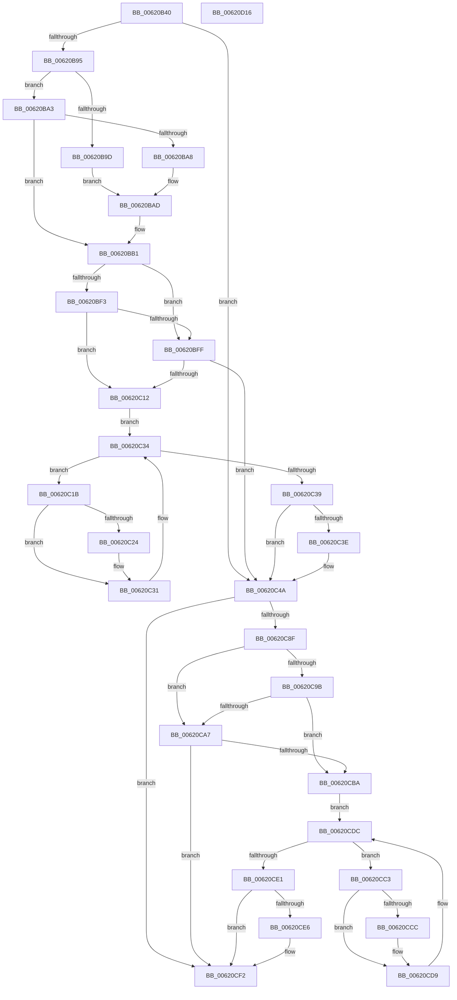

# DifExInitializeLookasideListExWrapper

- RVA: `0x00620B40`–`0x00620D17` (길이 `471` bytes)
- VA: `0x0000000140620B40`
- 실행 섹션: `.text`
- PDB 이름 있음: `예`; PDB Function 태그: `아니요`
- unwind 정보 RVA: `0x000D2C98`
- 디코드: `132`개 명령, `471/471` bytes 표시
- 미해석 바이트: `0` (있으면 어셈블리에 `.byte`로 보존)

> 이 문서는 커널 이미지의 기계어와 PDB 기호를 분석해 생성했습니다. 4번과 5번은 함수 원형과 자료형을 바이너리 사용 방식에서 추정한 C 해석이며 원본 소스 복구 결과는 아닙니다.

## 1. Dependencies

- 직접 호출 지점: **10**; 고유 호출 대상: **6**
- 직접 호출자로 확인된 함수: **0**
- RIP 상대 이미지 참조: **3**

### Outgoing calls
- `0x00620B7A` → [memset](../6C/memset_function_006C6C40.md) (function, `0x006C6C40`)
- `0x00620B84` → [DifGetAPIThunkContextById](../49/DifGetAPIThunkContextById_function_00495A34.md) (function, `0x00495A34`)
- `0x00620BA8` → [DifGetReturnAddressForWrappers](../4D/DifGetReturnAddressForWrappers_function_004D3C08.md) (function, `0x004D3C08`)
- `0x00620C06` → [ExAcquireRundownProtection](../21/ExAcquireRundownProtection_function_00216620.md) (function, `0x00216620`)
- `0x00620C2C` → [guard_dispatch_icall](../6B/guard_dispatch_icall_function_006BAAD0.md) (function, `0x006BAAD0`)
- `0x00620C45` → [ExReleaseRundownProtection](../34/ExReleaseRundownProtection_function_00349E80.md) (function, `0x00349E80`)
- `0x00620C82` → [guard_dispatch_icall](../6B/guard_dispatch_icall_function_006BAAD0.md) (function, `0x006BAAD0`)
- `0x00620CAE` → [ExAcquireRundownProtection](../21/ExAcquireRundownProtection_function_00216620.md) (function, `0x00216620`)
- `0x00620CD4` → [guard_dispatch_icall](../6B/guard_dispatch_icall_function_006BAAD0.md) (function, `0x006BAAD0`)
- `0x00620CED` → [ExReleaseRundownProtection](../34/ExReleaseRundownProtection_function_00349E80.md) (function, `0x00349E80`)

### Direct callers
- 이 함수 시작 RVA로 연결되는 직접 call은 확인되지 않았습니다. 간접 호출은 완전히 역산할 수 없습니다.

### Static image references
- `0x00620BB8` → RVA `0x00F048B8` (`.data`; read)
- `0x00620BF3` → RVA `0x00F04980` (`.data`; read)
- `0x00620BFF` → RVA `0x00F03E80` (`.data`; read)

## 2. Other-region calls and transfers

- 다른 실행 섹션으로 향하는 call: **0**
- 별도 외부 분기/꼬리 이동을 확인하지 못했습니다.

## 3. Assembly (complete function range)

```asm
00620B40  48 8B C4                        mov rax, rsp
00620B43  48 89 58 10                     mov qword ptr [rax + 0x10], rbx
00620B47  48 89 70 18                     mov qword ptr [rax + 0x18], rsi
00620B4B  48 89 78 20                     mov qword ptr [rax + 0x20], rdi
00620B4F  48 89 48 08                     mov qword ptr [rax + 8], rcx
00620B53  55                              push rbp
00620B54  41 54                           push r12
00620B56  41 55                           push r13
00620B58  41 56                           push r14
00620B5A  41 57                           push r15
00620B5C  48 8D 68 D1                     lea rbp, [rax - 0x2f]
00620B60  48 81 EC A0 00 00 00            sub rsp, 0xa0
00620B67  4C 8B EA                        mov r13, rdx
00620B6A  48 8D 4D B7                     lea rcx, [rbp - 0x49]
00620B6E  33 D2                           xor edx, edx
00620B70  4D 8B E0                        mov r12, r8
00620B73  45 8B F9                        mov r15d, r9d
00620B76  44 8D 42 48                     lea r8d, [rdx + 0x48]
00620B7A  E8 C1 60 0A 00                  call 0x1406c6c40
00620B7F  B9 8F 01 00 00                  mov ecx, 0x18f
00620B84  E8 AB 4E E7 FF                  call 0x140495a34
00620B89  4C 8B F0                        mov r14, rax
00620B8C  48 85 C0                        test rax, rax
00620B8F  0F 84 B5 00 00 00               je 0x140620c4a
00620B95  8B 48 0C                        mov ecx, dword ptr [rax + 0xc]
00620B98  F6 C1 18                        test cl, 0x18
00620B9B  74 06                           je 0x140620ba3
00620B9D  48 8B 45 2F                     mov rax, qword ptr [rbp + 0x2f]
00620BA1  EB 0A                           jmp 0x140620bad
00620BA3  F6 C1 04                        test cl, 4
00620BA6  74 09                           je 0x140620bb1
00620BA8  E8 5B 30 EB FF                  call 0x1404d3c08
00620BAD  48 89 45 B7                     mov qword ptr [rbp - 0x49], rax
00620BB1  48 8B 45 37                     mov rax, qword ptr [rbp + 0x37]
00620BB5  40 32 F6                        xor sil, sil
00620BB8  40 38 35 F9 3C 8E 00            cmp byte ptr [rip + 0x8e3cf9], sil
00620BBF  48 89 45 EF                     mov qword ptr [rbp - 0x11], rax
00620BC3  8B 45 57                        mov eax, dword ptr [rbp + 0x57]
00620BC6  89 45 D7                        mov dword ptr [rbp - 0x29], eax
00620BC9  48 8B 45 5F                     mov rax, qword ptr [rbp + 0x5f]
00620BCD  48 89 45 CF                     mov qword ptr [rbp - 0x31], rax
00620BD1  8B 45 67                        mov eax, dword ptr [rbp + 0x67]
00620BD4  89 45 C7                        mov dword ptr [rbp - 0x39], eax
00620BD7  0F B7 45 6F                     movzx eax, word ptr [rbp + 0x6f]
00620BDB  66 89 45 C3                     mov word ptr [rbp - 0x3d], ax
00620BDF  8B 45 77                        mov eax, dword ptr [rbp + 0x77]
00620BE2  89 45 BF                        mov dword ptr [rbp - 0x41], eax
00620BE5  4C 89 6D E7                     mov qword ptr [rbp - 0x19], r13
00620BE9  4C 89 65 DF                     mov qword ptr [rbp - 0x21], r12
00620BED  44 89 7D DB                     mov dword ptr [rbp - 0x25], r15d
00620BF1  75 0C                           jne 0x140620bff
00620BF3  F7 05 83 3D 8E 00 00 08 00 00   test dword ptr [rip + 0x8e3d83], 0x800
00620BFD  74 13                           je 0x140620c12
00620BFF  48 8D 0D 7A 32 8E 00            lea rcx, [rip + 0x8e327a]
00620C06  E8 15 5A BF FF                  call 0x140216620
00620C0B  40 8A F0                        mov sil, al
00620C0E  84 C0                           test al, al
00620C10  74 38                           je 0x140620c4a
00620C12  49 8D 7E 20                     lea rdi, [r14 + 0x20]
00620C16  48 8B 1F                        mov rbx, qword ptr [rdi]
00620C19  EB 19                           jmp 0x140620c34
00620C1B  48 8D 43 F0                     lea rax, [rbx - 0x10]
00620C1F  48 85 C0                        test rax, rax
00620C22  74 0D                           je 0x140620c31
00620C24  48 8B 40 08                     mov rax, qword ptr [rax + 8]
00620C28  48 8D 4D B7                     lea rcx, [rbp - 0x49]
00620C2C  E8 9F 9E 09 00                  call 0x1406baad0
00620C31  48 8B 1B                        mov rbx, qword ptr [rbx]
00620C34  48 3B DF                        cmp rbx, rdi
00620C37  75 E2                           jne 0x140620c1b
00620C39  40 84 F6                        test sil, sil
00620C3C  74 0C                           je 0x140620c4a
00620C3E  48 8D 0D 3B 32 8E 00            lea rcx, [rip + 0x8e323b]
00620C45  E8 36 92 D2 FF                  call 0x140349e80
00620C4A  8B 45 77                        mov eax, dword ptr [rbp + 0x77]
00620C4D  45 8B CF                        mov r9d, r15d
00620C50  48 8B 4D 37                     mov rcx, qword ptr [rbp + 0x37]
00620C54  4D 8B C4                        mov r8, r12
00620C57  89 44 24 40                     mov dword ptr [rsp + 0x40], eax
00620C5B  49 8B D5                        mov rdx, r13
00620C5E  0F B7 45 6F                     movzx eax, word ptr [rbp + 0x6f]
00620C62  66 89 44 24 38                  mov word ptr [rsp + 0x38], ax
00620C67  8B 45 67                        mov eax, dword ptr [rbp + 0x67]
00620C6A  89 44 24 30                     mov dword ptr [rsp + 0x30], eax
00620C6E  48 8B 45 5F                     mov rax, qword ptr [rbp + 0x5f]
00620C72  48 89 44 24 28                  mov qword ptr [rsp + 0x28], rax
00620C77  8B 45 57                        mov eax, dword ptr [rbp + 0x57]
00620C7A  89 44 24 20                     mov dword ptr [rsp + 0x20], eax
00620C7E  48 8B 45 7F                     mov rax, qword ptr [rbp + 0x7f]
00620C82  E8 49 9E 09 00                  call 0x1406baad0
00620C87  89 45 F7                        mov dword ptr [rbp - 9], eax
00620C8A  4D 85 F6                        test r14, r14
00620C8D  74 63                           je 0x140620cf2
00620C8F  40 32 FF                        xor dil, dil
00620C92  40 38 3D 1F 3C 8E 00            cmp byte ptr [rip + 0x8e3c1f], dil
00620C99  75 0C                           jne 0x140620ca7
00620C9B  F7 05 DB 3C 8E 00 00 08 00 00   test dword ptr [rip + 0x8e3cdb], 0x800
00620CA5  74 13                           je 0x140620cba
00620CA7  48 8D 0D D2 31 8E 00            lea rcx, [rip + 0x8e31d2]
00620CAE  E8 6D 59 BF FF                  call 0x140216620
00620CB3  40 8A F8                        mov dil, al
00620CB6  84 C0                           test al, al
00620CB8  74 38                           je 0x140620cf2
00620CBA  49 8D 76 30                     lea rsi, [r14 + 0x30]
00620CBE  48 8B 1E                        mov rbx, qword ptr [rsi]
00620CC1  EB 19                           jmp 0x140620cdc
00620CC3  48 8D 43 F0                     lea rax, [rbx - 0x10]
00620CC7  48 85 C0                        test rax, rax
00620CCA  74 0D                           je 0x140620cd9
00620CCC  48 8B 40 08                     mov rax, qword ptr [rax + 8]
00620CD0  48 8D 4D B7                     lea rcx, [rbp - 0x49]
00620CD4  E8 F7 9D 09 00                  call 0x1406baad0
00620CD9  48 8B 1B                        mov rbx, qword ptr [rbx]
00620CDC  48 3B DE                        cmp rbx, rsi
00620CDF  75 E2                           jne 0x140620cc3
00620CE1  40 84 FF                        test dil, dil
00620CE4  74 0C                           je 0x140620cf2
00620CE6  48 8D 0D 93 31 8E 00            lea rcx, [rip + 0x8e3193]
00620CED  E8 8E 91 D2 FF                  call 0x140349e80
00620CF2  8B 45 F7                        mov eax, dword ptr [rbp - 9]
00620CF5  4C 8D 9C 24 A0 00 00 00         lea r11, [rsp + 0xa0]
00620CFD  49 8B 5B 38                     mov rbx, qword ptr [r11 + 0x38]
00620D01  49 8B 73 40                     mov rsi, qword ptr [r11 + 0x40]
00620D05  49 8B 7B 48                     mov rdi, qword ptr [r11 + 0x48]
00620D09  49 8B E3                        mov rsp, r11
00620D0C  41 5F                           pop r15
00620D0E  41 5E                           pop r14
00620D10  41 5D                           pop r13
00620D12  41 5C                           pop r12
00620D14  5D                              pop rbp
00620D15  C3                              ret
00620D16  CC                              int3
```

## 4. C-style interpretation (structured pseudocode)

```c
__int64 __fastcall DifExInitializeLookasideListExWrapper(__int64 a1, __int64 a2, __int64 a3, int a4)
{
    __int64 result;
    __int64 v_rdi;
    __int64 v_rsi;
    __int64 v_rsp;
    unsigned __int64 v_stack_m28;
    unsigned int v_stack_m88;
    unsigned __int16 v_stack_m90;
    unsigned int v_stack_m98;
    unsigned __int64 v_stack_mA0;
    unsigned int v_stack_mA8;

    *(unsigned __int64 *)(v_rsp + 16) = v_rbx;
    *(unsigned __int64 *)(v_rsp + 24) = v_rsi;
    *(unsigned __int64 *)(v_rsp + 32) = v_rdi;
    *(unsigned __int64 *)(v_rsp + 8) = a1;
    v_rsp = (v_rsp) - (160);
    a2 = 0;
    result = memset(v_rsp - 47 - 73, a2, a2 + 72, a4);
    result = DifGetAPIThunkContextById(399, a2, a2 + 72, a4);
    if (result == 0) goto loc_00620C4A;
    if ((((unsigned __int8)((unsigned int)(*(unsigned int *)(result + 12)))) & (24)) == 0) goto loc_00620BA3;
    goto loc_00620BAD;
loc_00620BA3:
    if ((((unsigned __int8)((unsigned int)(*(unsigned int *)(result + 12)))) & (4)) == 0) goto loc_00620BB1;
    result = DifGetReturnAddressForWrappers((unsigned int)(*(unsigned int *)(result + 12)), a2, a2 + 72, a4);
loc_00620BAD:
    *(unsigned __int64 *)(v_rsp - 47 - 73) = result;
loc_00620BB1:
    v_rsi = 0;
    *(unsigned __int64 *)(v_rsp - 47 - 17) = *(unsigned __int64 *)(v_rsp - 47 + 55);
    *(unsigned int *)(v_rsp - 47 - 41) = (unsigned int)((unsigned int)(*(unsigned int *)(v_rsp - 47 + 87)));
    *(unsigned __int64 *)(v_rsp - 47 - 49) = *(unsigned __int64 *)(v_rsp - 47 + 95);
    *(unsigned int *)(v_rsp - 47 - 57) = (unsigned int)((unsigned int)(*(unsigned int *)(v_rsp - 47 + 103)));
    *(unsigned __int16 *)(v_rsp - 47 - 61) = (unsigned __int16)(*(unsigned __int16 *)(v_rsp - 47 + 111));
    *(unsigned int *)(v_rsp - 47 - 65) = (unsigned int)((unsigned int)(*(unsigned int *)(v_rsp - 47 + 119)));
    *(unsigned __int64 *)(v_rsp - 47 - 25) = 0;
    *(unsigned __int64 *)(v_rsp - 47 - 33) = a3;
    *(unsigned int *)(v_rsp - 47 - 37) = (unsigned int)((unsigned int)(a4));
    if ((*(unsigned __int8 *)(v_rip + 9321721)) != 0) goto loc_00620BFF;
    if (((*(unsigned int *)(v_rip + 9321859)) & (0x800ULL)) == 0) goto loc_00620C12;
loc_00620BFF:
    result = ExAcquireRundownProtection(v_rip + 9319034, a2, a2 + 72, a4);
    if ((unsigned __int8)(result) == 0) goto loc_00620C4A;
loc_00620C12:
    goto loc_00620C34;
loc_00620C1B:
    result = *(unsigned __int64 *)(result + 32) - 16;
    if (*(unsigned __int64 *)(result + 32) - 16 != 0) {
        result = *(unsigned __int64 *)(*(unsigned __int64 *)(result + 32) - 16 + 8);
        a1 = v_rsp - 47 - 73;
        result = guard_dispatch_icall(a1, a2, a2 + 72, a4);
    }
loc_00620C34:
    if ((*(unsigned __int64 *)(*(unsigned __int64 *)(result + 32))) != (result + 32)) goto loc_00620C1B;
    if ((unsigned __int8)((unsigned __int8)(result)) != 0) {
        a1 = v_rip + 9318971;
        result = ExReleaseRundownProtection(a1, a2, a2 + 72, a4);
    }
    v_stack_m88 = (unsigned int)((unsigned int)(*(unsigned int *)(v_rsp - 47 + 119)));
    v_stack_m90 = (unsigned __int16)(*(unsigned __int16 *)(v_rsp - 47 + 111));
    v_stack_m98 = (unsigned int)((unsigned int)(*(unsigned int *)(v_rsp - 47 + 103)));
    v_stack_mA0 = *(unsigned __int64 *)(v_rsp - 47 + 95);
    v_stack_mA8 = (unsigned int)((unsigned int)(*(unsigned int *)(v_rsp - 47 + 87)));
    result = guard_dispatch_icall(*(unsigned __int64 *)(v_rsp - 47 + 55), 0, a3, (unsigned int)((unsigned int)((unsigned int)(a4))));
    *(unsigned int *)(v_rsp - 47 - 9) = (unsigned int)(result);
    if (result == 0) goto loc_00620CF2;
    v_rdi = 0;
    if ((*(unsigned __int8 *)(v_rip + 9321503)) != 0) goto loc_00620CA7;
    if (((*(unsigned int *)(v_rip + 9321691)) & (0x800ULL)) == 0) goto loc_00620CBA;
loc_00620CA7:
    result = ExAcquireRundownProtection(v_rip + 9318866, 0, a3, (unsigned int)((unsigned int)((unsigned int)(a4))));
    if ((unsigned __int8)(result) == 0) goto loc_00620CF2;
loc_00620CBA:
    goto loc_00620CDC;
loc_00620CC3:
    result = *(unsigned __int64 *)(result + 48) - 16;
    if (*(unsigned __int64 *)(result + 48) - 16 != 0) {
        result = *(unsigned __int64 *)(*(unsigned __int64 *)(result + 48) - 16 + 8);
        a1 = v_rsp - 47 - 73;
        result = guard_dispatch_icall(a1, 0, a3, (unsigned int)((unsigned int)((unsigned int)(a4))));
    }
loc_00620CDC:
    if ((*(unsigned __int64 *)(*(unsigned __int64 *)(result + 48))) != (result + 48)) goto loc_00620CC3;
    if ((unsigned __int8)((unsigned __int8)(result)) != 0) {
        a1 = v_rip + 9318803;
        result = ExReleaseRundownProtection(a1, 0, a3, (unsigned int)((unsigned int)((unsigned int)(a4))));
    }
    return (unsigned int)(*(unsigned int *)(v_rsp - 47 - 9));
}
```

## 5. (Beta) C Style

```c
int64_t DifExInitializeLookasideListExWrapper(int64_t Arg1, int64_t Arg2, int64_t Arg3, int32_t Arg4)
{
    int64_t result;
    int64_t local_rdi;
    int64_t local_rsi;
    int64_t local_rsp;
    uint64_t v_stack_m28;
    uint32_t v_stack_m88;
    uint16_t v_stack_m90;
    uint32_t v_stack_m98;
    uint64_t v_stack_mA0;
    uint32_t v_stack_mA8;

    *(uint64_t *)(local_rsp + 0x10) = local_rbx;
    *(uint64_t *)(local_rsp + 0x18) = local_rsi;
    *(uint64_t *)(local_rsp + 0x20) = local_rdi;
    *(uint64_t *)(local_rsp + 0x8) = Arg1;
    local_rsp = (local_rsp) - (160);
    Arg2 = 0;
    result = memset(local_rsp - 47 - 73, Arg2, Arg2 + 72, Arg4);
    result = DifGetAPIThunkContextById(399, Arg2, Arg2 + 72, Arg4);
    if (result == 0) goto loc_00620C4A;
    if ((((uint8_t)((uint32_t)(*(uint32_t *)(result + 0xC)))) & (24)) == 0) goto loc_00620BA3;
    goto loc_00620BAD;
loc_00620BA3:
    if ((((uint8_t)((uint32_t)(*(uint32_t *)(result + 0xC)))) & (4)) == 0) goto loc_00620BB1;
    result = DifGetReturnAddressForWrappers((uint32_t)(*(uint32_t *)(result + 0xC)), Arg2, Arg2 + 72, Arg4);
loc_00620BAD:
    *(uint64_t *)(local_rsp - 0x2F - 0x49) = result;
loc_00620BB1:
    local_rsi = 0;
    *(uint64_t *)(local_rsp - 0x2F - 0x11) = *(uint64_t *)(local_rsp - 0x2F + 0x37);
    *(uint32_t *)(local_rsp - 0x2F - 0x29) = (uint32_t)((uint32_t)(*(uint32_t *)(local_rsp - 0x2F + 0x57)));
    *(uint64_t *)(local_rsp - 0x2F - 0x31) = *(uint64_t *)(local_rsp - 0x2F + 0x5F);
    *(uint32_t *)(local_rsp - 0x2F - 0x39) = (uint32_t)((uint32_t)(*(uint32_t *)(local_rsp - 0x2F + 0x67)));
    *(uint16_t *)(local_rsp - 0x2F - 0x3D) = (uint16_t)(*(uint16_t *)(local_rsp - 0x2F + 0x6F));
    *(uint32_t *)(local_rsp - 0x2F - 0x41) = (uint32_t)((uint32_t)(*(uint32_t *)(local_rsp - 0x2F + 0x77)));
    *(uint64_t *)(local_rsp - 0x2F - 0x19) = 0;
    *(uint64_t *)(local_rsp - 0x2F - 0x21) = Arg3;
    *(uint32_t *)(local_rsp - 0x2F - 0x25) = (uint32_t)((uint32_t)(Arg4));
    if ((*(uint8_t *)(v_rip + 0x8E3CF9)) != 0) goto loc_00620BFF;
    if (((*(uint32_t *)(v_rip + 0x8E3D83)) & (0x800ULL)) == 0) goto loc_00620C12;
loc_00620BFF:
    result = ExAcquireRundownProtection(v_rip + 9319034, Arg2, Arg2 + 72, Arg4);
    if ((uint8_t)(result) == 0) goto loc_00620C4A;
loc_00620C12:
    goto loc_00620C34;
loc_00620C1B:
    result = *(uint64_t *)(result + 0x20) - 16;
    if (*(uint64_t *)(result + 0x20) - 16 != 0) {
        result = *(uint64_t *)(*(uint64_t *)(result + 0x20) - 0x10 + 0x8);
        Arg1 = local_rsp - 47 - 73;
        result = guard_dispatch_icall(Arg1, Arg2, Arg2 + 72, Arg4);
    }
loc_00620C34:
    if ((*(uint64_t *)(*(uint64_t *)(result + 0x20))) != (result + 32)) goto loc_00620C1B;
    if ((uint8_t)((uint8_t)(result)) != 0) {
        Arg1 = v_rip + 9318971;
        result = ExReleaseRundownProtection(Arg1, Arg2, Arg2 + 72, Arg4);
    }
    v_stack_m88 = (uint32_t)((uint32_t)(*(uint32_t *)(local_rsp - 0x2F + 0x77)));
    v_stack_m90 = (uint16_t)(*(uint16_t *)(local_rsp - 0x2F + 0x6F));
    v_stack_m98 = (uint32_t)((uint32_t)(*(uint32_t *)(local_rsp - 0x2F + 0x67)));
    v_stack_mA0 = *(uint64_t *)(local_rsp - 0x2F + 0x5F);
    v_stack_mA8 = (uint32_t)((uint32_t)(*(uint32_t *)(local_rsp - 0x2F + 0x57)));
    result = guard_dispatch_icall(*(uint64_t *)(local_rsp - 0x2F + 0x37), 0, Arg3, (uint32_t)((uint32_t)((uint32_t)(Arg4))));
    *(uint32_t *)(local_rsp - 0x2F - 0x9) = (uint32_t)(result);
    if (result == 0) goto loc_00620CF2;
    local_rdi = 0;
    if ((*(uint8_t *)(v_rip + 0x8E3C1F)) != 0) goto loc_00620CA7;
    if (((*(uint32_t *)(v_rip + 0x8E3CDB)) & (0x800ULL)) == 0) goto loc_00620CBA;
loc_00620CA7:
    result = ExAcquireRundownProtection(v_rip + 9318866, 0, Arg3, (uint32_t)((uint32_t)((uint32_t)(Arg4))));
    if ((uint8_t)(result) == 0) goto loc_00620CF2;
loc_00620CBA:
    goto loc_00620CDC;
loc_00620CC3:
    result = *(uint64_t *)(result + 0x30) - 16;
    if (*(uint64_t *)(result + 0x30) - 16 != 0) {
        result = *(uint64_t *)(*(uint64_t *)(result + 0x30) - 0x10 + 0x8);
        Arg1 = local_rsp - 47 - 73;
        result = guard_dispatch_icall(Arg1, 0, Arg3, (uint32_t)((uint32_t)((uint32_t)(Arg4))));
    }
loc_00620CDC:
    if ((*(uint64_t *)(*(uint64_t *)(result + 0x30))) != (result + 48)) goto loc_00620CC3;
    if ((uint8_t)((uint8_t)(result)) != 0) {
        Arg1 = v_rip + 9318803;
        result = ExReleaseRundownProtection(Arg1, 0, Arg3, (uint32_t)((uint32_t)((uint32_t)(Arg4))));
    }
    return (uint32_t)(*(uint32_t *)(local_rsp - 0x2F - 0x9));
}
```

## 6. Execution-region graph

[열기: 2D/3D 그래프와 함수 탐색 컨트롤 패널](../../../control-panel.html?section=text&rva=0x00620B40&view=graph)

- 2D 그래프는 위에서 아래로 흐르고, 3D 그래프는 빈 공간을 드래그해 회전합니다. Shift+드래그는 이동, 휠은 확대·축소, 함수 노드 선택은 대상 보고서 이동입니다.

### Static fallback


