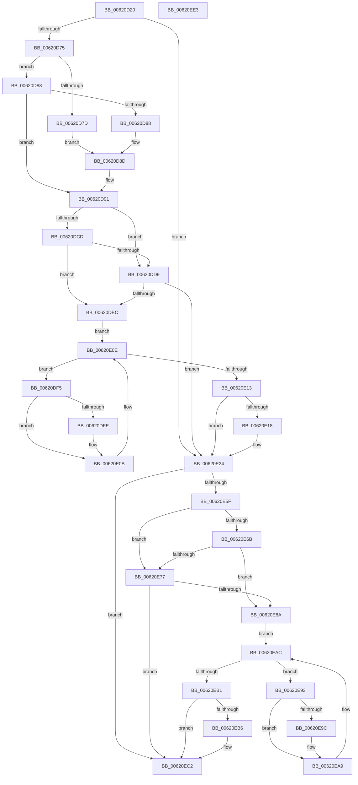

# DifExInitializeNPagedLookasideListWrapper

- RVA: `0x00620D20`–`0x00620EE4` (길이 `452` bytes)
- VA: `0x0000000140620D20`
- 실행 섹션: `.text`
- PDB 이름 있음: `예`; PDB Function 태그: `아니요`
- unwind 정보 RVA: `0x000D2C00`
- 디코드: `126`개 명령, `452/452` bytes 표시
- 미해석 바이트: `0` (있으면 어셈블리에 `.byte`로 보존)

> 이 문서는 커널 이미지의 기계어와 PDB 기호를 분석해 생성했습니다. 4번과 5번은 함수 원형과 자료형을 바이너리 사용 방식에서 추정한 C 해석이며 원본 소스 복구 결과는 아닙니다.

## 1. Dependencies

- 직접 호출 지점: **10**; 고유 호출 대상: **6**
- 직접 호출자로 확인된 함수: **0**
- RIP 상대 이미지 참조: **3**

### Outgoing calls
- `0x00620D5A` → [memset](../6C/memset_function_006C6C40.md) (function, `0x006C6C40`)
- `0x00620D64` → [DifGetAPIThunkContextById](../49/DifGetAPIThunkContextById_function_00495A34.md) (function, `0x00495A34`)
- `0x00620D88` → [DifGetReturnAddressForWrappers](../4D/DifGetReturnAddressForWrappers_function_004D3C08.md) (function, `0x004D3C08`)
- `0x00620DE0` → [ExAcquireRundownProtection](../21/ExAcquireRundownProtection_function_00216620.md) (function, `0x00216620`)
- `0x00620E06` → [guard_dispatch_icall](../6B/guard_dispatch_icall_function_006BAAD0.md) (function, `0x006BAAD0`)
- `0x00620E1F` → [ExReleaseRundownProtection](../34/ExReleaseRundownProtection_function_00349E80.md) (function, `0x00349E80`)
- `0x00620E55` → [guard_dispatch_icall](../6B/guard_dispatch_icall_function_006BAAD0.md) (function, `0x006BAAD0`)
- `0x00620E7E` → [ExAcquireRundownProtection](../21/ExAcquireRundownProtection_function_00216620.md) (function, `0x00216620`)
- `0x00620EA4` → [guard_dispatch_icall](../6B/guard_dispatch_icall_function_006BAAD0.md) (function, `0x006BAAD0`)
- `0x00620EBD` → [ExReleaseRundownProtection](../34/ExReleaseRundownProtection_function_00349E80.md) (function, `0x00349E80`)

### Direct callers
- 이 함수 시작 RVA로 연결되는 직접 call은 확인되지 않았습니다. 간접 호출은 완전히 역산할 수 없습니다.

### Static image references
- `0x00620D98` → RVA `0x00F048B8` (`.data`; read)
- `0x00620DCD` → RVA `0x00F04980` (`.data`; read)
- `0x00620DD9` → RVA `0x00F03E80` (`.data`; read)

## 2. Other-region calls and transfers

- 다른 실행 섹션으로 향하는 call: **0**
- 별도 외부 분기/꼬리 이동을 확인하지 못했습니다.

## 3. Assembly (complete function range)

```asm
00620D20  48 8B C4                        mov rax, rsp
00620D23  48 89 58 10                     mov qword ptr [rax + 0x10], rbx
00620D27  48 89 70 18                     mov qword ptr [rax + 0x18], rsi
00620D2B  48 89 78 20                     mov qword ptr [rax + 0x20], rdi
00620D2F  48 89 48 08                     mov qword ptr [rax + 8], rcx
00620D33  55                              push rbp
00620D34  41 54                           push r12
00620D36  41 55                           push r13
00620D38  41 56                           push r14
00620D3A  41 57                           push r15
00620D3C  48 8D 68 C9                     lea rbp, [rax - 0x37]
00620D40  48 81 EC 90 00 00 00            sub rsp, 0x90
00620D47  4C 8B EA                        mov r13, rdx
00620D4A  48 8D 4D CF                     lea rcx, [rbp - 0x31]
00620D4E  33 D2                           xor edx, edx
00620D50  4D 8B E0                        mov r12, r8
00620D53  45 8B F9                        mov r15d, r9d
00620D56  44 8D 42 40                     lea r8d, [rdx + 0x40]
00620D5A  E8 E1 5E 0A 00                  call 0x1406c6c40
00620D5F  B9 8E 01 00 00                  mov ecx, 0x18e
00620D64  E8 CB 4C E7 FF                  call 0x140495a34
00620D69  4C 8B F0                        mov r14, rax
00620D6C  48 85 C0                        test rax, rax
00620D6F  0F 84 AF 00 00 00               je 0x140620e24
00620D75  8B 48 0C                        mov ecx, dword ptr [rax + 0xc]
00620D78  F6 C1 18                        test cl, 0x18
00620D7B  74 06                           je 0x140620d83
00620D7D  48 8B 45 37                     mov rax, qword ptr [rbp + 0x37]
00620D81  EB 0A                           jmp 0x140620d8d
00620D83  F6 C1 04                        test cl, 4
00620D86  74 09                           je 0x140620d91
00620D88  E8 7B 2E EB FF                  call 0x1404d3c08
00620D8D  48 89 45 CF                     mov qword ptr [rbp - 0x31], rax
00620D91  48 8B 45 3F                     mov rax, qword ptr [rbp + 0x3f]
00620D95  40 32 F6                        xor sil, sil
00620D98  40 38 35 19 3B 8E 00            cmp byte ptr [rip + 0x8e3b19], sil
00620D9F  48 89 45 07                     mov qword ptr [rbp + 7], rax
00620DA3  48 8B 45 5F                     mov rax, qword ptr [rbp + 0x5f]
00620DA7  48 89 45 E7                     mov qword ptr [rbp - 0x19], rax
00620DAB  8B 45 67                        mov eax, dword ptr [rbp + 0x67]
00620DAE  89 45 DF                        mov dword ptr [rbp - 0x21], eax
00620DB1  0F B7 45 6F                     movzx eax, word ptr [rbp + 0x6f]
00620DB5  66 89 45 DB                     mov word ptr [rbp - 0x25], ax
00620DB9  8B 45 77                        mov eax, dword ptr [rbp + 0x77]
00620DBC  89 45 D7                        mov dword ptr [rbp - 0x29], eax
00620DBF  4C 89 6D FF                     mov qword ptr [rbp - 1], r13
00620DC3  4C 89 65 F7                     mov qword ptr [rbp - 9], r12
00620DC7  44 89 7D EF                     mov dword ptr [rbp - 0x11], r15d
00620DCB  75 0C                           jne 0x140620dd9
00620DCD  F7 05 A9 3B 8E 00 00 08 00 00   test dword ptr [rip + 0x8e3ba9], 0x800
00620DD7  74 13                           je 0x140620dec
00620DD9  48 8D 0D A0 30 8E 00            lea rcx, [rip + 0x8e30a0]
00620DE0  E8 3B 58 BF FF                  call 0x140216620
00620DE5  40 8A F0                        mov sil, al
00620DE8  84 C0                           test al, al
00620DEA  74 38                           je 0x140620e24
00620DEC  49 8D 7E 20                     lea rdi, [r14 + 0x20]
00620DF0  48 8B 1F                        mov rbx, qword ptr [rdi]
00620DF3  EB 19                           jmp 0x140620e0e
00620DF5  48 8D 43 F0                     lea rax, [rbx - 0x10]
00620DF9  48 85 C0                        test rax, rax
00620DFC  74 0D                           je 0x140620e0b
00620DFE  48 8B 40 08                     mov rax, qword ptr [rax + 8]
00620E02  48 8D 4D CF                     lea rcx, [rbp - 0x31]
00620E06  E8 C5 9C 09 00                  call 0x1406baad0
00620E0B  48 8B 1B                        mov rbx, qword ptr [rbx]
00620E0E  48 3B DF                        cmp rbx, rdi
00620E11  75 E2                           jne 0x140620df5
00620E13  40 84 F6                        test sil, sil
00620E16  74 0C                           je 0x140620e24
00620E18  48 8D 0D 61 30 8E 00            lea rcx, [rip + 0x8e3061]
00620E1F  E8 5C 90 D2 FF                  call 0x140349e80
00620E24  8B 45 77                        mov eax, dword ptr [rbp + 0x77]
00620E27  45 8B CF                        mov r9d, r15d
00620E2A  48 8B 4D 3F                     mov rcx, qword ptr [rbp + 0x3f]
00620E2E  4D 8B C4                        mov r8, r12
00620E31  89 44 24 38                     mov dword ptr [rsp + 0x38], eax
00620E35  49 8B D5                        mov rdx, r13
00620E38  0F B7 45 6F                     movzx eax, word ptr [rbp + 0x6f]
00620E3C  66 89 44 24 30                  mov word ptr [rsp + 0x30], ax
00620E41  8B 45 67                        mov eax, dword ptr [rbp + 0x67]
00620E44  89 44 24 28                     mov dword ptr [rsp + 0x28], eax
00620E48  48 8B 45 5F                     mov rax, qword ptr [rbp + 0x5f]
00620E4C  48 89 44 24 20                  mov qword ptr [rsp + 0x20], rax
00620E51  48 8B 45 7F                     mov rax, qword ptr [rbp + 0x7f]
00620E55  E8 76 9C 09 00                  call 0x1406baad0
00620E5A  4D 85 F6                        test r14, r14
00620E5D  74 63                           je 0x140620ec2
00620E5F  40 32 FF                        xor dil, dil
00620E62  40 38 3D 4F 3A 8E 00            cmp byte ptr [rip + 0x8e3a4f], dil
00620E69  75 0C                           jne 0x140620e77
00620E6B  F7 05 0B 3B 8E 00 00 08 00 00   test dword ptr [rip + 0x8e3b0b], 0x800
00620E75  74 13                           je 0x140620e8a
00620E77  48 8D 0D 02 30 8E 00            lea rcx, [rip + 0x8e3002]
00620E7E  E8 9D 57 BF FF                  call 0x140216620
00620E83  40 8A F8                        mov dil, al
00620E86  84 C0                           test al, al
00620E88  74 38                           je 0x140620ec2
00620E8A  49 8D 76 30                     lea rsi, [r14 + 0x30]
00620E8E  48 8B 1E                        mov rbx, qword ptr [rsi]
00620E91  EB 19                           jmp 0x140620eac
00620E93  48 8D 43 F0                     lea rax, [rbx - 0x10]
00620E97  48 85 C0                        test rax, rax
00620E9A  74 0D                           je 0x140620ea9
00620E9C  48 8B 40 08                     mov rax, qword ptr [rax + 8]
00620EA0  48 8D 4D CF                     lea rcx, [rbp - 0x31]
00620EA4  E8 27 9C 09 00                  call 0x1406baad0
00620EA9  48 8B 1B                        mov rbx, qword ptr [rbx]
00620EAC  48 3B DE                        cmp rbx, rsi
00620EAF  75 E2                           jne 0x140620e93
00620EB1  40 84 FF                        test dil, dil
00620EB4  74 0C                           je 0x140620ec2
00620EB6  48 8D 0D C3 2F 8E 00            lea rcx, [rip + 0x8e2fc3]
00620EBD  E8 BE 8F D2 FF                  call 0x140349e80
00620EC2  4C 8D 9C 24 90 00 00 00         lea r11, [rsp + 0x90]
00620ECA  49 8B 5B 38                     mov rbx, qword ptr [r11 + 0x38]
00620ECE  49 8B 73 40                     mov rsi, qword ptr [r11 + 0x40]
00620ED2  49 8B 7B 48                     mov rdi, qword ptr [r11 + 0x48]
00620ED6  49 8B E3                        mov rsp, r11
00620ED9  41 5F                           pop r15
00620EDB  41 5E                           pop r14
00620EDD  41 5D                           pop r13
00620EDF  41 5C                           pop r12
00620EE1  5D                              pop rbp
00620EE2  C3                              ret
00620EE3  CC                              int3
```

## 4. C-style interpretation (structured pseudocode)

```c
__int64 __fastcall DifExInitializeNPagedLookasideListWrapper(__int64 a1, __int64 a2, __int64 a3, int a4)
{
    __int64 result;
    __int64 v_rdi;
    __int64 v_rsi;
    __int64 v_rsp;
    unsigned __int64 v_stack_m28;
    unsigned int v_stack_m80;
    unsigned __int16 v_stack_m88;
    unsigned int v_stack_m90;
    unsigned __int64 v_stack_m98;

    *(unsigned __int64 *)(v_rsp + 16) = v_rbx;
    *(unsigned __int64 *)(v_rsp + 24) = v_rsi;
    *(unsigned __int64 *)(v_rsp + 32) = v_rdi;
    *(unsigned __int64 *)(v_rsp + 8) = a1;
    v_rsp = (v_rsp) - (144);
    a2 = 0;
    result = memset(v_rsp - 55 - 49, a2, a2 + 64, a4);
    result = DifGetAPIThunkContextById(398, a2, a2 + 64, a4);
    if (result == 0) goto loc_00620E24;
    if ((((unsigned __int8)((unsigned int)(*(unsigned int *)(result + 12)))) & (24)) == 0) goto loc_00620D83;
    goto loc_00620D8D;
loc_00620D83:
    if ((((unsigned __int8)((unsigned int)(*(unsigned int *)(result + 12)))) & (4)) == 0) goto loc_00620D91;
    result = DifGetReturnAddressForWrappers((unsigned int)(*(unsigned int *)(result + 12)), a2, a2 + 64, a4);
loc_00620D8D:
    *(unsigned __int64 *)(v_rsp - 55 - 49) = result;
loc_00620D91:
    v_rsi = 0;
    *(unsigned __int64 *)(v_rsp - 55 + 7) = *(unsigned __int64 *)(v_rsp - 55 + 63);
    *(unsigned __int64 *)(v_rsp - 55 - 25) = *(unsigned __int64 *)(v_rsp - 55 + 95);
    *(unsigned int *)(v_rsp - 55 - 33) = (unsigned int)((unsigned int)(*(unsigned int *)(v_rsp - 55 + 103)));
    *(unsigned __int16 *)(v_rsp - 55 - 37) = (unsigned __int16)(*(unsigned __int16 *)(v_rsp - 55 + 111));
    *(unsigned int *)(v_rsp - 55 - 41) = (unsigned int)((unsigned int)(*(unsigned int *)(v_rsp - 55 + 119)));
    *(unsigned __int64 *)(v_rsp - 55 - 1) = 0;
    *(unsigned __int64 *)(v_rsp - 55 - 9) = a3;
    *(unsigned int *)(v_rsp - 55 - 17) = (unsigned int)((unsigned int)(a4));
    if ((*(unsigned __int8 *)(v_rip + 9321241)) != 0) goto loc_00620DD9;
    if (((*(unsigned int *)(v_rip + 9321385)) & (0x800ULL)) == 0) goto loc_00620DEC;
loc_00620DD9:
    result = ExAcquireRundownProtection(v_rip + 9318560, a2, a2 + 64, a4);
    if ((unsigned __int8)(result) == 0) goto loc_00620E24;
loc_00620DEC:
    goto loc_00620E0E;
loc_00620DF5:
    result = *(unsigned __int64 *)(result + 32) - 16;
    if (*(unsigned __int64 *)(result + 32) - 16 != 0) {
        result = *(unsigned __int64 *)(*(unsigned __int64 *)(result + 32) - 16 + 8);
        a1 = v_rsp - 55 - 49;
        result = guard_dispatch_icall(a1, a2, a2 + 64, a4);
    }
loc_00620E0E:
    if ((*(unsigned __int64 *)(*(unsigned __int64 *)(result + 32))) != (result + 32)) goto loc_00620DF5;
    if ((unsigned __int8)((unsigned __int8)(result)) != 0) {
        a1 = v_rip + 9318497;
        result = ExReleaseRundownProtection(a1, a2, a2 + 64, a4);
    }
    v_stack_m80 = (unsigned int)((unsigned int)(*(unsigned int *)(v_rsp - 55 + 119)));
    v_stack_m88 = (unsigned __int16)(*(unsigned __int16 *)(v_rsp - 55 + 111));
    v_stack_m90 = (unsigned int)((unsigned int)(*(unsigned int *)(v_rsp - 55 + 103)));
    v_stack_m98 = *(unsigned __int64 *)(v_rsp - 55 + 95);
    result = guard_dispatch_icall(*(unsigned __int64 *)(v_rsp - 55 + 63), 0, a3, (unsigned int)((unsigned int)((unsigned int)(a4))));
    if (result == 0) goto loc_00620EC2;
    v_rdi = 0;
    if ((*(unsigned __int8 *)(v_rip + 9321039)) != 0) goto loc_00620E77;
    if (((*(unsigned int *)(v_rip + 9321227)) & (0x800ULL)) == 0) goto loc_00620E8A;
loc_00620E77:
    result = ExAcquireRundownProtection(v_rip + 9318402, 0, a3, (unsigned int)((unsigned int)((unsigned int)(a4))));
    if ((unsigned __int8)(result) == 0) goto loc_00620EC2;
loc_00620E8A:
    goto loc_00620EAC;
loc_00620E93:
    result = *(unsigned __int64 *)(result + 48) - 16;
    if (*(unsigned __int64 *)(result + 48) - 16 != 0) {
        result = *(unsigned __int64 *)(*(unsigned __int64 *)(result + 48) - 16 + 8);
        a1 = v_rsp - 55 - 49;
        result = guard_dispatch_icall(a1, 0, a3, (unsigned int)((unsigned int)((unsigned int)(a4))));
    }
loc_00620EAC:
    if ((*(unsigned __int64 *)(*(unsigned __int64 *)(result + 48))) != (result + 48)) goto loc_00620E93;
    if ((unsigned __int8)((unsigned __int8)(result)) != 0) {
        a1 = v_rip + 9318339;
        result = ExReleaseRundownProtection(a1, 0, a3, (unsigned int)((unsigned int)((unsigned int)(a4))));
    }
    return result;
}
```

## 5. (Beta) C Style

```c
int64_t DifExInitializeNPagedLookasideListWrapper(int64_t Arg1, int64_t Arg2, int64_t Arg3, int32_t Arg4)
{
    int64_t result;
    int64_t local_rdi;
    int64_t local_rsi;
    int64_t local_rsp;
    uint64_t v_stack_m28;
    uint32_t v_stack_m80;
    uint16_t v_stack_m88;
    uint32_t v_stack_m90;
    uint64_t v_stack_m98;

    *(uint64_t *)(local_rsp + 0x10) = local_rbx;
    *(uint64_t *)(local_rsp + 0x18) = local_rsi;
    *(uint64_t *)(local_rsp + 0x20) = local_rdi;
    *(uint64_t *)(local_rsp + 0x8) = Arg1;
    local_rsp = (local_rsp) - (144);
    Arg2 = 0;
    result = memset(local_rsp - 55 - 49, Arg2, Arg2 + 64, Arg4);
    result = DifGetAPIThunkContextById(398, Arg2, Arg2 + 64, Arg4);
    if (result == 0) goto loc_00620E24;
    if ((((uint8_t)((uint32_t)(*(uint32_t *)(result + 0xC)))) & (24)) == 0) goto loc_00620D83;
    goto loc_00620D8D;
loc_00620D83:
    if ((((uint8_t)((uint32_t)(*(uint32_t *)(result + 0xC)))) & (4)) == 0) goto loc_00620D91;
    result = DifGetReturnAddressForWrappers((uint32_t)(*(uint32_t *)(result + 0xC)), Arg2, Arg2 + 64, Arg4);
loc_00620D8D:
    *(uint64_t *)(local_rsp - 0x37 - 0x31) = result;
loc_00620D91:
    local_rsi = 0;
    *(uint64_t *)(local_rsp - 0x37 + 0x7) = *(uint64_t *)(local_rsp - 0x37 + 0x3F);
    *(uint64_t *)(local_rsp - 0x37 - 0x19) = *(uint64_t *)(local_rsp - 0x37 + 0x5F);
    *(uint32_t *)(local_rsp - 0x37 - 0x21) = (uint32_t)((uint32_t)(*(uint32_t *)(local_rsp - 0x37 + 0x67)));
    *(uint16_t *)(local_rsp - 0x37 - 0x25) = (uint16_t)(*(uint16_t *)(local_rsp - 0x37 + 0x6F));
    *(uint32_t *)(local_rsp - 0x37 - 0x29) = (uint32_t)((uint32_t)(*(uint32_t *)(local_rsp - 0x37 + 0x77)));
    *(uint64_t *)(local_rsp - 0x37 - 0x1) = 0;
    *(uint64_t *)(local_rsp - 0x37 - 0x9) = Arg3;
    *(uint32_t *)(local_rsp - 0x37 - 0x11) = (uint32_t)((uint32_t)(Arg4));
    if ((*(uint8_t *)(v_rip + 0x8E3B19)) != 0) goto loc_00620DD9;
    if (((*(uint32_t *)(v_rip + 0x8E3BA9)) & (0x800ULL)) == 0) goto loc_00620DEC;
loc_00620DD9:
    result = ExAcquireRundownProtection(v_rip + 9318560, Arg2, Arg2 + 64, Arg4);
    if ((uint8_t)(result) == 0) goto loc_00620E24;
loc_00620DEC:
    goto loc_00620E0E;
loc_00620DF5:
    result = *(uint64_t *)(result + 0x20) - 16;
    if (*(uint64_t *)(result + 0x20) - 16 != 0) {
        result = *(uint64_t *)(*(uint64_t *)(result + 0x20) - 0x10 + 0x8);
        Arg1 = local_rsp - 55 - 49;
        result = guard_dispatch_icall(Arg1, Arg2, Arg2 + 64, Arg4);
    }
loc_00620E0E:
    if ((*(uint64_t *)(*(uint64_t *)(result + 0x20))) != (result + 32)) goto loc_00620DF5;
    if ((uint8_t)((uint8_t)(result)) != 0) {
        Arg1 = v_rip + 9318497;
        result = ExReleaseRundownProtection(Arg1, Arg2, Arg2 + 64, Arg4);
    }
    v_stack_m80 = (uint32_t)((uint32_t)(*(uint32_t *)(local_rsp - 0x37 + 0x77)));
    v_stack_m88 = (uint16_t)(*(uint16_t *)(local_rsp - 0x37 + 0x6F));
    v_stack_m90 = (uint32_t)((uint32_t)(*(uint32_t *)(local_rsp - 0x37 + 0x67)));
    v_stack_m98 = *(uint64_t *)(local_rsp - 0x37 + 0x5F);
    result = guard_dispatch_icall(*(uint64_t *)(local_rsp - 0x37 + 0x3F), 0, Arg3, (uint32_t)((uint32_t)((uint32_t)(Arg4))));
    if (result == 0) goto loc_00620EC2;
    local_rdi = 0;
    if ((*(uint8_t *)(v_rip + 0x8E3A4F)) != 0) goto loc_00620E77;
    if (((*(uint32_t *)(v_rip + 0x8E3B0B)) & (0x800ULL)) == 0) goto loc_00620E8A;
loc_00620E77:
    result = ExAcquireRundownProtection(v_rip + 9318402, 0, Arg3, (uint32_t)((uint32_t)((uint32_t)(Arg4))));
    if ((uint8_t)(result) == 0) goto loc_00620EC2;
loc_00620E8A:
    goto loc_00620EAC;
loc_00620E93:
    result = *(uint64_t *)(result + 0x30) - 16;
    if (*(uint64_t *)(result + 0x30) - 16 != 0) {
        result = *(uint64_t *)(*(uint64_t *)(result + 0x30) - 0x10 + 0x8);
        Arg1 = local_rsp - 55 - 49;
        result = guard_dispatch_icall(Arg1, 0, Arg3, (uint32_t)((uint32_t)((uint32_t)(Arg4))));
    }
loc_00620EAC:
    if ((*(uint64_t *)(*(uint64_t *)(result + 0x30))) != (result + 48)) goto loc_00620E93;
    if ((uint8_t)((uint8_t)(result)) != 0) {
        Arg1 = v_rip + 9318339;
        result = ExReleaseRundownProtection(Arg1, 0, Arg3, (uint32_t)((uint32_t)((uint32_t)(Arg4))));
    }
    return result;
}
```

## 6. Execution-region graph

[열기: 2D/3D 그래프와 함수 탐색 컨트롤 패널](../../../control-panel.html?section=text&rva=0x00620D20&view=graph)

- 2D 그래프는 위에서 아래로 흐르고, 3D 그래프는 빈 공간을 드래그해 회전합니다. Shift+드래그는 이동, 휠은 확대·축소, 함수 노드 선택은 대상 보고서 이동입니다.

### Static fallback


