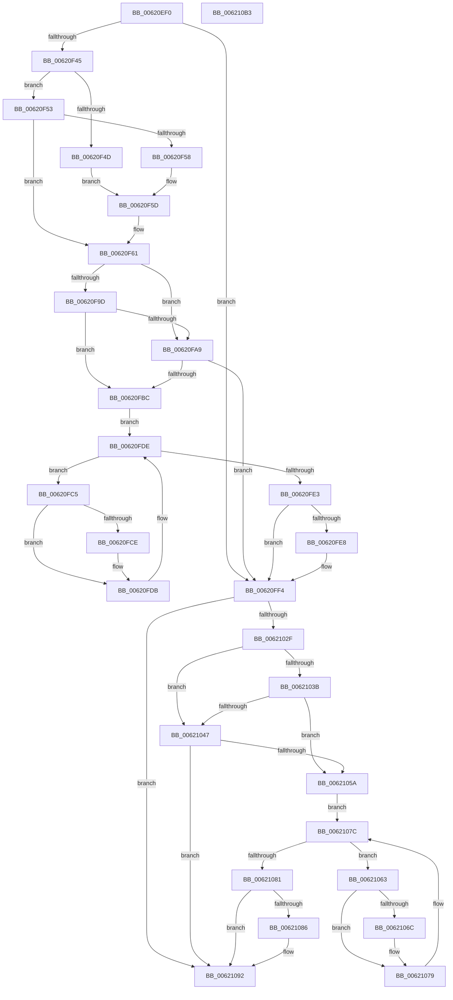

# DifExInitializePagedLookasideListWrapper

- RVA: `0x00620EF0`–`0x006210B4` (길이 `452` bytes)
- VA: `0x0000000140620EF0`
- 실행 섹션: `.text`
- PDB 이름 있음: `예`; PDB Function 태그: `아니요`
- unwind 정보 RVA: `0x000D2C00`
- 디코드: `126`개 명령, `452/452` bytes 표시
- 미해석 바이트: `0` (있으면 어셈블리에 `.byte`로 보존)

> 이 문서는 커널 이미지의 기계어와 PDB 기호를 분석해 생성했습니다. 4번과 5번은 함수 원형과 자료형을 바이너리 사용 방식에서 추정한 C 해석이며 원본 소스 복구 결과는 아닙니다.

## 1. Dependencies

- 직접 호출 지점: **10**; 고유 호출 대상: **6**
- 직접 호출자로 확인된 함수: **0**
- RIP 상대 이미지 참조: **3**

### Outgoing calls
- `0x00620F2A` → [memset](../6C/memset_function_006C6C40.md) (function, `0x006C6C40`)
- `0x00620F34` → [DifGetAPIThunkContextById](../49/DifGetAPIThunkContextById_function_00495A34.md) (function, `0x00495A34`)
- `0x00620F58` → [DifGetReturnAddressForWrappers](../4D/DifGetReturnAddressForWrappers_function_004D3C08.md) (function, `0x004D3C08`)
- `0x00620FB0` → [ExAcquireRundownProtection](../21/ExAcquireRundownProtection_function_00216620.md) (function, `0x00216620`)
- `0x00620FD6` → [guard_dispatch_icall](../6B/guard_dispatch_icall_function_006BAAD0.md) (function, `0x006BAAD0`)
- `0x00620FEF` → [ExReleaseRundownProtection](../34/ExReleaseRundownProtection_function_00349E80.md) (function, `0x00349E80`)
- `0x00621025` → [guard_dispatch_icall](../6B/guard_dispatch_icall_function_006BAAD0.md) (function, `0x006BAAD0`)
- `0x0062104E` → [ExAcquireRundownProtection](../21/ExAcquireRundownProtection_function_00216620.md) (function, `0x00216620`)
- `0x00621074` → [guard_dispatch_icall](../6B/guard_dispatch_icall_function_006BAAD0.md) (function, `0x006BAAD0`)
- `0x0062108D` → [ExReleaseRundownProtection](../34/ExReleaseRundownProtection_function_00349E80.md) (function, `0x00349E80`)

### Direct callers
- 이 함수 시작 RVA로 연결되는 직접 call은 확인되지 않았습니다. 간접 호출은 완전히 역산할 수 없습니다.

### Static image references
- `0x00620F68` → RVA `0x00F048B8` (`.data`; read)
- `0x00620F9D` → RVA `0x00F04980` (`.data`; read)
- `0x00620FA9` → RVA `0x00F03E80` (`.data`; read)

## 2. Other-region calls and transfers

- 다른 실행 섹션으로 향하는 call: **0**
- 별도 외부 분기/꼬리 이동을 확인하지 못했습니다.

## 3. Assembly (complete function range)

```asm
00620EF0  48 8B C4                        mov rax, rsp
00620EF3  48 89 58 10                     mov qword ptr [rax + 0x10], rbx
00620EF7  48 89 70 18                     mov qword ptr [rax + 0x18], rsi
00620EFB  48 89 78 20                     mov qword ptr [rax + 0x20], rdi
00620EFF  48 89 48 08                     mov qword ptr [rax + 8], rcx
00620F03  55                              push rbp
00620F04  41 54                           push r12
00620F06  41 55                           push r13
00620F08  41 56                           push r14
00620F0A  41 57                           push r15
00620F0C  48 8D 68 C9                     lea rbp, [rax - 0x37]
00620F10  48 81 EC 90 00 00 00            sub rsp, 0x90
00620F17  4C 8B EA                        mov r13, rdx
00620F1A  48 8D 4D CF                     lea rcx, [rbp - 0x31]
00620F1E  33 D2                           xor edx, edx
00620F20  4D 8B E0                        mov r12, r8
00620F23  45 8B F9                        mov r15d, r9d
00620F26  44 8D 42 40                     lea r8d, [rdx + 0x40]
00620F2A  E8 11 5D 0A 00                  call 0x1406c6c40
00620F2F  B9 8D 01 00 00                  mov ecx, 0x18d
00620F34  E8 FB 4A E7 FF                  call 0x140495a34
00620F39  4C 8B F0                        mov r14, rax
00620F3C  48 85 C0                        test rax, rax
00620F3F  0F 84 AF 00 00 00               je 0x140620ff4
00620F45  8B 48 0C                        mov ecx, dword ptr [rax + 0xc]
00620F48  F6 C1 18                        test cl, 0x18
00620F4B  74 06                           je 0x140620f53
00620F4D  48 8B 45 37                     mov rax, qword ptr [rbp + 0x37]
00620F51  EB 0A                           jmp 0x140620f5d
00620F53  F6 C1 04                        test cl, 4
00620F56  74 09                           je 0x140620f61
00620F58  E8 AB 2C EB FF                  call 0x1404d3c08
00620F5D  48 89 45 CF                     mov qword ptr [rbp - 0x31], rax
00620F61  48 8B 45 3F                     mov rax, qword ptr [rbp + 0x3f]
00620F65  40 32 F6                        xor sil, sil
00620F68  40 38 35 49 39 8E 00            cmp byte ptr [rip + 0x8e3949], sil
00620F6F  48 89 45 07                     mov qword ptr [rbp + 7], rax
00620F73  48 8B 45 5F                     mov rax, qword ptr [rbp + 0x5f]
00620F77  48 89 45 E7                     mov qword ptr [rbp - 0x19], rax
00620F7B  8B 45 67                        mov eax, dword ptr [rbp + 0x67]
00620F7E  89 45 DF                        mov dword ptr [rbp - 0x21], eax
00620F81  0F B7 45 6F                     movzx eax, word ptr [rbp + 0x6f]
00620F85  66 89 45 DB                     mov word ptr [rbp - 0x25], ax
00620F89  8B 45 77                        mov eax, dword ptr [rbp + 0x77]
00620F8C  89 45 D7                        mov dword ptr [rbp - 0x29], eax
00620F8F  4C 89 6D FF                     mov qword ptr [rbp - 1], r13
00620F93  4C 89 65 F7                     mov qword ptr [rbp - 9], r12
00620F97  44 89 7D EF                     mov dword ptr [rbp - 0x11], r15d
00620F9B  75 0C                           jne 0x140620fa9
00620F9D  F7 05 D9 39 8E 00 00 08 00 00   test dword ptr [rip + 0x8e39d9], 0x800
00620FA7  74 13                           je 0x140620fbc
00620FA9  48 8D 0D D0 2E 8E 00            lea rcx, [rip + 0x8e2ed0]
00620FB0  E8 6B 56 BF FF                  call 0x140216620
00620FB5  40 8A F0                        mov sil, al
00620FB8  84 C0                           test al, al
00620FBA  74 38                           je 0x140620ff4
00620FBC  49 8D 7E 20                     lea rdi, [r14 + 0x20]
00620FC0  48 8B 1F                        mov rbx, qword ptr [rdi]
00620FC3  EB 19                           jmp 0x140620fde
00620FC5  48 8D 43 F0                     lea rax, [rbx - 0x10]
00620FC9  48 85 C0                        test rax, rax
00620FCC  74 0D                           je 0x140620fdb
00620FCE  48 8B 40 08                     mov rax, qword ptr [rax + 8]
00620FD2  48 8D 4D CF                     lea rcx, [rbp - 0x31]
00620FD6  E8 F5 9A 09 00                  call 0x1406baad0
00620FDB  48 8B 1B                        mov rbx, qword ptr [rbx]
00620FDE  48 3B DF                        cmp rbx, rdi
00620FE1  75 E2                           jne 0x140620fc5
00620FE3  40 84 F6                        test sil, sil
00620FE6  74 0C                           je 0x140620ff4
00620FE8  48 8D 0D 91 2E 8E 00            lea rcx, [rip + 0x8e2e91]
00620FEF  E8 8C 8E D2 FF                  call 0x140349e80
00620FF4  8B 45 77                        mov eax, dword ptr [rbp + 0x77]
00620FF7  45 8B CF                        mov r9d, r15d
00620FFA  48 8B 4D 3F                     mov rcx, qword ptr [rbp + 0x3f]
00620FFE  4D 8B C4                        mov r8, r12
00621001  89 44 24 38                     mov dword ptr [rsp + 0x38], eax
00621005  49 8B D5                        mov rdx, r13
00621008  0F B7 45 6F                     movzx eax, word ptr [rbp + 0x6f]
0062100C  66 89 44 24 30                  mov word ptr [rsp + 0x30], ax
00621011  8B 45 67                        mov eax, dword ptr [rbp + 0x67]
00621014  89 44 24 28                     mov dword ptr [rsp + 0x28], eax
00621018  48 8B 45 5F                     mov rax, qword ptr [rbp + 0x5f]
0062101C  48 89 44 24 20                  mov qword ptr [rsp + 0x20], rax
00621021  48 8B 45 7F                     mov rax, qword ptr [rbp + 0x7f]
00621025  E8 A6 9A 09 00                  call 0x1406baad0
0062102A  4D 85 F6                        test r14, r14
0062102D  74 63                           je 0x140621092
0062102F  40 32 FF                        xor dil, dil
00621032  40 38 3D 7F 38 8E 00            cmp byte ptr [rip + 0x8e387f], dil
00621039  75 0C                           jne 0x140621047
0062103B  F7 05 3B 39 8E 00 00 08 00 00   test dword ptr [rip + 0x8e393b], 0x800
00621045  74 13                           je 0x14062105a
00621047  48 8D 0D 32 2E 8E 00            lea rcx, [rip + 0x8e2e32]
0062104E  E8 CD 55 BF FF                  call 0x140216620
00621053  40 8A F8                        mov dil, al
00621056  84 C0                           test al, al
00621058  74 38                           je 0x140621092
0062105A  49 8D 76 30                     lea rsi, [r14 + 0x30]
0062105E  48 8B 1E                        mov rbx, qword ptr [rsi]
00621061  EB 19                           jmp 0x14062107c
00621063  48 8D 43 F0                     lea rax, [rbx - 0x10]
00621067  48 85 C0                        test rax, rax
0062106A  74 0D                           je 0x140621079
0062106C  48 8B 40 08                     mov rax, qword ptr [rax + 8]
00621070  48 8D 4D CF                     lea rcx, [rbp - 0x31]
00621074  E8 57 9A 09 00                  call 0x1406baad0
00621079  48 8B 1B                        mov rbx, qword ptr [rbx]
0062107C  48 3B DE                        cmp rbx, rsi
0062107F  75 E2                           jne 0x140621063
00621081  40 84 FF                        test dil, dil
00621084  74 0C                           je 0x140621092
00621086  48 8D 0D F3 2D 8E 00            lea rcx, [rip + 0x8e2df3]
0062108D  E8 EE 8D D2 FF                  call 0x140349e80
00621092  4C 8D 9C 24 90 00 00 00         lea r11, [rsp + 0x90]
0062109A  49 8B 5B 38                     mov rbx, qword ptr [r11 + 0x38]
0062109E  49 8B 73 40                     mov rsi, qword ptr [r11 + 0x40]
006210A2  49 8B 7B 48                     mov rdi, qword ptr [r11 + 0x48]
006210A6  49 8B E3                        mov rsp, r11
006210A9  41 5F                           pop r15
006210AB  41 5E                           pop r14
006210AD  41 5D                           pop r13
006210AF  41 5C                           pop r12
006210B1  5D                              pop rbp
006210B2  C3                              ret
006210B3  CC                              int3
```

## 4. C-style interpretation (structured pseudocode)

```c
__int64 __fastcall DifExInitializePagedLookasideListWrapper(__int64 a1, __int64 a2, __int64 a3, int a4)
{
    __int64 result;
    __int64 v_rdi;
    __int64 v_rsi;
    __int64 v_rsp;
    unsigned __int64 v_stack_m28;
    unsigned int v_stack_m80;
    unsigned __int16 v_stack_m88;
    unsigned int v_stack_m90;
    unsigned __int64 v_stack_m98;

    *(unsigned __int64 *)(v_rsp + 16) = v_rbx;
    *(unsigned __int64 *)(v_rsp + 24) = v_rsi;
    *(unsigned __int64 *)(v_rsp + 32) = v_rdi;
    *(unsigned __int64 *)(v_rsp + 8) = a1;
    v_rsp = (v_rsp) - (144);
    a2 = 0;
    result = memset(v_rsp - 55 - 49, a2, a2 + 64, a4);
    result = DifGetAPIThunkContextById(397, a2, a2 + 64, a4);
    if (result == 0) goto loc_00620FF4;
    if ((((unsigned __int8)((unsigned int)(*(unsigned int *)(result + 12)))) & (24)) == 0) goto loc_00620F53;
    goto loc_00620F5D;
loc_00620F53:
    if ((((unsigned __int8)((unsigned int)(*(unsigned int *)(result + 12)))) & (4)) == 0) goto loc_00620F61;
    result = DifGetReturnAddressForWrappers((unsigned int)(*(unsigned int *)(result + 12)), a2, a2 + 64, a4);
loc_00620F5D:
    *(unsigned __int64 *)(v_rsp - 55 - 49) = result;
loc_00620F61:
    v_rsi = 0;
    *(unsigned __int64 *)(v_rsp - 55 + 7) = *(unsigned __int64 *)(v_rsp - 55 + 63);
    *(unsigned __int64 *)(v_rsp - 55 - 25) = *(unsigned __int64 *)(v_rsp - 55 + 95);
    *(unsigned int *)(v_rsp - 55 - 33) = (unsigned int)((unsigned int)(*(unsigned int *)(v_rsp - 55 + 103)));
    *(unsigned __int16 *)(v_rsp - 55 - 37) = (unsigned __int16)(*(unsigned __int16 *)(v_rsp - 55 + 111));
    *(unsigned int *)(v_rsp - 55 - 41) = (unsigned int)((unsigned int)(*(unsigned int *)(v_rsp - 55 + 119)));
    *(unsigned __int64 *)(v_rsp - 55 - 1) = 0;
    *(unsigned __int64 *)(v_rsp - 55 - 9) = a3;
    *(unsigned int *)(v_rsp - 55 - 17) = (unsigned int)((unsigned int)(a4));
    if ((*(unsigned __int8 *)(v_rip + 9320777)) != 0) goto loc_00620FA9;
    if (((*(unsigned int *)(v_rip + 9320921)) & (0x800ULL)) == 0) goto loc_00620FBC;
loc_00620FA9:
    result = ExAcquireRundownProtection(v_rip + 9318096, a2, a2 + 64, a4);
    if ((unsigned __int8)(result) == 0) goto loc_00620FF4;
loc_00620FBC:
    goto loc_00620FDE;
loc_00620FC5:
    result = *(unsigned __int64 *)(result + 32) - 16;
    if (*(unsigned __int64 *)(result + 32) - 16 != 0) {
        result = *(unsigned __int64 *)(*(unsigned __int64 *)(result + 32) - 16 + 8);
        a1 = v_rsp - 55 - 49;
        result = guard_dispatch_icall(a1, a2, a2 + 64, a4);
    }
loc_00620FDE:
    if ((*(unsigned __int64 *)(*(unsigned __int64 *)(result + 32))) != (result + 32)) goto loc_00620FC5;
    if ((unsigned __int8)((unsigned __int8)(result)) != 0) {
        a1 = v_rip + 9318033;
        result = ExReleaseRundownProtection(a1, a2, a2 + 64, a4);
    }
    v_stack_m80 = (unsigned int)((unsigned int)(*(unsigned int *)(v_rsp - 55 + 119)));
    v_stack_m88 = (unsigned __int16)(*(unsigned __int16 *)(v_rsp - 55 + 111));
    v_stack_m90 = (unsigned int)((unsigned int)(*(unsigned int *)(v_rsp - 55 + 103)));
    v_stack_m98 = *(unsigned __int64 *)(v_rsp - 55 + 95);
    result = guard_dispatch_icall(*(unsigned __int64 *)(v_rsp - 55 + 63), 0, a3, (unsigned int)((unsigned int)((unsigned int)(a4))));
    if (result == 0) goto loc_00621092;
    v_rdi = 0;
    if ((*(unsigned __int8 *)(v_rip + 9320575)) != 0) goto loc_00621047;
    if (((*(unsigned int *)(v_rip + 9320763)) & (0x800ULL)) == 0) goto loc_0062105A;
loc_00621047:
    result = ExAcquireRundownProtection(v_rip + 9317938, 0, a3, (unsigned int)((unsigned int)((unsigned int)(a4))));
    if ((unsigned __int8)(result) == 0) goto loc_00621092;
loc_0062105A:
    goto loc_0062107C;
loc_00621063:
    result = *(unsigned __int64 *)(result + 48) - 16;
    if (*(unsigned __int64 *)(result + 48) - 16 != 0) {
        result = *(unsigned __int64 *)(*(unsigned __int64 *)(result + 48) - 16 + 8);
        a1 = v_rsp - 55 - 49;
        result = guard_dispatch_icall(a1, 0, a3, (unsigned int)((unsigned int)((unsigned int)(a4))));
    }
loc_0062107C:
    if ((*(unsigned __int64 *)(*(unsigned __int64 *)(result + 48))) != (result + 48)) goto loc_00621063;
    if ((unsigned __int8)((unsigned __int8)(result)) != 0) {
        a1 = v_rip + 9317875;
        result = ExReleaseRundownProtection(a1, 0, a3, (unsigned int)((unsigned int)((unsigned int)(a4))));
    }
    return result;
}
```

## 5. (Beta) C Style

```c
int64_t DifExInitializePagedLookasideListWrapper(int64_t Arg1, int64_t Arg2, int64_t Arg3, int32_t Arg4)
{
    int64_t result;
    int64_t local_rdi;
    int64_t local_rsi;
    int64_t local_rsp;
    uint64_t v_stack_m28;
    uint32_t v_stack_m80;
    uint16_t v_stack_m88;
    uint32_t v_stack_m90;
    uint64_t v_stack_m98;

    *(uint64_t *)(local_rsp + 0x10) = local_rbx;
    *(uint64_t *)(local_rsp + 0x18) = local_rsi;
    *(uint64_t *)(local_rsp + 0x20) = local_rdi;
    *(uint64_t *)(local_rsp + 0x8) = Arg1;
    local_rsp = (local_rsp) - (144);
    Arg2 = 0;
    result = memset(local_rsp - 55 - 49, Arg2, Arg2 + 64, Arg4);
    result = DifGetAPIThunkContextById(397, Arg2, Arg2 + 64, Arg4);
    if (result == 0) goto loc_00620FF4;
    if ((((uint8_t)((uint32_t)(*(uint32_t *)(result + 0xC)))) & (24)) == 0) goto loc_00620F53;
    goto loc_00620F5D;
loc_00620F53:
    if ((((uint8_t)((uint32_t)(*(uint32_t *)(result + 0xC)))) & (4)) == 0) goto loc_00620F61;
    result = DifGetReturnAddressForWrappers((uint32_t)(*(uint32_t *)(result + 0xC)), Arg2, Arg2 + 64, Arg4);
loc_00620F5D:
    *(uint64_t *)(local_rsp - 0x37 - 0x31) = result;
loc_00620F61:
    local_rsi = 0;
    *(uint64_t *)(local_rsp - 0x37 + 0x7) = *(uint64_t *)(local_rsp - 0x37 + 0x3F);
    *(uint64_t *)(local_rsp - 0x37 - 0x19) = *(uint64_t *)(local_rsp - 0x37 + 0x5F);
    *(uint32_t *)(local_rsp - 0x37 - 0x21) = (uint32_t)((uint32_t)(*(uint32_t *)(local_rsp - 0x37 + 0x67)));
    *(uint16_t *)(local_rsp - 0x37 - 0x25) = (uint16_t)(*(uint16_t *)(local_rsp - 0x37 + 0x6F));
    *(uint32_t *)(local_rsp - 0x37 - 0x29) = (uint32_t)((uint32_t)(*(uint32_t *)(local_rsp - 0x37 + 0x77)));
    *(uint64_t *)(local_rsp - 0x37 - 0x1) = 0;
    *(uint64_t *)(local_rsp - 0x37 - 0x9) = Arg3;
    *(uint32_t *)(local_rsp - 0x37 - 0x11) = (uint32_t)((uint32_t)(Arg4));
    if ((*(uint8_t *)(v_rip + 0x8E3949)) != 0) goto loc_00620FA9;
    if (((*(uint32_t *)(v_rip + 0x8E39D9)) & (0x800ULL)) == 0) goto loc_00620FBC;
loc_00620FA9:
    result = ExAcquireRundownProtection(v_rip + 9318096, Arg2, Arg2 + 64, Arg4);
    if ((uint8_t)(result) == 0) goto loc_00620FF4;
loc_00620FBC:
    goto loc_00620FDE;
loc_00620FC5:
    result = *(uint64_t *)(result + 0x20) - 16;
    if (*(uint64_t *)(result + 0x20) - 16 != 0) {
        result = *(uint64_t *)(*(uint64_t *)(result + 0x20) - 0x10 + 0x8);
        Arg1 = local_rsp - 55 - 49;
        result = guard_dispatch_icall(Arg1, Arg2, Arg2 + 64, Arg4);
    }
loc_00620FDE:
    if ((*(uint64_t *)(*(uint64_t *)(result + 0x20))) != (result + 32)) goto loc_00620FC5;
    if ((uint8_t)((uint8_t)(result)) != 0) {
        Arg1 = v_rip + 9318033;
        result = ExReleaseRundownProtection(Arg1, Arg2, Arg2 + 64, Arg4);
    }
    v_stack_m80 = (uint32_t)((uint32_t)(*(uint32_t *)(local_rsp - 0x37 + 0x77)));
    v_stack_m88 = (uint16_t)(*(uint16_t *)(local_rsp - 0x37 + 0x6F));
    v_stack_m90 = (uint32_t)((uint32_t)(*(uint32_t *)(local_rsp - 0x37 + 0x67)));
    v_stack_m98 = *(uint64_t *)(local_rsp - 0x37 + 0x5F);
    result = guard_dispatch_icall(*(uint64_t *)(local_rsp - 0x37 + 0x3F), 0, Arg3, (uint32_t)((uint32_t)((uint32_t)(Arg4))));
    if (result == 0) goto loc_00621092;
    local_rdi = 0;
    if ((*(uint8_t *)(v_rip + 0x8E387F)) != 0) goto loc_00621047;
    if (((*(uint32_t *)(v_rip + 0x8E393B)) & (0x800ULL)) == 0) goto loc_0062105A;
loc_00621047:
    result = ExAcquireRundownProtection(v_rip + 9317938, 0, Arg3, (uint32_t)((uint32_t)((uint32_t)(Arg4))));
    if ((uint8_t)(result) == 0) goto loc_00621092;
loc_0062105A:
    goto loc_0062107C;
loc_00621063:
    result = *(uint64_t *)(result + 0x30) - 16;
    if (*(uint64_t *)(result + 0x30) - 16 != 0) {
        result = *(uint64_t *)(*(uint64_t *)(result + 0x30) - 0x10 + 0x8);
        Arg1 = local_rsp - 55 - 49;
        result = guard_dispatch_icall(Arg1, 0, Arg3, (uint32_t)((uint32_t)((uint32_t)(Arg4))));
    }
loc_0062107C:
    if ((*(uint64_t *)(*(uint64_t *)(result + 0x30))) != (result + 48)) goto loc_00621063;
    if ((uint8_t)((uint8_t)(result)) != 0) {
        Arg1 = v_rip + 9317875;
        result = ExReleaseRundownProtection(Arg1, 0, Arg3, (uint32_t)((uint32_t)((uint32_t)(Arg4))));
    }
    return result;
}
```

## 6. Execution-region graph

[열기: 2D/3D 그래프와 함수 탐색 컨트롤 패널](../../../control-panel.html?section=text&rva=0x00620EF0&view=graph)

- 2D 그래프는 위에서 아래로 흐르고, 3D 그래프는 빈 공간을 드래그해 회전합니다. Shift+드래그는 이동, 휠은 확대·축소, 함수 노드 선택은 대상 보고서 이동입니다.

### Static fallback


