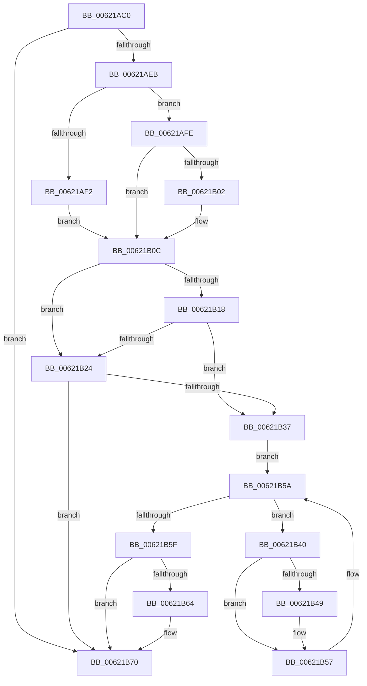

# DifExRaiseAccessViolationWrapper

- RVA: `0x00621AC0`–`0x00621B76` (길이 `182` bytes)
- VA: `0x0000000140621AC0`
- 실행 섹션: `.text`
- PDB 이름 있음: `예`; PDB Function 태그: `아니요`
- unwind 정보 RVA: `0x000D2C88`
- 디코드: `48`개 명령, `182/182` bytes 표시
- 미해석 바이트: `0` (있으면 어셈블리에 `.byte`로 보존)

> 이 문서는 커널 이미지의 기계어와 PDB 기호를 분석해 생성했습니다. 4번과 5번은 함수 원형과 자료형을 바이너리 사용 방식에서 추정한 C 해석이며 원본 소스 복구 결과는 아닙니다.

## 1. Dependencies

- 직접 호출 지점: **6**; 고유 호출 대상: **6**
- 직접 호출자로 확인된 함수: **0**
- RIP 상대 이미지 참조: **3**

### Outgoing calls
- `0x00621ADA` → [DifGetAPIThunkContextById](../49/DifGetAPIThunkContextById_function_00495A34.md) (function, `0x00495A34`)
- `0x00621B02` → [DifGetReturnAddressForWrappers](../4D/DifGetReturnAddressForWrappers_function_004D3C08.md) (function, `0x004D3C08`)
- `0x00621B2B` → [ExAcquireRundownProtection](../21/ExAcquireRundownProtection_function_00216620.md) (function, `0x00216620`)
- `0x00621B52` → [guard_dispatch_icall](../6B/guard_dispatch_icall_function_006BAAD0.md) (function, `0x006BAAD0`)
- `0x00621B6B` → [ExReleaseRundownProtection](../34/ExReleaseRundownProtection_function_00349E80.md) (function, `0x00349E80`)
- `0x00621B70` → [ExRaiseAccessViolation](../../page/8E/ExRaiseAccessViolation_function_008E9240.md) (function, `0x008E9240`)

### Direct callers
- 이 함수 시작 RVA로 연결되는 직접 call은 확인되지 않았습니다. 간접 호출은 완전히 역산할 수 없습니다.

### Static image references
- `0x00621B0F` → RVA `0x00F048B8` (`.data`; read)
- `0x00621B18` → RVA `0x00F04980` (`.data`; read)
- `0x00621B24` → RVA `0x00F03E80` (`.data`; read)

## 2. Other-region calls and transfers

- 다른 실행 섹션으로 향하는 call: **1**
  - `0x00621B70` → [ExRaiseAccessViolation](../../page/8E/ExRaiseAccessViolation_function_008E9240.md) (`.text` → `PAGE`)
- 별도 외부 분기/꼬리 이동을 확인하지 못했습니다.

## 3. Assembly (complete function range)

```asm
00621AC0  48 89 5C 24 10                  mov qword ptr [rsp + 0x10], rbx
00621AC5  48 89 74 24 18                  mov qword ptr [rsp + 0x18], rsi
00621ACA  57                              push rdi
00621ACB  48 83 EC 20                     sub rsp, 0x20
00621ACF  48 83 64 24 30 00               and qword ptr [rsp + 0x30], 0
00621AD5  B9 8A 01 00 00                  mov ecx, 0x18a
00621ADA  E8 55 3F E7 FF                  call 0x140495a34
00621ADF  48 8B D8                        mov rbx, rax
00621AE2  48 85 C0                        test rax, rax
00621AE5  0F 84 85 00 00 00               je 0x140621b70
00621AEB  8B 40 0C                        mov eax, dword ptr [rax + 0xc]
00621AEE  A8 18                           test al, 0x18
00621AF0  74 0C                           je 0x140621afe
00621AF2  48 8B 4C 24 28                  mov rcx, qword ptr [rsp + 0x28]
00621AF7  48 89 4C 24 30                  mov qword ptr [rsp + 0x30], rcx
00621AFC  EB 0E                           jmp 0x140621b0c
00621AFE  A8 04                           test al, 4
00621B00  74 0A                           je 0x140621b0c
00621B02  E8 01 21 EB FF                  call 0x1404d3c08
00621B07  48 89 44 24 30                  mov qword ptr [rsp + 0x30], rax
00621B0C  40 32 FF                        xor dil, dil
00621B0F  40 38 3D A2 2D 8E 00            cmp byte ptr [rip + 0x8e2da2], dil
00621B16  75 0C                           jne 0x140621b24
00621B18  F7 05 5E 2E 8E 00 00 08 00 00   test dword ptr [rip + 0x8e2e5e], 0x800
00621B22  74 13                           je 0x140621b37
00621B24  48 8D 0D 55 23 8E 00            lea rcx, [rip + 0x8e2355]
00621B2B  E8 F0 4A BF FF                  call 0x140216620
00621B30  40 8A F8                        mov dil, al
00621B33  84 C0                           test al, al
00621B35  74 39                           je 0x140621b70
00621B37  48 8D 73 20                     lea rsi, [rbx + 0x20]
00621B3B  48 8B 1E                        mov rbx, qword ptr [rsi]
00621B3E  EB 1A                           jmp 0x140621b5a
00621B40  48 8D 43 F0                     lea rax, [rbx - 0x10]
00621B44  48 85 C0                        test rax, rax
00621B47  74 0E                           je 0x140621b57
00621B49  48 8B 40 08                     mov rax, qword ptr [rax + 8]
00621B4D  48 8D 4C 24 30                  lea rcx, [rsp + 0x30]
00621B52  E8 79 8F 09 00                  call 0x1406baad0
00621B57  48 8B 1B                        mov rbx, qword ptr [rbx]
00621B5A  48 3B DE                        cmp rbx, rsi
00621B5D  75 E1                           jne 0x140621b40
00621B5F  40 84 FF                        test dil, dil
00621B62  74 0C                           je 0x140621b70
00621B64  48 8D 0D 15 23 8E 00            lea rcx, [rip + 0x8e2315]
00621B6B  E8 10 83 D2 FF                  call 0x140349e80
00621B70  E8 CB 76 2C 00                  call 0x1408e9240
00621B75  CC                              int3
```

## 4. C-style interpretation (structured pseudocode)

```c
__int64 __fastcall DifExRaiseAccessViolationWrapper(void)
{
    __int64 result;
    __int64 v_rdi;
    __int64 v_rsp;
    unsigned __int64 v_stack_p0;
    unsigned __int64 v_stack_p10;
    unsigned __int64 v_stack_p18;
    unsigned __int64 v_stack_p8;

    v_stack_p10 = v_rbx;
    v_stack_p18 = v_rsi;
    v_rsp = (v_rsp) - (32);
    result = DifGetAPIThunkContextById(394, a2, a3, a4);
    if (result == 0) goto loc_00621B70;
    if ((((unsigned __int8)((unsigned int)(*(unsigned int *)(result + 12)))) & (24)) == 0) goto loc_00621AFE;
    v_stack_p8 = v_stack_p0;
    goto loc_00621B0C;
loc_00621AFE:
    result = (unsigned int)(*(unsigned int *)(result + 12));
    if ((((unsigned __int8)((unsigned int)(*(unsigned int *)(result + 12)))) & (4)) != 0) {
        result = DifGetReturnAddressForWrappers(v_stack_p0, a2, a3, a4);
        v_stack_p8 = result;
    }
    v_rdi = 0;
    if ((*(unsigned __int8 *)(v_rip + 9317794)) != 0) goto loc_00621B24;
    if (((*(unsigned int *)(v_rip + 9317982)) & (0x800ULL)) == 0) goto loc_00621B37;
loc_00621B24:
    result = ExAcquireRundownProtection(v_rip + 9315157, a2, a3, a4);
    if ((unsigned __int8)(result) == 0) goto loc_00621B70;
loc_00621B37:
    goto loc_00621B5A;
loc_00621B40:
    result = *(unsigned __int64 *)(result + 32) - 16;
    if (*(unsigned __int64 *)(result + 32) - 16 != 0) {
        result = *(unsigned __int64 *)(*(unsigned __int64 *)(result + 32) - 16 + 8);
        a1 = v_stack_p8;
        result = guard_dispatch_icall(a1, a2, a3, a4);
    }
loc_00621B5A:
    if ((*(unsigned __int64 *)(*(unsigned __int64 *)(result + 32))) != (result + 32)) goto loc_00621B40;
    if ((unsigned __int8)((unsigned __int8)(result)) != 0) {
        a1 = v_rip + 9315093;
        result = ExReleaseRundownProtection(a1, a2, a3, a4);
    }
    result = ExRaiseAccessViolation(a1, a2, a3, a4);
    return result;
}
```

## 5. (Beta) C Style

```c
void DifExRaiseAccessViolationWrapper(void)
{
    int64_t result;
    int64_t local_rdi;
    int64_t local_rsp;
    uint64_t v_stack_p0;
    uint64_t v_stack_p10;
    uint64_t v_stack_p18;
    uint64_t v_stack_p8;

    v_stack_p10 = local_rbx;
    v_stack_p18 = local_rsi;
    local_rsp = (local_rsp) - (32);
    result = DifGetAPIThunkContextById(394, a2, a3, a4);
    if (result == 0) goto loc_00621B70;
    if ((((uint8_t)((uint32_t)(*(uint32_t *)(result + 0xC)))) & (24)) == 0) goto loc_00621AFE;
    v_stack_p8 = v_stack_p0;
    goto loc_00621B0C;
loc_00621AFE:
    result = (uint32_t)(*(uint32_t *)(result + 0xC));
    if ((((uint8_t)((uint32_t)(*(uint32_t *)(result + 0xC)))) & (4)) != 0) {
        result = DifGetReturnAddressForWrappers(v_stack_p0, a2, a3, a4);
        v_stack_p8 = result;
    }
    local_rdi = 0;
    if ((*(uint8_t *)(v_rip + 0x8E2DA2)) != 0) goto loc_00621B24;
    if (((*(uint32_t *)(v_rip + 0x8E2E5E)) & (0x800ULL)) == 0) goto loc_00621B37;
loc_00621B24:
    result = ExAcquireRundownProtection(v_rip + 9315157, a2, a3, a4);
    if ((uint8_t)(result) == 0) goto loc_00621B70;
loc_00621B37:
    goto loc_00621B5A;
loc_00621B40:
    result = *(uint64_t *)(result + 0x20) - 16;
    if (*(uint64_t *)(result + 0x20) - 16 != 0) {
        result = *(uint64_t *)(*(uint64_t *)(result + 0x20) - 0x10 + 0x8);
        a1 = v_stack_p8;
        result = guard_dispatch_icall(a1, a2, a3, a4);
    }
loc_00621B5A:
    if ((*(uint64_t *)(*(uint64_t *)(result + 0x20))) != (result + 32)) goto loc_00621B40;
    if ((uint8_t)((uint8_t)(result)) != 0) {
        a1 = v_rip + 9315093;
        result = ExReleaseRundownProtection(a1, a2, a3, a4);
    }
    result = ExRaiseAccessViolation(a1, a2, a3, a4);
    return result;
}
```

## 6. Execution-region graph

[열기: 2D/3D 그래프와 함수 탐색 컨트롤 패널](../../../control-panel.html?section=text&rva=0x00621AC0&view=graph)

- 2D 그래프는 위에서 아래로 흐르고, 3D 그래프는 빈 공간을 드래그해 회전합니다. Shift+드래그는 이동, 휠은 확대·축소, 함수 노드 선택은 대상 보고서 이동입니다.

### Static fallback


