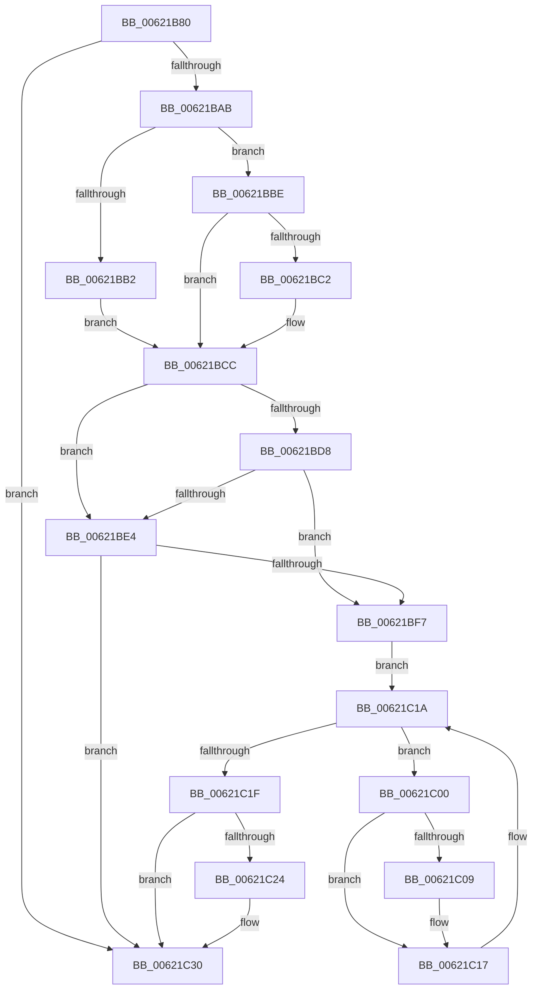

# DifExRaiseDatatypeMisalignmentWrapper

- RVA: `0x00621B80`–`0x00621C36` (길이 `182` bytes)
- VA: `0x0000000140621B80`
- 실행 섹션: `.text`
- PDB 이름 있음: `예`; PDB Function 태그: `아니요`
- unwind 정보 RVA: `0x000D2C88`
- 디코드: `48`개 명령, `182/182` bytes 표시
- 미해석 바이트: `0` (있으면 어셈블리에 `.byte`로 보존)

> 이 문서는 커널 이미지의 기계어와 PDB 기호를 분석해 생성했습니다. 4번과 5번은 함수 원형과 자료형을 바이너리 사용 방식에서 추정한 C 해석이며 원본 소스 복구 결과는 아닙니다.

## 1. Dependencies

- 직접 호출 지점: **6**; 고유 호출 대상: **6**
- 직접 호출자로 확인된 함수: **0**
- RIP 상대 이미지 참조: **3**

### Outgoing calls
- `0x00621B9A` → [DifGetAPIThunkContextById](../49/DifGetAPIThunkContextById_function_00495A34.md) (function, `0x00495A34`)
- `0x00621BC2` → [DifGetReturnAddressForWrappers](../4D/DifGetReturnAddressForWrappers_function_004D3C08.md) (function, `0x004D3C08`)
- `0x00621BEB` → [ExAcquireRundownProtection](../21/ExAcquireRundownProtection_function_00216620.md) (function, `0x00216620`)
- `0x00621C12` → [guard_dispatch_icall](../6B/guard_dispatch_icall_function_006BAAD0.md) (function, `0x006BAAD0`)
- `0x00621C2B` → [ExReleaseRundownProtection](../34/ExReleaseRundownProtection_function_00349E80.md) (function, `0x00349E80`)
- `0x00621C30` → [ExRaiseDatatypeMisalignment](../../page/89/ExRaiseDatatypeMisalignment_function_00899FD0.md) (function, `0x00899FD0`)

### Direct callers
- 이 함수 시작 RVA로 연결되는 직접 call은 확인되지 않았습니다. 간접 호출은 완전히 역산할 수 없습니다.

### Static image references
- `0x00621BCF` → RVA `0x00F048B8` (`.data`; read)
- `0x00621BD8` → RVA `0x00F04980` (`.data`; read)
- `0x00621BE4` → RVA `0x00F03E80` (`.data`; read)

## 2. Other-region calls and transfers

- 다른 실행 섹션으로 향하는 call: **1**
  - `0x00621C30` → [ExRaiseDatatypeMisalignment](../../page/89/ExRaiseDatatypeMisalignment_function_00899FD0.md) (`.text` → `PAGE`)
- 별도 외부 분기/꼬리 이동을 확인하지 못했습니다.

## 3. Assembly (complete function range)

```asm
00621B80  48 89 5C 24 10                  mov qword ptr [rsp + 0x10], rbx
00621B85  48 89 74 24 18                  mov qword ptr [rsp + 0x18], rsi
00621B8A  57                              push rdi
00621B8B  48 83 EC 20                     sub rsp, 0x20
00621B8F  48 83 64 24 30 00               and qword ptr [rsp + 0x30], 0
00621B95  B9 89 01 00 00                  mov ecx, 0x189
00621B9A  E8 95 3E E7 FF                  call 0x140495a34
00621B9F  48 8B D8                        mov rbx, rax
00621BA2  48 85 C0                        test rax, rax
00621BA5  0F 84 85 00 00 00               je 0x140621c30
00621BAB  8B 40 0C                        mov eax, dword ptr [rax + 0xc]
00621BAE  A8 18                           test al, 0x18
00621BB0  74 0C                           je 0x140621bbe
00621BB2  48 8B 4C 24 28                  mov rcx, qword ptr [rsp + 0x28]
00621BB7  48 89 4C 24 30                  mov qword ptr [rsp + 0x30], rcx
00621BBC  EB 0E                           jmp 0x140621bcc
00621BBE  A8 04                           test al, 4
00621BC0  74 0A                           je 0x140621bcc
00621BC2  E8 41 20 EB FF                  call 0x1404d3c08
00621BC7  48 89 44 24 30                  mov qword ptr [rsp + 0x30], rax
00621BCC  40 32 FF                        xor dil, dil
00621BCF  40 38 3D E2 2C 8E 00            cmp byte ptr [rip + 0x8e2ce2], dil
00621BD6  75 0C                           jne 0x140621be4
00621BD8  F7 05 9E 2D 8E 00 00 08 00 00   test dword ptr [rip + 0x8e2d9e], 0x800
00621BE2  74 13                           je 0x140621bf7
00621BE4  48 8D 0D 95 22 8E 00            lea rcx, [rip + 0x8e2295]
00621BEB  E8 30 4A BF FF                  call 0x140216620
00621BF0  40 8A F8                        mov dil, al
00621BF3  84 C0                           test al, al
00621BF5  74 39                           je 0x140621c30
00621BF7  48 8D 73 20                     lea rsi, [rbx + 0x20]
00621BFB  48 8B 1E                        mov rbx, qword ptr [rsi]
00621BFE  EB 1A                           jmp 0x140621c1a
00621C00  48 8D 43 F0                     lea rax, [rbx - 0x10]
00621C04  48 85 C0                        test rax, rax
00621C07  74 0E                           je 0x140621c17
00621C09  48 8B 40 08                     mov rax, qword ptr [rax + 8]
00621C0D  48 8D 4C 24 30                  lea rcx, [rsp + 0x30]
00621C12  E8 B9 8E 09 00                  call 0x1406baad0
00621C17  48 8B 1B                        mov rbx, qword ptr [rbx]
00621C1A  48 3B DE                        cmp rbx, rsi
00621C1D  75 E1                           jne 0x140621c00
00621C1F  40 84 FF                        test dil, dil
00621C22  74 0C                           je 0x140621c30
00621C24  48 8D 0D 55 22 8E 00            lea rcx, [rip + 0x8e2255]
00621C2B  E8 50 82 D2 FF                  call 0x140349e80
00621C30  E8 9B 83 27 00                  call 0x140899fd0
00621C35  CC                              int3
```

## 4. C-style interpretation (structured pseudocode)

```c
__int64 __fastcall DifExRaiseDatatypeMisalignmentWrapper(void)
{
    __int64 result;
    __int64 v_rdi;
    __int64 v_rsp;
    unsigned __int64 v_stack_p0;
    unsigned __int64 v_stack_p10;
    unsigned __int64 v_stack_p18;
    unsigned __int64 v_stack_p8;

    v_stack_p10 = v_rbx;
    v_stack_p18 = v_rsi;
    v_rsp = (v_rsp) - (32);
    result = DifGetAPIThunkContextById(393, a2, a3, a4);
    if (result == 0) goto loc_00621C30;
    if ((((unsigned __int8)((unsigned int)(*(unsigned int *)(result + 12)))) & (24)) == 0) goto loc_00621BBE;
    v_stack_p8 = v_stack_p0;
    goto loc_00621BCC;
loc_00621BBE:
    result = (unsigned int)(*(unsigned int *)(result + 12));
    if ((((unsigned __int8)((unsigned int)(*(unsigned int *)(result + 12)))) & (4)) != 0) {
        result = DifGetReturnAddressForWrappers(v_stack_p0, a2, a3, a4);
        v_stack_p8 = result;
    }
    v_rdi = 0;
    if ((*(unsigned __int8 *)(v_rip + 9317602)) != 0) goto loc_00621BE4;
    if (((*(unsigned int *)(v_rip + 9317790)) & (0x800ULL)) == 0) goto loc_00621BF7;
loc_00621BE4:
    result = ExAcquireRundownProtection(v_rip + 9314965, a2, a3, a4);
    if ((unsigned __int8)(result) == 0) goto loc_00621C30;
loc_00621BF7:
    goto loc_00621C1A;
loc_00621C00:
    result = *(unsigned __int64 *)(result + 32) - 16;
    if (*(unsigned __int64 *)(result + 32) - 16 != 0) {
        result = *(unsigned __int64 *)(*(unsigned __int64 *)(result + 32) - 16 + 8);
        a1 = v_stack_p8;
        result = guard_dispatch_icall(a1, a2, a3, a4);
    }
loc_00621C1A:
    if ((*(unsigned __int64 *)(*(unsigned __int64 *)(result + 32))) != (result + 32)) goto loc_00621C00;
    if ((unsigned __int8)((unsigned __int8)(result)) != 0) {
        a1 = v_rip + 9314901;
        result = ExReleaseRundownProtection(a1, a2, a3, a4);
    }
    result = ExRaiseDatatypeMisalignment(a1, a2, a3, a4);
    return result;
}
```

## 5. (Beta) C Style

```c
void DifExRaiseDatatypeMisalignmentWrapper(void)
{
    int64_t result;
    int64_t local_rdi;
    int64_t local_rsp;
    uint64_t v_stack_p0;
    uint64_t v_stack_p10;
    uint64_t v_stack_p18;
    uint64_t v_stack_p8;

    v_stack_p10 = local_rbx;
    v_stack_p18 = local_rsi;
    local_rsp = (local_rsp) - (32);
    result = DifGetAPIThunkContextById(393, a2, a3, a4);
    if (result == 0) goto loc_00621C30;
    if ((((uint8_t)((uint32_t)(*(uint32_t *)(result + 0xC)))) & (24)) == 0) goto loc_00621BBE;
    v_stack_p8 = v_stack_p0;
    goto loc_00621BCC;
loc_00621BBE:
    result = (uint32_t)(*(uint32_t *)(result + 0xC));
    if ((((uint8_t)((uint32_t)(*(uint32_t *)(result + 0xC)))) & (4)) != 0) {
        result = DifGetReturnAddressForWrappers(v_stack_p0, a2, a3, a4);
        v_stack_p8 = result;
    }
    local_rdi = 0;
    if ((*(uint8_t *)(v_rip + 0x8E2CE2)) != 0) goto loc_00621BE4;
    if (((*(uint32_t *)(v_rip + 0x8E2D9E)) & (0x800ULL)) == 0) goto loc_00621BF7;
loc_00621BE4:
    result = ExAcquireRundownProtection(v_rip + 9314965, a2, a3, a4);
    if ((uint8_t)(result) == 0) goto loc_00621C30;
loc_00621BF7:
    goto loc_00621C1A;
loc_00621C00:
    result = *(uint64_t *)(result + 0x20) - 16;
    if (*(uint64_t *)(result + 0x20) - 16 != 0) {
        result = *(uint64_t *)(*(uint64_t *)(result + 0x20) - 0x10 + 0x8);
        a1 = v_stack_p8;
        result = guard_dispatch_icall(a1, a2, a3, a4);
    }
loc_00621C1A:
    if ((*(uint64_t *)(*(uint64_t *)(result + 0x20))) != (result + 32)) goto loc_00621C00;
    if ((uint8_t)((uint8_t)(result)) != 0) {
        a1 = v_rip + 9314901;
        result = ExReleaseRundownProtection(a1, a2, a3, a4);
    }
    result = ExRaiseDatatypeMisalignment(a1, a2, a3, a4);
    return result;
}
```

## 6. Execution-region graph

[열기: 2D/3D 그래프와 함수 탐색 컨트롤 패널](../../../control-panel.html?section=text&rva=0x00621B80&view=graph)

- 2D 그래프는 위에서 아래로 흐르고, 3D 그래프는 빈 공간을 드래그해 회전합니다. Shift+드래그는 이동, 휠은 확대·축소, 함수 노드 선택은 대상 보고서 이동입니다.

### Static fallback


