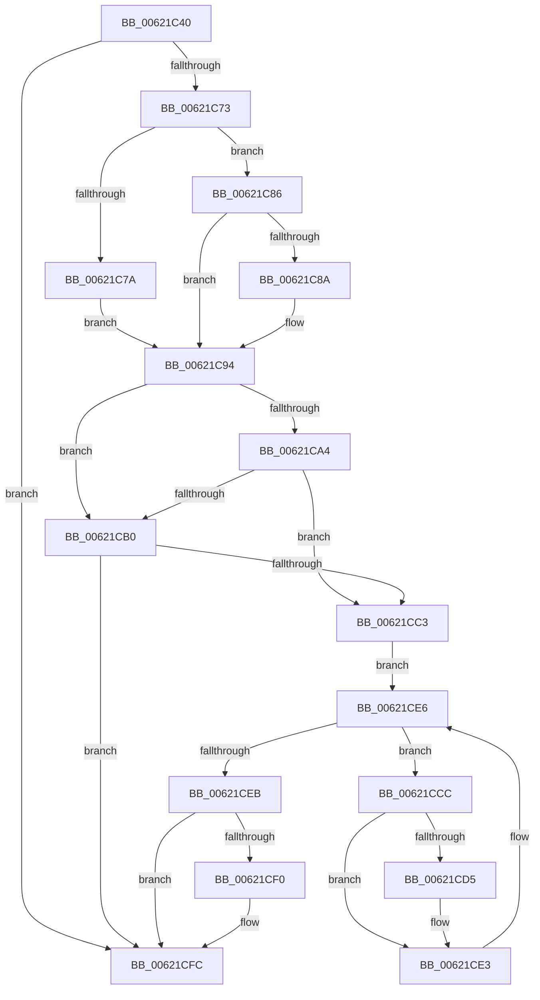

# DifExRaiseStatusWrapper

- RVA: `0x00621C40`–`0x00621D04` (길이 `196` bytes)
- VA: `0x0000000140621C40`
- 실행 섹션: `.text`
- PDB 이름 있음: `예`; PDB Function 태그: `아니요`
- unwind 정보 RVA: `0x000BB168`
- 디코드: `54`개 명령, `196/196` bytes 표시
- 미해석 바이트: `0` (있으면 어셈블리에 `.byte`로 보존)

> 이 문서는 커널 이미지의 기계어와 PDB 기호를 분석해 생성했습니다. 4번과 5번은 함수 원형과 자료형을 바이너리 사용 방식에서 추정한 C 해석이며 원본 소스 복구 결과는 아닙니다.

## 1. Dependencies

- 직접 호출 지점: **6**; 고유 호출 대상: **6**
- 직접 호출자로 확인된 함수: **0**
- RIP 상대 이미지 참조: **3**

### Outgoing calls
- `0x00621C62` → [DifGetAPIThunkContextById](../49/DifGetAPIThunkContextById_function_00495A34.md) (function, `0x00495A34`)
- `0x00621C8A` → [DifGetReturnAddressForWrappers](../4D/DifGetReturnAddressForWrappers_function_004D3C08.md) (function, `0x004D3C08`)
- `0x00621CB7` → [ExAcquireRundownProtection](../21/ExAcquireRundownProtection_function_00216620.md) (function, `0x00216620`)
- `0x00621CDE` → [guard_dispatch_icall](../6B/guard_dispatch_icall_function_006BAAD0.md) (function, `0x006BAAD0`)
- `0x00621CF7` → [ExReleaseRundownProtection](../34/ExReleaseRundownProtection_function_00349E80.md) (function, `0x00349E80`)
- `0x00621CFE` → [RtlRaiseStatus](../2F/RtlRaiseStatus_function_002F6A50.md) (function, `0x002F6A50`)

### Direct callers
- 이 함수 시작 RVA로 연결되는 직접 call은 확인되지 않았습니다. 간접 호출은 완전히 역산할 수 없습니다.

### Static image references
- `0x00621C9B` → RVA `0x00F048B8` (`.data`; read)
- `0x00621CA4` → RVA `0x00F04980` (`.data`; read)
- `0x00621CB0` → RVA `0x00F03E80` (`.data`; read)

## 2. Other-region calls and transfers

- 다른 실행 섹션으로 향하는 call: **0**
- 별도 외부 분기/꼬리 이동을 확인하지 못했습니다.

## 3. Assembly (complete function range)

```asm
00621C40  48 8B C4                        mov rax, rsp
00621C43  48 89 58 08                     mov qword ptr [rax + 8], rbx
00621C47  48 89 68 10                     mov qword ptr [rax + 0x10], rbp
00621C4B  48 89 70 18                     mov qword ptr [rax + 0x18], rsi
00621C4F  57                              push rdi
00621C50  48 83 EC 30                     sub rsp, 0x30
00621C54  8B E9                           mov ebp, ecx
00621C56  0F 57 C0                        xorps xmm0, xmm0
00621C59  B9 88 01 00 00                  mov ecx, 0x188
00621C5E  0F 11 40 E8                     movups xmmword ptr [rax - 0x18], xmm0
00621C62  E8 CD 3D E7 FF                  call 0x140495a34
00621C67  48 8B D8                        mov rbx, rax
00621C6A  48 85 C0                        test rax, rax
00621C6D  0F 84 89 00 00 00               je 0x140621cfc
00621C73  8B 40 0C                        mov eax, dword ptr [rax + 0xc]
00621C76  A8 18                           test al, 0x18
00621C78  74 0C                           je 0x140621c86
00621C7A  48 8B 4C 24 38                  mov rcx, qword ptr [rsp + 0x38]
00621C7F  48 89 4C 24 20                  mov qword ptr [rsp + 0x20], rcx
00621C84  EB 0E                           jmp 0x140621c94
00621C86  A8 04                           test al, 4
00621C88  74 0A                           je 0x140621c94
00621C8A  E8 79 1F EB FF                  call 0x1404d3c08
00621C8F  48 89 44 24 20                  mov qword ptr [rsp + 0x20], rax
00621C94  40 32 FF                        xor dil, dil
00621C97  89 6C 24 28                     mov dword ptr [rsp + 0x28], ebp
00621C9B  40 38 3D 16 2C 8E 00            cmp byte ptr [rip + 0x8e2c16], dil
00621CA2  75 0C                           jne 0x140621cb0
00621CA4  F7 05 D2 2C 8E 00 00 08 00 00   test dword ptr [rip + 0x8e2cd2], 0x800
00621CAE  74 13                           je 0x140621cc3
00621CB0  48 8D 0D C9 21 8E 00            lea rcx, [rip + 0x8e21c9]
00621CB7  E8 64 49 BF FF                  call 0x140216620
00621CBC  40 8A F8                        mov dil, al
00621CBF  84 C0                           test al, al
00621CC1  74 39                           je 0x140621cfc
00621CC3  48 8D 73 20                     lea rsi, [rbx + 0x20]
00621CC7  48 8B 1E                        mov rbx, qword ptr [rsi]
00621CCA  EB 1A                           jmp 0x140621ce6
00621CCC  48 8D 43 F0                     lea rax, [rbx - 0x10]
00621CD0  48 85 C0                        test rax, rax
00621CD3  74 0E                           je 0x140621ce3
00621CD5  48 8B 40 08                     mov rax, qword ptr [rax + 8]
00621CD9  48 8D 4C 24 20                  lea rcx, [rsp + 0x20]
00621CDE  E8 ED 8D 09 00                  call 0x1406baad0
00621CE3  48 8B 1B                        mov rbx, qword ptr [rbx]
00621CE6  48 3B DE                        cmp rbx, rsi
00621CE9  75 E1                           jne 0x140621ccc
00621CEB  40 84 FF                        test dil, dil
00621CEE  74 0C                           je 0x140621cfc
00621CF0  48 8D 0D 89 21 8E 00            lea rcx, [rip + 0x8e2189]
00621CF7  E8 84 81 D2 FF                  call 0x140349e80
00621CFC  8B CD                           mov ecx, ebp
00621CFE  E8 4D 4D CD FF                  call 0x1402f6a50
00621D03  CC                              int3
```

## 4. C-style interpretation (structured pseudocode)

```c
__int64 __fastcall DifExRaiseStatusWrapper(int a1)
{
    __int64 result;
    __int64 v_rdi;
    __int64 v_rsp;
    unsigned int v_stack_m10;
    unsigned __int64 v_stack_m18;
    unsigned __int64 v_stack_p0;

    *(unsigned __int64 *)(v_rsp + 8) = v_rbx;
    *(unsigned __int64 *)(v_rsp + 16) = v_rbp;
    *(unsigned __int64 *)(v_rsp + 24) = v_rsi;
    v_rsp = (v_rsp) - (48);
    *(unsigned __int64 *)(v_rsp - 24) = v_xmm0;
    result = DifGetAPIThunkContextById(392, a2, a3, a4);
    if (result == 0) goto loc_00621CFC;
    if ((((unsigned __int8)((unsigned int)(*(unsigned int *)(result + 12)))) & (24)) == 0) goto loc_00621C86;
    v_stack_m18 = v_stack_p0;
    goto loc_00621C94;
loc_00621C86:
    result = (unsigned int)(*(unsigned int *)(result + 12));
    if ((((unsigned __int8)((unsigned int)(*(unsigned int *)(result + 12)))) & (4)) != 0) {
        result = DifGetReturnAddressForWrappers(v_stack_p0, a2, a3, a4);
        v_stack_m18 = result;
    }
    v_rdi = 0;
    v_stack_m10 = (unsigned int)((unsigned int)(a1));
    if ((*(unsigned __int8 *)(v_rip + 9317398)) != 0) goto loc_00621CB0;
    if (((*(unsigned int *)(v_rip + 9317586)) & (0x800ULL)) == 0) goto loc_00621CC3;
loc_00621CB0:
    result = ExAcquireRundownProtection(v_rip + 9314761, a2, a3, a4);
    if ((unsigned __int8)(result) == 0) goto loc_00621CFC;
loc_00621CC3:
    goto loc_00621CE6;
loc_00621CCC:
    result = *(unsigned __int64 *)(result + 32) - 16;
    if (*(unsigned __int64 *)(result + 32) - 16 != 0) {
        result = *(unsigned __int64 *)(*(unsigned __int64 *)(result + 32) - 16 + 8);
        a1 = v_stack_m18;
        result = guard_dispatch_icall(a1, a2, a3, a4);
    }
loc_00621CE6:
    if ((*(unsigned __int64 *)(*(unsigned __int64 *)(result + 32))) != (result + 32)) goto loc_00621CCC;
    if ((unsigned __int8)((unsigned __int8)(result)) != 0) {
        a1 = v_rip + 9314697;
        result = ExReleaseRundownProtection(a1, a2, a3, a4);
    }
    result = RtlRaiseStatus((unsigned int)((unsigned int)((unsigned int)(a1))), a2, a3, a4);
    return result;
}
```

## 5. (Beta) C Style

```c
int64_t DifExRaiseStatusWrapper(int32_t Arg1)
{
    int64_t result;
    int64_t local_rdi;
    int64_t local_rsp;
    uint32_t v_stack_m10;
    uint64_t v_stack_m18;
    uint64_t v_stack_p0;

    *(uint64_t *)(local_rsp + 0x8) = local_rbx;
    *(uint64_t *)(local_rsp + 0x10) = local_rbp;
    *(uint64_t *)(local_rsp + 0x18) = local_rsi;
    local_rsp = (local_rsp) - (48);
    *(uint64_t *)(local_rsp - 0x18) = v_xmm0;
    result = DifGetAPIThunkContextById(392, a2, a3, a4);
    if (result == 0) goto loc_00621CFC;
    if ((((uint8_t)((uint32_t)(*(uint32_t *)(result + 0xC)))) & (24)) == 0) goto loc_00621C86;
    v_stack_m18 = v_stack_p0;
    goto loc_00621C94;
loc_00621C86:
    result = (uint32_t)(*(uint32_t *)(result + 0xC));
    if ((((uint8_t)((uint32_t)(*(uint32_t *)(result + 0xC)))) & (4)) != 0) {
        result = DifGetReturnAddressForWrappers(v_stack_p0, a2, a3, a4);
        v_stack_m18 = result;
    }
    local_rdi = 0;
    v_stack_m10 = (uint32_t)((uint32_t)(Arg1));
    if ((*(uint8_t *)(v_rip + 0x8E2C16)) != 0) goto loc_00621CB0;
    if (((*(uint32_t *)(v_rip + 0x8E2CD2)) & (0x800ULL)) == 0) goto loc_00621CC3;
loc_00621CB0:
    result = ExAcquireRundownProtection(v_rip + 9314761, a2, a3, a4);
    if ((uint8_t)(result) == 0) goto loc_00621CFC;
loc_00621CC3:
    goto loc_00621CE6;
loc_00621CCC:
    result = *(uint64_t *)(result + 0x20) - 16;
    if (*(uint64_t *)(result + 0x20) - 16 != 0) {
        result = *(uint64_t *)(*(uint64_t *)(result + 0x20) - 0x10 + 0x8);
        Arg1 = v_stack_m18;
        result = guard_dispatch_icall(Arg1, a2, a3, a4);
    }
loc_00621CE6:
    if ((*(uint64_t *)(*(uint64_t *)(result + 0x20))) != (result + 32)) goto loc_00621CCC;
    if ((uint8_t)((uint8_t)(result)) != 0) {
        Arg1 = v_rip + 9314697;
        result = ExReleaseRundownProtection(Arg1, a2, a3, a4);
    }
    result = RtlRaiseStatus((uint32_t)((uint32_t)((uint32_t)(Arg1))), a2, a3, a4);
    return result;
}
```

## 6. Execution-region graph

[열기: 2D/3D 그래프와 함수 탐색 컨트롤 패널](../../../control-panel.html?section=text&rva=0x00621C40&view=graph)

- 2D 그래프는 위에서 아래로 흐르고, 3D 그래프는 빈 공간을 드래그해 회전합니다. Shift+드래그는 이동, 휠은 확대·축소, 함수 노드 선택은 대상 보고서 이동입니다.

### Static fallback


