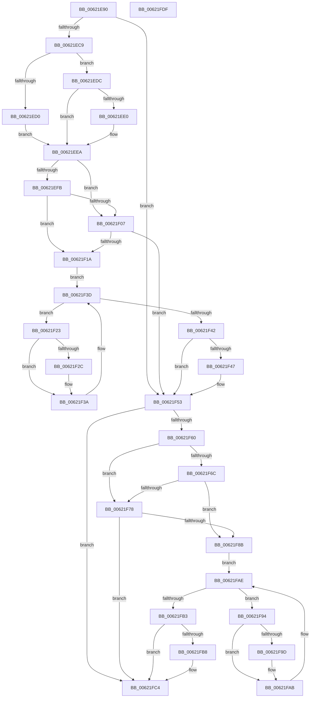

# DifExReinitializeFastResourceWrapper

- RVA: `0x00621E90`–`0x00621FE0` (길이 `336` bytes)
- VA: `0x0000000140621E90`
- 실행 섹션: `.text`
- PDB 이름 있음: `예`; PDB Function 태그: `아니요`
- unwind 정보 RVA: `0x0005D7BC`
- 디코드: `90`개 명령, `336/336` bytes 표시
- 미해석 바이트: `0` (있으면 어셈블리에 `.byte`로 보존)

> 이 문서는 커널 이미지의 기계어와 PDB 기호를 분석해 생성했습니다. 4번과 5번은 함수 원형과 자료형을 바이너리 사용 방식에서 추정한 C 해석이며 원본 소스 복구 결과는 아닙니다.

## 1. Dependencies

- 직접 호출 지점: **9**; 고유 호출 대상: **6**
- 직접 호출자로 확인된 함수: **0**
- RIP 상대 이미지 참조: **3**

### Outgoing calls
- `0x00621EB8` → [DifGetAPIThunkContextById](../49/DifGetAPIThunkContextById_function_00495A34.md) (function, `0x00495A34`)
- `0x00621EE0` → [DifGetReturnAddressForWrappers](../4D/DifGetReturnAddressForWrappers_function_004D3C08.md) (function, `0x004D3C08`)
- `0x00621F0E` → [ExAcquireRundownProtection](../21/ExAcquireRundownProtection_function_00216620.md) (function, `0x00216620`)
- `0x00621F35` → [guard_dispatch_icall](../6B/guard_dispatch_icall_function_006BAAD0.md) (function, `0x006BAAD0`)
- `0x00621F4E` → [ExReleaseRundownProtection](../34/ExReleaseRundownProtection_function_00349E80.md) (function, `0x00349E80`)
- `0x00621F56` → [ExReinitializeFastResource](../3C/ExReinitializeFastResource_function_003CF400.md) (function, `0x003CF400`)
- `0x00621F7F` → [ExAcquireRundownProtection](../21/ExAcquireRundownProtection_function_00216620.md) (function, `0x00216620`)
- `0x00621FA6` → [guard_dispatch_icall](../6B/guard_dispatch_icall_function_006BAAD0.md) (function, `0x006BAAD0`)
- `0x00621FBF` → [ExReleaseRundownProtection](../34/ExReleaseRundownProtection_function_00349E80.md) (function, `0x00349E80`)

### Direct callers
- 이 함수 시작 RVA로 연결되는 직접 call은 확인되지 않았습니다. 간접 호출은 완전히 역산할 수 없습니다.

### Static image references
- `0x00621EF2` → RVA `0x00F048B8` (`.data`; read)
- `0x00621EFB` → RVA `0x00F04980` (`.data`; read)
- `0x00621F07` → RVA `0x00F03E80` (`.data`; read)

## 2. Other-region calls and transfers

- 다른 실행 섹션으로 향하는 call: **0**
- 별도 외부 분기/꼬리 이동을 확인하지 못했습니다.

## 3. Assembly (complete function range)

```asm
00621E90  48 8B C4                        mov rax, rsp
00621E93  48 89 58 08                     mov qword ptr [rax + 8], rbx
00621E97  48 89 68 10                     mov qword ptr [rax + 0x10], rbp
00621E9B  48 89 70 18                     mov qword ptr [rax + 0x18], rsi
00621E9F  48 89 78 20                     mov qword ptr [rax + 0x20], rdi
00621EA3  41 56                           push r14
00621EA5  48 83 EC 30                     sub rsp, 0x30
00621EA9  48 8B E9                        mov rbp, rcx
00621EAC  0F 57 C0                        xorps xmm0, xmm0
00621EAF  B9 C0 01 00 00                  mov ecx, 0x1c0
00621EB4  0F 11 40 E8                     movups xmmword ptr [rax - 0x18], xmm0
00621EB8  E8 77 3B E7 FF                  call 0x140495a34
00621EBD  48 8B F8                        mov rdi, rax
00621EC0  48 85 C0                        test rax, rax
00621EC3  0F 84 8A 00 00 00               je 0x140621f53
00621EC9  8B 40 0C                        mov eax, dword ptr [rax + 0xc]
00621ECC  A8 18                           test al, 0x18
00621ECE  74 0C                           je 0x140621edc
00621ED0  48 8B 4C 24 38                  mov rcx, qword ptr [rsp + 0x38]
00621ED5  48 89 4C 24 20                  mov qword ptr [rsp + 0x20], rcx
00621EDA  EB 0E                           jmp 0x140621eea
00621EDC  A8 04                           test al, 4
00621EDE  74 0A                           je 0x140621eea
00621EE0  E8 23 1D EB FF                  call 0x1404d3c08
00621EE5  48 89 44 24 20                  mov qword ptr [rsp + 0x20], rax
00621EEA  40 32 F6                        xor sil, sil
00621EED  48 89 6C 24 28                  mov qword ptr [rsp + 0x28], rbp
00621EF2  40 38 35 BF 29 8E 00            cmp byte ptr [rip + 0x8e29bf], sil
00621EF9  75 0C                           jne 0x140621f07
00621EFB  F7 05 7B 2A 8E 00 00 08 00 00   test dword ptr [rip + 0x8e2a7b], 0x800
00621F05  74 13                           je 0x140621f1a
00621F07  48 8D 0D 72 1F 8E 00            lea rcx, [rip + 0x8e1f72]
00621F0E  E8 0D 47 BF FF                  call 0x140216620
00621F13  40 8A F0                        mov sil, al
00621F16  84 C0                           test al, al
00621F18  74 39                           je 0x140621f53
00621F1A  4C 8D 77 20                     lea r14, [rdi + 0x20]
00621F1E  49 8B 1E                        mov rbx, qword ptr [r14]
00621F21  EB 1A                           jmp 0x140621f3d
00621F23  48 8D 43 F0                     lea rax, [rbx - 0x10]
00621F27  48 85 C0                        test rax, rax
00621F2A  74 0E                           je 0x140621f3a
00621F2C  48 8B 40 08                     mov rax, qword ptr [rax + 8]
00621F30  48 8D 4C 24 20                  lea rcx, [rsp + 0x20]
00621F35  E8 96 8B 09 00                  call 0x1406baad0
00621F3A  48 8B 1B                        mov rbx, qword ptr [rbx]
00621F3D  49 3B DE                        cmp rbx, r14
00621F40  75 E1                           jne 0x140621f23
00621F42  40 84 F6                        test sil, sil
00621F45  74 0C                           je 0x140621f53
00621F47  48 8D 0D 32 1F 8E 00            lea rcx, [rip + 0x8e1f32]
00621F4E  E8 2D 7F D2 FF                  call 0x140349e80
00621F53  48 8B CD                        mov rcx, rbp
00621F56  E8 A5 D4 DA FF                  call 0x1403cf400
00621F5B  48 85 FF                        test rdi, rdi
00621F5E  74 64                           je 0x140621fc4
00621F60  40 32 F6                        xor sil, sil
00621F63  40 38 35 4E 29 8E 00            cmp byte ptr [rip + 0x8e294e], sil
00621F6A  75 0C                           jne 0x140621f78
00621F6C  F7 05 0A 2A 8E 00 00 08 00 00   test dword ptr [rip + 0x8e2a0a], 0x800
00621F76  74 13                           je 0x140621f8b
00621F78  48 8D 0D 01 1F 8E 00            lea rcx, [rip + 0x8e1f01]
00621F7F  E8 9C 46 BF FF                  call 0x140216620
00621F84  40 8A F0                        mov sil, al
00621F87  84 C0                           test al, al
00621F89  74 39                           je 0x140621fc4
00621F8B  48 83 C7 30                     add rdi, 0x30
00621F8F  48 8B 1F                        mov rbx, qword ptr [rdi]
00621F92  EB 1A                           jmp 0x140621fae
00621F94  48 8D 43 F0                     lea rax, [rbx - 0x10]
00621F98  48 85 C0                        test rax, rax
00621F9B  74 0E                           je 0x140621fab
00621F9D  48 8B 40 08                     mov rax, qword ptr [rax + 8]
00621FA1  48 8D 4C 24 20                  lea rcx, [rsp + 0x20]
00621FA6  E8 25 8B 09 00                  call 0x1406baad0
00621FAB  48 8B 1B                        mov rbx, qword ptr [rbx]
00621FAE  48 3B DF                        cmp rbx, rdi
00621FB1  75 E1                           jne 0x140621f94
00621FB3  40 84 F6                        test sil, sil
00621FB6  74 0C                           je 0x140621fc4
00621FB8  48 8D 0D C1 1E 8E 00            lea rcx, [rip + 0x8e1ec1]
00621FBF  E8 BC 7E D2 FF                  call 0x140349e80
00621FC4  48 8B 5C 24 40                  mov rbx, qword ptr [rsp + 0x40]
00621FC9  48 8B 6C 24 48                  mov rbp, qword ptr [rsp + 0x48]
00621FCE  48 8B 74 24 50                  mov rsi, qword ptr [rsp + 0x50]
00621FD3  48 8B 7C 24 58                  mov rdi, qword ptr [rsp + 0x58]
00621FD8  48 83 C4 30                     add rsp, 0x30
00621FDC  41 5E                           pop r14
00621FDE  C3                              ret
00621FDF  CC                              int3
```

## 4. C-style interpretation (structured pseudocode)

```c
__int64 __fastcall DifExReinitializeFastResourceWrapper(__int64 a1)
{
    __int64 result;
    __int64 v_rdi;
    __int64 v_rsi;
    __int64 v_rsp;
    unsigned __int64 v_stack_m10;
    unsigned __int64 v_stack_m18;
    unsigned __int64 v_stack_p0;
    unsigned __int64 v_stack_p10;
    unsigned __int64 v_stack_p18;
    unsigned __int64 v_stack_p20;
    unsigned __int64 v_stack_p8;

    *(unsigned __int64 *)(v_rsp + 8) = v_rbx;
    *(unsigned __int64 *)(v_rsp + 16) = v_rbp;
    *(unsigned __int64 *)(v_rsp + 24) = v_rsi;
    *(unsigned __int64 *)(v_rsp + 32) = v_rdi;
    v_rsp = (v_rsp) - (48);
    *(unsigned __int64 *)(v_rsp - 24) = v_xmm0;
    result = DifGetAPIThunkContextById(448, a2, a3, a4);
    if (result == 0) goto loc_00621F53;
    if ((((unsigned __int8)((unsigned int)(*(unsigned int *)(result + 12)))) & (24)) == 0) goto loc_00621EDC;
    v_stack_m18 = v_stack_p0;
    goto loc_00621EEA;
loc_00621EDC:
    result = (unsigned int)(*(unsigned int *)(result + 12));
    if ((((unsigned __int8)((unsigned int)(*(unsigned int *)(result + 12)))) & (4)) != 0) {
        result = DifGetReturnAddressForWrappers(v_stack_p0, a2, a3, a4);
        v_stack_m18 = result;
    }
    v_rsi = 0;
    v_stack_m10 = a1;
    if ((*(unsigned __int8 *)(v_rip + 9316799)) != 0) goto loc_00621F07;
    if (((*(unsigned int *)(v_rip + 9316987)) & (0x800ULL)) == 0) goto loc_00621F1A;
loc_00621F07:
    result = ExAcquireRundownProtection(v_rip + 9314162, a2, a3, a4);
    if ((unsigned __int8)(result) == 0) goto loc_00621F53;
loc_00621F1A:
    goto loc_00621F3D;
loc_00621F23:
    result = *(unsigned __int64 *)(result + 32) - 16;
    if (*(unsigned __int64 *)(result + 32) - 16 != 0) {
        result = *(unsigned __int64 *)(*(unsigned __int64 *)(result + 32) - 16 + 8);
        a1 = v_stack_m18;
        result = guard_dispatch_icall(a1, a2, a3, a4);
    }
loc_00621F3D:
    if ((*(unsigned __int64 *)(*(unsigned __int64 *)(result + 32))) != (result + 32)) goto loc_00621F23;
    if ((unsigned __int8)((unsigned __int8)(result)) != 0) {
        a1 = v_rip + 9314098;
        result = ExReleaseRundownProtection(a1, a2, a3, a4);
    }
    result = ExReinitializeFastResource(a1, a2, a3, a4);
    if (result == 0) goto loc_00621FC4;
    v_rsi = 0;
    if ((*(unsigned __int8 *)(v_rip + 9316686)) != 0) goto loc_00621F78;
    if (((*(unsigned int *)(v_rip + 9316874)) & (0x800ULL)) == 0) goto loc_00621F8B;
loc_00621F78:
    result = ExAcquireRundownProtection(v_rip + 9314049, a2, a3, a4);
    if ((unsigned __int8)(result) == 0) goto loc_00621FC4;
loc_00621F8B:
    v_rdi = (result) + (48);
    goto loc_00621FAE;
loc_00621F94:
    result = *(unsigned __int64 *)(v_rdi) - 16;
    if (*(unsigned __int64 *)(v_rdi) - 16 != 0) {
        result = *(unsigned __int64 *)(*(unsigned __int64 *)(v_rdi) - 16 + 8);
        a1 = v_stack_m18;
        result = guard_dispatch_icall(a1, a2, a3, a4);
    }
loc_00621FAE:
    if ((*(unsigned __int64 *)(*(unsigned __int64 *)(v_rdi))) != v_rdi) goto loc_00621F94;
    if ((unsigned __int8)((unsigned __int8)(result)) != 0) {
        a1 = v_rip + 9313985;
        result = ExReleaseRundownProtection(a1, a2, a3, a4);
    }
    v_rsp = (v_rsp) + (48);
    return result;
}
```

## 5. (Beta) C Style

```c
int64_t DifExReinitializeFastResourceWrapper(int64_t Arg1)
{
    int64_t result;
    int64_t local_rdi;
    int64_t local_rsi;
    int64_t local_rsp;
    uint64_t v_stack_m10;
    uint64_t v_stack_m18;
    uint64_t v_stack_p0;
    uint64_t v_stack_p10;
    uint64_t v_stack_p18;
    uint64_t v_stack_p20;
    uint64_t v_stack_p8;

    *(uint64_t *)(local_rsp + 0x8) = local_rbx;
    *(uint64_t *)(local_rsp + 0x10) = local_rbp;
    *(uint64_t *)(local_rsp + 0x18) = local_rsi;
    *(uint64_t *)(local_rsp + 0x20) = local_rdi;
    local_rsp = (local_rsp) - (48);
    *(uint64_t *)(local_rsp - 0x18) = v_xmm0;
    result = DifGetAPIThunkContextById(448, a2, a3, a4);
    if (result == 0) goto loc_00621F53;
    if ((((uint8_t)((uint32_t)(*(uint32_t *)(result + 0xC)))) & (24)) == 0) goto loc_00621EDC;
    v_stack_m18 = v_stack_p0;
    goto loc_00621EEA;
loc_00621EDC:
    result = (uint32_t)(*(uint32_t *)(result + 0xC));
    if ((((uint8_t)((uint32_t)(*(uint32_t *)(result + 0xC)))) & (4)) != 0) {
        result = DifGetReturnAddressForWrappers(v_stack_p0, a2, a3, a4);
        v_stack_m18 = result;
    }
    local_rsi = 0;
    v_stack_m10 = Arg1;
    if ((*(uint8_t *)(v_rip + 0x8E29BF)) != 0) goto loc_00621F07;
    if (((*(uint32_t *)(v_rip + 0x8E2A7B)) & (0x800ULL)) == 0) goto loc_00621F1A;
loc_00621F07:
    result = ExAcquireRundownProtection(v_rip + 9314162, a2, a3, a4);
    if ((uint8_t)(result) == 0) goto loc_00621F53;
loc_00621F1A:
    goto loc_00621F3D;
loc_00621F23:
    result = *(uint64_t *)(result + 0x20) - 16;
    if (*(uint64_t *)(result + 0x20) - 16 != 0) {
        result = *(uint64_t *)(*(uint64_t *)(result + 0x20) - 0x10 + 0x8);
        Arg1 = v_stack_m18;
        result = guard_dispatch_icall(Arg1, a2, a3, a4);
    }
loc_00621F3D:
    if ((*(uint64_t *)(*(uint64_t *)(result + 0x20))) != (result + 32)) goto loc_00621F23;
    if ((uint8_t)((uint8_t)(result)) != 0) {
        Arg1 = v_rip + 9314098;
        result = ExReleaseRundownProtection(Arg1, a2, a3, a4);
    }
    result = ExReinitializeFastResource(Arg1, a2, a3, a4);
    if (result == 0) goto loc_00621FC4;
    local_rsi = 0;
    if ((*(uint8_t *)(v_rip + 0x8E294E)) != 0) goto loc_00621F78;
    if (((*(uint32_t *)(v_rip + 0x8E2A0A)) & (0x800ULL)) == 0) goto loc_00621F8B;
loc_00621F78:
    result = ExAcquireRundownProtection(v_rip + 9314049, a2, a3, a4);
    if ((uint8_t)(result) == 0) goto loc_00621FC4;
loc_00621F8B:
    local_rdi = (result) + (48);
    goto loc_00621FAE;
loc_00621F94:
    result = *(uint64_t *)(local_rdi) - 16;
    if (*(uint64_t *)(local_rdi) - 16 != 0) {
        result = *(uint64_t *)(*(uint64_t *)(local_rdi) - 0x10 + 0x8);
        Arg1 = v_stack_m18;
        result = guard_dispatch_icall(Arg1, a2, a3, a4);
    }
loc_00621FAE:
    if ((*(uint64_t *)(*(uint64_t *)(local_rdi))) != local_rdi) goto loc_00621F94;
    if ((uint8_t)((uint8_t)(result)) != 0) {
        Arg1 = v_rip + 9313985;
        result = ExReleaseRundownProtection(Arg1, a2, a3, a4);
    }
    local_rsp = (local_rsp) + (48);
    return result;
}
```

## 6. Execution-region graph

[열기: 2D/3D 그래프와 함수 탐색 컨트롤 패널](../../../control-panel.html?section=text&rva=0x00621E90&view=graph)

- 2D 그래프는 위에서 아래로 흐르고, 3D 그래프는 빈 공간을 드래그해 회전합니다. Shift+드래그는 이동, 휠은 확대·축소, 함수 노드 선택은 대상 보고서 이동입니다.

### Static fallback


