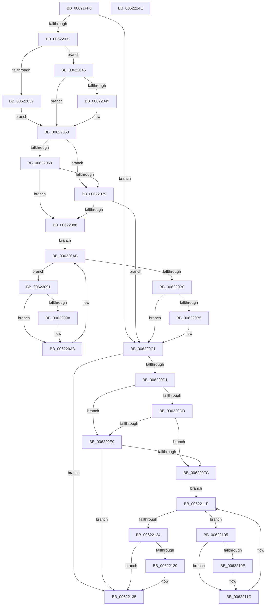

# DifExReleaseDisownedFastResourceExclusiveWrapper

- RVA: `0x00621FF0`–`0x0062214F` (길이 `351` bytes)
- VA: `0x0000000140621FF0`
- 실행 섹션: `.text`
- PDB 이름 있음: `예`; PDB Function 태그: `아니요`
- unwind 정보 RVA: `0x00093E28`
- 디코드: `97`개 명령, `351/351` bytes 표시
- 미해석 바이트: `0` (있으면 어셈블리에 `.byte`로 보존)

> 이 문서는 커널 이미지의 기계어와 PDB 기호를 분석해 생성했습니다. 4번과 5번은 함수 원형과 자료형을 바이너리 사용 방식에서 추정한 C 해석이며 원본 소스 복구 결과는 아닙니다.

## 1. Dependencies

- 직접 호출 지점: **9**; 고유 호출 대상: **6**
- 직접 호출자로 확인된 함수: **0**
- RIP 상대 이미지 참조: **3**

### Outgoing calls
- `0x00622021` → [DifGetAPIThunkContextById](../49/DifGetAPIThunkContextById_function_00495A34.md) (function, `0x00495A34`)
- `0x00622049` → [DifGetReturnAddressForWrappers](../4D/DifGetReturnAddressForWrappers_function_004D3C08.md) (function, `0x004D3C08`)
- `0x0062207C` → [ExAcquireRundownProtection](../21/ExAcquireRundownProtection_function_00216620.md) (function, `0x00216620`)
- `0x006220A3` → [guard_dispatch_icall](../6B/guard_dispatch_icall_function_006BAAD0.md) (function, `0x006BAAD0`)
- `0x006220BC` → [ExReleaseRundownProtection](../34/ExReleaseRundownProtection_function_00349E80.md) (function, `0x00349E80`)
- `0x006220C7` → [ExReleaseDisownedFastResourceExclusive](../65/ExReleaseDisownedFastResourceExclusive_function_006586D0.md) (function, `0x006586D0`)
- `0x006220F0` → [ExAcquireRundownProtection](../21/ExAcquireRundownProtection_function_00216620.md) (function, `0x00216620`)
- `0x00622117` → [guard_dispatch_icall](../6B/guard_dispatch_icall_function_006BAAD0.md) (function, `0x006BAAD0`)
- `0x00622130` → [ExReleaseRundownProtection](../34/ExReleaseRundownProtection_function_00349E80.md) (function, `0x00349E80`)

### Direct callers
- 이 함수 시작 RVA로 연결되는 직접 call은 확인되지 않았습니다. 간접 호출은 완전히 역산할 수 없습니다.

### Static image references
- `0x0062205B` → RVA `0x00F048B8` (`.data`; read)
- `0x00622069` → RVA `0x00F04980` (`.data`; read)
- `0x00622075` → RVA `0x00F03E80` (`.data`; read)

## 2. Other-region calls and transfers

- 다른 실행 섹션으로 향하는 call: **0**
- 별도 외부 분기/꼬리 이동을 확인하지 못했습니다.

## 3. Assembly (complete function range)

```asm
00621FF0  4C 8B DC                        mov r11, rsp
00621FF3  49 89 5B 08                     mov qword ptr [r11 + 8], rbx
00621FF7  49 89 6B 10                     mov qword ptr [r11 + 0x10], rbp
00621FFB  49 89 73 18                     mov qword ptr [r11 + 0x18], rsi
00621FFF  57                              push rdi
00622000  41 56                           push r14
00622002  41 57                           push r15
00622004  48 83 EC 40                     sub rsp, 0x40
00622008  33 C0                           xor eax, eax
0062200A  0F 57 C0                        xorps xmm0, xmm0
0062200D  0F 11 44 24 20                  movups xmmword ptr [rsp + 0x20], xmm0
00622012  4C 8B F9                        mov r15, rcx
00622015  49 89 43 D8                     mov qword ptr [r11 - 0x28], rax
00622019  B9 C7 01 00 00                  mov ecx, 0x1c7
0062201E  4C 8B F2                        mov r14, rdx
00622021  E8 0E 3A E7 FF                  call 0x140495a34
00622026  48 8B F0                        mov rsi, rax
00622029  48 85 C0                        test rax, rax
0062202C  0F 84 8F 00 00 00               je 0x1406220c1
00622032  8B 40 0C                        mov eax, dword ptr [rax + 0xc]
00622035  A8 18                           test al, 0x18
00622037  74 0C                           je 0x140622045
00622039  48 8B 4C 24 58                  mov rcx, qword ptr [rsp + 0x58]
0062203E  48 89 4C 24 20                  mov qword ptr [rsp + 0x20], rcx
00622043  EB 0E                           jmp 0x140622053
00622045  A8 04                           test al, 4
00622047  74 0A                           je 0x140622053
00622049  E8 BA 1B EB FF                  call 0x1404d3c08
0062204E  48 89 44 24 20                  mov qword ptr [rsp + 0x20], rax
00622053  40 32 ED                        xor bpl, bpl
00622056  4C 89 7C 24 30                  mov qword ptr [rsp + 0x30], r15
0062205B  40 38 2D 56 28 8E 00            cmp byte ptr [rip + 0x8e2856], bpl
00622062  4C 89 74 24 28                  mov qword ptr [rsp + 0x28], r14
00622067  75 0C                           jne 0x140622075
00622069  F7 05 0D 29 8E 00 00 08 00 00   test dword ptr [rip + 0x8e290d], 0x800
00622073  74 13                           je 0x140622088
00622075  48 8D 0D 04 1E 8E 00            lea rcx, [rip + 0x8e1e04]
0062207C  E8 9F 45 BF FF                  call 0x140216620
00622081  40 8A E8                        mov bpl, al
00622084  84 C0                           test al, al
00622086  74 39                           je 0x1406220c1
00622088  48 8D 7E 20                     lea rdi, [rsi + 0x20]
0062208C  48 8B 1F                        mov rbx, qword ptr [rdi]
0062208F  EB 1A                           jmp 0x1406220ab
00622091  48 8D 43 F0                     lea rax, [rbx - 0x10]
00622095  48 85 C0                        test rax, rax
00622098  74 0E                           je 0x1406220a8
0062209A  48 8B 40 08                     mov rax, qword ptr [rax + 8]
0062209E  48 8D 4C 24 20                  lea rcx, [rsp + 0x20]
006220A3  E8 28 8A 09 00                  call 0x1406baad0
006220A8  48 8B 1B                        mov rbx, qword ptr [rbx]
006220AB  48 3B DF                        cmp rbx, rdi
006220AE  75 E1                           jne 0x140622091
006220B0  40 84 ED                        test bpl, bpl
006220B3  74 0C                           je 0x1406220c1
006220B5  48 8D 0D C4 1D 8E 00            lea rcx, [rip + 0x8e1dc4]
006220BC  E8 BF 7D D2 FF                  call 0x140349e80
006220C1  49 8B D6                        mov rdx, r14
006220C4  49 8B CF                        mov rcx, r15
006220C7  E8 04 66 03 00                  call 0x1406586d0
006220CC  48 85 F6                        test rsi, rsi
006220CF  74 64                           je 0x140622135
006220D1  40 32 FF                        xor dil, dil
006220D4  40 38 3D DD 27 8E 00            cmp byte ptr [rip + 0x8e27dd], dil
006220DB  75 0C                           jne 0x1406220e9
006220DD  F7 05 99 28 8E 00 00 08 00 00   test dword ptr [rip + 0x8e2899], 0x800
006220E7  74 13                           je 0x1406220fc
006220E9  48 8D 0D 90 1D 8E 00            lea rcx, [rip + 0x8e1d90]
006220F0  E8 2B 45 BF FF                  call 0x140216620
006220F5  40 8A F8                        mov dil, al
006220F8  84 C0                           test al, al
006220FA  74 39                           je 0x140622135
006220FC  48 83 C6 30                     add rsi, 0x30
00622100  48 8B 1E                        mov rbx, qword ptr [rsi]
00622103  EB 1A                           jmp 0x14062211f
00622105  48 8D 43 F0                     lea rax, [rbx - 0x10]
00622109  48 85 C0                        test rax, rax
0062210C  74 0E                           je 0x14062211c
0062210E  48 8B 40 08                     mov rax, qword ptr [rax + 8]
00622112  48 8D 4C 24 20                  lea rcx, [rsp + 0x20]
00622117  E8 B4 89 09 00                  call 0x1406baad0
0062211C  48 8B 1B                        mov rbx, qword ptr [rbx]
0062211F  48 3B DE                        cmp rbx, rsi
00622122  75 E1                           jne 0x140622105
00622124  40 84 FF                        test dil, dil
00622127  74 0C                           je 0x140622135
00622129  48 8D 0D 50 1D 8E 00            lea rcx, [rip + 0x8e1d50]
00622130  E8 4B 7D D2 FF                  call 0x140349e80
00622135  48 8B 5C 24 60                  mov rbx, qword ptr [rsp + 0x60]
0062213A  48 8B 6C 24 68                  mov rbp, qword ptr [rsp + 0x68]
0062213F  48 8B 74 24 70                  mov rsi, qword ptr [rsp + 0x70]
00622144  48 83 C4 40                     add rsp, 0x40
00622148  41 5F                           pop r15
0062214A  41 5E                           pop r14
0062214C  5F                              pop rdi
0062214D  C3                              ret
0062214E  CC                              int3
```

## 4. C-style interpretation (structured pseudocode)

```c
__int64 __fastcall DifExReleaseDisownedFastResourceExclusiveWrapper(__int64 a1, __int64 a2)
{
    __int64 result;
    __int64 v_rbp;
    __int64 v_rdi;
    __int64 v_rsi;
    __int64 v_rsp;
    unsigned __int64 v_stack_m28;
    unsigned __int64 v_stack_m30;
    unsigned __int64 v_stack_m38;
    unsigned __int64 v_stack_p0;
    unsigned __int64 v_stack_p10;
    unsigned __int64 v_stack_p18;
    unsigned __int64 v_stack_p8;

    *(unsigned __int64 *)(v_rsp + 8) = v_rbx;
    *(unsigned __int64 *)(v_rsp + 16) = v_rbp;
    *(unsigned __int64 *)(v_rsp + 24) = v_rsi;
    v_rsp = (v_rsp) - (64);
    result = 0;
    v_stack_m38 = v_xmm0;
    *(unsigned __int64 *)(v_rsp - 40) = 0;
    result = DifGetAPIThunkContextById(455, a2, a3, a4);
    if (result == 0) goto loc_006220C1;
    if ((((unsigned __int8)((unsigned int)(*(unsigned int *)(result + 12)))) & (24)) == 0) goto loc_00622045;
    v_stack_m38 = v_stack_p0;
    goto loc_00622053;
loc_00622045:
    result = (unsigned int)(*(unsigned int *)(result + 12));
    if ((((unsigned __int8)((unsigned int)(*(unsigned int *)(result + 12)))) & (4)) != 0) {
        result = DifGetReturnAddressForWrappers(v_stack_p0, a2, a3, a4);
        v_stack_m38 = result;
    }
    v_rbp = 0;
    v_stack_m28 = a1;
    v_stack_m30 = a2;
    if ((*(unsigned __int8 *)(v_rip + 9316438)) != 0) goto loc_00622075;
    if (((*(unsigned int *)(v_rip + 9316621)) & (0x800ULL)) == 0) goto loc_00622088;
loc_00622075:
    result = ExAcquireRundownProtection(v_rip + 9313796, a2, a3, a4);
    if ((unsigned __int8)(result) == 0) goto loc_006220C1;
loc_00622088:
    goto loc_006220AB;
loc_00622091:
    result = *(unsigned __int64 *)(result + 32) - 16;
    if (*(unsigned __int64 *)(result + 32) - 16 != 0) {
        result = *(unsigned __int64 *)(*(unsigned __int64 *)(result + 32) - 16 + 8);
        a1 = v_stack_m38;
        result = guard_dispatch_icall(a1, a2, a3, a4);
    }
loc_006220AB:
    if ((*(unsigned __int64 *)(*(unsigned __int64 *)(result + 32))) != (result + 32)) goto loc_00622091;
    if ((unsigned __int8)((unsigned __int8)(result)) != 0) {
        a1 = v_rip + 9313732;
        result = ExReleaseRundownProtection(a1, a2, a3, a4);
    }
    result = ExReleaseDisownedFastResourceExclusive(a1, a2, a3, a4);
    if (result == 0) goto loc_00622135;
    v_rdi = 0;
    if ((*(unsigned __int8 *)(v_rip + 9316317)) != 0) goto loc_006220E9;
    if (((*(unsigned int *)(v_rip + 9316505)) & (0x800ULL)) == 0) goto loc_006220FC;
loc_006220E9:
    result = ExAcquireRundownProtection(v_rip + 9313680, a2, a3, a4);
    if ((unsigned __int8)(result) == 0) goto loc_00622135;
loc_006220FC:
    v_rsi = (result) + (48);
    goto loc_0062211F;
loc_00622105:
    result = *(unsigned __int64 *)(v_rsi) - 16;
    if (*(unsigned __int64 *)(v_rsi) - 16 != 0) {
        result = *(unsigned __int64 *)(*(unsigned __int64 *)(v_rsi) - 16 + 8);
        a1 = v_stack_m38;
        result = guard_dispatch_icall(a1, a2, a3, a4);
    }
loc_0062211F:
    if ((*(unsigned __int64 *)(*(unsigned __int64 *)(v_rsi))) != v_rsi) goto loc_00622105;
    if ((unsigned __int8)((unsigned __int8)(result)) != 0) {
        a1 = v_rip + 9313616;
        result = ExReleaseRundownProtection(a1, a2, a3, a4);
    }
    v_rsp = (v_rsp) + (64);
    return result;
}
```

## 5. (Beta) C Style

```c
int64_t DifExReleaseDisownedFastResourceExclusiveWrapper(int64_t Arg1, int64_t Arg2)
{
    int64_t result;
    int64_t local_rbp;
    int64_t local_rdi;
    int64_t local_rsi;
    int64_t local_rsp;
    uint64_t v_stack_m28;
    uint64_t v_stack_m30;
    uint64_t v_stack_m38;
    uint64_t v_stack_p0;
    uint64_t v_stack_p10;
    uint64_t v_stack_p18;
    uint64_t v_stack_p8;

    *(uint64_t *)(local_rsp + 0x8) = local_rbx;
    *(uint64_t *)(local_rsp + 0x10) = local_rbp;
    *(uint64_t *)(local_rsp + 0x18) = local_rsi;
    local_rsp = (local_rsp) - (64);
    result = 0;
    v_stack_m38 = v_xmm0;
    *(uint64_t *)(local_rsp - 0x28) = 0;
    result = DifGetAPIThunkContextById(455, Arg2, a3, a4);
    if (result == 0) goto loc_006220C1;
    if ((((uint8_t)((uint32_t)(*(uint32_t *)(result + 0xC)))) & (24)) == 0) goto loc_00622045;
    v_stack_m38 = v_stack_p0;
    goto loc_00622053;
loc_00622045:
    result = (uint32_t)(*(uint32_t *)(result + 0xC));
    if ((((uint8_t)((uint32_t)(*(uint32_t *)(result + 0xC)))) & (4)) != 0) {
        result = DifGetReturnAddressForWrappers(v_stack_p0, Arg2, a3, a4);
        v_stack_m38 = result;
    }
    local_rbp = 0;
    v_stack_m28 = Arg1;
    v_stack_m30 = Arg2;
    if ((*(uint8_t *)(v_rip + 0x8E2856)) != 0) goto loc_00622075;
    if (((*(uint32_t *)(v_rip + 0x8E290D)) & (0x800ULL)) == 0) goto loc_00622088;
loc_00622075:
    result = ExAcquireRundownProtection(v_rip + 9313796, Arg2, a3, a4);
    if ((uint8_t)(result) == 0) goto loc_006220C1;
loc_00622088:
    goto loc_006220AB;
loc_00622091:
    result = *(uint64_t *)(result + 0x20) - 16;
    if (*(uint64_t *)(result + 0x20) - 16 != 0) {
        result = *(uint64_t *)(*(uint64_t *)(result + 0x20) - 0x10 + 0x8);
        Arg1 = v_stack_m38;
        result = guard_dispatch_icall(Arg1, Arg2, a3, a4);
    }
loc_006220AB:
    if ((*(uint64_t *)(*(uint64_t *)(result + 0x20))) != (result + 32)) goto loc_00622091;
    if ((uint8_t)((uint8_t)(result)) != 0) {
        Arg1 = v_rip + 9313732;
        result = ExReleaseRundownProtection(Arg1, Arg2, a3, a4);
    }
    result = ExReleaseDisownedFastResourceExclusive(Arg1, Arg2, a3, a4);
    if (result == 0) goto loc_00622135;
    local_rdi = 0;
    if ((*(uint8_t *)(v_rip + 0x8E27DD)) != 0) goto loc_006220E9;
    if (((*(uint32_t *)(v_rip + 0x8E2899)) & (0x800ULL)) == 0) goto loc_006220FC;
loc_006220E9:
    result = ExAcquireRundownProtection(v_rip + 9313680, Arg2, a3, a4);
    if ((uint8_t)(result) == 0) goto loc_00622135;
loc_006220FC:
    local_rsi = (result) + (48);
    goto loc_0062211F;
loc_00622105:
    result = *(uint64_t *)(local_rsi) - 16;
    if (*(uint64_t *)(local_rsi) - 16 != 0) {
        result = *(uint64_t *)(*(uint64_t *)(local_rsi) - 0x10 + 0x8);
        Arg1 = v_stack_m38;
        result = guard_dispatch_icall(Arg1, Arg2, a3, a4);
    }
loc_0062211F:
    if ((*(uint64_t *)(*(uint64_t *)(local_rsi))) != local_rsi) goto loc_00622105;
    if ((uint8_t)((uint8_t)(result)) != 0) {
        Arg1 = v_rip + 9313616;
        result = ExReleaseRundownProtection(Arg1, Arg2, a3, a4);
    }
    local_rsp = (local_rsp) + (64);
    return result;
}
```

## 6. Execution-region graph

[열기: 2D/3D 그래프와 함수 탐색 컨트롤 패널](../../../control-panel.html?section=text&rva=0x00621FF0&view=graph)

- 2D 그래프는 위에서 아래로 흐르고, 3D 그래프는 빈 공간을 드래그해 회전합니다. Shift+드래그는 이동, 휠은 확대·축소, 함수 노드 선택은 대상 보고서 이동입니다.

### Static fallback


