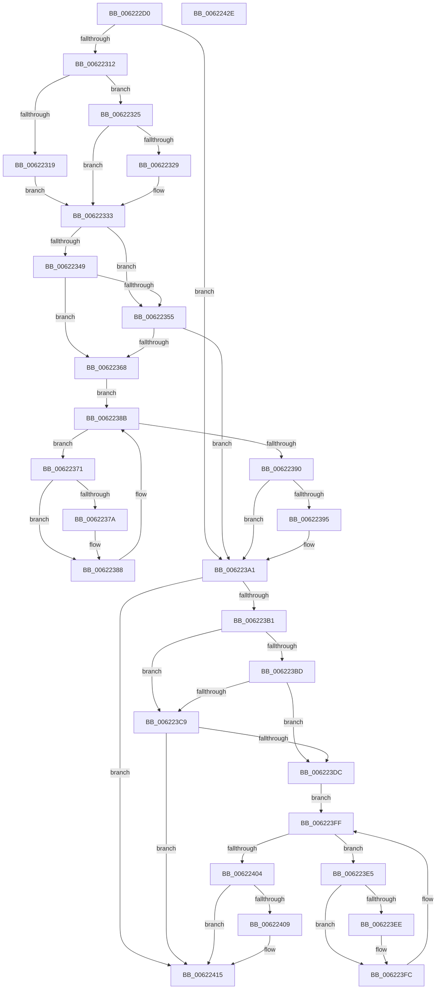

# DifExReleaseDisownedFastResourceWrapper

- RVA: `0x006222D0`–`0x0062242F` (길이 `351` bytes)
- VA: `0x00000001406222D0`
- 실행 섹션: `.text`
- PDB 이름 있음: `예`; PDB Function 태그: `아니요`
- unwind 정보 RVA: `0x00093E28`
- 디코드: `97`개 명령, `351/351` bytes 표시
- 미해석 바이트: `0` (있으면 어셈블리에 `.byte`로 보존)

> 이 문서는 커널 이미지의 기계어와 PDB 기호를 분석해 생성했습니다. 4번과 5번은 함수 원형과 자료형을 바이너리 사용 방식에서 추정한 C 해석이며 원본 소스 복구 결과는 아닙니다.

## 1. Dependencies

- 직접 호출 지점: **9**; 고유 호출 대상: **6**
- 직접 호출자로 확인된 함수: **0**
- RIP 상대 이미지 참조: **3**

### Outgoing calls
- `0x00622301` → [DifGetAPIThunkContextById](../49/DifGetAPIThunkContextById_function_00495A34.md) (function, `0x00495A34`)
- `0x00622329` → [DifGetReturnAddressForWrappers](../4D/DifGetReturnAddressForWrappers_function_004D3C08.md) (function, `0x004D3C08`)
- `0x0062235C` → [ExAcquireRundownProtection](../21/ExAcquireRundownProtection_function_00216620.md) (function, `0x00216620`)
- `0x00622383` → [guard_dispatch_icall](../6B/guard_dispatch_icall_function_006BAAD0.md) (function, `0x006BAAD0`)
- `0x0062239C` → [ExReleaseRundownProtection](../34/ExReleaseRundownProtection_function_00349E80.md) (function, `0x00349E80`)
- `0x006223A7` → [ExReleaseDisownedFastResource](../41/ExReleaseDisownedFastResource_function_00416230.md) (function, `0x00416230`)
- `0x006223D0` → [ExAcquireRundownProtection](../21/ExAcquireRundownProtection_function_00216620.md) (function, `0x00216620`)
- `0x006223F7` → [guard_dispatch_icall](../6B/guard_dispatch_icall_function_006BAAD0.md) (function, `0x006BAAD0`)
- `0x00622410` → [ExReleaseRundownProtection](../34/ExReleaseRundownProtection_function_00349E80.md) (function, `0x00349E80`)

### Direct callers
- 이 함수 시작 RVA로 연결되는 직접 call은 확인되지 않았습니다. 간접 호출은 완전히 역산할 수 없습니다.

### Static image references
- `0x0062233B` → RVA `0x00F048B8` (`.data`; read)
- `0x00622349` → RVA `0x00F04980` (`.data`; read)
- `0x00622355` → RVA `0x00F03E80` (`.data`; read)

## 2. Other-region calls and transfers

- 다른 실행 섹션으로 향하는 call: **0**
- 별도 외부 분기/꼬리 이동을 확인하지 못했습니다.

## 3. Assembly (complete function range)

```asm
006222D0  4C 8B DC                        mov r11, rsp
006222D3  49 89 5B 08                     mov qword ptr [r11 + 8], rbx
006222D7  49 89 6B 10                     mov qword ptr [r11 + 0x10], rbp
006222DB  49 89 73 18                     mov qword ptr [r11 + 0x18], rsi
006222DF  57                              push rdi
006222E0  41 56                           push r14
006222E2  41 57                           push r15
006222E4  48 83 EC 40                     sub rsp, 0x40
006222E8  33 C0                           xor eax, eax
006222EA  0F 57 C0                        xorps xmm0, xmm0
006222ED  0F 11 44 24 20                  movups xmmword ptr [rsp + 0x20], xmm0
006222F2  4C 8B F9                        mov r15, rcx
006222F5  49 89 43 D8                     mov qword ptr [r11 - 0x28], rax
006222F9  B9 C8 01 00 00                  mov ecx, 0x1c8
006222FE  4C 8B F2                        mov r14, rdx
00622301  E8 2E 37 E7 FF                  call 0x140495a34
00622306  48 8B F0                        mov rsi, rax
00622309  48 85 C0                        test rax, rax
0062230C  0F 84 8F 00 00 00               je 0x1406223a1
00622312  8B 40 0C                        mov eax, dword ptr [rax + 0xc]
00622315  A8 18                           test al, 0x18
00622317  74 0C                           je 0x140622325
00622319  48 8B 4C 24 58                  mov rcx, qword ptr [rsp + 0x58]
0062231E  48 89 4C 24 20                  mov qword ptr [rsp + 0x20], rcx
00622323  EB 0E                           jmp 0x140622333
00622325  A8 04                           test al, 4
00622327  74 0A                           je 0x140622333
00622329  E8 DA 18 EB FF                  call 0x1404d3c08
0062232E  48 89 44 24 20                  mov qword ptr [rsp + 0x20], rax
00622333  40 32 ED                        xor bpl, bpl
00622336  4C 89 7C 24 30                  mov qword ptr [rsp + 0x30], r15
0062233B  40 38 2D 76 25 8E 00            cmp byte ptr [rip + 0x8e2576], bpl
00622342  4C 89 74 24 28                  mov qword ptr [rsp + 0x28], r14
00622347  75 0C                           jne 0x140622355
00622349  F7 05 2D 26 8E 00 00 08 00 00   test dword ptr [rip + 0x8e262d], 0x800
00622353  74 13                           je 0x140622368
00622355  48 8D 0D 24 1B 8E 00            lea rcx, [rip + 0x8e1b24]
0062235C  E8 BF 42 BF FF                  call 0x140216620
00622361  40 8A E8                        mov bpl, al
00622364  84 C0                           test al, al
00622366  74 39                           je 0x1406223a1
00622368  48 8D 7E 20                     lea rdi, [rsi + 0x20]
0062236C  48 8B 1F                        mov rbx, qword ptr [rdi]
0062236F  EB 1A                           jmp 0x14062238b
00622371  48 8D 43 F0                     lea rax, [rbx - 0x10]
00622375  48 85 C0                        test rax, rax
00622378  74 0E                           je 0x140622388
0062237A  48 8B 40 08                     mov rax, qword ptr [rax + 8]
0062237E  48 8D 4C 24 20                  lea rcx, [rsp + 0x20]
00622383  E8 48 87 09 00                  call 0x1406baad0
00622388  48 8B 1B                        mov rbx, qword ptr [rbx]
0062238B  48 3B DF                        cmp rbx, rdi
0062238E  75 E1                           jne 0x140622371
00622390  40 84 ED                        test bpl, bpl
00622393  74 0C                           je 0x1406223a1
00622395  48 8D 0D E4 1A 8E 00            lea rcx, [rip + 0x8e1ae4]
0062239C  E8 DF 7A D2 FF                  call 0x140349e80
006223A1  49 8B D6                        mov rdx, r14
006223A4  49 8B CF                        mov rcx, r15
006223A7  E8 84 3E DF FF                  call 0x140416230
006223AC  48 85 F6                        test rsi, rsi
006223AF  74 64                           je 0x140622415
006223B1  40 32 FF                        xor dil, dil
006223B4  40 38 3D FD 24 8E 00            cmp byte ptr [rip + 0x8e24fd], dil
006223BB  75 0C                           jne 0x1406223c9
006223BD  F7 05 B9 25 8E 00 00 08 00 00   test dword ptr [rip + 0x8e25b9], 0x800
006223C7  74 13                           je 0x1406223dc
006223C9  48 8D 0D B0 1A 8E 00            lea rcx, [rip + 0x8e1ab0]
006223D0  E8 4B 42 BF FF                  call 0x140216620
006223D5  40 8A F8                        mov dil, al
006223D8  84 C0                           test al, al
006223DA  74 39                           je 0x140622415
006223DC  48 83 C6 30                     add rsi, 0x30
006223E0  48 8B 1E                        mov rbx, qword ptr [rsi]
006223E3  EB 1A                           jmp 0x1406223ff
006223E5  48 8D 43 F0                     lea rax, [rbx - 0x10]
006223E9  48 85 C0                        test rax, rax
006223EC  74 0E                           je 0x1406223fc
006223EE  48 8B 40 08                     mov rax, qword ptr [rax + 8]
006223F2  48 8D 4C 24 20                  lea rcx, [rsp + 0x20]
006223F7  E8 D4 86 09 00                  call 0x1406baad0
006223FC  48 8B 1B                        mov rbx, qword ptr [rbx]
006223FF  48 3B DE                        cmp rbx, rsi
00622402  75 E1                           jne 0x1406223e5
00622404  40 84 FF                        test dil, dil
00622407  74 0C                           je 0x140622415
00622409  48 8D 0D 70 1A 8E 00            lea rcx, [rip + 0x8e1a70]
00622410  E8 6B 7A D2 FF                  call 0x140349e80
00622415  48 8B 5C 24 60                  mov rbx, qword ptr [rsp + 0x60]
0062241A  48 8B 6C 24 68                  mov rbp, qword ptr [rsp + 0x68]
0062241F  48 8B 74 24 70                  mov rsi, qword ptr [rsp + 0x70]
00622424  48 83 C4 40                     add rsp, 0x40
00622428  41 5F                           pop r15
0062242A  41 5E                           pop r14
0062242C  5F                              pop rdi
0062242D  C3                              ret
0062242E  CC                              int3
```

## 4. C-style interpretation (structured pseudocode)

```c
__int64 __fastcall DifExReleaseDisownedFastResourceWrapper(__int64 a1, __int64 a2)
{
    __int64 result;
    __int64 v_rbp;
    __int64 v_rdi;
    __int64 v_rsi;
    __int64 v_rsp;
    unsigned __int64 v_stack_m28;
    unsigned __int64 v_stack_m30;
    unsigned __int64 v_stack_m38;
    unsigned __int64 v_stack_p0;
    unsigned __int64 v_stack_p10;
    unsigned __int64 v_stack_p18;
    unsigned __int64 v_stack_p8;

    *(unsigned __int64 *)(v_rsp + 8) = v_rbx;
    *(unsigned __int64 *)(v_rsp + 16) = v_rbp;
    *(unsigned __int64 *)(v_rsp + 24) = v_rsi;
    v_rsp = (v_rsp) - (64);
    result = 0;
    v_stack_m38 = v_xmm0;
    *(unsigned __int64 *)(v_rsp - 40) = 0;
    result = DifGetAPIThunkContextById(456, a2, a3, a4);
    if (result == 0) goto loc_006223A1;
    if ((((unsigned __int8)((unsigned int)(*(unsigned int *)(result + 12)))) & (24)) == 0) goto loc_00622325;
    v_stack_m38 = v_stack_p0;
    goto loc_00622333;
loc_00622325:
    result = (unsigned int)(*(unsigned int *)(result + 12));
    if ((((unsigned __int8)((unsigned int)(*(unsigned int *)(result + 12)))) & (4)) != 0) {
        result = DifGetReturnAddressForWrappers(v_stack_p0, a2, a3, a4);
        v_stack_m38 = result;
    }
    v_rbp = 0;
    v_stack_m28 = a1;
    v_stack_m30 = a2;
    if ((*(unsigned __int8 *)(v_rip + 9315702)) != 0) goto loc_00622355;
    if (((*(unsigned int *)(v_rip + 9315885)) & (0x800ULL)) == 0) goto loc_00622368;
loc_00622355:
    result = ExAcquireRundownProtection(v_rip + 9313060, a2, a3, a4);
    if ((unsigned __int8)(result) == 0) goto loc_006223A1;
loc_00622368:
    goto loc_0062238B;
loc_00622371:
    result = *(unsigned __int64 *)(result + 32) - 16;
    if (*(unsigned __int64 *)(result + 32) - 16 != 0) {
        result = *(unsigned __int64 *)(*(unsigned __int64 *)(result + 32) - 16 + 8);
        a1 = v_stack_m38;
        result = guard_dispatch_icall(a1, a2, a3, a4);
    }
loc_0062238B:
    if ((*(unsigned __int64 *)(*(unsigned __int64 *)(result + 32))) != (result + 32)) goto loc_00622371;
    if ((unsigned __int8)((unsigned __int8)(result)) != 0) {
        a1 = v_rip + 9312996;
        result = ExReleaseRundownProtection(a1, a2, a3, a4);
    }
    result = ExReleaseDisownedFastResource(a1, a2, a3, a4);
    if (result == 0) goto loc_00622415;
    v_rdi = 0;
    if ((*(unsigned __int8 *)(v_rip + 9315581)) != 0) goto loc_006223C9;
    if (((*(unsigned int *)(v_rip + 9315769)) & (0x800ULL)) == 0) goto loc_006223DC;
loc_006223C9:
    result = ExAcquireRundownProtection(v_rip + 9312944, a2, a3, a4);
    if ((unsigned __int8)(result) == 0) goto loc_00622415;
loc_006223DC:
    v_rsi = (result) + (48);
    goto loc_006223FF;
loc_006223E5:
    result = *(unsigned __int64 *)(v_rsi) - 16;
    if (*(unsigned __int64 *)(v_rsi) - 16 != 0) {
        result = *(unsigned __int64 *)(*(unsigned __int64 *)(v_rsi) - 16 + 8);
        a1 = v_stack_m38;
        result = guard_dispatch_icall(a1, a2, a3, a4);
    }
loc_006223FF:
    if ((*(unsigned __int64 *)(*(unsigned __int64 *)(v_rsi))) != v_rsi) goto loc_006223E5;
    if ((unsigned __int8)((unsigned __int8)(result)) != 0) {
        a1 = v_rip + 9312880;
        result = ExReleaseRundownProtection(a1, a2, a3, a4);
    }
    v_rsp = (v_rsp) + (64);
    return result;
}
```

## 5. (Beta) C Style

```c
int64_t DifExReleaseDisownedFastResourceWrapper(int64_t Arg1, int64_t Arg2)
{
    int64_t result;
    int64_t local_rbp;
    int64_t local_rdi;
    int64_t local_rsi;
    int64_t local_rsp;
    uint64_t v_stack_m28;
    uint64_t v_stack_m30;
    uint64_t v_stack_m38;
    uint64_t v_stack_p0;
    uint64_t v_stack_p10;
    uint64_t v_stack_p18;
    uint64_t v_stack_p8;

    *(uint64_t *)(local_rsp + 0x8) = local_rbx;
    *(uint64_t *)(local_rsp + 0x10) = local_rbp;
    *(uint64_t *)(local_rsp + 0x18) = local_rsi;
    local_rsp = (local_rsp) - (64);
    result = 0;
    v_stack_m38 = v_xmm0;
    *(uint64_t *)(local_rsp - 0x28) = 0;
    result = DifGetAPIThunkContextById(456, Arg2, a3, a4);
    if (result == 0) goto loc_006223A1;
    if ((((uint8_t)((uint32_t)(*(uint32_t *)(result + 0xC)))) & (24)) == 0) goto loc_00622325;
    v_stack_m38 = v_stack_p0;
    goto loc_00622333;
loc_00622325:
    result = (uint32_t)(*(uint32_t *)(result + 0xC));
    if ((((uint8_t)((uint32_t)(*(uint32_t *)(result + 0xC)))) & (4)) != 0) {
        result = DifGetReturnAddressForWrappers(v_stack_p0, Arg2, a3, a4);
        v_stack_m38 = result;
    }
    local_rbp = 0;
    v_stack_m28 = Arg1;
    v_stack_m30 = Arg2;
    if ((*(uint8_t *)(v_rip + 0x8E2576)) != 0) goto loc_00622355;
    if (((*(uint32_t *)(v_rip + 0x8E262D)) & (0x800ULL)) == 0) goto loc_00622368;
loc_00622355:
    result = ExAcquireRundownProtection(v_rip + 9313060, Arg2, a3, a4);
    if ((uint8_t)(result) == 0) goto loc_006223A1;
loc_00622368:
    goto loc_0062238B;
loc_00622371:
    result = *(uint64_t *)(result + 0x20) - 16;
    if (*(uint64_t *)(result + 0x20) - 16 != 0) {
        result = *(uint64_t *)(*(uint64_t *)(result + 0x20) - 0x10 + 0x8);
        Arg1 = v_stack_m38;
        result = guard_dispatch_icall(Arg1, Arg2, a3, a4);
    }
loc_0062238B:
    if ((*(uint64_t *)(*(uint64_t *)(result + 0x20))) != (result + 32)) goto loc_00622371;
    if ((uint8_t)((uint8_t)(result)) != 0) {
        Arg1 = v_rip + 9312996;
        result = ExReleaseRundownProtection(Arg1, Arg2, a3, a4);
    }
    result = ExReleaseDisownedFastResource(Arg1, Arg2, a3, a4);
    if (result == 0) goto loc_00622415;
    local_rdi = 0;
    if ((*(uint8_t *)(v_rip + 0x8E24FD)) != 0) goto loc_006223C9;
    if (((*(uint32_t *)(v_rip + 0x8E25B9)) & (0x800ULL)) == 0) goto loc_006223DC;
loc_006223C9:
    result = ExAcquireRundownProtection(v_rip + 9312944, Arg2, a3, a4);
    if ((uint8_t)(result) == 0) goto loc_00622415;
loc_006223DC:
    local_rsi = (result) + (48);
    goto loc_006223FF;
loc_006223E5:
    result = *(uint64_t *)(local_rsi) - 16;
    if (*(uint64_t *)(local_rsi) - 16 != 0) {
        result = *(uint64_t *)(*(uint64_t *)(local_rsi) - 0x10 + 0x8);
        Arg1 = v_stack_m38;
        result = guard_dispatch_icall(Arg1, Arg2, a3, a4);
    }
loc_006223FF:
    if ((*(uint64_t *)(*(uint64_t *)(local_rsi))) != local_rsi) goto loc_006223E5;
    if ((uint8_t)((uint8_t)(result)) != 0) {
        Arg1 = v_rip + 9312880;
        result = ExReleaseRundownProtection(Arg1, Arg2, a3, a4);
    }
    local_rsp = (local_rsp) + (64);
    return result;
}
```

## 6. Execution-region graph

[열기: 2D/3D 그래프와 함수 탐색 컨트롤 패널](../../../control-panel.html?section=text&rva=0x006222D0&view=graph)

- 2D 그래프는 위에서 아래로 흐르고, 3D 그래프는 빈 공간을 드래그해 회전합니다. Shift+드래그는 이동, 휠은 확대·축소, 함수 노드 선택은 대상 보고서 이동입니다.

### Static fallback


