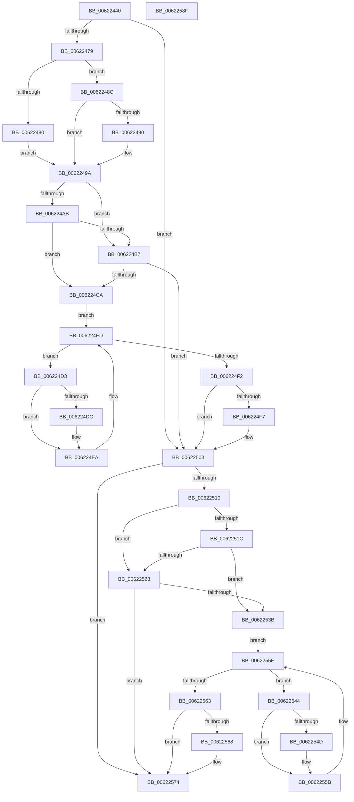

# DifExReleaseFastMutexUnsafeWrapper

- RVA: `0x00622440`–`0x00622590` (길이 `336` bytes)
- VA: `0x0000000140622440`
- 실행 섹션: `.text`
- PDB 이름 있음: `예`; PDB Function 태그: `아니요`
- unwind 정보 RVA: `0x0005D7BC`
- 디코드: `90`개 명령, `336/336` bytes 표시
- 미해석 바이트: `0` (있으면 어셈블리에 `.byte`로 보존)

> 이 문서는 커널 이미지의 기계어와 PDB 기호를 분석해 생성했습니다. 4번과 5번은 함수 원형과 자료형을 바이너리 사용 방식에서 추정한 C 해석이며 원본 소스 복구 결과는 아닙니다.

## 1. Dependencies

- 직접 호출 지점: **9**; 고유 호출 대상: **6**
- 직접 호출자로 확인된 함수: **0**
- RIP 상대 이미지 참조: **3**

### Outgoing calls
- `0x00622468` → [DifGetAPIThunkContextById](../49/DifGetAPIThunkContextById_function_00495A34.md) (function, `0x00495A34`)
- `0x00622490` → [DifGetReturnAddressForWrappers](../4D/DifGetReturnAddressForWrappers_function_004D3C08.md) (function, `0x004D3C08`)
- `0x006224BE` → [ExAcquireRundownProtection](../21/ExAcquireRundownProtection_function_00216620.md) (function, `0x00216620`)
- `0x006224E5` → [guard_dispatch_icall](../6B/guard_dispatch_icall_function_006BAAD0.md) (function, `0x006BAAD0`)
- `0x006224FE` → [ExReleaseRundownProtection](../34/ExReleaseRundownProtection_function_00349E80.md) (function, `0x00349E80`)
- `0x00622506` → [ExReleaseFastMutexUnsafe](../25/ExReleaseFastMutexUnsafe_function_002503A0.md) (function, `0x002503A0`)
- `0x0062252F` → [ExAcquireRundownProtection](../21/ExAcquireRundownProtection_function_00216620.md) (function, `0x00216620`)
- `0x00622556` → [guard_dispatch_icall](../6B/guard_dispatch_icall_function_006BAAD0.md) (function, `0x006BAAD0`)
- `0x0062256F` → [ExReleaseRundownProtection](../34/ExReleaseRundownProtection_function_00349E80.md) (function, `0x00349E80`)

### Direct callers
- 이 함수 시작 RVA로 연결되는 직접 call은 확인되지 않았습니다. 간접 호출은 완전히 역산할 수 없습니다.

### Static image references
- `0x006224A2` → RVA `0x00F048B8` (`.data`; read)
- `0x006224AB` → RVA `0x00F04980` (`.data`; read)
- `0x006224B7` → RVA `0x00F03E80` (`.data`; read)

## 2. Other-region calls and transfers

- 다른 실행 섹션으로 향하는 call: **0**
- 별도 외부 분기/꼬리 이동을 확인하지 못했습니다.

## 3. Assembly (complete function range)

```asm
00622440  48 8B C4                        mov rax, rsp
00622443  48 89 58 08                     mov qword ptr [rax + 8], rbx
00622447  48 89 68 10                     mov qword ptr [rax + 0x10], rbp
0062244B  48 89 70 18                     mov qword ptr [rax + 0x18], rsi
0062244F  48 89 78 20                     mov qword ptr [rax + 0x20], rdi
00622453  41 56                           push r14
00622455  48 83 EC 30                     sub rsp, 0x30
00622459  48 8B E9                        mov rbp, rcx
0062245C  0F 57 C0                        xorps xmm0, xmm0
0062245F  B9 85 01 00 00                  mov ecx, 0x185
00622464  0F 11 40 E8                     movups xmmword ptr [rax - 0x18], xmm0
00622468  E8 C7 35 E7 FF                  call 0x140495a34
0062246D  48 8B F8                        mov rdi, rax
00622470  48 85 C0                        test rax, rax
00622473  0F 84 8A 00 00 00               je 0x140622503
00622479  8B 40 0C                        mov eax, dword ptr [rax + 0xc]
0062247C  A8 18                           test al, 0x18
0062247E  74 0C                           je 0x14062248c
00622480  48 8B 4C 24 38                  mov rcx, qword ptr [rsp + 0x38]
00622485  48 89 4C 24 20                  mov qword ptr [rsp + 0x20], rcx
0062248A  EB 0E                           jmp 0x14062249a
0062248C  A8 04                           test al, 4
0062248E  74 0A                           je 0x14062249a
00622490  E8 73 17 EB FF                  call 0x1404d3c08
00622495  48 89 44 24 20                  mov qword ptr [rsp + 0x20], rax
0062249A  40 32 F6                        xor sil, sil
0062249D  48 89 6C 24 28                  mov qword ptr [rsp + 0x28], rbp
006224A2  40 38 35 0F 24 8E 00            cmp byte ptr [rip + 0x8e240f], sil
006224A9  75 0C                           jne 0x1406224b7
006224AB  F7 05 CB 24 8E 00 00 08 00 00   test dword ptr [rip + 0x8e24cb], 0x800
006224B5  74 13                           je 0x1406224ca
006224B7  48 8D 0D C2 19 8E 00            lea rcx, [rip + 0x8e19c2]
006224BE  E8 5D 41 BF FF                  call 0x140216620
006224C3  40 8A F0                        mov sil, al
006224C6  84 C0                           test al, al
006224C8  74 39                           je 0x140622503
006224CA  4C 8D 77 20                     lea r14, [rdi + 0x20]
006224CE  49 8B 1E                        mov rbx, qword ptr [r14]
006224D1  EB 1A                           jmp 0x1406224ed
006224D3  48 8D 43 F0                     lea rax, [rbx - 0x10]
006224D7  48 85 C0                        test rax, rax
006224DA  74 0E                           je 0x1406224ea
006224DC  48 8B 40 08                     mov rax, qword ptr [rax + 8]
006224E0  48 8D 4C 24 20                  lea rcx, [rsp + 0x20]
006224E5  E8 E6 85 09 00                  call 0x1406baad0
006224EA  48 8B 1B                        mov rbx, qword ptr [rbx]
006224ED  49 3B DE                        cmp rbx, r14
006224F0  75 E1                           jne 0x1406224d3
006224F2  40 84 F6                        test sil, sil
006224F5  74 0C                           je 0x140622503
006224F7  48 8D 0D 82 19 8E 00            lea rcx, [rip + 0x8e1982]
006224FE  E8 7D 79 D2 FF                  call 0x140349e80
00622503  48 8B CD                        mov rcx, rbp
00622506  E8 95 DE C2 FF                  call 0x1402503a0
0062250B  48 85 FF                        test rdi, rdi
0062250E  74 64                           je 0x140622574
00622510  40 32 F6                        xor sil, sil
00622513  40 38 35 9E 23 8E 00            cmp byte ptr [rip + 0x8e239e], sil
0062251A  75 0C                           jne 0x140622528
0062251C  F7 05 5A 24 8E 00 00 08 00 00   test dword ptr [rip + 0x8e245a], 0x800
00622526  74 13                           je 0x14062253b
00622528  48 8D 0D 51 19 8E 00            lea rcx, [rip + 0x8e1951]
0062252F  E8 EC 40 BF FF                  call 0x140216620
00622534  40 8A F0                        mov sil, al
00622537  84 C0                           test al, al
00622539  74 39                           je 0x140622574
0062253B  48 83 C7 30                     add rdi, 0x30
0062253F  48 8B 1F                        mov rbx, qword ptr [rdi]
00622542  EB 1A                           jmp 0x14062255e
00622544  48 8D 43 F0                     lea rax, [rbx - 0x10]
00622548  48 85 C0                        test rax, rax
0062254B  74 0E                           je 0x14062255b
0062254D  48 8B 40 08                     mov rax, qword ptr [rax + 8]
00622551  48 8D 4C 24 20                  lea rcx, [rsp + 0x20]
00622556  E8 75 85 09 00                  call 0x1406baad0
0062255B  48 8B 1B                        mov rbx, qword ptr [rbx]
0062255E  48 3B DF                        cmp rbx, rdi
00622561  75 E1                           jne 0x140622544
00622563  40 84 F6                        test sil, sil
00622566  74 0C                           je 0x140622574
00622568  48 8D 0D 11 19 8E 00            lea rcx, [rip + 0x8e1911]
0062256F  E8 0C 79 D2 FF                  call 0x140349e80
00622574  48 8B 5C 24 40                  mov rbx, qword ptr [rsp + 0x40]
00622579  48 8B 6C 24 48                  mov rbp, qword ptr [rsp + 0x48]
0062257E  48 8B 74 24 50                  mov rsi, qword ptr [rsp + 0x50]
00622583  48 8B 7C 24 58                  mov rdi, qword ptr [rsp + 0x58]
00622588  48 83 C4 30                     add rsp, 0x30
0062258C  41 5E                           pop r14
0062258E  C3                              ret
0062258F  CC                              int3
```

## 4. C-style interpretation (structured pseudocode)

```c
__int64 __fastcall DifExReleaseFastMutexUnsafeWrapper(__int64 a1)
{
    __int64 result;
    __int64 v_rdi;
    __int64 v_rsi;
    __int64 v_rsp;
    unsigned __int64 v_stack_m10;
    unsigned __int64 v_stack_m18;
    unsigned __int64 v_stack_p0;
    unsigned __int64 v_stack_p10;
    unsigned __int64 v_stack_p18;
    unsigned __int64 v_stack_p20;
    unsigned __int64 v_stack_p8;

    *(unsigned __int64 *)(v_rsp + 8) = v_rbx;
    *(unsigned __int64 *)(v_rsp + 16) = v_rbp;
    *(unsigned __int64 *)(v_rsp + 24) = v_rsi;
    *(unsigned __int64 *)(v_rsp + 32) = v_rdi;
    v_rsp = (v_rsp) - (48);
    *(unsigned __int64 *)(v_rsp - 24) = v_xmm0;
    result = DifGetAPIThunkContextById(389, a2, a3, a4);
    if (result == 0) goto loc_00622503;
    if ((((unsigned __int8)((unsigned int)(*(unsigned int *)(result + 12)))) & (24)) == 0) goto loc_0062248C;
    v_stack_m18 = v_stack_p0;
    goto loc_0062249A;
loc_0062248C:
    result = (unsigned int)(*(unsigned int *)(result + 12));
    if ((((unsigned __int8)((unsigned int)(*(unsigned int *)(result + 12)))) & (4)) != 0) {
        result = DifGetReturnAddressForWrappers(v_stack_p0, a2, a3, a4);
        v_stack_m18 = result;
    }
    v_rsi = 0;
    v_stack_m10 = a1;
    if ((*(unsigned __int8 *)(v_rip + 9315343)) != 0) goto loc_006224B7;
    if (((*(unsigned int *)(v_rip + 9315531)) & (0x800ULL)) == 0) goto loc_006224CA;
loc_006224B7:
    result = ExAcquireRundownProtection(v_rip + 9312706, a2, a3, a4);
    if ((unsigned __int8)(result) == 0) goto loc_00622503;
loc_006224CA:
    goto loc_006224ED;
loc_006224D3:
    result = *(unsigned __int64 *)(result + 32) - 16;
    if (*(unsigned __int64 *)(result + 32) - 16 != 0) {
        result = *(unsigned __int64 *)(*(unsigned __int64 *)(result + 32) - 16 + 8);
        a1 = v_stack_m18;
        result = guard_dispatch_icall(a1, a2, a3, a4);
    }
loc_006224ED:
    if ((*(unsigned __int64 *)(*(unsigned __int64 *)(result + 32))) != (result + 32)) goto loc_006224D3;
    if ((unsigned __int8)((unsigned __int8)(result)) != 0) {
        a1 = v_rip + 9312642;
        result = ExReleaseRundownProtection(a1, a2, a3, a4);
    }
    result = ExReleaseFastMutexUnsafe(a1, a2, a3, a4);
    if (result == 0) goto loc_00622574;
    v_rsi = 0;
    if ((*(unsigned __int8 *)(v_rip + 9315230)) != 0) goto loc_00622528;
    if (((*(unsigned int *)(v_rip + 9315418)) & (0x800ULL)) == 0) goto loc_0062253B;
loc_00622528:
    result = ExAcquireRundownProtection(v_rip + 9312593, a2, a3, a4);
    if ((unsigned __int8)(result) == 0) goto loc_00622574;
loc_0062253B:
    v_rdi = (result) + (48);
    goto loc_0062255E;
loc_00622544:
    result = *(unsigned __int64 *)(v_rdi) - 16;
    if (*(unsigned __int64 *)(v_rdi) - 16 != 0) {
        result = *(unsigned __int64 *)(*(unsigned __int64 *)(v_rdi) - 16 + 8);
        a1 = v_stack_m18;
        result = guard_dispatch_icall(a1, a2, a3, a4);
    }
loc_0062255E:
    if ((*(unsigned __int64 *)(*(unsigned __int64 *)(v_rdi))) != v_rdi) goto loc_00622544;
    if ((unsigned __int8)((unsigned __int8)(result)) != 0) {
        a1 = v_rip + 9312529;
        result = ExReleaseRundownProtection(a1, a2, a3, a4);
    }
    v_rsp = (v_rsp) + (48);
    return result;
}
```

## 5. (Beta) C Style

```c
int64_t DifExReleaseFastMutexUnsafeWrapper(int64_t Arg1)
{
    int64_t result;
    int64_t local_rdi;
    int64_t local_rsi;
    int64_t local_rsp;
    uint64_t v_stack_m10;
    uint64_t v_stack_m18;
    uint64_t v_stack_p0;
    uint64_t v_stack_p10;
    uint64_t v_stack_p18;
    uint64_t v_stack_p20;
    uint64_t v_stack_p8;

    *(uint64_t *)(local_rsp + 0x8) = local_rbx;
    *(uint64_t *)(local_rsp + 0x10) = local_rbp;
    *(uint64_t *)(local_rsp + 0x18) = local_rsi;
    *(uint64_t *)(local_rsp + 0x20) = local_rdi;
    local_rsp = (local_rsp) - (48);
    *(uint64_t *)(local_rsp - 0x18) = v_xmm0;
    result = DifGetAPIThunkContextById(389, a2, a3, a4);
    if (result == 0) goto loc_00622503;
    if ((((uint8_t)((uint32_t)(*(uint32_t *)(result + 0xC)))) & (24)) == 0) goto loc_0062248C;
    v_stack_m18 = v_stack_p0;
    goto loc_0062249A;
loc_0062248C:
    result = (uint32_t)(*(uint32_t *)(result + 0xC));
    if ((((uint8_t)((uint32_t)(*(uint32_t *)(result + 0xC)))) & (4)) != 0) {
        result = DifGetReturnAddressForWrappers(v_stack_p0, a2, a3, a4);
        v_stack_m18 = result;
    }
    local_rsi = 0;
    v_stack_m10 = Arg1;
    if ((*(uint8_t *)(v_rip + 0x8E240F)) != 0) goto loc_006224B7;
    if (((*(uint32_t *)(v_rip + 0x8E24CB)) & (0x800ULL)) == 0) goto loc_006224CA;
loc_006224B7:
    result = ExAcquireRundownProtection(v_rip + 9312706, a2, a3, a4);
    if ((uint8_t)(result) == 0) goto loc_00622503;
loc_006224CA:
    goto loc_006224ED;
loc_006224D3:
    result = *(uint64_t *)(result + 0x20) - 16;
    if (*(uint64_t *)(result + 0x20) - 16 != 0) {
        result = *(uint64_t *)(*(uint64_t *)(result + 0x20) - 0x10 + 0x8);
        Arg1 = v_stack_m18;
        result = guard_dispatch_icall(Arg1, a2, a3, a4);
    }
loc_006224ED:
    if ((*(uint64_t *)(*(uint64_t *)(result + 0x20))) != (result + 32)) goto loc_006224D3;
    if ((uint8_t)((uint8_t)(result)) != 0) {
        Arg1 = v_rip + 9312642;
        result = ExReleaseRundownProtection(Arg1, a2, a3, a4);
    }
    result = ExReleaseFastMutexUnsafe(Arg1, a2, a3, a4);
    if (result == 0) goto loc_00622574;
    local_rsi = 0;
    if ((*(uint8_t *)(v_rip + 0x8E239E)) != 0) goto loc_00622528;
    if (((*(uint32_t *)(v_rip + 0x8E245A)) & (0x800ULL)) == 0) goto loc_0062253B;
loc_00622528:
    result = ExAcquireRundownProtection(v_rip + 9312593, a2, a3, a4);
    if ((uint8_t)(result) == 0) goto loc_00622574;
loc_0062253B:
    local_rdi = (result) + (48);
    goto loc_0062255E;
loc_00622544:
    result = *(uint64_t *)(local_rdi) - 16;
    if (*(uint64_t *)(local_rdi) - 16 != 0) {
        result = *(uint64_t *)(*(uint64_t *)(local_rdi) - 0x10 + 0x8);
        Arg1 = v_stack_m18;
        result = guard_dispatch_icall(Arg1, a2, a3, a4);
    }
loc_0062255E:
    if ((*(uint64_t *)(*(uint64_t *)(local_rdi))) != local_rdi) goto loc_00622544;
    if ((uint8_t)((uint8_t)(result)) != 0) {
        Arg1 = v_rip + 9312529;
        result = ExReleaseRundownProtection(Arg1, a2, a3, a4);
    }
    local_rsp = (local_rsp) + (48);
    return result;
}
```

## 6. Execution-region graph

[열기: 2D/3D 그래프와 함수 탐색 컨트롤 패널](../../../control-panel.html?section=text&rva=0x00622440&view=graph)

- 2D 그래프는 위에서 아래로 흐르고, 3D 그래프는 빈 공간을 드래그해 회전합니다. Shift+드래그는 이동, 휠은 확대·축소, 함수 노드 선택은 대상 보고서 이동입니다.

### Static fallback


