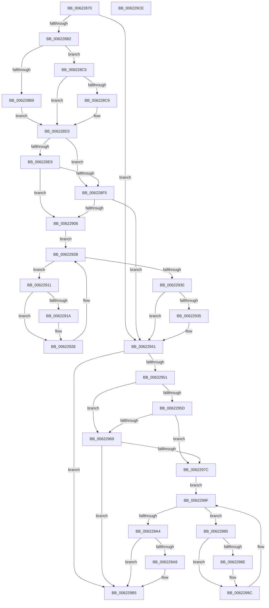

# DifExReleaseFastResourceSharedWrapper

- RVA: `0x00622870`–`0x006229CF` (길이 `351` bytes)
- VA: `0x0000000140622870`
- 실행 섹션: `.text`
- PDB 이름 있음: `예`; PDB Function 태그: `아니요`
- unwind 정보 RVA: `0x00093E28`
- 디코드: `97`개 명령, `351/351` bytes 표시
- 미해석 바이트: `0` (있으면 어셈블리에 `.byte`로 보존)

> 이 문서는 커널 이미지의 기계어와 PDB 기호를 분석해 생성했습니다. 4번과 5번은 함수 원형과 자료형을 바이너리 사용 방식에서 추정한 C 해석이며 원본 소스 복구 결과는 아닙니다.

## 1. Dependencies

- 직접 호출 지점: **9**; 고유 호출 대상: **6**
- 직접 호출자로 확인된 함수: **0**
- RIP 상대 이미지 참조: **3**

### Outgoing calls
- `0x006228A1` → [DifGetAPIThunkContextById](../49/DifGetAPIThunkContextById_function_00495A34.md) (function, `0x00495A34`)
- `0x006228C9` → [DifGetReturnAddressForWrappers](../4D/DifGetReturnAddressForWrappers_function_004D3C08.md) (function, `0x004D3C08`)
- `0x006228FC` → [ExAcquireRundownProtection](../21/ExAcquireRundownProtection_function_00216620.md) (function, `0x00216620`)
- `0x00622923` → [guard_dispatch_icall](../6B/guard_dispatch_icall_function_006BAAD0.md) (function, `0x006BAAD0`)
- `0x0062293C` → [ExReleaseRundownProtection](../34/ExReleaseRundownProtection_function_00349E80.md) (function, `0x00349E80`)
- `0x00622947` → [ExReleaseFastResourceShared](../4F/ExReleaseFastResourceShared_function_004F59C0.md) (function, `0x004F59C0`)
- `0x00622970` → [ExAcquireRundownProtection](../21/ExAcquireRundownProtection_function_00216620.md) (function, `0x00216620`)
- `0x00622997` → [guard_dispatch_icall](../6B/guard_dispatch_icall_function_006BAAD0.md) (function, `0x006BAAD0`)
- `0x006229B0` → [ExReleaseRundownProtection](../34/ExReleaseRundownProtection_function_00349E80.md) (function, `0x00349E80`)

### Direct callers
- 이 함수 시작 RVA로 연결되는 직접 call은 확인되지 않았습니다. 간접 호출은 완전히 역산할 수 없습니다.

### Static image references
- `0x006228DB` → RVA `0x00F048B8` (`.data`; read)
- `0x006228E9` → RVA `0x00F04980` (`.data`; read)
- `0x006228F5` → RVA `0x00F03E80` (`.data`; read)

## 2. Other-region calls and transfers

- 다른 실행 섹션으로 향하는 call: **0**
- 별도 외부 분기/꼬리 이동을 확인하지 못했습니다.

## 3. Assembly (complete function range)

```asm
00622870  4C 8B DC                        mov r11, rsp
00622873  49 89 5B 08                     mov qword ptr [r11 + 8], rbx
00622877  49 89 6B 10                     mov qword ptr [r11 + 0x10], rbp
0062287B  49 89 73 18                     mov qword ptr [r11 + 0x18], rsi
0062287F  57                              push rdi
00622880  41 56                           push r14
00622882  41 57                           push r15
00622884  48 83 EC 40                     sub rsp, 0x40
00622888  33 C0                           xor eax, eax
0062288A  0F 57 C0                        xorps xmm0, xmm0
0062288D  0F 11 44 24 20                  movups xmmword ptr [rsp + 0x20], xmm0
00622892  4C 8B F9                        mov r15, rcx
00622895  49 89 43 D8                     mov qword ptr [r11 - 0x28], rax
00622899  B9 C2 01 00 00                  mov ecx, 0x1c2
0062289E  4C 8B F2                        mov r14, rdx
006228A1  E8 8E 31 E7 FF                  call 0x140495a34
006228A6  48 8B F0                        mov rsi, rax
006228A9  48 85 C0                        test rax, rax
006228AC  0F 84 8F 00 00 00               je 0x140622941
006228B2  8B 40 0C                        mov eax, dword ptr [rax + 0xc]
006228B5  A8 18                           test al, 0x18
006228B7  74 0C                           je 0x1406228c5
006228B9  48 8B 4C 24 58                  mov rcx, qword ptr [rsp + 0x58]
006228BE  48 89 4C 24 20                  mov qword ptr [rsp + 0x20], rcx
006228C3  EB 0E                           jmp 0x1406228d3
006228C5  A8 04                           test al, 4
006228C7  74 0A                           je 0x1406228d3
006228C9  E8 3A 13 EB FF                  call 0x1404d3c08
006228CE  48 89 44 24 20                  mov qword ptr [rsp + 0x20], rax
006228D3  40 32 ED                        xor bpl, bpl
006228D6  4C 89 7C 24 30                  mov qword ptr [rsp + 0x30], r15
006228DB  40 38 2D D6 1F 8E 00            cmp byte ptr [rip + 0x8e1fd6], bpl
006228E2  4C 89 74 24 28                  mov qword ptr [rsp + 0x28], r14
006228E7  75 0C                           jne 0x1406228f5
006228E9  F7 05 8D 20 8E 00 00 08 00 00   test dword ptr [rip + 0x8e208d], 0x800
006228F3  74 13                           je 0x140622908
006228F5  48 8D 0D 84 15 8E 00            lea rcx, [rip + 0x8e1584]
006228FC  E8 1F 3D BF FF                  call 0x140216620
00622901  40 8A E8                        mov bpl, al
00622904  84 C0                           test al, al
00622906  74 39                           je 0x140622941
00622908  48 8D 7E 20                     lea rdi, [rsi + 0x20]
0062290C  48 8B 1F                        mov rbx, qword ptr [rdi]
0062290F  EB 1A                           jmp 0x14062292b
00622911  48 8D 43 F0                     lea rax, [rbx - 0x10]
00622915  48 85 C0                        test rax, rax
00622918  74 0E                           je 0x140622928
0062291A  48 8B 40 08                     mov rax, qword ptr [rax + 8]
0062291E  48 8D 4C 24 20                  lea rcx, [rsp + 0x20]
00622923  E8 A8 81 09 00                  call 0x1406baad0
00622928  48 8B 1B                        mov rbx, qword ptr [rbx]
0062292B  48 3B DF                        cmp rbx, rdi
0062292E  75 E1                           jne 0x140622911
00622930  40 84 ED                        test bpl, bpl
00622933  74 0C                           je 0x140622941
00622935  48 8D 0D 44 15 8E 00            lea rcx, [rip + 0x8e1544]
0062293C  E8 3F 75 D2 FF                  call 0x140349e80
00622941  49 8B D6                        mov rdx, r14
00622944  49 8B CF                        mov rcx, r15
00622947  E8 74 30 ED FF                  call 0x1404f59c0
0062294C  48 85 F6                        test rsi, rsi
0062294F  74 64                           je 0x1406229b5
00622951  40 32 FF                        xor dil, dil
00622954  40 38 3D 5D 1F 8E 00            cmp byte ptr [rip + 0x8e1f5d], dil
0062295B  75 0C                           jne 0x140622969
0062295D  F7 05 19 20 8E 00 00 08 00 00   test dword ptr [rip + 0x8e2019], 0x800
00622967  74 13                           je 0x14062297c
00622969  48 8D 0D 10 15 8E 00            lea rcx, [rip + 0x8e1510]
00622970  E8 AB 3C BF FF                  call 0x140216620
00622975  40 8A F8                        mov dil, al
00622978  84 C0                           test al, al
0062297A  74 39                           je 0x1406229b5
0062297C  48 83 C6 30                     add rsi, 0x30
00622980  48 8B 1E                        mov rbx, qword ptr [rsi]
00622983  EB 1A                           jmp 0x14062299f
00622985  48 8D 43 F0                     lea rax, [rbx - 0x10]
00622989  48 85 C0                        test rax, rax
0062298C  74 0E                           je 0x14062299c
0062298E  48 8B 40 08                     mov rax, qword ptr [rax + 8]
00622992  48 8D 4C 24 20                  lea rcx, [rsp + 0x20]
00622997  E8 34 81 09 00                  call 0x1406baad0
0062299C  48 8B 1B                        mov rbx, qword ptr [rbx]
0062299F  48 3B DE                        cmp rbx, rsi
006229A2  75 E1                           jne 0x140622985
006229A4  40 84 FF                        test dil, dil
006229A7  74 0C                           je 0x1406229b5
006229A9  48 8D 0D D0 14 8E 00            lea rcx, [rip + 0x8e14d0]
006229B0  E8 CB 74 D2 FF                  call 0x140349e80
006229B5  48 8B 5C 24 60                  mov rbx, qword ptr [rsp + 0x60]
006229BA  48 8B 6C 24 68                  mov rbp, qword ptr [rsp + 0x68]
006229BF  48 8B 74 24 70                  mov rsi, qword ptr [rsp + 0x70]
006229C4  48 83 C4 40                     add rsp, 0x40
006229C8  41 5F                           pop r15
006229CA  41 5E                           pop r14
006229CC  5F                              pop rdi
006229CD  C3                              ret
006229CE  CC                              int3
```

## 4. C-style interpretation (structured pseudocode)

```c
__int64 __fastcall DifExReleaseFastResourceSharedWrapper(__int64 a1, __int64 a2)
{
    __int64 result;
    __int64 v_rbp;
    __int64 v_rdi;
    __int64 v_rsi;
    __int64 v_rsp;
    unsigned __int64 v_stack_m28;
    unsigned __int64 v_stack_m30;
    unsigned __int64 v_stack_m38;
    unsigned __int64 v_stack_p0;
    unsigned __int64 v_stack_p10;
    unsigned __int64 v_stack_p18;
    unsigned __int64 v_stack_p8;

    *(unsigned __int64 *)(v_rsp + 8) = v_rbx;
    *(unsigned __int64 *)(v_rsp + 16) = v_rbp;
    *(unsigned __int64 *)(v_rsp + 24) = v_rsi;
    v_rsp = (v_rsp) - (64);
    result = 0;
    v_stack_m38 = v_xmm0;
    *(unsigned __int64 *)(v_rsp - 40) = 0;
    result = DifGetAPIThunkContextById(450, a2, a3, a4);
    if (result == 0) goto loc_00622941;
    if ((((unsigned __int8)((unsigned int)(*(unsigned int *)(result + 12)))) & (24)) == 0) goto loc_006228C5;
    v_stack_m38 = v_stack_p0;
    goto loc_006228D3;
loc_006228C5:
    result = (unsigned int)(*(unsigned int *)(result + 12));
    if ((((unsigned __int8)((unsigned int)(*(unsigned int *)(result + 12)))) & (4)) != 0) {
        result = DifGetReturnAddressForWrappers(v_stack_p0, a2, a3, a4);
        v_stack_m38 = result;
    }
    v_rbp = 0;
    v_stack_m28 = a1;
    v_stack_m30 = a2;
    if ((*(unsigned __int8 *)(v_rip + 9314262)) != 0) goto loc_006228F5;
    if (((*(unsigned int *)(v_rip + 9314445)) & (0x800ULL)) == 0) goto loc_00622908;
loc_006228F5:
    result = ExAcquireRundownProtection(v_rip + 9311620, a2, a3, a4);
    if ((unsigned __int8)(result) == 0) goto loc_00622941;
loc_00622908:
    goto loc_0062292B;
loc_00622911:
    result = *(unsigned __int64 *)(result + 32) - 16;
    if (*(unsigned __int64 *)(result + 32) - 16 != 0) {
        result = *(unsigned __int64 *)(*(unsigned __int64 *)(result + 32) - 16 + 8);
        a1 = v_stack_m38;
        result = guard_dispatch_icall(a1, a2, a3, a4);
    }
loc_0062292B:
    if ((*(unsigned __int64 *)(*(unsigned __int64 *)(result + 32))) != (result + 32)) goto loc_00622911;
    if ((unsigned __int8)((unsigned __int8)(result)) != 0) {
        a1 = v_rip + 9311556;
        result = ExReleaseRundownProtection(a1, a2, a3, a4);
    }
    result = ExReleaseFastResourceShared(a1, a2, a3, a4);
    if (result == 0) goto loc_006229B5;
    v_rdi = 0;
    if ((*(unsigned __int8 *)(v_rip + 9314141)) != 0) goto loc_00622969;
    if (((*(unsigned int *)(v_rip + 9314329)) & (0x800ULL)) == 0) goto loc_0062297C;
loc_00622969:
    result = ExAcquireRundownProtection(v_rip + 9311504, a2, a3, a4);
    if ((unsigned __int8)(result) == 0) goto loc_006229B5;
loc_0062297C:
    v_rsi = (result) + (48);
    goto loc_0062299F;
loc_00622985:
    result = *(unsigned __int64 *)(v_rsi) - 16;
    if (*(unsigned __int64 *)(v_rsi) - 16 != 0) {
        result = *(unsigned __int64 *)(*(unsigned __int64 *)(v_rsi) - 16 + 8);
        a1 = v_stack_m38;
        result = guard_dispatch_icall(a1, a2, a3, a4);
    }
loc_0062299F:
    if ((*(unsigned __int64 *)(*(unsigned __int64 *)(v_rsi))) != v_rsi) goto loc_00622985;
    if ((unsigned __int8)((unsigned __int8)(result)) != 0) {
        a1 = v_rip + 9311440;
        result = ExReleaseRundownProtection(a1, a2, a3, a4);
    }
    v_rsp = (v_rsp) + (64);
    return result;
}
```

## 5. (Beta) C Style

```c
int64_t DifExReleaseFastResourceSharedWrapper(int64_t Arg1, int64_t Arg2)
{
    int64_t result;
    int64_t local_rbp;
    int64_t local_rdi;
    int64_t local_rsi;
    int64_t local_rsp;
    uint64_t v_stack_m28;
    uint64_t v_stack_m30;
    uint64_t v_stack_m38;
    uint64_t v_stack_p0;
    uint64_t v_stack_p10;
    uint64_t v_stack_p18;
    uint64_t v_stack_p8;

    *(uint64_t *)(local_rsp + 0x8) = local_rbx;
    *(uint64_t *)(local_rsp + 0x10) = local_rbp;
    *(uint64_t *)(local_rsp + 0x18) = local_rsi;
    local_rsp = (local_rsp) - (64);
    result = 0;
    v_stack_m38 = v_xmm0;
    *(uint64_t *)(local_rsp - 0x28) = 0;
    result = DifGetAPIThunkContextById(450, Arg2, a3, a4);
    if (result == 0) goto loc_00622941;
    if ((((uint8_t)((uint32_t)(*(uint32_t *)(result + 0xC)))) & (24)) == 0) goto loc_006228C5;
    v_stack_m38 = v_stack_p0;
    goto loc_006228D3;
loc_006228C5:
    result = (uint32_t)(*(uint32_t *)(result + 0xC));
    if ((((uint8_t)((uint32_t)(*(uint32_t *)(result + 0xC)))) & (4)) != 0) {
        result = DifGetReturnAddressForWrappers(v_stack_p0, Arg2, a3, a4);
        v_stack_m38 = result;
    }
    local_rbp = 0;
    v_stack_m28 = Arg1;
    v_stack_m30 = Arg2;
    if ((*(uint8_t *)(v_rip + 0x8E1FD6)) != 0) goto loc_006228F5;
    if (((*(uint32_t *)(v_rip + 0x8E208D)) & (0x800ULL)) == 0) goto loc_00622908;
loc_006228F5:
    result = ExAcquireRundownProtection(v_rip + 9311620, Arg2, a3, a4);
    if ((uint8_t)(result) == 0) goto loc_00622941;
loc_00622908:
    goto loc_0062292B;
loc_00622911:
    result = *(uint64_t *)(result + 0x20) - 16;
    if (*(uint64_t *)(result + 0x20) - 16 != 0) {
        result = *(uint64_t *)(*(uint64_t *)(result + 0x20) - 0x10 + 0x8);
        Arg1 = v_stack_m38;
        result = guard_dispatch_icall(Arg1, Arg2, a3, a4);
    }
loc_0062292B:
    if ((*(uint64_t *)(*(uint64_t *)(result + 0x20))) != (result + 32)) goto loc_00622911;
    if ((uint8_t)((uint8_t)(result)) != 0) {
        Arg1 = v_rip + 9311556;
        result = ExReleaseRundownProtection(Arg1, Arg2, a3, a4);
    }
    result = ExReleaseFastResourceShared(Arg1, Arg2, a3, a4);
    if (result == 0) goto loc_006229B5;
    local_rdi = 0;
    if ((*(uint8_t *)(v_rip + 0x8E1F5D)) != 0) goto loc_00622969;
    if (((*(uint32_t *)(v_rip + 0x8E2019)) & (0x800ULL)) == 0) goto loc_0062297C;
loc_00622969:
    result = ExAcquireRundownProtection(v_rip + 9311504, Arg2, a3, a4);
    if ((uint8_t)(result) == 0) goto loc_006229B5;
loc_0062297C:
    local_rsi = (result) + (48);
    goto loc_0062299F;
loc_00622985:
    result = *(uint64_t *)(local_rsi) - 16;
    if (*(uint64_t *)(local_rsi) - 16 != 0) {
        result = *(uint64_t *)(*(uint64_t *)(local_rsi) - 0x10 + 0x8);
        Arg1 = v_stack_m38;
        result = guard_dispatch_icall(Arg1, Arg2, a3, a4);
    }
loc_0062299F:
    if ((*(uint64_t *)(*(uint64_t *)(local_rsi))) != local_rsi) goto loc_00622985;
    if ((uint8_t)((uint8_t)(result)) != 0) {
        Arg1 = v_rip + 9311440;
        result = ExReleaseRundownProtection(Arg1, Arg2, a3, a4);
    }
    local_rsp = (local_rsp) + (64);
    return result;
}
```

## 6. Execution-region graph

[열기: 2D/3D 그래프와 함수 탐색 컨트롤 패널](../../../control-panel.html?section=text&rva=0x00622870&view=graph)

- 2D 그래프는 위에서 아래로 흐르고, 3D 그래프는 빈 공간을 드래그해 회전합니다. Shift+드래그는 이동, 휠은 확대·축소, 함수 노드 선택은 대상 보고서 이동입니다.

### Static fallback


