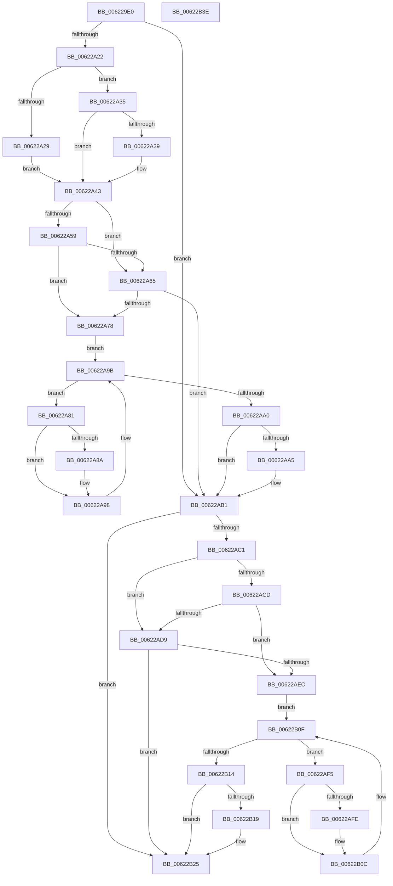

# DifExReleaseFastResourceWrapper

- RVA: `0x006229E0`–`0x00622B3F` (길이 `351` bytes)
- VA: `0x00000001406229E0`
- 실행 섹션: `.text`
- PDB 이름 있음: `예`; PDB Function 태그: `아니요`
- unwind 정보 RVA: `0x00093E28`
- 디코드: `97`개 명령, `351/351` bytes 표시
- 미해석 바이트: `0` (있으면 어셈블리에 `.byte`로 보존)

> 이 문서는 커널 이미지의 기계어와 PDB 기호를 분석해 생성했습니다. 4번과 5번은 함수 원형과 자료형을 바이너리 사용 방식에서 추정한 C 해석이며 원본 소스 복구 결과는 아닙니다.

## 1. Dependencies

- 직접 호출 지점: **9**; 고유 호출 대상: **6**
- 직접 호출자로 확인된 함수: **0**
- RIP 상대 이미지 참조: **3**

### Outgoing calls
- `0x00622A11` → [DifGetAPIThunkContextById](../49/DifGetAPIThunkContextById_function_00495A34.md) (function, `0x00495A34`)
- `0x00622A39` → [DifGetReturnAddressForWrappers](../4D/DifGetReturnAddressForWrappers_function_004D3C08.md) (function, `0x004D3C08`)
- `0x00622A6C` → [ExAcquireRundownProtection](../21/ExAcquireRundownProtection_function_00216620.md) (function, `0x00216620`)
- `0x00622A93` → [guard_dispatch_icall](../6B/guard_dispatch_icall_function_006BAAD0.md) (function, `0x006BAAD0`)
- `0x00622AAC` → [ExReleaseRundownProtection](../34/ExReleaseRundownProtection_function_00349E80.md) (function, `0x00349E80`)
- `0x00622AB7` → [ExReleaseFastResource](../26/ExReleaseFastResource_function_002613D0.md) (function, `0x002613D0`)
- `0x00622AE0` → [ExAcquireRundownProtection](../21/ExAcquireRundownProtection_function_00216620.md) (function, `0x00216620`)
- `0x00622B07` → [guard_dispatch_icall](../6B/guard_dispatch_icall_function_006BAAD0.md) (function, `0x006BAAD0`)
- `0x00622B20` → [ExReleaseRundownProtection](../34/ExReleaseRundownProtection_function_00349E80.md) (function, `0x00349E80`)

### Direct callers
- 이 함수 시작 RVA로 연결되는 직접 call은 확인되지 않았습니다. 간접 호출은 완전히 역산할 수 없습니다.

### Static image references
- `0x00622A4B` → RVA `0x00F048B8` (`.data`; read)
- `0x00622A59` → RVA `0x00F04980` (`.data`; read)
- `0x00622A65` → RVA `0x00F03E80` (`.data`; read)

## 2. Other-region calls and transfers

- 다른 실행 섹션으로 향하는 call: **0**
- 별도 외부 분기/꼬리 이동을 확인하지 못했습니다.

## 3. Assembly (complete function range)

```asm
006229E0  4C 8B DC                        mov r11, rsp
006229E3  49 89 5B 08                     mov qword ptr [r11 + 8], rbx
006229E7  49 89 6B 10                     mov qword ptr [r11 + 0x10], rbp
006229EB  49 89 73 18                     mov qword ptr [r11 + 0x18], rsi
006229EF  57                              push rdi
006229F0  41 56                           push r14
006229F2  41 57                           push r15
006229F4  48 83 EC 40                     sub rsp, 0x40
006229F8  33 C0                           xor eax, eax
006229FA  0F 57 C0                        xorps xmm0, xmm0
006229FD  0F 11 44 24 20                  movups xmmword ptr [rsp + 0x20], xmm0
00622A02  4C 8B F9                        mov r15, rcx
00622A05  49 89 43 D8                     mov qword ptr [r11 - 0x28], rax
00622A09  B9 C4 01 00 00                  mov ecx, 0x1c4
00622A0E  4C 8B F2                        mov r14, rdx
00622A11  E8 1E 30 E7 FF                  call 0x140495a34
00622A16  48 8B F0                        mov rsi, rax
00622A19  48 85 C0                        test rax, rax
00622A1C  0F 84 8F 00 00 00               je 0x140622ab1
00622A22  8B 40 0C                        mov eax, dword ptr [rax + 0xc]
00622A25  A8 18                           test al, 0x18
00622A27  74 0C                           je 0x140622a35
00622A29  48 8B 4C 24 58                  mov rcx, qword ptr [rsp + 0x58]
00622A2E  48 89 4C 24 20                  mov qword ptr [rsp + 0x20], rcx
00622A33  EB 0E                           jmp 0x140622a43
00622A35  A8 04                           test al, 4
00622A37  74 0A                           je 0x140622a43
00622A39  E8 CA 11 EB FF                  call 0x1404d3c08
00622A3E  48 89 44 24 20                  mov qword ptr [rsp + 0x20], rax
00622A43  40 32 ED                        xor bpl, bpl
00622A46  4C 89 7C 24 30                  mov qword ptr [rsp + 0x30], r15
00622A4B  40 38 2D 66 1E 8E 00            cmp byte ptr [rip + 0x8e1e66], bpl
00622A52  4C 89 74 24 28                  mov qword ptr [rsp + 0x28], r14
00622A57  75 0C                           jne 0x140622a65
00622A59  F7 05 1D 1F 8E 00 00 08 00 00   test dword ptr [rip + 0x8e1f1d], 0x800
00622A63  74 13                           je 0x140622a78
00622A65  48 8D 0D 14 14 8E 00            lea rcx, [rip + 0x8e1414]
00622A6C  E8 AF 3B BF FF                  call 0x140216620
00622A71  40 8A E8                        mov bpl, al
00622A74  84 C0                           test al, al
00622A76  74 39                           je 0x140622ab1
00622A78  48 8D 7E 20                     lea rdi, [rsi + 0x20]
00622A7C  48 8B 1F                        mov rbx, qword ptr [rdi]
00622A7F  EB 1A                           jmp 0x140622a9b
00622A81  48 8D 43 F0                     lea rax, [rbx - 0x10]
00622A85  48 85 C0                        test rax, rax
00622A88  74 0E                           je 0x140622a98
00622A8A  48 8B 40 08                     mov rax, qword ptr [rax + 8]
00622A8E  48 8D 4C 24 20                  lea rcx, [rsp + 0x20]
00622A93  E8 38 80 09 00                  call 0x1406baad0
00622A98  48 8B 1B                        mov rbx, qword ptr [rbx]
00622A9B  48 3B DF                        cmp rbx, rdi
00622A9E  75 E1                           jne 0x140622a81
00622AA0  40 84 ED                        test bpl, bpl
00622AA3  74 0C                           je 0x140622ab1
00622AA5  48 8D 0D D4 13 8E 00            lea rcx, [rip + 0x8e13d4]
00622AAC  E8 CF 73 D2 FF                  call 0x140349e80
00622AB1  49 8B D6                        mov rdx, r14
00622AB4  49 8B CF                        mov rcx, r15
00622AB7  E8 14 E9 C3 FF                  call 0x1402613d0
00622ABC  48 85 F6                        test rsi, rsi
00622ABF  74 64                           je 0x140622b25
00622AC1  40 32 FF                        xor dil, dil
00622AC4  40 38 3D ED 1D 8E 00            cmp byte ptr [rip + 0x8e1ded], dil
00622ACB  75 0C                           jne 0x140622ad9
00622ACD  F7 05 A9 1E 8E 00 00 08 00 00   test dword ptr [rip + 0x8e1ea9], 0x800
00622AD7  74 13                           je 0x140622aec
00622AD9  48 8D 0D A0 13 8E 00            lea rcx, [rip + 0x8e13a0]
00622AE0  E8 3B 3B BF FF                  call 0x140216620
00622AE5  40 8A F8                        mov dil, al
00622AE8  84 C0                           test al, al
00622AEA  74 39                           je 0x140622b25
00622AEC  48 83 C6 30                     add rsi, 0x30
00622AF0  48 8B 1E                        mov rbx, qword ptr [rsi]
00622AF3  EB 1A                           jmp 0x140622b0f
00622AF5  48 8D 43 F0                     lea rax, [rbx - 0x10]
00622AF9  48 85 C0                        test rax, rax
00622AFC  74 0E                           je 0x140622b0c
00622AFE  48 8B 40 08                     mov rax, qword ptr [rax + 8]
00622B02  48 8D 4C 24 20                  lea rcx, [rsp + 0x20]
00622B07  E8 C4 7F 09 00                  call 0x1406baad0
00622B0C  48 8B 1B                        mov rbx, qword ptr [rbx]
00622B0F  48 3B DE                        cmp rbx, rsi
00622B12  75 E1                           jne 0x140622af5
00622B14  40 84 FF                        test dil, dil
00622B17  74 0C                           je 0x140622b25
00622B19  48 8D 0D 60 13 8E 00            lea rcx, [rip + 0x8e1360]
00622B20  E8 5B 73 D2 FF                  call 0x140349e80
00622B25  48 8B 5C 24 60                  mov rbx, qword ptr [rsp + 0x60]
00622B2A  48 8B 6C 24 68                  mov rbp, qword ptr [rsp + 0x68]
00622B2F  48 8B 74 24 70                  mov rsi, qword ptr [rsp + 0x70]
00622B34  48 83 C4 40                     add rsp, 0x40
00622B38  41 5F                           pop r15
00622B3A  41 5E                           pop r14
00622B3C  5F                              pop rdi
00622B3D  C3                              ret
00622B3E  CC                              int3
```

## 4. C-style interpretation (structured pseudocode)

```c
__int64 __fastcall DifExReleaseFastResourceWrapper(__int64 a1, __int64 a2)
{
    __int64 result;
    __int64 v_rbp;
    __int64 v_rdi;
    __int64 v_rsi;
    __int64 v_rsp;
    unsigned __int64 v_stack_m28;
    unsigned __int64 v_stack_m30;
    unsigned __int64 v_stack_m38;
    unsigned __int64 v_stack_p0;
    unsigned __int64 v_stack_p10;
    unsigned __int64 v_stack_p18;
    unsigned __int64 v_stack_p8;

    *(unsigned __int64 *)(v_rsp + 8) = v_rbx;
    *(unsigned __int64 *)(v_rsp + 16) = v_rbp;
    *(unsigned __int64 *)(v_rsp + 24) = v_rsi;
    v_rsp = (v_rsp) - (64);
    result = 0;
    v_stack_m38 = v_xmm0;
    *(unsigned __int64 *)(v_rsp - 40) = 0;
    result = DifGetAPIThunkContextById(452, a2, a3, a4);
    if (result == 0) goto loc_00622AB1;
    if ((((unsigned __int8)((unsigned int)(*(unsigned int *)(result + 12)))) & (24)) == 0) goto loc_00622A35;
    v_stack_m38 = v_stack_p0;
    goto loc_00622A43;
loc_00622A35:
    result = (unsigned int)(*(unsigned int *)(result + 12));
    if ((((unsigned __int8)((unsigned int)(*(unsigned int *)(result + 12)))) & (4)) != 0) {
        result = DifGetReturnAddressForWrappers(v_stack_p0, a2, a3, a4);
        v_stack_m38 = result;
    }
    v_rbp = 0;
    v_stack_m28 = a1;
    v_stack_m30 = a2;
    if ((*(unsigned __int8 *)(v_rip + 9313894)) != 0) goto loc_00622A65;
    if (((*(unsigned int *)(v_rip + 9314077)) & (0x800ULL)) == 0) goto loc_00622A78;
loc_00622A65:
    result = ExAcquireRundownProtection(v_rip + 9311252, a2, a3, a4);
    if ((unsigned __int8)(result) == 0) goto loc_00622AB1;
loc_00622A78:
    goto loc_00622A9B;
loc_00622A81:
    result = *(unsigned __int64 *)(result + 32) - 16;
    if (*(unsigned __int64 *)(result + 32) - 16 != 0) {
        result = *(unsigned __int64 *)(*(unsigned __int64 *)(result + 32) - 16 + 8);
        a1 = v_stack_m38;
        result = guard_dispatch_icall(a1, a2, a3, a4);
    }
loc_00622A9B:
    if ((*(unsigned __int64 *)(*(unsigned __int64 *)(result + 32))) != (result + 32)) goto loc_00622A81;
    if ((unsigned __int8)((unsigned __int8)(result)) != 0) {
        a1 = v_rip + 9311188;
        result = ExReleaseRundownProtection(a1, a2, a3, a4);
    }
    result = ExReleaseFastResource(a1, a2, a3, a4);
    if (result == 0) goto loc_00622B25;
    v_rdi = 0;
    if ((*(unsigned __int8 *)(v_rip + 9313773)) != 0) goto loc_00622AD9;
    if (((*(unsigned int *)(v_rip + 9313961)) & (0x800ULL)) == 0) goto loc_00622AEC;
loc_00622AD9:
    result = ExAcquireRundownProtection(v_rip + 9311136, a2, a3, a4);
    if ((unsigned __int8)(result) == 0) goto loc_00622B25;
loc_00622AEC:
    v_rsi = (result) + (48);
    goto loc_00622B0F;
loc_00622AF5:
    result = *(unsigned __int64 *)(v_rsi) - 16;
    if (*(unsigned __int64 *)(v_rsi) - 16 != 0) {
        result = *(unsigned __int64 *)(*(unsigned __int64 *)(v_rsi) - 16 + 8);
        a1 = v_stack_m38;
        result = guard_dispatch_icall(a1, a2, a3, a4);
    }
loc_00622B0F:
    if ((*(unsigned __int64 *)(*(unsigned __int64 *)(v_rsi))) != v_rsi) goto loc_00622AF5;
    if ((unsigned __int8)((unsigned __int8)(result)) != 0) {
        a1 = v_rip + 9311072;
        result = ExReleaseRundownProtection(a1, a2, a3, a4);
    }
    v_rsp = (v_rsp) + (64);
    return result;
}
```

## 5. (Beta) C Style

```c
int64_t DifExReleaseFastResourceWrapper(int64_t Arg1, int64_t Arg2)
{
    int64_t result;
    int64_t local_rbp;
    int64_t local_rdi;
    int64_t local_rsi;
    int64_t local_rsp;
    uint64_t v_stack_m28;
    uint64_t v_stack_m30;
    uint64_t v_stack_m38;
    uint64_t v_stack_p0;
    uint64_t v_stack_p10;
    uint64_t v_stack_p18;
    uint64_t v_stack_p8;

    *(uint64_t *)(local_rsp + 0x8) = local_rbx;
    *(uint64_t *)(local_rsp + 0x10) = local_rbp;
    *(uint64_t *)(local_rsp + 0x18) = local_rsi;
    local_rsp = (local_rsp) - (64);
    result = 0;
    v_stack_m38 = v_xmm0;
    *(uint64_t *)(local_rsp - 0x28) = 0;
    result = DifGetAPIThunkContextById(452, Arg2, a3, a4);
    if (result == 0) goto loc_00622AB1;
    if ((((uint8_t)((uint32_t)(*(uint32_t *)(result + 0xC)))) & (24)) == 0) goto loc_00622A35;
    v_stack_m38 = v_stack_p0;
    goto loc_00622A43;
loc_00622A35:
    result = (uint32_t)(*(uint32_t *)(result + 0xC));
    if ((((uint8_t)((uint32_t)(*(uint32_t *)(result + 0xC)))) & (4)) != 0) {
        result = DifGetReturnAddressForWrappers(v_stack_p0, Arg2, a3, a4);
        v_stack_m38 = result;
    }
    local_rbp = 0;
    v_stack_m28 = Arg1;
    v_stack_m30 = Arg2;
    if ((*(uint8_t *)(v_rip + 0x8E1E66)) != 0) goto loc_00622A65;
    if (((*(uint32_t *)(v_rip + 0x8E1F1D)) & (0x800ULL)) == 0) goto loc_00622A78;
loc_00622A65:
    result = ExAcquireRundownProtection(v_rip + 9311252, Arg2, a3, a4);
    if ((uint8_t)(result) == 0) goto loc_00622AB1;
loc_00622A78:
    goto loc_00622A9B;
loc_00622A81:
    result = *(uint64_t *)(result + 0x20) - 16;
    if (*(uint64_t *)(result + 0x20) - 16 != 0) {
        result = *(uint64_t *)(*(uint64_t *)(result + 0x20) - 0x10 + 0x8);
        Arg1 = v_stack_m38;
        result = guard_dispatch_icall(Arg1, Arg2, a3, a4);
    }
loc_00622A9B:
    if ((*(uint64_t *)(*(uint64_t *)(result + 0x20))) != (result + 32)) goto loc_00622A81;
    if ((uint8_t)((uint8_t)(result)) != 0) {
        Arg1 = v_rip + 9311188;
        result = ExReleaseRundownProtection(Arg1, Arg2, a3, a4);
    }
    result = ExReleaseFastResource(Arg1, Arg2, a3, a4);
    if (result == 0) goto loc_00622B25;
    local_rdi = 0;
    if ((*(uint8_t *)(v_rip + 0x8E1DED)) != 0) goto loc_00622AD9;
    if (((*(uint32_t *)(v_rip + 0x8E1EA9)) & (0x800ULL)) == 0) goto loc_00622AEC;
loc_00622AD9:
    result = ExAcquireRundownProtection(v_rip + 9311136, Arg2, a3, a4);
    if ((uint8_t)(result) == 0) goto loc_00622B25;
loc_00622AEC:
    local_rsi = (result) + (48);
    goto loc_00622B0F;
loc_00622AF5:
    result = *(uint64_t *)(local_rsi) - 16;
    if (*(uint64_t *)(local_rsi) - 16 != 0) {
        result = *(uint64_t *)(*(uint64_t *)(local_rsi) - 0x10 + 0x8);
        Arg1 = v_stack_m38;
        result = guard_dispatch_icall(Arg1, Arg2, a3, a4);
    }
loc_00622B0F:
    if ((*(uint64_t *)(*(uint64_t *)(local_rsi))) != local_rsi) goto loc_00622AF5;
    if ((uint8_t)((uint8_t)(result)) != 0) {
        Arg1 = v_rip + 9311072;
        result = ExReleaseRundownProtection(Arg1, Arg2, a3, a4);
    }
    local_rsp = (local_rsp) + (64);
    return result;
}
```

## 6. Execution-region graph

[열기: 2D/3D 그래프와 함수 탐색 컨트롤 패널](../../../control-panel.html?section=text&rva=0x006229E0&view=graph)

- 2D 그래프는 위에서 아래로 흐르고, 3D 그래프는 빈 공간을 드래그해 회전합니다. Shift+드래그는 이동, 휠은 확대·축소, 함수 노드 선택은 대상 보고서 이동입니다.

### Static fallback


