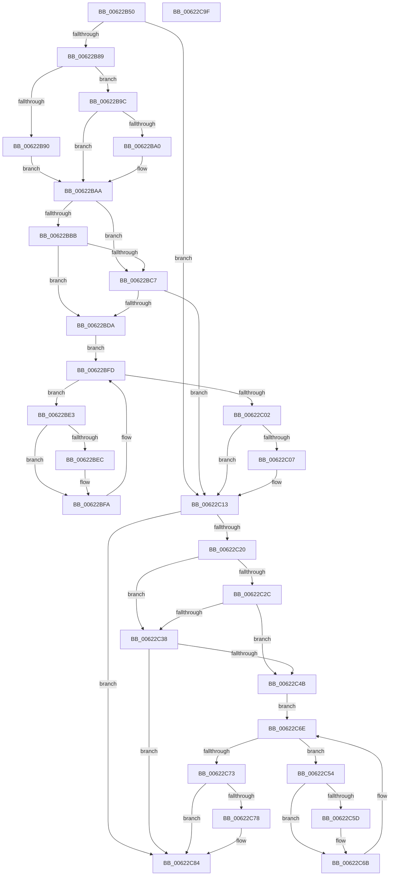

# DifExReleaseResourceAndLeaveCriticalRegionWrapper

- RVA: `0x00622B50`–`0x00622CA0` (길이 `336` bytes)
- VA: `0x0000000140622B50`
- 실행 섹션: `.text`
- PDB 이름 있음: `예`; PDB Function 태그: `아니요`
- unwind 정보 RVA: `0x0005D7BC`
- 디코드: `90`개 명령, `336/336` bytes 표시
- 미해석 바이트: `0` (있으면 어셈블리에 `.byte`로 보존)

> 이 문서는 커널 이미지의 기계어와 PDB 기호를 분석해 생성했습니다. 4번과 5번은 함수 원형과 자료형을 바이너리 사용 방식에서 추정한 C 해석이며 원본 소스 복구 결과는 아닙니다.

## 1. Dependencies

- 직접 호출 지점: **9**; 고유 호출 대상: **6**
- 직접 호출자로 확인된 함수: **0**
- RIP 상대 이미지 참조: **3**

### Outgoing calls
- `0x00622B78` → [DifGetAPIThunkContextById](../49/DifGetAPIThunkContextById_function_00495A34.md) (function, `0x00495A34`)
- `0x00622BA0` → [DifGetReturnAddressForWrappers](../4D/DifGetReturnAddressForWrappers_function_004D3C08.md) (function, `0x004D3C08`)
- `0x00622BCE` → [ExAcquireRundownProtection](../21/ExAcquireRundownProtection_function_00216620.md) (function, `0x00216620`)
- `0x00622BF5` → [guard_dispatch_icall](../6B/guard_dispatch_icall_function_006BAAD0.md) (function, `0x006BAAD0`)
- `0x00622C0E` → [ExReleaseRundownProtection](../34/ExReleaseRundownProtection_function_00349E80.md) (function, `0x00349E80`)
- `0x00622C16` → [ExReleaseResourceAndLeaveCriticalRegion](../25/ExReleaseResourceAndLeaveCriticalRegion_function_0025D8D0.md) (function, `0x0025D8D0`)
- `0x00622C3F` → [ExAcquireRundownProtection](../21/ExAcquireRundownProtection_function_00216620.md) (function, `0x00216620`)
- `0x00622C66` → [guard_dispatch_icall](../6B/guard_dispatch_icall_function_006BAAD0.md) (function, `0x006BAAD0`)
- `0x00622C7F` → [ExReleaseRundownProtection](../34/ExReleaseRundownProtection_function_00349E80.md) (function, `0x00349E80`)

### Direct callers
- 이 함수 시작 RVA로 연결되는 직접 call은 확인되지 않았습니다. 간접 호출은 완전히 역산할 수 없습니다.

### Static image references
- `0x00622BB2` → RVA `0x00F048B8` (`.data`; read)
- `0x00622BBB` → RVA `0x00F04980` (`.data`; read)
- `0x00622BC7` → RVA `0x00F03E80` (`.data`; read)

## 2. Other-region calls and transfers

- 다른 실행 섹션으로 향하는 call: **0**
- 별도 외부 분기/꼬리 이동을 확인하지 못했습니다.

## 3. Assembly (complete function range)

```asm
00622B50  48 8B C4                        mov rax, rsp
00622B53  48 89 58 08                     mov qword ptr [rax + 8], rbx
00622B57  48 89 68 10                     mov qword ptr [rax + 0x10], rbp
00622B5B  48 89 70 18                     mov qword ptr [rax + 0x18], rsi
00622B5F  48 89 78 20                     mov qword ptr [rax + 0x20], rdi
00622B63  41 56                           push r14
00622B65  48 83 EC 30                     sub rsp, 0x30
00622B69  48 8B E9                        mov rbp, rcx
00622B6C  0F 57 C0                        xorps xmm0, xmm0
00622B6F  B9 84 01 00 00                  mov ecx, 0x184
00622B74  0F 11 40 E8                     movups xmmword ptr [rax - 0x18], xmm0
00622B78  E8 B7 2E E7 FF                  call 0x140495a34
00622B7D  48 8B F8                        mov rdi, rax
00622B80  48 85 C0                        test rax, rax
00622B83  0F 84 8A 00 00 00               je 0x140622c13
00622B89  8B 40 0C                        mov eax, dword ptr [rax + 0xc]
00622B8C  A8 18                           test al, 0x18
00622B8E  74 0C                           je 0x140622b9c
00622B90  48 8B 4C 24 38                  mov rcx, qword ptr [rsp + 0x38]
00622B95  48 89 4C 24 20                  mov qword ptr [rsp + 0x20], rcx
00622B9A  EB 0E                           jmp 0x140622baa
00622B9C  A8 04                           test al, 4
00622B9E  74 0A                           je 0x140622baa
00622BA0  E8 63 10 EB FF                  call 0x1404d3c08
00622BA5  48 89 44 24 20                  mov qword ptr [rsp + 0x20], rax
00622BAA  40 32 F6                        xor sil, sil
00622BAD  48 89 6C 24 28                  mov qword ptr [rsp + 0x28], rbp
00622BB2  40 38 35 FF 1C 8E 00            cmp byte ptr [rip + 0x8e1cff], sil
00622BB9  75 0C                           jne 0x140622bc7
00622BBB  F7 05 BB 1D 8E 00 00 08 00 00   test dword ptr [rip + 0x8e1dbb], 0x800
00622BC5  74 13                           je 0x140622bda
00622BC7  48 8D 0D B2 12 8E 00            lea rcx, [rip + 0x8e12b2]
00622BCE  E8 4D 3A BF FF                  call 0x140216620
00622BD3  40 8A F0                        mov sil, al
00622BD6  84 C0                           test al, al
00622BD8  74 39                           je 0x140622c13
00622BDA  4C 8D 77 20                     lea r14, [rdi + 0x20]
00622BDE  49 8B 1E                        mov rbx, qword ptr [r14]
00622BE1  EB 1A                           jmp 0x140622bfd
00622BE3  48 8D 43 F0                     lea rax, [rbx - 0x10]
00622BE7  48 85 C0                        test rax, rax
00622BEA  74 0E                           je 0x140622bfa
00622BEC  48 8B 40 08                     mov rax, qword ptr [rax + 8]
00622BF0  48 8D 4C 24 20                  lea rcx, [rsp + 0x20]
00622BF5  E8 D6 7E 09 00                  call 0x1406baad0
00622BFA  48 8B 1B                        mov rbx, qword ptr [rbx]
00622BFD  49 3B DE                        cmp rbx, r14
00622C00  75 E1                           jne 0x140622be3
00622C02  40 84 F6                        test sil, sil
00622C05  74 0C                           je 0x140622c13
00622C07  48 8D 0D 72 12 8E 00            lea rcx, [rip + 0x8e1272]
00622C0E  E8 6D 72 D2 FF                  call 0x140349e80
00622C13  48 8B CD                        mov rcx, rbp
00622C16  E8 B5 AC C3 FF                  call 0x14025d8d0
00622C1B  48 85 FF                        test rdi, rdi
00622C1E  74 64                           je 0x140622c84
00622C20  40 32 F6                        xor sil, sil
00622C23  40 38 35 8E 1C 8E 00            cmp byte ptr [rip + 0x8e1c8e], sil
00622C2A  75 0C                           jne 0x140622c38
00622C2C  F7 05 4A 1D 8E 00 00 08 00 00   test dword ptr [rip + 0x8e1d4a], 0x800
00622C36  74 13                           je 0x140622c4b
00622C38  48 8D 0D 41 12 8E 00            lea rcx, [rip + 0x8e1241]
00622C3F  E8 DC 39 BF FF                  call 0x140216620
00622C44  40 8A F0                        mov sil, al
00622C47  84 C0                           test al, al
00622C49  74 39                           je 0x140622c84
00622C4B  48 83 C7 30                     add rdi, 0x30
00622C4F  48 8B 1F                        mov rbx, qword ptr [rdi]
00622C52  EB 1A                           jmp 0x140622c6e
00622C54  48 8D 43 F0                     lea rax, [rbx - 0x10]
00622C58  48 85 C0                        test rax, rax
00622C5B  74 0E                           je 0x140622c6b
00622C5D  48 8B 40 08                     mov rax, qword ptr [rax + 8]
00622C61  48 8D 4C 24 20                  lea rcx, [rsp + 0x20]
00622C66  E8 65 7E 09 00                  call 0x1406baad0
00622C6B  48 8B 1B                        mov rbx, qword ptr [rbx]
00622C6E  48 3B DF                        cmp rbx, rdi
00622C71  75 E1                           jne 0x140622c54
00622C73  40 84 F6                        test sil, sil
00622C76  74 0C                           je 0x140622c84
00622C78  48 8D 0D 01 12 8E 00            lea rcx, [rip + 0x8e1201]
00622C7F  E8 FC 71 D2 FF                  call 0x140349e80
00622C84  48 8B 5C 24 40                  mov rbx, qword ptr [rsp + 0x40]
00622C89  48 8B 6C 24 48                  mov rbp, qword ptr [rsp + 0x48]
00622C8E  48 8B 74 24 50                  mov rsi, qword ptr [rsp + 0x50]
00622C93  48 8B 7C 24 58                  mov rdi, qword ptr [rsp + 0x58]
00622C98  48 83 C4 30                     add rsp, 0x30
00622C9C  41 5E                           pop r14
00622C9E  C3                              ret
00622C9F  CC                              int3
```

## 4. C-style interpretation (structured pseudocode)

```c
__int64 __fastcall DifExReleaseResourceAndLeaveCriticalRegionWrapper(__int64 a1)
{
    __int64 result;
    __int64 v_rdi;
    __int64 v_rsi;
    __int64 v_rsp;
    unsigned __int64 v_stack_m10;
    unsigned __int64 v_stack_m18;
    unsigned __int64 v_stack_p0;
    unsigned __int64 v_stack_p10;
    unsigned __int64 v_stack_p18;
    unsigned __int64 v_stack_p20;
    unsigned __int64 v_stack_p8;

    *(unsigned __int64 *)(v_rsp + 8) = v_rbx;
    *(unsigned __int64 *)(v_rsp + 16) = v_rbp;
    *(unsigned __int64 *)(v_rsp + 24) = v_rsi;
    *(unsigned __int64 *)(v_rsp + 32) = v_rdi;
    v_rsp = (v_rsp) - (48);
    *(unsigned __int64 *)(v_rsp - 24) = v_xmm0;
    result = DifGetAPIThunkContextById(388, a2, a3, a4);
    if (result == 0) goto loc_00622C13;
    if ((((unsigned __int8)((unsigned int)(*(unsigned int *)(result + 12)))) & (24)) == 0) goto loc_00622B9C;
    v_stack_m18 = v_stack_p0;
    goto loc_00622BAA;
loc_00622B9C:
    result = (unsigned int)(*(unsigned int *)(result + 12));
    if ((((unsigned __int8)((unsigned int)(*(unsigned int *)(result + 12)))) & (4)) != 0) {
        result = DifGetReturnAddressForWrappers(v_stack_p0, a2, a3, a4);
        v_stack_m18 = result;
    }
    v_rsi = 0;
    v_stack_m10 = a1;
    if ((*(unsigned __int8 *)(v_rip + 9313535)) != 0) goto loc_00622BC7;
    if (((*(unsigned int *)(v_rip + 9313723)) & (0x800ULL)) == 0) goto loc_00622BDA;
loc_00622BC7:
    result = ExAcquireRundownProtection(v_rip + 9310898, a2, a3, a4);
    if ((unsigned __int8)(result) == 0) goto loc_00622C13;
loc_00622BDA:
    goto loc_00622BFD;
loc_00622BE3:
    result = *(unsigned __int64 *)(result + 32) - 16;
    if (*(unsigned __int64 *)(result + 32) - 16 != 0) {
        result = *(unsigned __int64 *)(*(unsigned __int64 *)(result + 32) - 16 + 8);
        a1 = v_stack_m18;
        result = guard_dispatch_icall(a1, a2, a3, a4);
    }
loc_00622BFD:
    if ((*(unsigned __int64 *)(*(unsigned __int64 *)(result + 32))) != (result + 32)) goto loc_00622BE3;
    if ((unsigned __int8)((unsigned __int8)(result)) != 0) {
        a1 = v_rip + 9310834;
        result = ExReleaseRundownProtection(a1, a2, a3, a4);
    }
    result = ExReleaseResourceAndLeaveCriticalRegion(a1, a2, a3, a4);
    if (result == 0) goto loc_00622C84;
    v_rsi = 0;
    if ((*(unsigned __int8 *)(v_rip + 9313422)) != 0) goto loc_00622C38;
    if (((*(unsigned int *)(v_rip + 9313610)) & (0x800ULL)) == 0) goto loc_00622C4B;
loc_00622C38:
    result = ExAcquireRundownProtection(v_rip + 9310785, a2, a3, a4);
    if ((unsigned __int8)(result) == 0) goto loc_00622C84;
loc_00622C4B:
    v_rdi = (result) + (48);
    goto loc_00622C6E;
loc_00622C54:
    result = *(unsigned __int64 *)(v_rdi) - 16;
    if (*(unsigned __int64 *)(v_rdi) - 16 != 0) {
        result = *(unsigned __int64 *)(*(unsigned __int64 *)(v_rdi) - 16 + 8);
        a1 = v_stack_m18;
        result = guard_dispatch_icall(a1, a2, a3, a4);
    }
loc_00622C6E:
    if ((*(unsigned __int64 *)(*(unsigned __int64 *)(v_rdi))) != v_rdi) goto loc_00622C54;
    if ((unsigned __int8)((unsigned __int8)(result)) != 0) {
        a1 = v_rip + 9310721;
        result = ExReleaseRundownProtection(a1, a2, a3, a4);
    }
    v_rsp = (v_rsp) + (48);
    return result;
}
```

## 5. (Beta) C Style

```c
int64_t DifExReleaseResourceAndLeaveCriticalRegionWrapper(int64_t Arg1)
{
    int64_t result;
    int64_t local_rdi;
    int64_t local_rsi;
    int64_t local_rsp;
    uint64_t v_stack_m10;
    uint64_t v_stack_m18;
    uint64_t v_stack_p0;
    uint64_t v_stack_p10;
    uint64_t v_stack_p18;
    uint64_t v_stack_p20;
    uint64_t v_stack_p8;

    *(uint64_t *)(local_rsp + 0x8) = local_rbx;
    *(uint64_t *)(local_rsp + 0x10) = local_rbp;
    *(uint64_t *)(local_rsp + 0x18) = local_rsi;
    *(uint64_t *)(local_rsp + 0x20) = local_rdi;
    local_rsp = (local_rsp) - (48);
    *(uint64_t *)(local_rsp - 0x18) = v_xmm0;
    result = DifGetAPIThunkContextById(388, a2, a3, a4);
    if (result == 0) goto loc_00622C13;
    if ((((uint8_t)((uint32_t)(*(uint32_t *)(result + 0xC)))) & (24)) == 0) goto loc_00622B9C;
    v_stack_m18 = v_stack_p0;
    goto loc_00622BAA;
loc_00622B9C:
    result = (uint32_t)(*(uint32_t *)(result + 0xC));
    if ((((uint8_t)((uint32_t)(*(uint32_t *)(result + 0xC)))) & (4)) != 0) {
        result = DifGetReturnAddressForWrappers(v_stack_p0, a2, a3, a4);
        v_stack_m18 = result;
    }
    local_rsi = 0;
    v_stack_m10 = Arg1;
    if ((*(uint8_t *)(v_rip + 0x8E1CFF)) != 0) goto loc_00622BC7;
    if (((*(uint32_t *)(v_rip + 0x8E1DBB)) & (0x800ULL)) == 0) goto loc_00622BDA;
loc_00622BC7:
    result = ExAcquireRundownProtection(v_rip + 9310898, a2, a3, a4);
    if ((uint8_t)(result) == 0) goto loc_00622C13;
loc_00622BDA:
    goto loc_00622BFD;
loc_00622BE3:
    result = *(uint64_t *)(result + 0x20) - 16;
    if (*(uint64_t *)(result + 0x20) - 16 != 0) {
        result = *(uint64_t *)(*(uint64_t *)(result + 0x20) - 0x10 + 0x8);
        Arg1 = v_stack_m18;
        result = guard_dispatch_icall(Arg1, a2, a3, a4);
    }
loc_00622BFD:
    if ((*(uint64_t *)(*(uint64_t *)(result + 0x20))) != (result + 32)) goto loc_00622BE3;
    if ((uint8_t)((uint8_t)(result)) != 0) {
        Arg1 = v_rip + 9310834;
        result = ExReleaseRundownProtection(Arg1, a2, a3, a4);
    }
    result = ExReleaseResourceAndLeaveCriticalRegion(Arg1, a2, a3, a4);
    if (result == 0) goto loc_00622C84;
    local_rsi = 0;
    if ((*(uint8_t *)(v_rip + 0x8E1C8E)) != 0) goto loc_00622C38;
    if (((*(uint32_t *)(v_rip + 0x8E1D4A)) & (0x800ULL)) == 0) goto loc_00622C4B;
loc_00622C38:
    result = ExAcquireRundownProtection(v_rip + 9310785, a2, a3, a4);
    if ((uint8_t)(result) == 0) goto loc_00622C84;
loc_00622C4B:
    local_rdi = (result) + (48);
    goto loc_00622C6E;
loc_00622C54:
    result = *(uint64_t *)(local_rdi) - 16;
    if (*(uint64_t *)(local_rdi) - 16 != 0) {
        result = *(uint64_t *)(*(uint64_t *)(local_rdi) - 0x10 + 0x8);
        Arg1 = v_stack_m18;
        result = guard_dispatch_icall(Arg1, a2, a3, a4);
    }
loc_00622C6E:
    if ((*(uint64_t *)(*(uint64_t *)(local_rdi))) != local_rdi) goto loc_00622C54;
    if ((uint8_t)((uint8_t)(result)) != 0) {
        Arg1 = v_rip + 9310721;
        result = ExReleaseRundownProtection(Arg1, a2, a3, a4);
    }
    local_rsp = (local_rsp) + (48);
    return result;
}
```

## 6. Execution-region graph

[열기: 2D/3D 그래프와 함수 탐색 컨트롤 패널](../../../control-panel.html?section=text&rva=0x00622B50&view=graph)

- 2D 그래프는 위에서 아래로 흐르고, 3D 그래프는 빈 공간을 드래그해 회전합니다. Shift+드래그는 이동, 휠은 확대·축소, 함수 노드 선택은 대상 보고서 이동입니다.

### Static fallback


