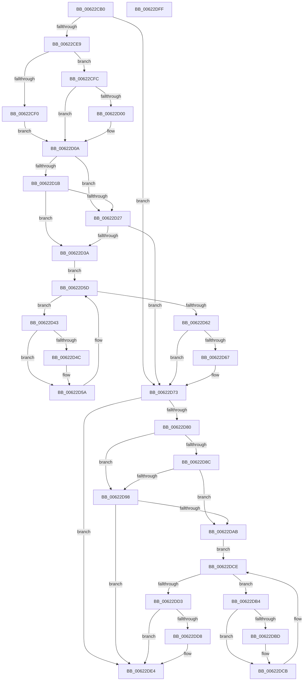

# DifExReleaseResourceAndLeavePriorityRegionWrapper

- RVA: `0x00622CB0`–`0x00622E00` (길이 `336` bytes)
- VA: `0x0000000140622CB0`
- 실행 섹션: `.text`
- PDB 이름 있음: `예`; PDB Function 태그: `아니요`
- unwind 정보 RVA: `0x0005D7BC`
- 디코드: `90`개 명령, `336/336` bytes 표시
- 미해석 바이트: `0` (있으면 어셈블리에 `.byte`로 보존)

> 이 문서는 커널 이미지의 기계어와 PDB 기호를 분석해 생성했습니다. 4번과 5번은 함수 원형과 자료형을 바이너리 사용 방식에서 추정한 C 해석이며 원본 소스 복구 결과는 아닙니다.

## 1. Dependencies

- 직접 호출 지점: **9**; 고유 호출 대상: **6**
- 직접 호출자로 확인된 함수: **0**
- RIP 상대 이미지 참조: **3**

### Outgoing calls
- `0x00622CD8` → [DifGetAPIThunkContextById](../49/DifGetAPIThunkContextById_function_00495A34.md) (function, `0x00495A34`)
- `0x00622D00` → [DifGetReturnAddressForWrappers](../4D/DifGetReturnAddressForWrappers_function_004D3C08.md) (function, `0x004D3C08`)
- `0x00622D2E` → [ExAcquireRundownProtection](../21/ExAcquireRundownProtection_function_00216620.md) (function, `0x00216620`)
- `0x00622D55` → [guard_dispatch_icall](../6B/guard_dispatch_icall_function_006BAAD0.md) (function, `0x006BAAD0`)
- `0x00622D6E` → [ExReleaseRundownProtection](../34/ExReleaseRundownProtection_function_00349E80.md) (function, `0x00349E80`)
- `0x00622D76` → [ExReleaseResourceAndLeavePriorityRegion](../65/ExReleaseResourceAndLeavePriorityRegion_function_00658DA0.md) (function, `0x00658DA0`)
- `0x00622D9F` → [ExAcquireRundownProtection](../21/ExAcquireRundownProtection_function_00216620.md) (function, `0x00216620`)
- `0x00622DC6` → [guard_dispatch_icall](../6B/guard_dispatch_icall_function_006BAAD0.md) (function, `0x006BAAD0`)
- `0x00622DDF` → [ExReleaseRundownProtection](../34/ExReleaseRundownProtection_function_00349E80.md) (function, `0x00349E80`)

### Direct callers
- 이 함수 시작 RVA로 연결되는 직접 call은 확인되지 않았습니다. 간접 호출은 완전히 역산할 수 없습니다.

### Static image references
- `0x00622D12` → RVA `0x00F048B8` (`.data`; read)
- `0x00622D1B` → RVA `0x00F04980` (`.data`; read)
- `0x00622D27` → RVA `0x00F03E80` (`.data`; read)

## 2. Other-region calls and transfers

- 다른 실행 섹션으로 향하는 call: **0**
- 별도 외부 분기/꼬리 이동을 확인하지 못했습니다.

## 3. Assembly (complete function range)

```asm
00622CB0  48 8B C4                        mov rax, rsp
00622CB3  48 89 58 08                     mov qword ptr [rax + 8], rbx
00622CB7  48 89 68 10                     mov qword ptr [rax + 0x10], rbp
00622CBB  48 89 70 18                     mov qword ptr [rax + 0x18], rsi
00622CBF  48 89 78 20                     mov qword ptr [rax + 0x20], rdi
00622CC3  41 56                           push r14
00622CC5  48 83 EC 30                     sub rsp, 0x30
00622CC9  48 8B E9                        mov rbp, rcx
00622CCC  0F 57 C0                        xorps xmm0, xmm0
00622CCF  B9 83 01 00 00                  mov ecx, 0x183
00622CD4  0F 11 40 E8                     movups xmmword ptr [rax - 0x18], xmm0
00622CD8  E8 57 2D E7 FF                  call 0x140495a34
00622CDD  48 8B F8                        mov rdi, rax
00622CE0  48 85 C0                        test rax, rax
00622CE3  0F 84 8A 00 00 00               je 0x140622d73
00622CE9  8B 40 0C                        mov eax, dword ptr [rax + 0xc]
00622CEC  A8 18                           test al, 0x18
00622CEE  74 0C                           je 0x140622cfc
00622CF0  48 8B 4C 24 38                  mov rcx, qword ptr [rsp + 0x38]
00622CF5  48 89 4C 24 20                  mov qword ptr [rsp + 0x20], rcx
00622CFA  EB 0E                           jmp 0x140622d0a
00622CFC  A8 04                           test al, 4
00622CFE  74 0A                           je 0x140622d0a
00622D00  E8 03 0F EB FF                  call 0x1404d3c08
00622D05  48 89 44 24 20                  mov qword ptr [rsp + 0x20], rax
00622D0A  40 32 F6                        xor sil, sil
00622D0D  48 89 6C 24 28                  mov qword ptr [rsp + 0x28], rbp
00622D12  40 38 35 9F 1B 8E 00            cmp byte ptr [rip + 0x8e1b9f], sil
00622D19  75 0C                           jne 0x140622d27
00622D1B  F7 05 5B 1C 8E 00 00 08 00 00   test dword ptr [rip + 0x8e1c5b], 0x800
00622D25  74 13                           je 0x140622d3a
00622D27  48 8D 0D 52 11 8E 00            lea rcx, [rip + 0x8e1152]
00622D2E  E8 ED 38 BF FF                  call 0x140216620
00622D33  40 8A F0                        mov sil, al
00622D36  84 C0                           test al, al
00622D38  74 39                           je 0x140622d73
00622D3A  4C 8D 77 20                     lea r14, [rdi + 0x20]
00622D3E  49 8B 1E                        mov rbx, qword ptr [r14]
00622D41  EB 1A                           jmp 0x140622d5d
00622D43  48 8D 43 F0                     lea rax, [rbx - 0x10]
00622D47  48 85 C0                        test rax, rax
00622D4A  74 0E                           je 0x140622d5a
00622D4C  48 8B 40 08                     mov rax, qword ptr [rax + 8]
00622D50  48 8D 4C 24 20                  lea rcx, [rsp + 0x20]
00622D55  E8 76 7D 09 00                  call 0x1406baad0
00622D5A  48 8B 1B                        mov rbx, qword ptr [rbx]
00622D5D  49 3B DE                        cmp rbx, r14
00622D60  75 E1                           jne 0x140622d43
00622D62  40 84 F6                        test sil, sil
00622D65  74 0C                           je 0x140622d73
00622D67  48 8D 0D 12 11 8E 00            lea rcx, [rip + 0x8e1112]
00622D6E  E8 0D 71 D2 FF                  call 0x140349e80
00622D73  48 8B CD                        mov rcx, rbp
00622D76  E8 25 60 03 00                  call 0x140658da0
00622D7B  48 85 FF                        test rdi, rdi
00622D7E  74 64                           je 0x140622de4
00622D80  40 32 F6                        xor sil, sil
00622D83  40 38 35 2E 1B 8E 00            cmp byte ptr [rip + 0x8e1b2e], sil
00622D8A  75 0C                           jne 0x140622d98
00622D8C  F7 05 EA 1B 8E 00 00 08 00 00   test dword ptr [rip + 0x8e1bea], 0x800
00622D96  74 13                           je 0x140622dab
00622D98  48 8D 0D E1 10 8E 00            lea rcx, [rip + 0x8e10e1]
00622D9F  E8 7C 38 BF FF                  call 0x140216620
00622DA4  40 8A F0                        mov sil, al
00622DA7  84 C0                           test al, al
00622DA9  74 39                           je 0x140622de4
00622DAB  48 83 C7 30                     add rdi, 0x30
00622DAF  48 8B 1F                        mov rbx, qword ptr [rdi]
00622DB2  EB 1A                           jmp 0x140622dce
00622DB4  48 8D 43 F0                     lea rax, [rbx - 0x10]
00622DB8  48 85 C0                        test rax, rax
00622DBB  74 0E                           je 0x140622dcb
00622DBD  48 8B 40 08                     mov rax, qword ptr [rax + 8]
00622DC1  48 8D 4C 24 20                  lea rcx, [rsp + 0x20]
00622DC6  E8 05 7D 09 00                  call 0x1406baad0
00622DCB  48 8B 1B                        mov rbx, qword ptr [rbx]
00622DCE  48 3B DF                        cmp rbx, rdi
00622DD1  75 E1                           jne 0x140622db4
00622DD3  40 84 F6                        test sil, sil
00622DD6  74 0C                           je 0x140622de4
00622DD8  48 8D 0D A1 10 8E 00            lea rcx, [rip + 0x8e10a1]
00622DDF  E8 9C 70 D2 FF                  call 0x140349e80
00622DE4  48 8B 5C 24 40                  mov rbx, qword ptr [rsp + 0x40]
00622DE9  48 8B 6C 24 48                  mov rbp, qword ptr [rsp + 0x48]
00622DEE  48 8B 74 24 50                  mov rsi, qword ptr [rsp + 0x50]
00622DF3  48 8B 7C 24 58                  mov rdi, qword ptr [rsp + 0x58]
00622DF8  48 83 C4 30                     add rsp, 0x30
00622DFC  41 5E                           pop r14
00622DFE  C3                              ret
00622DFF  CC                              int3
```

## 4. C-style interpretation (structured pseudocode)

```c
__int64 __fastcall DifExReleaseResourceAndLeavePriorityRegionWrapper(__int64 a1)
{
    __int64 result;
    __int64 v_rdi;
    __int64 v_rsi;
    __int64 v_rsp;
    unsigned __int64 v_stack_m10;
    unsigned __int64 v_stack_m18;
    unsigned __int64 v_stack_p0;
    unsigned __int64 v_stack_p10;
    unsigned __int64 v_stack_p18;
    unsigned __int64 v_stack_p20;
    unsigned __int64 v_stack_p8;

    *(unsigned __int64 *)(v_rsp + 8) = v_rbx;
    *(unsigned __int64 *)(v_rsp + 16) = v_rbp;
    *(unsigned __int64 *)(v_rsp + 24) = v_rsi;
    *(unsigned __int64 *)(v_rsp + 32) = v_rdi;
    v_rsp = (v_rsp) - (48);
    *(unsigned __int64 *)(v_rsp - 24) = v_xmm0;
    result = DifGetAPIThunkContextById(387, a2, a3, a4);
    if (result == 0) goto loc_00622D73;
    if ((((unsigned __int8)((unsigned int)(*(unsigned int *)(result + 12)))) & (24)) == 0) goto loc_00622CFC;
    v_stack_m18 = v_stack_p0;
    goto loc_00622D0A;
loc_00622CFC:
    result = (unsigned int)(*(unsigned int *)(result + 12));
    if ((((unsigned __int8)((unsigned int)(*(unsigned int *)(result + 12)))) & (4)) != 0) {
        result = DifGetReturnAddressForWrappers(v_stack_p0, a2, a3, a4);
        v_stack_m18 = result;
    }
    v_rsi = 0;
    v_stack_m10 = a1;
    if ((*(unsigned __int8 *)(v_rip + 9313183)) != 0) goto loc_00622D27;
    if (((*(unsigned int *)(v_rip + 9313371)) & (0x800ULL)) == 0) goto loc_00622D3A;
loc_00622D27:
    result = ExAcquireRundownProtection(v_rip + 9310546, a2, a3, a4);
    if ((unsigned __int8)(result) == 0) goto loc_00622D73;
loc_00622D3A:
    goto loc_00622D5D;
loc_00622D43:
    result = *(unsigned __int64 *)(result + 32) - 16;
    if (*(unsigned __int64 *)(result + 32) - 16 != 0) {
        result = *(unsigned __int64 *)(*(unsigned __int64 *)(result + 32) - 16 + 8);
        a1 = v_stack_m18;
        result = guard_dispatch_icall(a1, a2, a3, a4);
    }
loc_00622D5D:
    if ((*(unsigned __int64 *)(*(unsigned __int64 *)(result + 32))) != (result + 32)) goto loc_00622D43;
    if ((unsigned __int8)((unsigned __int8)(result)) != 0) {
        a1 = v_rip + 9310482;
        result = ExReleaseRundownProtection(a1, a2, a3, a4);
    }
    result = ExReleaseResourceAndLeavePriorityRegion(a1, a2, a3, a4);
    if (result == 0) goto loc_00622DE4;
    v_rsi = 0;
    if ((*(unsigned __int8 *)(v_rip + 9313070)) != 0) goto loc_00622D98;
    if (((*(unsigned int *)(v_rip + 9313258)) & (0x800ULL)) == 0) goto loc_00622DAB;
loc_00622D98:
    result = ExAcquireRundownProtection(v_rip + 9310433, a2, a3, a4);
    if ((unsigned __int8)(result) == 0) goto loc_00622DE4;
loc_00622DAB:
    v_rdi = (result) + (48);
    goto loc_00622DCE;
loc_00622DB4:
    result = *(unsigned __int64 *)(v_rdi) - 16;
    if (*(unsigned __int64 *)(v_rdi) - 16 != 0) {
        result = *(unsigned __int64 *)(*(unsigned __int64 *)(v_rdi) - 16 + 8);
        a1 = v_stack_m18;
        result = guard_dispatch_icall(a1, a2, a3, a4);
    }
loc_00622DCE:
    if ((*(unsigned __int64 *)(*(unsigned __int64 *)(v_rdi))) != v_rdi) goto loc_00622DB4;
    if ((unsigned __int8)((unsigned __int8)(result)) != 0) {
        a1 = v_rip + 9310369;
        result = ExReleaseRundownProtection(a1, a2, a3, a4);
    }
    v_rsp = (v_rsp) + (48);
    return result;
}
```

## 5. (Beta) C Style

```c
int64_t DifExReleaseResourceAndLeavePriorityRegionWrapper(int64_t Arg1)
{
    int64_t result;
    int64_t local_rdi;
    int64_t local_rsi;
    int64_t local_rsp;
    uint64_t v_stack_m10;
    uint64_t v_stack_m18;
    uint64_t v_stack_p0;
    uint64_t v_stack_p10;
    uint64_t v_stack_p18;
    uint64_t v_stack_p20;
    uint64_t v_stack_p8;

    *(uint64_t *)(local_rsp + 0x8) = local_rbx;
    *(uint64_t *)(local_rsp + 0x10) = local_rbp;
    *(uint64_t *)(local_rsp + 0x18) = local_rsi;
    *(uint64_t *)(local_rsp + 0x20) = local_rdi;
    local_rsp = (local_rsp) - (48);
    *(uint64_t *)(local_rsp - 0x18) = v_xmm0;
    result = DifGetAPIThunkContextById(387, a2, a3, a4);
    if (result == 0) goto loc_00622D73;
    if ((((uint8_t)((uint32_t)(*(uint32_t *)(result + 0xC)))) & (24)) == 0) goto loc_00622CFC;
    v_stack_m18 = v_stack_p0;
    goto loc_00622D0A;
loc_00622CFC:
    result = (uint32_t)(*(uint32_t *)(result + 0xC));
    if ((((uint8_t)((uint32_t)(*(uint32_t *)(result + 0xC)))) & (4)) != 0) {
        result = DifGetReturnAddressForWrappers(v_stack_p0, a2, a3, a4);
        v_stack_m18 = result;
    }
    local_rsi = 0;
    v_stack_m10 = Arg1;
    if ((*(uint8_t *)(v_rip + 0x8E1B9F)) != 0) goto loc_00622D27;
    if (((*(uint32_t *)(v_rip + 0x8E1C5B)) & (0x800ULL)) == 0) goto loc_00622D3A;
loc_00622D27:
    result = ExAcquireRundownProtection(v_rip + 9310546, a2, a3, a4);
    if ((uint8_t)(result) == 0) goto loc_00622D73;
loc_00622D3A:
    goto loc_00622D5D;
loc_00622D43:
    result = *(uint64_t *)(result + 0x20) - 16;
    if (*(uint64_t *)(result + 0x20) - 16 != 0) {
        result = *(uint64_t *)(*(uint64_t *)(result + 0x20) - 0x10 + 0x8);
        Arg1 = v_stack_m18;
        result = guard_dispatch_icall(Arg1, a2, a3, a4);
    }
loc_00622D5D:
    if ((*(uint64_t *)(*(uint64_t *)(result + 0x20))) != (result + 32)) goto loc_00622D43;
    if ((uint8_t)((uint8_t)(result)) != 0) {
        Arg1 = v_rip + 9310482;
        result = ExReleaseRundownProtection(Arg1, a2, a3, a4);
    }
    result = ExReleaseResourceAndLeavePriorityRegion(Arg1, a2, a3, a4);
    if (result == 0) goto loc_00622DE4;
    local_rsi = 0;
    if ((*(uint8_t *)(v_rip + 0x8E1B2E)) != 0) goto loc_00622D98;
    if (((*(uint32_t *)(v_rip + 0x8E1BEA)) & (0x800ULL)) == 0) goto loc_00622DAB;
loc_00622D98:
    result = ExAcquireRundownProtection(v_rip + 9310433, a2, a3, a4);
    if ((uint8_t)(result) == 0) goto loc_00622DE4;
loc_00622DAB:
    local_rdi = (result) + (48);
    goto loc_00622DCE;
loc_00622DB4:
    result = *(uint64_t *)(local_rdi) - 16;
    if (*(uint64_t *)(local_rdi) - 16 != 0) {
        result = *(uint64_t *)(*(uint64_t *)(local_rdi) - 0x10 + 0x8);
        Arg1 = v_stack_m18;
        result = guard_dispatch_icall(Arg1, a2, a3, a4);
    }
loc_00622DCE:
    if ((*(uint64_t *)(*(uint64_t *)(local_rdi))) != local_rdi) goto loc_00622DB4;
    if ((uint8_t)((uint8_t)(result)) != 0) {
        Arg1 = v_rip + 9310369;
        result = ExReleaseRundownProtection(Arg1, a2, a3, a4);
    }
    local_rsp = (local_rsp) + (48);
    return result;
}
```

## 6. Execution-region graph

[열기: 2D/3D 그래프와 함수 탐색 컨트롤 패널](../../../control-panel.html?section=text&rva=0x00622CB0&view=graph)

- 2D 그래프는 위에서 아래로 흐르고, 3D 그래프는 빈 공간을 드래그해 회전합니다. Shift+드래그는 이동, 휠은 확대·축소, 함수 노드 선택은 대상 보고서 이동입니다.

### Static fallback


