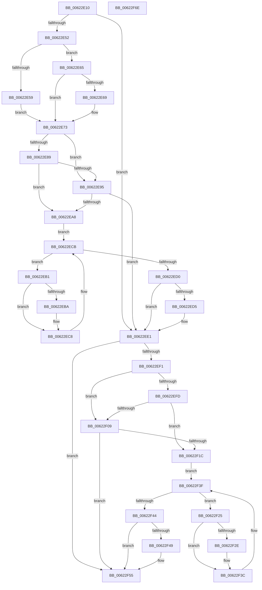

# DifExReleaseResourceForThreadLiteWrapper

- RVA: `0x00622E10`–`0x00622F6F` (길이 `351` bytes)
- VA: `0x0000000140622E10`
- 실행 섹션: `.text`
- PDB 이름 있음: `예`; PDB Function 태그: `아니요`
- unwind 정보 RVA: `0x00093E28`
- 디코드: `97`개 명령, `351/351` bytes 표시
- 미해석 바이트: `0` (있으면 어셈블리에 `.byte`로 보존)

> 이 문서는 커널 이미지의 기계어와 PDB 기호를 분석해 생성했습니다. 4번과 5번은 함수 원형과 자료형을 바이너리 사용 방식에서 추정한 C 해석이며 원본 소스 복구 결과는 아닙니다.

## 1. Dependencies

- 직접 호출 지점: **9**; 고유 호출 대상: **6**
- 직접 호출자로 확인된 함수: **0**
- RIP 상대 이미지 참조: **3**

### Outgoing calls
- `0x00622E41` → [DifGetAPIThunkContextById](../49/DifGetAPIThunkContextById_function_00495A34.md) (function, `0x00495A34`)
- `0x00622E69` → [DifGetReturnAddressForWrappers](../4D/DifGetReturnAddressForWrappers_function_004D3C08.md) (function, `0x004D3C08`)
- `0x00622E9C` → [ExAcquireRundownProtection](../21/ExAcquireRundownProtection_function_00216620.md) (function, `0x00216620`)
- `0x00622EC3` → [guard_dispatch_icall](../6B/guard_dispatch_icall_function_006BAAD0.md) (function, `0x006BAAD0`)
- `0x00622EDC` → [ExReleaseRundownProtection](../34/ExReleaseRundownProtection_function_00349E80.md) (function, `0x00349E80`)
- `0x00622EE7` → [ExReleaseResourceForThreadLite](../27/ExReleaseResourceForThreadLite_function_00273C10.md) (function, `0x00273C10`)
- `0x00622F10` → [ExAcquireRundownProtection](../21/ExAcquireRundownProtection_function_00216620.md) (function, `0x00216620`)
- `0x00622F37` → [guard_dispatch_icall](../6B/guard_dispatch_icall_function_006BAAD0.md) (function, `0x006BAAD0`)
- `0x00622F50` → [ExReleaseRundownProtection](../34/ExReleaseRundownProtection_function_00349E80.md) (function, `0x00349E80`)

### Direct callers
- 이 함수 시작 RVA로 연결되는 직접 call은 확인되지 않았습니다. 간접 호출은 완전히 역산할 수 없습니다.

### Static image references
- `0x00622E7B` → RVA `0x00F048B8` (`.data`; read)
- `0x00622E89` → RVA `0x00F04980` (`.data`; read)
- `0x00622E95` → RVA `0x00F03E80` (`.data`; read)

## 2. Other-region calls and transfers

- 다른 실행 섹션으로 향하는 call: **0**
- 별도 외부 분기/꼬리 이동을 확인하지 못했습니다.

## 3. Assembly (complete function range)

```asm
00622E10  4C 8B DC                        mov r11, rsp
00622E13  49 89 5B 08                     mov qword ptr [r11 + 8], rbx
00622E17  49 89 6B 10                     mov qword ptr [r11 + 0x10], rbp
00622E1B  49 89 73 18                     mov qword ptr [r11 + 0x18], rsi
00622E1F  57                              push rdi
00622E20  41 56                           push r14
00622E22  41 57                           push r15
00622E24  48 83 EC 40                     sub rsp, 0x40
00622E28  33 C0                           xor eax, eax
00622E2A  0F 57 C0                        xorps xmm0, xmm0
00622E2D  0F 11 44 24 20                  movups xmmword ptr [rsp + 0x20], xmm0
00622E32  4C 8B F9                        mov r15, rcx
00622E35  49 89 43 D8                     mov qword ptr [r11 - 0x28], rax
00622E39  B9 82 01 00 00                  mov ecx, 0x182
00622E3E  4C 8B F2                        mov r14, rdx
00622E41  E8 EE 2B E7 FF                  call 0x140495a34
00622E46  48 8B F0                        mov rsi, rax
00622E49  48 85 C0                        test rax, rax
00622E4C  0F 84 8F 00 00 00               je 0x140622ee1
00622E52  8B 40 0C                        mov eax, dword ptr [rax + 0xc]
00622E55  A8 18                           test al, 0x18
00622E57  74 0C                           je 0x140622e65
00622E59  48 8B 4C 24 58                  mov rcx, qword ptr [rsp + 0x58]
00622E5E  48 89 4C 24 20                  mov qword ptr [rsp + 0x20], rcx
00622E63  EB 0E                           jmp 0x140622e73
00622E65  A8 04                           test al, 4
00622E67  74 0A                           je 0x140622e73
00622E69  E8 9A 0D EB FF                  call 0x1404d3c08
00622E6E  48 89 44 24 20                  mov qword ptr [rsp + 0x20], rax
00622E73  40 32 ED                        xor bpl, bpl
00622E76  4C 89 7C 24 30                  mov qword ptr [rsp + 0x30], r15
00622E7B  40 38 2D 36 1A 8E 00            cmp byte ptr [rip + 0x8e1a36], bpl
00622E82  4C 89 74 24 28                  mov qword ptr [rsp + 0x28], r14
00622E87  75 0C                           jne 0x140622e95
00622E89  F7 05 ED 1A 8E 00 00 08 00 00   test dword ptr [rip + 0x8e1aed], 0x800
00622E93  74 13                           je 0x140622ea8
00622E95  48 8D 0D E4 0F 8E 00            lea rcx, [rip + 0x8e0fe4]
00622E9C  E8 7F 37 BF FF                  call 0x140216620
00622EA1  40 8A E8                        mov bpl, al
00622EA4  84 C0                           test al, al
00622EA6  74 39                           je 0x140622ee1
00622EA8  48 8D 7E 20                     lea rdi, [rsi + 0x20]
00622EAC  48 8B 1F                        mov rbx, qword ptr [rdi]
00622EAF  EB 1A                           jmp 0x140622ecb
00622EB1  48 8D 43 F0                     lea rax, [rbx - 0x10]
00622EB5  48 85 C0                        test rax, rax
00622EB8  74 0E                           je 0x140622ec8
00622EBA  48 8B 40 08                     mov rax, qword ptr [rax + 8]
00622EBE  48 8D 4C 24 20                  lea rcx, [rsp + 0x20]
00622EC3  E8 08 7C 09 00                  call 0x1406baad0
00622EC8  48 8B 1B                        mov rbx, qword ptr [rbx]
00622ECB  48 3B DF                        cmp rbx, rdi
00622ECE  75 E1                           jne 0x140622eb1
00622ED0  40 84 ED                        test bpl, bpl
00622ED3  74 0C                           je 0x140622ee1
00622ED5  48 8D 0D A4 0F 8E 00            lea rcx, [rip + 0x8e0fa4]
00622EDC  E8 9F 6F D2 FF                  call 0x140349e80
00622EE1  49 8B D6                        mov rdx, r14
00622EE4  49 8B CF                        mov rcx, r15
00622EE7  E8 24 0D C5 FF                  call 0x140273c10
00622EEC  48 85 F6                        test rsi, rsi
00622EEF  74 64                           je 0x140622f55
00622EF1  40 32 FF                        xor dil, dil
00622EF4  40 38 3D BD 19 8E 00            cmp byte ptr [rip + 0x8e19bd], dil
00622EFB  75 0C                           jne 0x140622f09
00622EFD  F7 05 79 1A 8E 00 00 08 00 00   test dword ptr [rip + 0x8e1a79], 0x800
00622F07  74 13                           je 0x140622f1c
00622F09  48 8D 0D 70 0F 8E 00            lea rcx, [rip + 0x8e0f70]
00622F10  E8 0B 37 BF FF                  call 0x140216620
00622F15  40 8A F8                        mov dil, al
00622F18  84 C0                           test al, al
00622F1A  74 39                           je 0x140622f55
00622F1C  48 83 C6 30                     add rsi, 0x30
00622F20  48 8B 1E                        mov rbx, qword ptr [rsi]
00622F23  EB 1A                           jmp 0x140622f3f
00622F25  48 8D 43 F0                     lea rax, [rbx - 0x10]
00622F29  48 85 C0                        test rax, rax
00622F2C  74 0E                           je 0x140622f3c
00622F2E  48 8B 40 08                     mov rax, qword ptr [rax + 8]
00622F32  48 8D 4C 24 20                  lea rcx, [rsp + 0x20]
00622F37  E8 94 7B 09 00                  call 0x1406baad0
00622F3C  48 8B 1B                        mov rbx, qword ptr [rbx]
00622F3F  48 3B DE                        cmp rbx, rsi
00622F42  75 E1                           jne 0x140622f25
00622F44  40 84 FF                        test dil, dil
00622F47  74 0C                           je 0x140622f55
00622F49  48 8D 0D 30 0F 8E 00            lea rcx, [rip + 0x8e0f30]
00622F50  E8 2B 6F D2 FF                  call 0x140349e80
00622F55  48 8B 5C 24 60                  mov rbx, qword ptr [rsp + 0x60]
00622F5A  48 8B 6C 24 68                  mov rbp, qword ptr [rsp + 0x68]
00622F5F  48 8B 74 24 70                  mov rsi, qword ptr [rsp + 0x70]
00622F64  48 83 C4 40                     add rsp, 0x40
00622F68  41 5F                           pop r15
00622F6A  41 5E                           pop r14
00622F6C  5F                              pop rdi
00622F6D  C3                              ret
00622F6E  CC                              int3
```

## 4. C-style interpretation (structured pseudocode)

```c
__int64 __fastcall DifExReleaseResourceForThreadLiteWrapper(__int64 a1, __int64 a2)
{
    __int64 result;
    __int64 v_rbp;
    __int64 v_rdi;
    __int64 v_rsi;
    __int64 v_rsp;
    unsigned __int64 v_stack_m28;
    unsigned __int64 v_stack_m30;
    unsigned __int64 v_stack_m38;
    unsigned __int64 v_stack_p0;
    unsigned __int64 v_stack_p10;
    unsigned __int64 v_stack_p18;
    unsigned __int64 v_stack_p8;

    *(unsigned __int64 *)(v_rsp + 8) = v_rbx;
    *(unsigned __int64 *)(v_rsp + 16) = v_rbp;
    *(unsigned __int64 *)(v_rsp + 24) = v_rsi;
    v_rsp = (v_rsp) - (64);
    result = 0;
    v_stack_m38 = v_xmm0;
    *(unsigned __int64 *)(v_rsp - 40) = 0;
    result = DifGetAPIThunkContextById(386, a2, a3, a4);
    if (result == 0) goto loc_00622EE1;
    if ((((unsigned __int8)((unsigned int)(*(unsigned int *)(result + 12)))) & (24)) == 0) goto loc_00622E65;
    v_stack_m38 = v_stack_p0;
    goto loc_00622E73;
loc_00622E65:
    result = (unsigned int)(*(unsigned int *)(result + 12));
    if ((((unsigned __int8)((unsigned int)(*(unsigned int *)(result + 12)))) & (4)) != 0) {
        result = DifGetReturnAddressForWrappers(v_stack_p0, a2, a3, a4);
        v_stack_m38 = result;
    }
    v_rbp = 0;
    v_stack_m28 = a1;
    v_stack_m30 = a2;
    if ((*(unsigned __int8 *)(v_rip + 9312822)) != 0) goto loc_00622E95;
    if (((*(unsigned int *)(v_rip + 9313005)) & (0x800ULL)) == 0) goto loc_00622EA8;
loc_00622E95:
    result = ExAcquireRundownProtection(v_rip + 9310180, a2, a3, a4);
    if ((unsigned __int8)(result) == 0) goto loc_00622EE1;
loc_00622EA8:
    goto loc_00622ECB;
loc_00622EB1:
    result = *(unsigned __int64 *)(result + 32) - 16;
    if (*(unsigned __int64 *)(result + 32) - 16 != 0) {
        result = *(unsigned __int64 *)(*(unsigned __int64 *)(result + 32) - 16 + 8);
        a1 = v_stack_m38;
        result = guard_dispatch_icall(a1, a2, a3, a4);
    }
loc_00622ECB:
    if ((*(unsigned __int64 *)(*(unsigned __int64 *)(result + 32))) != (result + 32)) goto loc_00622EB1;
    if ((unsigned __int8)((unsigned __int8)(result)) != 0) {
        a1 = v_rip + 9310116;
        result = ExReleaseRundownProtection(a1, a2, a3, a4);
    }
    result = ExReleaseResourceForThreadLite(a1, a2, a3, a4);
    if (result == 0) goto loc_00622F55;
    v_rdi = 0;
    if ((*(unsigned __int8 *)(v_rip + 9312701)) != 0) goto loc_00622F09;
    if (((*(unsigned int *)(v_rip + 9312889)) & (0x800ULL)) == 0) goto loc_00622F1C;
loc_00622F09:
    result = ExAcquireRundownProtection(v_rip + 9310064, a2, a3, a4);
    if ((unsigned __int8)(result) == 0) goto loc_00622F55;
loc_00622F1C:
    v_rsi = (result) + (48);
    goto loc_00622F3F;
loc_00622F25:
    result = *(unsigned __int64 *)(v_rsi) - 16;
    if (*(unsigned __int64 *)(v_rsi) - 16 != 0) {
        result = *(unsigned __int64 *)(*(unsigned __int64 *)(v_rsi) - 16 + 8);
        a1 = v_stack_m38;
        result = guard_dispatch_icall(a1, a2, a3, a4);
    }
loc_00622F3F:
    if ((*(unsigned __int64 *)(*(unsigned __int64 *)(v_rsi))) != v_rsi) goto loc_00622F25;
    if ((unsigned __int8)((unsigned __int8)(result)) != 0) {
        a1 = v_rip + 9310000;
        result = ExReleaseRundownProtection(a1, a2, a3, a4);
    }
    v_rsp = (v_rsp) + (64);
    return result;
}
```

## 5. (Beta) C Style

```c
int64_t DifExReleaseResourceForThreadLiteWrapper(int64_t Arg1, int64_t Arg2)
{
    int64_t result;
    int64_t local_rbp;
    int64_t local_rdi;
    int64_t local_rsi;
    int64_t local_rsp;
    uint64_t v_stack_m28;
    uint64_t v_stack_m30;
    uint64_t v_stack_m38;
    uint64_t v_stack_p0;
    uint64_t v_stack_p10;
    uint64_t v_stack_p18;
    uint64_t v_stack_p8;

    *(uint64_t *)(local_rsp + 0x8) = local_rbx;
    *(uint64_t *)(local_rsp + 0x10) = local_rbp;
    *(uint64_t *)(local_rsp + 0x18) = local_rsi;
    local_rsp = (local_rsp) - (64);
    result = 0;
    v_stack_m38 = v_xmm0;
    *(uint64_t *)(local_rsp - 0x28) = 0;
    result = DifGetAPIThunkContextById(386, Arg2, a3, a4);
    if (result == 0) goto loc_00622EE1;
    if ((((uint8_t)((uint32_t)(*(uint32_t *)(result + 0xC)))) & (24)) == 0) goto loc_00622E65;
    v_stack_m38 = v_stack_p0;
    goto loc_00622E73;
loc_00622E65:
    result = (uint32_t)(*(uint32_t *)(result + 0xC));
    if ((((uint8_t)((uint32_t)(*(uint32_t *)(result + 0xC)))) & (4)) != 0) {
        result = DifGetReturnAddressForWrappers(v_stack_p0, Arg2, a3, a4);
        v_stack_m38 = result;
    }
    local_rbp = 0;
    v_stack_m28 = Arg1;
    v_stack_m30 = Arg2;
    if ((*(uint8_t *)(v_rip + 0x8E1A36)) != 0) goto loc_00622E95;
    if (((*(uint32_t *)(v_rip + 0x8E1AED)) & (0x800ULL)) == 0) goto loc_00622EA8;
loc_00622E95:
    result = ExAcquireRundownProtection(v_rip + 9310180, Arg2, a3, a4);
    if ((uint8_t)(result) == 0) goto loc_00622EE1;
loc_00622EA8:
    goto loc_00622ECB;
loc_00622EB1:
    result = *(uint64_t *)(result + 0x20) - 16;
    if (*(uint64_t *)(result + 0x20) - 16 != 0) {
        result = *(uint64_t *)(*(uint64_t *)(result + 0x20) - 0x10 + 0x8);
        Arg1 = v_stack_m38;
        result = guard_dispatch_icall(Arg1, Arg2, a3, a4);
    }
loc_00622ECB:
    if ((*(uint64_t *)(*(uint64_t *)(result + 0x20))) != (result + 32)) goto loc_00622EB1;
    if ((uint8_t)((uint8_t)(result)) != 0) {
        Arg1 = v_rip + 9310116;
        result = ExReleaseRundownProtection(Arg1, Arg2, a3, a4);
    }
    result = ExReleaseResourceForThreadLite(Arg1, Arg2, a3, a4);
    if (result == 0) goto loc_00622F55;
    local_rdi = 0;
    if ((*(uint8_t *)(v_rip + 0x8E19BD)) != 0) goto loc_00622F09;
    if (((*(uint32_t *)(v_rip + 0x8E1A79)) & (0x800ULL)) == 0) goto loc_00622F1C;
loc_00622F09:
    result = ExAcquireRundownProtection(v_rip + 9310064, Arg2, a3, a4);
    if ((uint8_t)(result) == 0) goto loc_00622F55;
loc_00622F1C:
    local_rsi = (result) + (48);
    goto loc_00622F3F;
loc_00622F25:
    result = *(uint64_t *)(local_rsi) - 16;
    if (*(uint64_t *)(local_rsi) - 16 != 0) {
        result = *(uint64_t *)(*(uint64_t *)(local_rsi) - 0x10 + 0x8);
        Arg1 = v_stack_m38;
        result = guard_dispatch_icall(Arg1, Arg2, a3, a4);
    }
loc_00622F3F:
    if ((*(uint64_t *)(*(uint64_t *)(local_rsi))) != local_rsi) goto loc_00622F25;
    if ((uint8_t)((uint8_t)(result)) != 0) {
        Arg1 = v_rip + 9310000;
        result = ExReleaseRundownProtection(Arg1, Arg2, a3, a4);
    }
    local_rsp = (local_rsp) + (64);
    return result;
}
```

## 6. Execution-region graph

[열기: 2D/3D 그래프와 함수 탐색 컨트롤 패널](../../../control-panel.html?section=text&rva=0x00622E10&view=graph)

- 2D 그래프는 위에서 아래로 흐르고, 3D 그래프는 빈 공간을 드래그해 회전합니다. Shift+드래그는 이동, 휠은 확대·축소, 함수 노드 선택은 대상 보고서 이동입니다.

### Static fallback


