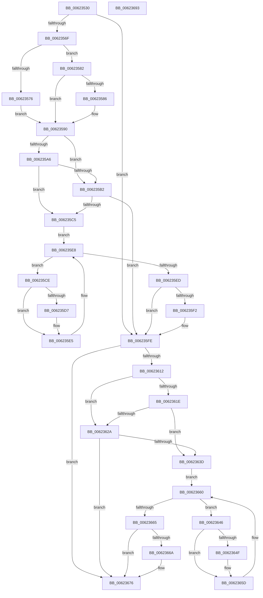

# DifExTryToConvertFastResourceSharedToExclusiveWrapper

- RVA: `0x00623530`–`0x00623694` (길이 `356` bytes)
- VA: `0x0000000140623530`
- 실행 섹션: `.text`
- PDB 이름 있음: `예`; PDB Function 태그: `아니요`
- unwind 정보 RVA: `0x00093E28`
- 디코드: `98`개 명령, `356/356` bytes 표시
- 미해석 바이트: `0` (있으면 어셈블리에 `.byte`로 보존)

> 이 문서는 커널 이미지의 기계어와 PDB 기호를 분석해 생성했습니다. 4번과 5번은 함수 원형과 자료형을 바이너리 사용 방식에서 추정한 C 해석이며 원본 소스 복구 결과는 아닙니다.

## 1. Dependencies

- 직접 호출 지점: **9**; 고유 호출 대상: **6**
- 직접 호출자로 확인된 함수: **0**
- RIP 상대 이미지 참조: **3**

### Outgoing calls
- `0x0062355E` → [DifGetAPIThunkContextById](../49/DifGetAPIThunkContextById_function_00495A34.md) (function, `0x00495A34`)
- `0x00623586` → [DifGetReturnAddressForWrappers](../4D/DifGetReturnAddressForWrappers_function_004D3C08.md) (function, `0x004D3C08`)
- `0x006235B9` → [ExAcquireRundownProtection](../21/ExAcquireRundownProtection_function_00216620.md) (function, `0x00216620`)
- `0x006235E0` → [guard_dispatch_icall](../6B/guard_dispatch_icall_function_006BAAD0.md) (function, `0x006BAAD0`)
- `0x006235F9` → [ExReleaseRundownProtection](../34/ExReleaseRundownProtection_function_00349E80.md) (function, `0x00349E80`)
- `0x00623604` → [ExTryToConvertFastResourceSharedToExclusive](../65/ExTryToConvertFastResourceSharedToExclusive_function_00658A30.md) (function, `0x00658A30`)
- `0x00623631` → [ExAcquireRundownProtection](../21/ExAcquireRundownProtection_function_00216620.md) (function, `0x00216620`)
- `0x00623658` → [guard_dispatch_icall](../6B/guard_dispatch_icall_function_006BAAD0.md) (function, `0x006BAAD0`)
- `0x00623671` → [ExReleaseRundownProtection](../34/ExReleaseRundownProtection_function_00349E80.md) (function, `0x00349E80`)

### Direct callers
- 이 함수 시작 RVA로 연결되는 직접 call은 확인되지 않았습니다. 간접 호출은 완전히 역산할 수 없습니다.

### Static image references
- `0x00623598` → RVA `0x00F048B8` (`.data`; read)
- `0x006235A6` → RVA `0x00F04980` (`.data`; read)
- `0x006235B2` → RVA `0x00F03E80` (`.data`; read)

## 2. Other-region calls and transfers

- 다른 실행 섹션으로 향하는 call: **0**
- 별도 외부 분기/꼬리 이동을 확인하지 못했습니다.

## 3. Assembly (complete function range)

```asm
00623530  48 8B C4                        mov rax, rsp
00623533  48 89 58 08                     mov qword ptr [rax + 8], rbx
00623537  48 89 68 10                     mov qword ptr [rax + 0x10], rbp
0062353B  48 89 70 18                     mov qword ptr [rax + 0x18], rsi
0062353F  57                              push rdi
00623540  41 56                           push r14
00623542  41 57                           push r15
00623544  48 83 EC 40                     sub rsp, 0x40
00623548  0F 57 C0                        xorps xmm0, xmm0
0062354B  4C 8B F9                        mov r15, rcx
0062354E  B9 CA 01 00 00                  mov ecx, 0x1ca
00623553  4C 8B F2                        mov r14, rdx
00623556  0F 11 40 C8                     movups xmmword ptr [rax - 0x38], xmm0
0062355A  0F 11 40 D8                     movups xmmword ptr [rax - 0x28], xmm0
0062355E  E8 D1 24 E7 FF                  call 0x140495a34
00623563  48 8B F0                        mov rsi, rax
00623566  48 85 C0                        test rax, rax
00623569  0F 84 8F 00 00 00               je 0x1406235fe
0062356F  8B 40 0C                        mov eax, dword ptr [rax + 0xc]
00623572  A8 18                           test al, 0x18
00623574  74 0C                           je 0x140623582
00623576  48 8B 4C 24 58                  mov rcx, qword ptr [rsp + 0x58]
0062357B  48 89 4C 24 20                  mov qword ptr [rsp + 0x20], rcx
00623580  EB 0E                           jmp 0x140623590
00623582  A8 04                           test al, 4
00623584  74 0A                           je 0x140623590
00623586  E8 7D 06 EB FF                  call 0x1404d3c08
0062358B  48 89 44 24 20                  mov qword ptr [rsp + 0x20], rax
00623590  40 32 ED                        xor bpl, bpl
00623593  4C 89 7C 24 30                  mov qword ptr [rsp + 0x30], r15
00623598  40 38 2D 19 13 8E 00            cmp byte ptr [rip + 0x8e1319], bpl
0062359F  4C 89 74 24 28                  mov qword ptr [rsp + 0x28], r14
006235A4  75 0C                           jne 0x1406235b2
006235A6  F7 05 D0 13 8E 00 00 08 00 00   test dword ptr [rip + 0x8e13d0], 0x800
006235B0  74 13                           je 0x1406235c5
006235B2  48 8D 0D C7 08 8E 00            lea rcx, [rip + 0x8e08c7]
006235B9  E8 62 30 BF FF                  call 0x140216620
006235BE  40 8A E8                        mov bpl, al
006235C1  84 C0                           test al, al
006235C3  74 39                           je 0x1406235fe
006235C5  48 8D 7E 20                     lea rdi, [rsi + 0x20]
006235C9  48 8B 1F                        mov rbx, qword ptr [rdi]
006235CC  EB 1A                           jmp 0x1406235e8
006235CE  48 8D 43 F0                     lea rax, [rbx - 0x10]
006235D2  48 85 C0                        test rax, rax
006235D5  74 0E                           je 0x1406235e5
006235D7  48 8B 40 08                     mov rax, qword ptr [rax + 8]
006235DB  48 8D 4C 24 20                  lea rcx, [rsp + 0x20]
006235E0  E8 EB 74 09 00                  call 0x1406baad0
006235E5  48 8B 1B                        mov rbx, qword ptr [rbx]
006235E8  48 3B DF                        cmp rbx, rdi
006235EB  75 E1                           jne 0x1406235ce
006235ED  40 84 ED                        test bpl, bpl
006235F0  74 0C                           je 0x1406235fe
006235F2  48 8D 0D 87 08 8E 00            lea rcx, [rip + 0x8e0887]
006235F9  E8 82 68 D2 FF                  call 0x140349e80
006235FE  49 8B D6                        mov rdx, r14
00623601  49 8B CF                        mov rcx, r15
00623604  E8 27 54 03 00                  call 0x140658a30
00623609  88 44 24 38                     mov byte ptr [rsp + 0x38], al
0062360D  48 85 F6                        test rsi, rsi
00623610  74 64                           je 0x140623676
00623612  40 32 FF                        xor dil, dil
00623615  40 38 3D 9C 12 8E 00            cmp byte ptr [rip + 0x8e129c], dil
0062361C  75 0C                           jne 0x14062362a
0062361E  F7 05 58 13 8E 00 00 08 00 00   test dword ptr [rip + 0x8e1358], 0x800
00623628  74 13                           je 0x14062363d
0062362A  48 8D 0D 4F 08 8E 00            lea rcx, [rip + 0x8e084f]
00623631  E8 EA 2F BF FF                  call 0x140216620
00623636  40 8A F8                        mov dil, al
00623639  84 C0                           test al, al
0062363B  74 39                           je 0x140623676
0062363D  48 83 C6 30                     add rsi, 0x30
00623641  48 8B 1E                        mov rbx, qword ptr [rsi]
00623644  EB 1A                           jmp 0x140623660
00623646  48 8D 43 F0                     lea rax, [rbx - 0x10]
0062364A  48 85 C0                        test rax, rax
0062364D  74 0E                           je 0x14062365d
0062364F  48 8B 40 08                     mov rax, qword ptr [rax + 8]
00623653  48 8D 4C 24 20                  lea rcx, [rsp + 0x20]
00623658  E8 73 74 09 00                  call 0x1406baad0
0062365D  48 8B 1B                        mov rbx, qword ptr [rbx]
00623660  48 3B DE                        cmp rbx, rsi
00623663  75 E1                           jne 0x140623646
00623665  40 84 FF                        test dil, dil
00623668  74 0C                           je 0x140623676
0062366A  48 8D 0D 0F 08 8E 00            lea rcx, [rip + 0x8e080f]
00623671  E8 0A 68 D2 FF                  call 0x140349e80
00623676  8A 44 24 38                     mov al, byte ptr [rsp + 0x38]
0062367A  48 8B 5C 24 60                  mov rbx, qword ptr [rsp + 0x60]
0062367F  48 8B 6C 24 68                  mov rbp, qword ptr [rsp + 0x68]
00623684  48 8B 74 24 70                  mov rsi, qword ptr [rsp + 0x70]
00623689  48 83 C4 40                     add rsp, 0x40
0062368D  41 5F                           pop r15
0062368F  41 5E                           pop r14
00623691  5F                              pop rdi
00623692  C3                              ret
00623693  CC                              int3
```

## 4. C-style interpretation (structured pseudocode)

```c
__int64 __fastcall DifExTryToConvertFastResourceSharedToExclusiveWrapper(__int64 a1, __int64 a2)
{
    __int64 result;
    __int64 v_rbp;
    __int64 v_rdi;
    __int64 v_rsi;
    __int64 v_rsp;
    unsigned __int8 v_stack_m20;
    unsigned __int64 v_stack_m28;
    unsigned __int64 v_stack_m30;
    unsigned __int64 v_stack_m38;
    unsigned __int64 v_stack_p0;
    unsigned __int64 v_stack_p10;
    unsigned __int64 v_stack_p18;
    unsigned __int64 v_stack_p8;

    *(unsigned __int64 *)(v_rsp + 8) = v_rbx;
    *(unsigned __int64 *)(v_rsp + 16) = v_rbp;
    *(unsigned __int64 *)(v_rsp + 24) = v_rsi;
    v_rsp = (v_rsp) - (64);
    *(unsigned __int64 *)(v_rsp - 56) = v_xmm0;
    *(unsigned __int64 *)(v_rsp - 40) = v_xmm0;
    result = DifGetAPIThunkContextById(458, a2, a3, a4);
    if (result == 0) goto loc_006235FE;
    if ((((unsigned __int8)((unsigned int)(*(unsigned int *)(result + 12)))) & (24)) == 0) goto loc_00623582;
    v_stack_m38 = v_stack_p0;
    goto loc_00623590;
loc_00623582:
    result = (unsigned int)(*(unsigned int *)(result + 12));
    if ((((unsigned __int8)((unsigned int)(*(unsigned int *)(result + 12)))) & (4)) != 0) {
        result = DifGetReturnAddressForWrappers(v_stack_p0, a2, a3, a4);
        v_stack_m38 = result;
    }
    v_rbp = 0;
    v_stack_m28 = a1;
    v_stack_m30 = a2;
    if ((*(unsigned __int8 *)(v_rip + 9311001)) != 0) goto loc_006235B2;
    if (((*(unsigned int *)(v_rip + 9311184)) & (0x800ULL)) == 0) goto loc_006235C5;
loc_006235B2:
    result = ExAcquireRundownProtection(v_rip + 9308359, a2, a3, a4);
    if ((unsigned __int8)(result) == 0) goto loc_006235FE;
loc_006235C5:
    goto loc_006235E8;
loc_006235CE:
    result = *(unsigned __int64 *)(result + 32) - 16;
    if (*(unsigned __int64 *)(result + 32) - 16 != 0) {
        result = *(unsigned __int64 *)(*(unsigned __int64 *)(result + 32) - 16 + 8);
        a1 = v_stack_m38;
        result = guard_dispatch_icall(a1, a2, a3, a4);
    }
loc_006235E8:
    if ((*(unsigned __int64 *)(*(unsigned __int64 *)(result + 32))) != (result + 32)) goto loc_006235CE;
    if ((unsigned __int8)((unsigned __int8)(result)) != 0) {
        a1 = v_rip + 9308295;
        result = ExReleaseRundownProtection(a1, a2, a3, a4);
    }
    result = ExTryToConvertFastResourceSharedToExclusive(a1, a2, a3, a4);
    v_stack_m20 = (unsigned __int8)(result);
    if (result == 0) goto loc_00623676;
    v_rdi = 0;
    if ((*(unsigned __int8 *)(v_rip + 9310876)) != 0) goto loc_0062362A;
    if (((*(unsigned int *)(v_rip + 9311064)) & (0x800ULL)) == 0) goto loc_0062363D;
loc_0062362A:
    result = ExAcquireRundownProtection(v_rip + 9308239, a2, a3, a4);
    if ((unsigned __int8)(result) == 0) goto loc_00623676;
loc_0062363D:
    v_rsi = (result) + (48);
    goto loc_00623660;
loc_00623646:
    result = *(unsigned __int64 *)(v_rsi) - 16;
    if (*(unsigned __int64 *)(v_rsi) - 16 != 0) {
        result = *(unsigned __int64 *)(*(unsigned __int64 *)(v_rsi) - 16 + 8);
        a1 = v_stack_m38;
        result = guard_dispatch_icall(a1, a2, a3, a4);
    }
loc_00623660:
    if ((*(unsigned __int64 *)(*(unsigned __int64 *)(v_rsi))) != v_rsi) goto loc_00623646;
    if ((unsigned __int8)((unsigned __int8)(result)) != 0) {
        a1 = v_rip + 9308175;
        result = ExReleaseRundownProtection(a1, a2, a3, a4);
    }
    v_rsp = (v_rsp) + (64);
    return v_stack_m20;
}
```

## 5. (Beta) C Style

```c
int64_t DifExTryToConvertFastResourceSharedToExclusiveWrapper(int64_t Arg1, int64_t Arg2)
{
    int64_t result;
    int64_t local_rbp;
    int64_t local_rdi;
    int64_t local_rsi;
    int64_t local_rsp;
    uint8_t v_stack_m20;
    uint64_t v_stack_m28;
    uint64_t v_stack_m30;
    uint64_t v_stack_m38;
    uint64_t v_stack_p0;
    uint64_t v_stack_p10;
    uint64_t v_stack_p18;
    uint64_t v_stack_p8;

    *(uint64_t *)(local_rsp + 0x8) = local_rbx;
    *(uint64_t *)(local_rsp + 0x10) = local_rbp;
    *(uint64_t *)(local_rsp + 0x18) = local_rsi;
    local_rsp = (local_rsp) - (64);
    *(uint64_t *)(local_rsp - 0x38) = v_xmm0;
    *(uint64_t *)(local_rsp - 0x28) = v_xmm0;
    result = DifGetAPIThunkContextById(458, Arg2, a3, a4);
    if (result == 0) goto loc_006235FE;
    if ((((uint8_t)((uint32_t)(*(uint32_t *)(result + 0xC)))) & (24)) == 0) goto loc_00623582;
    v_stack_m38 = v_stack_p0;
    goto loc_00623590;
loc_00623582:
    result = (uint32_t)(*(uint32_t *)(result + 0xC));
    if ((((uint8_t)((uint32_t)(*(uint32_t *)(result + 0xC)))) & (4)) != 0) {
        result = DifGetReturnAddressForWrappers(v_stack_p0, Arg2, a3, a4);
        v_stack_m38 = result;
    }
    local_rbp = 0;
    v_stack_m28 = Arg1;
    v_stack_m30 = Arg2;
    if ((*(uint8_t *)(v_rip + 0x8E1319)) != 0) goto loc_006235B2;
    if (((*(uint32_t *)(v_rip + 0x8E13D0)) & (0x800ULL)) == 0) goto loc_006235C5;
loc_006235B2:
    result = ExAcquireRundownProtection(v_rip + 9308359, Arg2, a3, a4);
    if ((uint8_t)(result) == 0) goto loc_006235FE;
loc_006235C5:
    goto loc_006235E8;
loc_006235CE:
    result = *(uint64_t *)(result + 0x20) - 16;
    if (*(uint64_t *)(result + 0x20) - 16 != 0) {
        result = *(uint64_t *)(*(uint64_t *)(result + 0x20) - 0x10 + 0x8);
        Arg1 = v_stack_m38;
        result = guard_dispatch_icall(Arg1, Arg2, a3, a4);
    }
loc_006235E8:
    if ((*(uint64_t *)(*(uint64_t *)(result + 0x20))) != (result + 32)) goto loc_006235CE;
    if ((uint8_t)((uint8_t)(result)) != 0) {
        Arg1 = v_rip + 9308295;
        result = ExReleaseRundownProtection(Arg1, Arg2, a3, a4);
    }
    result = ExTryToConvertFastResourceSharedToExclusive(Arg1, Arg2, a3, a4);
    v_stack_m20 = (uint8_t)(result);
    if (result == 0) goto loc_00623676;
    local_rdi = 0;
    if ((*(uint8_t *)(v_rip + 0x8E129C)) != 0) goto loc_0062362A;
    if (((*(uint32_t *)(v_rip + 0x8E1358)) & (0x800ULL)) == 0) goto loc_0062363D;
loc_0062362A:
    result = ExAcquireRundownProtection(v_rip + 9308239, Arg2, a3, a4);
    if ((uint8_t)(result) == 0) goto loc_00623676;
loc_0062363D:
    local_rsi = (result) + (48);
    goto loc_00623660;
loc_00623646:
    result = *(uint64_t *)(local_rsi) - 16;
    if (*(uint64_t *)(local_rsi) - 16 != 0) {
        result = *(uint64_t *)(*(uint64_t *)(local_rsi) - 0x10 + 0x8);
        Arg1 = v_stack_m38;
        result = guard_dispatch_icall(Arg1, Arg2, a3, a4);
    }
loc_00623660:
    if ((*(uint64_t *)(*(uint64_t *)(local_rsi))) != local_rsi) goto loc_00623646;
    if ((uint8_t)((uint8_t)(result)) != 0) {
        Arg1 = v_rip + 9308175;
        result = ExReleaseRundownProtection(Arg1, Arg2, a3, a4);
    }
    local_rsp = (local_rsp) + (64);
    return v_stack_m20;
}
```

## 6. Execution-region graph

[열기: 2D/3D 그래프와 함수 탐색 컨트롤 패널](../../../control-panel.html?section=text&rva=0x00623530&view=graph)

- 2D 그래프는 위에서 아래로 흐르고, 3D 그래프는 빈 공간을 드래그해 회전합니다. Shift+드래그는 이동, 휠은 확대·축소, 함수 노드 선택은 대상 보고서 이동입니다.

### Static fallback


