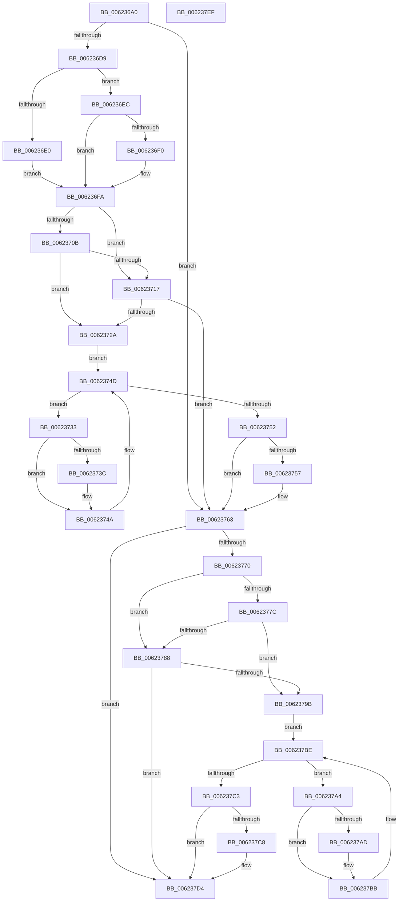

# DifExUnregisterCallbackWrapper

- RVA: `0x006236A0`–`0x006237F0` (길이 `336` bytes)
- VA: `0x00000001406236A0`
- 실행 섹션: `.text`
- PDB 이름 있음: `예`; PDB Function 태그: `아니요`
- unwind 정보 RVA: `0x0005D7BC`
- 디코드: `90`개 명령, `336/336` bytes 표시
- 미해석 바이트: `0` (있으면 어셈블리에 `.byte`로 보존)

> 이 문서는 커널 이미지의 기계어와 PDB 기호를 분석해 생성했습니다. 4번과 5번은 함수 원형과 자료형을 바이너리 사용 방식에서 추정한 C 해석이며 원본 소스 복구 결과는 아닙니다.

## 1. Dependencies

- 직접 호출 지점: **9**; 고유 호출 대상: **6**
- 직접 호출자로 확인된 함수: **0**
- RIP 상대 이미지 참조: **3**

### Outgoing calls
- `0x006236C8` → [DifGetAPIThunkContextById](../49/DifGetAPIThunkContextById_function_00495A34.md) (function, `0x00495A34`)
- `0x006236F0` → [DifGetReturnAddressForWrappers](../4D/DifGetReturnAddressForWrappers_function_004D3C08.md) (function, `0x004D3C08`)
- `0x0062371E` → [ExAcquireRundownProtection](../21/ExAcquireRundownProtection_function_00216620.md) (function, `0x00216620`)
- `0x00623745` → [guard_dispatch_icall](../6B/guard_dispatch_icall_function_006BAAD0.md) (function, `0x006BAAD0`)
- `0x0062375E` → [ExReleaseRundownProtection](../34/ExReleaseRundownProtection_function_00349E80.md) (function, `0x00349E80`)
- `0x00623766` → [ExUnregisterCallback](../4B/ExUnregisterCallback_function_004B7F80.md) (function, `0x004B7F80`)
- `0x0062378F` → [ExAcquireRundownProtection](../21/ExAcquireRundownProtection_function_00216620.md) (function, `0x00216620`)
- `0x006237B6` → [guard_dispatch_icall](../6B/guard_dispatch_icall_function_006BAAD0.md) (function, `0x006BAAD0`)
- `0x006237CF` → [ExReleaseRundownProtection](../34/ExReleaseRundownProtection_function_00349E80.md) (function, `0x00349E80`)

### Direct callers
- 이 함수 시작 RVA로 연결되는 직접 call은 확인되지 않았습니다. 간접 호출은 완전히 역산할 수 없습니다.

### Static image references
- `0x00623702` → RVA `0x00F048B8` (`.data`; read)
- `0x0062370B` → RVA `0x00F04980` (`.data`; read)
- `0x00623717` → RVA `0x00F03E80` (`.data`; read)

## 2. Other-region calls and transfers

- 다른 실행 섹션으로 향하는 call: **0**
- 별도 외부 분기/꼬리 이동을 확인하지 못했습니다.

## 3. Assembly (complete function range)

```asm
006236A0  48 8B C4                        mov rax, rsp
006236A3  48 89 58 08                     mov qword ptr [rax + 8], rbx
006236A7  48 89 68 10                     mov qword ptr [rax + 0x10], rbp
006236AB  48 89 70 18                     mov qword ptr [rax + 0x18], rsi
006236AF  48 89 78 20                     mov qword ptr [rax + 0x20], rdi
006236B3  41 56                           push r14
006236B5  48 83 EC 30                     sub rsp, 0x30
006236B9  48 8B E9                        mov rbp, rcx
006236BC  0F 57 C0                        xorps xmm0, xmm0
006236BF  B9 7E 01 00 00                  mov ecx, 0x17e
006236C4  0F 11 40 E8                     movups xmmword ptr [rax - 0x18], xmm0
006236C8  E8 67 23 E7 FF                  call 0x140495a34
006236CD  48 8B F8                        mov rdi, rax
006236D0  48 85 C0                        test rax, rax
006236D3  0F 84 8A 00 00 00               je 0x140623763
006236D9  8B 40 0C                        mov eax, dword ptr [rax + 0xc]
006236DC  A8 18                           test al, 0x18
006236DE  74 0C                           je 0x1406236ec
006236E0  48 8B 4C 24 38                  mov rcx, qword ptr [rsp + 0x38]
006236E5  48 89 4C 24 20                  mov qword ptr [rsp + 0x20], rcx
006236EA  EB 0E                           jmp 0x1406236fa
006236EC  A8 04                           test al, 4
006236EE  74 0A                           je 0x1406236fa
006236F0  E8 13 05 EB FF                  call 0x1404d3c08
006236F5  48 89 44 24 20                  mov qword ptr [rsp + 0x20], rax
006236FA  40 32 F6                        xor sil, sil
006236FD  48 89 6C 24 28                  mov qword ptr [rsp + 0x28], rbp
00623702  40 38 35 AF 11 8E 00            cmp byte ptr [rip + 0x8e11af], sil
00623709  75 0C                           jne 0x140623717
0062370B  F7 05 6B 12 8E 00 00 08 00 00   test dword ptr [rip + 0x8e126b], 0x800
00623715  74 13                           je 0x14062372a
00623717  48 8D 0D 62 07 8E 00            lea rcx, [rip + 0x8e0762]
0062371E  E8 FD 2E BF FF                  call 0x140216620
00623723  40 8A F0                        mov sil, al
00623726  84 C0                           test al, al
00623728  74 39                           je 0x140623763
0062372A  4C 8D 77 20                     lea r14, [rdi + 0x20]
0062372E  49 8B 1E                        mov rbx, qword ptr [r14]
00623731  EB 1A                           jmp 0x14062374d
00623733  48 8D 43 F0                     lea rax, [rbx - 0x10]
00623737  48 85 C0                        test rax, rax
0062373A  74 0E                           je 0x14062374a
0062373C  48 8B 40 08                     mov rax, qword ptr [rax + 8]
00623740  48 8D 4C 24 20                  lea rcx, [rsp + 0x20]
00623745  E8 86 73 09 00                  call 0x1406baad0
0062374A  48 8B 1B                        mov rbx, qword ptr [rbx]
0062374D  49 3B DE                        cmp rbx, r14
00623750  75 E1                           jne 0x140623733
00623752  40 84 F6                        test sil, sil
00623755  74 0C                           je 0x140623763
00623757  48 8D 0D 22 07 8E 00            lea rcx, [rip + 0x8e0722]
0062375E  E8 1D 67 D2 FF                  call 0x140349e80
00623763  48 8B CD                        mov rcx, rbp
00623766  E8 15 48 E9 FF                  call 0x1404b7f80
0062376B  48 85 FF                        test rdi, rdi
0062376E  74 64                           je 0x1406237d4
00623770  40 32 F6                        xor sil, sil
00623773  40 38 35 3E 11 8E 00            cmp byte ptr [rip + 0x8e113e], sil
0062377A  75 0C                           jne 0x140623788
0062377C  F7 05 FA 11 8E 00 00 08 00 00   test dword ptr [rip + 0x8e11fa], 0x800
00623786  74 13                           je 0x14062379b
00623788  48 8D 0D F1 06 8E 00            lea rcx, [rip + 0x8e06f1]
0062378F  E8 8C 2E BF FF                  call 0x140216620
00623794  40 8A F0                        mov sil, al
00623797  84 C0                           test al, al
00623799  74 39                           je 0x1406237d4
0062379B  48 83 C7 30                     add rdi, 0x30
0062379F  48 8B 1F                        mov rbx, qword ptr [rdi]
006237A2  EB 1A                           jmp 0x1406237be
006237A4  48 8D 43 F0                     lea rax, [rbx - 0x10]
006237A8  48 85 C0                        test rax, rax
006237AB  74 0E                           je 0x1406237bb
006237AD  48 8B 40 08                     mov rax, qword ptr [rax + 8]
006237B1  48 8D 4C 24 20                  lea rcx, [rsp + 0x20]
006237B6  E8 15 73 09 00                  call 0x1406baad0
006237BB  48 8B 1B                        mov rbx, qword ptr [rbx]
006237BE  48 3B DF                        cmp rbx, rdi
006237C1  75 E1                           jne 0x1406237a4
006237C3  40 84 F6                        test sil, sil
006237C6  74 0C                           je 0x1406237d4
006237C8  48 8D 0D B1 06 8E 00            lea rcx, [rip + 0x8e06b1]
006237CF  E8 AC 66 D2 FF                  call 0x140349e80
006237D4  48 8B 5C 24 40                  mov rbx, qword ptr [rsp + 0x40]
006237D9  48 8B 6C 24 48                  mov rbp, qword ptr [rsp + 0x48]
006237DE  48 8B 74 24 50                  mov rsi, qword ptr [rsp + 0x50]
006237E3  48 8B 7C 24 58                  mov rdi, qword ptr [rsp + 0x58]
006237E8  48 83 C4 30                     add rsp, 0x30
006237EC  41 5E                           pop r14
006237EE  C3                              ret
006237EF  CC                              int3
```

## 4. C-style interpretation (structured pseudocode)

```c
__int64 __fastcall DifExUnregisterCallbackWrapper(__int64 a1)
{
    __int64 result;
    __int64 v_rdi;
    __int64 v_rsi;
    __int64 v_rsp;
    unsigned __int64 v_stack_m10;
    unsigned __int64 v_stack_m18;
    unsigned __int64 v_stack_p0;
    unsigned __int64 v_stack_p10;
    unsigned __int64 v_stack_p18;
    unsigned __int64 v_stack_p20;
    unsigned __int64 v_stack_p8;

    *(unsigned __int64 *)(v_rsp + 8) = v_rbx;
    *(unsigned __int64 *)(v_rsp + 16) = v_rbp;
    *(unsigned __int64 *)(v_rsp + 24) = v_rsi;
    *(unsigned __int64 *)(v_rsp + 32) = v_rdi;
    v_rsp = (v_rsp) - (48);
    *(unsigned __int64 *)(v_rsp - 24) = v_xmm0;
    result = DifGetAPIThunkContextById(382, a2, a3, a4);
    if (result == 0) goto loc_00623763;
    if ((((unsigned __int8)((unsigned int)(*(unsigned int *)(result + 12)))) & (24)) == 0) goto loc_006236EC;
    v_stack_m18 = v_stack_p0;
    goto loc_006236FA;
loc_006236EC:
    result = (unsigned int)(*(unsigned int *)(result + 12));
    if ((((unsigned __int8)((unsigned int)(*(unsigned int *)(result + 12)))) & (4)) != 0) {
        result = DifGetReturnAddressForWrappers(v_stack_p0, a2, a3, a4);
        v_stack_m18 = result;
    }
    v_rsi = 0;
    v_stack_m10 = a1;
    if ((*(unsigned __int8 *)(v_rip + 9310639)) != 0) goto loc_00623717;
    if (((*(unsigned int *)(v_rip + 9310827)) & (0x800ULL)) == 0) goto loc_0062372A;
loc_00623717:
    result = ExAcquireRundownProtection(v_rip + 9308002, a2, a3, a4);
    if ((unsigned __int8)(result) == 0) goto loc_00623763;
loc_0062372A:
    goto loc_0062374D;
loc_00623733:
    result = *(unsigned __int64 *)(result + 32) - 16;
    if (*(unsigned __int64 *)(result + 32) - 16 != 0) {
        result = *(unsigned __int64 *)(*(unsigned __int64 *)(result + 32) - 16 + 8);
        a1 = v_stack_m18;
        result = guard_dispatch_icall(a1, a2, a3, a4);
    }
loc_0062374D:
    if ((*(unsigned __int64 *)(*(unsigned __int64 *)(result + 32))) != (result + 32)) goto loc_00623733;
    if ((unsigned __int8)((unsigned __int8)(result)) != 0) {
        a1 = v_rip + 9307938;
        result = ExReleaseRundownProtection(a1, a2, a3, a4);
    }
    result = ExUnregisterCallback(a1, a2, a3, a4);
    if (result == 0) goto loc_006237D4;
    v_rsi = 0;
    if ((*(unsigned __int8 *)(v_rip + 9310526)) != 0) goto loc_00623788;
    if (((*(unsigned int *)(v_rip + 9310714)) & (0x800ULL)) == 0) goto loc_0062379B;
loc_00623788:
    result = ExAcquireRundownProtection(v_rip + 9307889, a2, a3, a4);
    if ((unsigned __int8)(result) == 0) goto loc_006237D4;
loc_0062379B:
    v_rdi = (result) + (48);
    goto loc_006237BE;
loc_006237A4:
    result = *(unsigned __int64 *)(v_rdi) - 16;
    if (*(unsigned __int64 *)(v_rdi) - 16 != 0) {
        result = *(unsigned __int64 *)(*(unsigned __int64 *)(v_rdi) - 16 + 8);
        a1 = v_stack_m18;
        result = guard_dispatch_icall(a1, a2, a3, a4);
    }
loc_006237BE:
    if ((*(unsigned __int64 *)(*(unsigned __int64 *)(v_rdi))) != v_rdi) goto loc_006237A4;
    if ((unsigned __int8)((unsigned __int8)(result)) != 0) {
        a1 = v_rip + 9307825;
        result = ExReleaseRundownProtection(a1, a2, a3, a4);
    }
    v_rsp = (v_rsp) + (48);
    return result;
}
```

## 5. (Beta) C Style

```c
int64_t DifExUnregisterCallbackWrapper(int64_t Arg1)
{
    int64_t result;
    int64_t local_rdi;
    int64_t local_rsi;
    int64_t local_rsp;
    uint64_t v_stack_m10;
    uint64_t v_stack_m18;
    uint64_t v_stack_p0;
    uint64_t v_stack_p10;
    uint64_t v_stack_p18;
    uint64_t v_stack_p20;
    uint64_t v_stack_p8;

    *(uint64_t *)(local_rsp + 0x8) = local_rbx;
    *(uint64_t *)(local_rsp + 0x10) = local_rbp;
    *(uint64_t *)(local_rsp + 0x18) = local_rsi;
    *(uint64_t *)(local_rsp + 0x20) = local_rdi;
    local_rsp = (local_rsp) - (48);
    *(uint64_t *)(local_rsp - 0x18) = v_xmm0;
    result = DifGetAPIThunkContextById(382, a2, a3, a4);
    if (result == 0) goto loc_00623763;
    if ((((uint8_t)((uint32_t)(*(uint32_t *)(result + 0xC)))) & (24)) == 0) goto loc_006236EC;
    v_stack_m18 = v_stack_p0;
    goto loc_006236FA;
loc_006236EC:
    result = (uint32_t)(*(uint32_t *)(result + 0xC));
    if ((((uint8_t)((uint32_t)(*(uint32_t *)(result + 0xC)))) & (4)) != 0) {
        result = DifGetReturnAddressForWrappers(v_stack_p0, a2, a3, a4);
        v_stack_m18 = result;
    }
    local_rsi = 0;
    v_stack_m10 = Arg1;
    if ((*(uint8_t *)(v_rip + 0x8E11AF)) != 0) goto loc_00623717;
    if (((*(uint32_t *)(v_rip + 0x8E126B)) & (0x800ULL)) == 0) goto loc_0062372A;
loc_00623717:
    result = ExAcquireRundownProtection(v_rip + 9308002, a2, a3, a4);
    if ((uint8_t)(result) == 0) goto loc_00623763;
loc_0062372A:
    goto loc_0062374D;
loc_00623733:
    result = *(uint64_t *)(result + 0x20) - 16;
    if (*(uint64_t *)(result + 0x20) - 16 != 0) {
        result = *(uint64_t *)(*(uint64_t *)(result + 0x20) - 0x10 + 0x8);
        Arg1 = v_stack_m18;
        result = guard_dispatch_icall(Arg1, a2, a3, a4);
    }
loc_0062374D:
    if ((*(uint64_t *)(*(uint64_t *)(result + 0x20))) != (result + 32)) goto loc_00623733;
    if ((uint8_t)((uint8_t)(result)) != 0) {
        Arg1 = v_rip + 9307938;
        result = ExReleaseRundownProtection(Arg1, a2, a3, a4);
    }
    result = ExUnregisterCallback(Arg1, a2, a3, a4);
    if (result == 0) goto loc_006237D4;
    local_rsi = 0;
    if ((*(uint8_t *)(v_rip + 0x8E113E)) != 0) goto loc_00623788;
    if (((*(uint32_t *)(v_rip + 0x8E11FA)) & (0x800ULL)) == 0) goto loc_0062379B;
loc_00623788:
    result = ExAcquireRundownProtection(v_rip + 9307889, a2, a3, a4);
    if ((uint8_t)(result) == 0) goto loc_006237D4;
loc_0062379B:
    local_rdi = (result) + (48);
    goto loc_006237BE;
loc_006237A4:
    result = *(uint64_t *)(local_rdi) - 16;
    if (*(uint64_t *)(local_rdi) - 16 != 0) {
        result = *(uint64_t *)(*(uint64_t *)(local_rdi) - 0x10 + 0x8);
        Arg1 = v_stack_m18;
        result = guard_dispatch_icall(Arg1, a2, a3, a4);
    }
loc_006237BE:
    if ((*(uint64_t *)(*(uint64_t *)(local_rdi))) != local_rdi) goto loc_006237A4;
    if ((uint8_t)((uint8_t)(result)) != 0) {
        Arg1 = v_rip + 9307825;
        result = ExReleaseRundownProtection(Arg1, a2, a3, a4);
    }
    local_rsp = (local_rsp) + (48);
    return result;
}
```

## 6. Execution-region graph

[열기: 2D/3D 그래프와 함수 탐색 컨트롤 패널](../../../control-panel.html?section=text&rva=0x006236A0&view=graph)

- 2D 그래프는 위에서 아래로 흐르고, 3D 그래프는 빈 공간을 드래그해 회전합니다. Shift+드래그는 이동, 휠은 확대·축소, 함수 노드 선택은 대상 보고서 이동입니다.

### Static fallback


