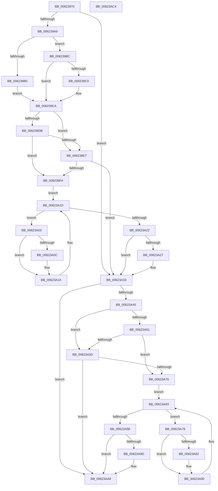

# DifExfAcquirePushLockExclusiveWrapper

- RVA: `0x00623970`–`0x00623AC5` (길이 `341` bytes)
- VA: `0x0000000140623970`
- 실행 섹션: `.text`
- PDB 이름 있음: `예`; PDB Function 태그: `아니요`
- unwind 정보 RVA: `0x0005D7BC`
- 디코드: `92`개 명령, `341/341` bytes 표시
- 미해석 바이트: `0` (있으면 어셈블리에 `.byte`로 보존)

> 이 문서는 커널 이미지의 기계어와 PDB 기호를 분석해 생성했습니다. 4번과 5번은 함수 원형과 자료형을 바이너리 사용 방식에서 추정한 C 해석이며 원본 소스 복구 결과는 아닙니다.

## 1. Dependencies

- 직접 호출 지점: **9**; 고유 호출 대상: **6**
- 직접 호출자로 확인된 함수: **0**
- RIP 상대 이미지 참조: **3**

### Outgoing calls
- `0x00623998` → [DifGetAPIThunkContextById](../49/DifGetAPIThunkContextById_function_00495A34.md) (function, `0x00495A34`)
- `0x006239C0` → [DifGetReturnAddressForWrappers](../4D/DifGetReturnAddressForWrappers_function_004D3C08.md) (function, `0x004D3C08`)
- `0x006239EE` → [ExAcquireRundownProtection](../21/ExAcquireRundownProtection_function_00216620.md) (function, `0x00216620`)
- `0x00623A15` → [guard_dispatch_icall](../6B/guard_dispatch_icall_function_006BAAD0.md) (function, `0x006BAAD0`)
- `0x00623A2E` → [ExReleaseRundownProtection](../34/ExReleaseRundownProtection_function_00349E80.md) (function, `0x00349E80`)
- `0x00623A3B` → [ExfAcquirePushLockExclusiveEx](../20/ExfAcquirePushLockExclusiveEx_function_0020FC90.md) (function, `0x0020FC90`)
- `0x00623A64` → [ExAcquireRundownProtection](../21/ExAcquireRundownProtection_function_00216620.md) (function, `0x00216620`)
- `0x00623A8B` → [guard_dispatch_icall](../6B/guard_dispatch_icall_function_006BAAD0.md) (function, `0x006BAAD0`)
- `0x00623AA4` → [ExReleaseRundownProtection](../34/ExReleaseRundownProtection_function_00349E80.md) (function, `0x00349E80`)

### Direct callers
- 이 함수 시작 RVA로 연결되는 직접 call은 확인되지 않았습니다. 간접 호출은 완전히 역산할 수 없습니다.

### Static image references
- `0x006239D2` → RVA `0x00F048B8` (`.data`; read)
- `0x006239DB` → RVA `0x00F04980` (`.data`; read)
- `0x006239E7` → RVA `0x00F03E80` (`.data`; read)

## 2. Other-region calls and transfers

- 다른 실행 섹션으로 향하는 call: **0**
- 별도 외부 분기/꼬리 이동을 확인하지 못했습니다.

## 3. Assembly (complete function range)

```asm
00623970  48 8B C4                        mov rax, rsp
00623973  48 89 58 08                     mov qword ptr [rax + 8], rbx
00623977  48 89 68 10                     mov qword ptr [rax + 0x10], rbp
0062397B  48 89 70 18                     mov qword ptr [rax + 0x18], rsi
0062397F  48 89 78 20                     mov qword ptr [rax + 0x20], rdi
00623983  41 56                           push r14
00623985  48 83 EC 30                     sub rsp, 0x30
00623989  48 8B E9                        mov rbp, rcx
0062398C  0F 57 C0                        xorps xmm0, xmm0
0062398F  B9 7C 01 00 00                  mov ecx, 0x17c
00623994  0F 11 40 E8                     movups xmmword ptr [rax - 0x18], xmm0
00623998  E8 97 20 E7 FF                  call 0x140495a34
0062399D  48 8B F0                        mov rsi, rax
006239A0  48 85 C0                        test rax, rax
006239A3  0F 84 8A 00 00 00               je 0x140623a33
006239A9  8B 40 0C                        mov eax, dword ptr [rax + 0xc]
006239AC  A8 18                           test al, 0x18
006239AE  74 0C                           je 0x1406239bc
006239B0  48 8B 4C 24 38                  mov rcx, qword ptr [rsp + 0x38]
006239B5  48 89 4C 24 20                  mov qword ptr [rsp + 0x20], rcx
006239BA  EB 0E                           jmp 0x1406239ca
006239BC  A8 04                           test al, 4
006239BE  74 0A                           je 0x1406239ca
006239C0  E8 43 02 EB FF                  call 0x1404d3c08
006239C5  48 89 44 24 20                  mov qword ptr [rsp + 0x20], rax
006239CA  40 32 FF                        xor dil, dil
006239CD  48 89 6C 24 28                  mov qword ptr [rsp + 0x28], rbp
006239D2  40 38 3D DF 0E 8E 00            cmp byte ptr [rip + 0x8e0edf], dil
006239D9  75 0C                           jne 0x1406239e7
006239DB  F7 05 9B 0F 8E 00 00 08 00 00   test dword ptr [rip + 0x8e0f9b], 0x800
006239E5  74 13                           je 0x1406239fa
006239E7  48 8D 0D 92 04 8E 00            lea rcx, [rip + 0x8e0492]
006239EE  E8 2D 2C BF FF                  call 0x140216620
006239F3  40 8A F8                        mov dil, al
006239F6  84 C0                           test al, al
006239F8  74 39                           je 0x140623a33
006239FA  4C 8D 76 20                     lea r14, [rsi + 0x20]
006239FE  49 8B 1E                        mov rbx, qword ptr [r14]
00623A01  EB 1A                           jmp 0x140623a1d
00623A03  48 8D 43 F0                     lea rax, [rbx - 0x10]
00623A07  48 85 C0                        test rax, rax
00623A0A  74 0E                           je 0x140623a1a
00623A0C  48 8B 40 08                     mov rax, qword ptr [rax + 8]
00623A10  48 8D 4C 24 20                  lea rcx, [rsp + 0x20]
00623A15  E8 B6 70 09 00                  call 0x1406baad0
00623A1A  48 8B 1B                        mov rbx, qword ptr [rbx]
00623A1D  49 3B DE                        cmp rbx, r14
00623A20  75 E1                           jne 0x140623a03
00623A22  40 84 FF                        test dil, dil
00623A25  74 0C                           je 0x140623a33
00623A27  48 8D 0D 52 04 8E 00            lea rcx, [rip + 0x8e0452]
00623A2E  E8 4D 64 D2 FF                  call 0x140349e80
00623A33  4C 8B C5                        mov r8, rbp
00623A36  33 D2                           xor edx, edx
00623A38  48 8B CD                        mov rcx, rbp
00623A3B  E8 50 C2 BE FF                  call 0x14020fc90
00623A40  48 85 F6                        test rsi, rsi
00623A43  74 64                           je 0x140623aa9
00623A45  40 32 FF                        xor dil, dil
00623A48  40 38 3D 69 0E 8E 00            cmp byte ptr [rip + 0x8e0e69], dil
00623A4F  75 0C                           jne 0x140623a5d
00623A51  F7 05 25 0F 8E 00 00 08 00 00   test dword ptr [rip + 0x8e0f25], 0x800
00623A5B  74 13                           je 0x140623a70
00623A5D  48 8D 0D 1C 04 8E 00            lea rcx, [rip + 0x8e041c]
00623A64  E8 B7 2B BF FF                  call 0x140216620
00623A69  40 8A F8                        mov dil, al
00623A6C  84 C0                           test al, al
00623A6E  74 39                           je 0x140623aa9
00623A70  48 83 C6 30                     add rsi, 0x30
00623A74  48 8B 1E                        mov rbx, qword ptr [rsi]
00623A77  EB 1A                           jmp 0x140623a93
00623A79  48 8D 43 F0                     lea rax, [rbx - 0x10]
00623A7D  48 85 C0                        test rax, rax
00623A80  74 0E                           je 0x140623a90
00623A82  48 8B 40 08                     mov rax, qword ptr [rax + 8]
00623A86  48 8D 4C 24 20                  lea rcx, [rsp + 0x20]
00623A8B  E8 40 70 09 00                  call 0x1406baad0
00623A90  48 8B 1B                        mov rbx, qword ptr [rbx]
00623A93  48 3B DE                        cmp rbx, rsi
00623A96  75 E1                           jne 0x140623a79
00623A98  40 84 FF                        test dil, dil
00623A9B  74 0C                           je 0x140623aa9
00623A9D  48 8D 0D DC 03 8E 00            lea rcx, [rip + 0x8e03dc]
00623AA4  E8 D7 63 D2 FF                  call 0x140349e80
00623AA9  48 8B 5C 24 40                  mov rbx, qword ptr [rsp + 0x40]
00623AAE  48 8B 6C 24 48                  mov rbp, qword ptr [rsp + 0x48]
00623AB3  48 8B 74 24 50                  mov rsi, qword ptr [rsp + 0x50]
00623AB8  48 8B 7C 24 58                  mov rdi, qword ptr [rsp + 0x58]
00623ABD  48 83 C4 30                     add rsp, 0x30
00623AC1  41 5E                           pop r14
00623AC3  C3                              ret
00623AC4  CC                              int3
```

## 4. C-style interpretation (structured pseudocode)

```c
__int64 __fastcall DifExfAcquirePushLockExclusiveWrapper(__int64 a1, int a2)
{
    __int64 result;
    __int64 v_rdi;
    __int64 v_rsi;
    __int64 v_rsp;
    unsigned __int64 v_stack_m10;
    unsigned __int64 v_stack_m18;
    unsigned __int64 v_stack_p0;
    unsigned __int64 v_stack_p10;
    unsigned __int64 v_stack_p18;
    unsigned __int64 v_stack_p20;
    unsigned __int64 v_stack_p8;

    *(unsigned __int64 *)(v_rsp + 8) = v_rbx;
    *(unsigned __int64 *)(v_rsp + 16) = v_rbp;
    *(unsigned __int64 *)(v_rsp + 24) = v_rsi;
    *(unsigned __int64 *)(v_rsp + 32) = v_rdi;
    v_rsp = (v_rsp) - (48);
    *(unsigned __int64 *)(v_rsp - 24) = v_xmm0;
    result = DifGetAPIThunkContextById(380, a2, a3, a4);
    if (result == 0) goto loc_00623A33;
    if ((((unsigned __int8)((unsigned int)(*(unsigned int *)(result + 12)))) & (24)) == 0) goto loc_006239BC;
    v_stack_m18 = v_stack_p0;
    goto loc_006239CA;
loc_006239BC:
    result = (unsigned int)(*(unsigned int *)(result + 12));
    if ((((unsigned __int8)((unsigned int)(*(unsigned int *)(result + 12)))) & (4)) != 0) {
        result = DifGetReturnAddressForWrappers(v_stack_p0, a2, a3, a4);
        v_stack_m18 = result;
    }
    v_rdi = 0;
    v_stack_m10 = a1;
    if ((*(unsigned __int8 *)(v_rip + 9309919)) != 0) goto loc_006239E7;
    if (((*(unsigned int *)(v_rip + 9310107)) & (0x800ULL)) == 0) goto loc_006239FA;
loc_006239E7:
    result = ExAcquireRundownProtection(v_rip + 9307282, a2, a3, a4);
    if ((unsigned __int8)(result) == 0) goto loc_00623A33;
loc_006239FA:
    goto loc_00623A1D;
loc_00623A03:
    result = *(unsigned __int64 *)(result + 32) - 16;
    if (*(unsigned __int64 *)(result + 32) - 16 != 0) {
        result = *(unsigned __int64 *)(*(unsigned __int64 *)(result + 32) - 16 + 8);
        a1 = v_stack_m18;
        result = guard_dispatch_icall(a1, a2, a3, a4);
    }
loc_00623A1D:
    if ((*(unsigned __int64 *)(*(unsigned __int64 *)(result + 32))) != (result + 32)) goto loc_00623A03;
    if ((unsigned __int8)((unsigned __int8)(result)) != 0) {
        a1 = v_rip + 9307218;
        result = ExReleaseRundownProtection(a1, a2, a3, a4);
    }
    a2 = 0;
    result = ExfAcquirePushLockExclusiveEx(a1, a2, a1, a4);
    if (result == 0) goto loc_00623AA9;
    v_rdi = 0;
    if ((*(unsigned __int8 *)(v_rip + 9309801)) != 0) goto loc_00623A5D;
    if (((*(unsigned int *)(v_rip + 9309989)) & (0x800ULL)) == 0) goto loc_00623A70;
loc_00623A5D:
    result = ExAcquireRundownProtection(v_rip + 9307164, a2, a1, a4);
    if ((unsigned __int8)(result) == 0) goto loc_00623AA9;
loc_00623A70:
    v_rsi = (result) + (48);
    goto loc_00623A93;
loc_00623A79:
    result = *(unsigned __int64 *)(v_rsi) - 16;
    if (*(unsigned __int64 *)(v_rsi) - 16 != 0) {
        result = *(unsigned __int64 *)(*(unsigned __int64 *)(v_rsi) - 16 + 8);
        a1 = v_stack_m18;
        result = guard_dispatch_icall(a1, a2, a1, a4);
    }
loc_00623A93:
    if ((*(unsigned __int64 *)(*(unsigned __int64 *)(v_rsi))) != v_rsi) goto loc_00623A79;
    if ((unsigned __int8)((unsigned __int8)(result)) != 0) {
        a1 = v_rip + 9307100;
        result = ExReleaseRundownProtection(a1, a2, a1, a4);
    }
    v_rsp = (v_rsp) + (48);
    return result;
}
```

## 5. (Beta) C Style

```c
int64_t DifExfAcquirePushLockExclusiveWrapper(int64_t Arg1, int32_t Arg2)
{
    int64_t result;
    int64_t local_rdi;
    int64_t local_rsi;
    int64_t local_rsp;
    uint64_t v_stack_m10;
    uint64_t v_stack_m18;
    uint64_t v_stack_p0;
    uint64_t v_stack_p10;
    uint64_t v_stack_p18;
    uint64_t v_stack_p20;
    uint64_t v_stack_p8;

    *(uint64_t *)(local_rsp + 0x8) = local_rbx;
    *(uint64_t *)(local_rsp + 0x10) = local_rbp;
    *(uint64_t *)(local_rsp + 0x18) = local_rsi;
    *(uint64_t *)(local_rsp + 0x20) = local_rdi;
    local_rsp = (local_rsp) - (48);
    *(uint64_t *)(local_rsp - 0x18) = v_xmm0;
    result = DifGetAPIThunkContextById(380, Arg2, a3, a4);
    if (result == 0) goto loc_00623A33;
    if ((((uint8_t)((uint32_t)(*(uint32_t *)(result + 0xC)))) & (24)) == 0) goto loc_006239BC;
    v_stack_m18 = v_stack_p0;
    goto loc_006239CA;
loc_006239BC:
    result = (uint32_t)(*(uint32_t *)(result + 0xC));
    if ((((uint8_t)((uint32_t)(*(uint32_t *)(result + 0xC)))) & (4)) != 0) {
        result = DifGetReturnAddressForWrappers(v_stack_p0, Arg2, a3, a4);
        v_stack_m18 = result;
    }
    local_rdi = 0;
    v_stack_m10 = Arg1;
    if ((*(uint8_t *)(v_rip + 0x8E0EDF)) != 0) goto loc_006239E7;
    if (((*(uint32_t *)(v_rip + 0x8E0F9B)) & (0x800ULL)) == 0) goto loc_006239FA;
loc_006239E7:
    result = ExAcquireRundownProtection(v_rip + 9307282, Arg2, a3, a4);
    if ((uint8_t)(result) == 0) goto loc_00623A33;
loc_006239FA:
    goto loc_00623A1D;
loc_00623A03:
    result = *(uint64_t *)(result + 0x20) - 16;
    if (*(uint64_t *)(result + 0x20) - 16 != 0) {
        result = *(uint64_t *)(*(uint64_t *)(result + 0x20) - 0x10 + 0x8);
        Arg1 = v_stack_m18;
        result = guard_dispatch_icall(Arg1, Arg2, a3, a4);
    }
loc_00623A1D:
    if ((*(uint64_t *)(*(uint64_t *)(result + 0x20))) != (result + 32)) goto loc_00623A03;
    if ((uint8_t)((uint8_t)(result)) != 0) {
        Arg1 = v_rip + 9307218;
        result = ExReleaseRundownProtection(Arg1, Arg2, a3, a4);
    }
    Arg2 = 0;
    result = ExfAcquirePushLockExclusiveEx(Arg1, Arg2, Arg1, a4);
    if (result == 0) goto loc_00623AA9;
    local_rdi = 0;
    if ((*(uint8_t *)(v_rip + 0x8E0E69)) != 0) goto loc_00623A5D;
    if (((*(uint32_t *)(v_rip + 0x8E0F25)) & (0x800ULL)) == 0) goto loc_00623A70;
loc_00623A5D:
    result = ExAcquireRundownProtection(v_rip + 9307164, Arg2, Arg1, a4);
    if ((uint8_t)(result) == 0) goto loc_00623AA9;
loc_00623A70:
    local_rsi = (result) + (48);
    goto loc_00623A93;
loc_00623A79:
    result = *(uint64_t *)(local_rsi) - 16;
    if (*(uint64_t *)(local_rsi) - 16 != 0) {
        result = *(uint64_t *)(*(uint64_t *)(local_rsi) - 0x10 + 0x8);
        Arg1 = v_stack_m18;
        result = guard_dispatch_icall(Arg1, Arg2, Arg1, a4);
    }
loc_00623A93:
    if ((*(uint64_t *)(*(uint64_t *)(local_rsi))) != local_rsi) goto loc_00623A79;
    if ((uint8_t)((uint8_t)(result)) != 0) {
        Arg1 = v_rip + 9307100;
        result = ExReleaseRundownProtection(Arg1, Arg2, Arg1, a4);
    }
    local_rsp = (local_rsp) + (48);
    return result;
}
```

## 6. Execution-region graph

[열기: 2D/3D 그래프와 함수 탐색 컨트롤 패널](../../../control-panel.html?section=text&rva=0x00623970&view=graph)

- 2D 그래프는 위에서 아래로 흐르고, 3D 그래프는 빈 공간을 드래그해 회전합니다. Shift+드래그는 이동, 휠은 확대·축소, 함수 노드 선택은 대상 보고서 이동입니다.

### Static fallback


