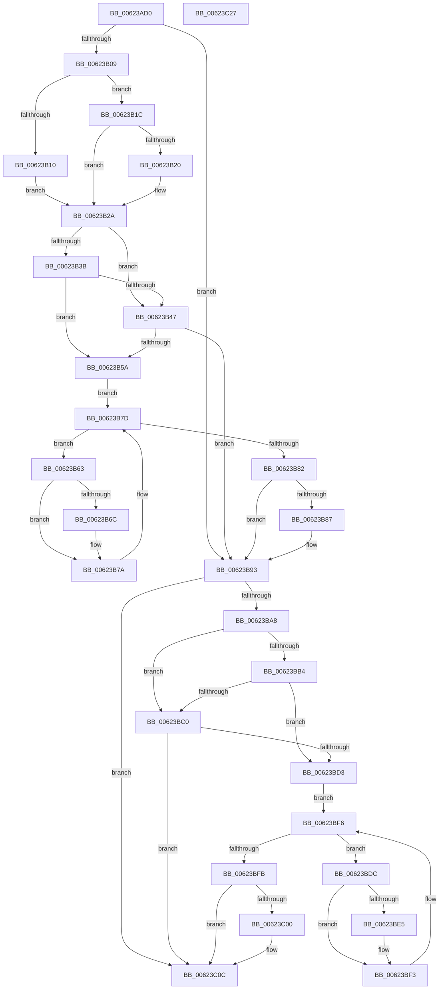

# DifExfAcquirePushLockSharedWrapper

- RVA: `0x00623AD0`–`0x00623C28` (길이 `344` bytes)
- VA: `0x0000000140623AD0`
- 실행 섹션: `.text`
- PDB 이름 있음: `예`; PDB Function 태그: `아니요`
- unwind 정보 RVA: `0x0005D7BC`
- 디코드: `93`개 명령, `344/344` bytes 표시
- 미해석 바이트: `0` (있으면 어셈블리에 `.byte`로 보존)

> 이 문서는 커널 이미지의 기계어와 PDB 기호를 분석해 생성했습니다. 4번과 5번은 함수 원형과 자료형을 바이너리 사용 방식에서 추정한 C 해석이며 원본 소스 복구 결과는 아닙니다.

## 1. Dependencies

- 직접 호출 지점: **9**; 고유 호출 대상: **6**
- 직접 호출자로 확인된 함수: **0**
- RIP 상대 이미지 참조: **3**

### Outgoing calls
- `0x00623AF8` → [DifGetAPIThunkContextById](../49/DifGetAPIThunkContextById_function_00495A34.md) (function, `0x00495A34`)
- `0x00623B20` → [DifGetReturnAddressForWrappers](../4D/DifGetReturnAddressForWrappers_function_004D3C08.md) (function, `0x004D3C08`)
- `0x00623B4E` → [ExAcquireRundownProtection](../21/ExAcquireRundownProtection_function_00216620.md) (function, `0x00216620`)
- `0x00623B75` → [guard_dispatch_icall](../6B/guard_dispatch_icall_function_006BAAD0.md) (function, `0x006BAAD0`)
- `0x00623B8E` → [ExReleaseRundownProtection](../34/ExReleaseRundownProtection_function_00349E80.md) (function, `0x00349E80`)
- `0x00623B9E` → [ExfAcquirePushLockSharedEx](../21/ExfAcquirePushLockSharedEx_function_0021044C.md) (function, `0x0021044C`)
- `0x00623BC7` → [ExAcquireRundownProtection](../21/ExAcquireRundownProtection_function_00216620.md) (function, `0x00216620`)
- `0x00623BEE` → [guard_dispatch_icall](../6B/guard_dispatch_icall_function_006BAAD0.md) (function, `0x006BAAD0`)
- `0x00623C07` → [ExReleaseRundownProtection](../34/ExReleaseRundownProtection_function_00349E80.md) (function, `0x00349E80`)

### Direct callers
- 이 함수 시작 RVA로 연결되는 직접 call은 확인되지 않았습니다. 간접 호출은 완전히 역산할 수 없습니다.

### Static image references
- `0x00623B32` → RVA `0x00F048B8` (`.data`; read)
- `0x00623B3B` → RVA `0x00F04980` (`.data`; read)
- `0x00623B47` → RVA `0x00F03E80` (`.data`; read)

## 2. Other-region calls and transfers

- 다른 실행 섹션으로 향하는 call: **0**
- 별도 외부 분기/꼬리 이동을 확인하지 못했습니다.

## 3. Assembly (complete function range)

```asm
00623AD0  48 8B C4                        mov rax, rsp
00623AD3  48 89 58 08                     mov qword ptr [rax + 8], rbx
00623AD7  48 89 68 10                     mov qword ptr [rax + 0x10], rbp
00623ADB  48 89 70 18                     mov qword ptr [rax + 0x18], rsi
00623ADF  48 89 78 20                     mov qword ptr [rax + 0x20], rdi
00623AE3  41 56                           push r14
00623AE5  48 83 EC 30                     sub rsp, 0x30
00623AE9  48 8B E9                        mov rbp, rcx
00623AEC  0F 57 C0                        xorps xmm0, xmm0
00623AEF  B9 7B 01 00 00                  mov ecx, 0x17b
00623AF4  0F 11 40 E8                     movups xmmword ptr [rax - 0x18], xmm0
00623AF8  E8 37 1F E7 FF                  call 0x140495a34
00623AFD  48 8B F0                        mov rsi, rax
00623B00  48 85 C0                        test rax, rax
00623B03  0F 84 8A 00 00 00               je 0x140623b93
00623B09  8B 40 0C                        mov eax, dword ptr [rax + 0xc]
00623B0C  A8 18                           test al, 0x18
00623B0E  74 0C                           je 0x140623b1c
00623B10  48 8B 4C 24 38                  mov rcx, qword ptr [rsp + 0x38]
00623B15  48 89 4C 24 20                  mov qword ptr [rsp + 0x20], rcx
00623B1A  EB 0E                           jmp 0x140623b2a
00623B1C  A8 04                           test al, 4
00623B1E  74 0A                           je 0x140623b2a
00623B20  E8 E3 00 EB FF                  call 0x1404d3c08
00623B25  48 89 44 24 20                  mov qword ptr [rsp + 0x20], rax
00623B2A  40 32 FF                        xor dil, dil
00623B2D  48 89 6C 24 28                  mov qword ptr [rsp + 0x28], rbp
00623B32  40 38 3D 7F 0D 8E 00            cmp byte ptr [rip + 0x8e0d7f], dil
00623B39  75 0C                           jne 0x140623b47
00623B3B  F7 05 3B 0E 8E 00 00 08 00 00   test dword ptr [rip + 0x8e0e3b], 0x800
00623B45  74 13                           je 0x140623b5a
00623B47  48 8D 0D 32 03 8E 00            lea rcx, [rip + 0x8e0332]
00623B4E  E8 CD 2A BF FF                  call 0x140216620
00623B53  40 8A F8                        mov dil, al
00623B56  84 C0                           test al, al
00623B58  74 39                           je 0x140623b93
00623B5A  4C 8D 76 20                     lea r14, [rsi + 0x20]
00623B5E  49 8B 1E                        mov rbx, qword ptr [r14]
00623B61  EB 1A                           jmp 0x140623b7d
00623B63  48 8D 43 F0                     lea rax, [rbx - 0x10]
00623B67  48 85 C0                        test rax, rax
00623B6A  74 0E                           je 0x140623b7a
00623B6C  48 8B 40 08                     mov rax, qword ptr [rax + 8]
00623B70  48 8D 4C 24 20                  lea rcx, [rsp + 0x20]
00623B75  E8 56 6F 09 00                  call 0x1406baad0
00623B7A  48 8B 1B                        mov rbx, qword ptr [rbx]
00623B7D  49 3B DE                        cmp rbx, r14
00623B80  75 E1                           jne 0x140623b63
00623B82  40 84 FF                        test dil, dil
00623B85  74 0C                           je 0x140623b93
00623B87  48 8D 0D F2 02 8E 00            lea rcx, [rip + 0x8e02f2]
00623B8E  E8 ED 62 D2 FF                  call 0x140349e80
00623B93  4C 8B CD                        mov r9, rbp
00623B96  45 33 C0                        xor r8d, r8d
00623B99  33 D2                           xor edx, edx
00623B9B  48 8B CD                        mov rcx, rbp
00623B9E  E8 A9 C8 BE FF                  call 0x14021044c
00623BA3  48 85 F6                        test rsi, rsi
00623BA6  74 64                           je 0x140623c0c
00623BA8  40 32 FF                        xor dil, dil
00623BAB  40 38 3D 06 0D 8E 00            cmp byte ptr [rip + 0x8e0d06], dil
00623BB2  75 0C                           jne 0x140623bc0
00623BB4  F7 05 C2 0D 8E 00 00 08 00 00   test dword ptr [rip + 0x8e0dc2], 0x800
00623BBE  74 13                           je 0x140623bd3
00623BC0  48 8D 0D B9 02 8E 00            lea rcx, [rip + 0x8e02b9]
00623BC7  E8 54 2A BF FF                  call 0x140216620
00623BCC  40 8A F8                        mov dil, al
00623BCF  84 C0                           test al, al
00623BD1  74 39                           je 0x140623c0c
00623BD3  48 83 C6 30                     add rsi, 0x30
00623BD7  48 8B 1E                        mov rbx, qword ptr [rsi]
00623BDA  EB 1A                           jmp 0x140623bf6
00623BDC  48 8D 43 F0                     lea rax, [rbx - 0x10]
00623BE0  48 85 C0                        test rax, rax
00623BE3  74 0E                           je 0x140623bf3
00623BE5  48 8B 40 08                     mov rax, qword ptr [rax + 8]
00623BE9  48 8D 4C 24 20                  lea rcx, [rsp + 0x20]
00623BEE  E8 DD 6E 09 00                  call 0x1406baad0
00623BF3  48 8B 1B                        mov rbx, qword ptr [rbx]
00623BF6  48 3B DE                        cmp rbx, rsi
00623BF9  75 E1                           jne 0x140623bdc
00623BFB  40 84 FF                        test dil, dil
00623BFE  74 0C                           je 0x140623c0c
00623C00  48 8D 0D 79 02 8E 00            lea rcx, [rip + 0x8e0279]
00623C07  E8 74 62 D2 FF                  call 0x140349e80
00623C0C  48 8B 5C 24 40                  mov rbx, qword ptr [rsp + 0x40]
00623C11  48 8B 6C 24 48                  mov rbp, qword ptr [rsp + 0x48]
00623C16  48 8B 74 24 50                  mov rsi, qword ptr [rsp + 0x50]
00623C1B  48 8B 7C 24 58                  mov rdi, qword ptr [rsp + 0x58]
00623C20  48 83 C4 30                     add rsp, 0x30
00623C24  41 5E                           pop r14
00623C26  C3                              ret
00623C27  CC                              int3
```

## 4. C-style interpretation (structured pseudocode)

```c
__int64 __fastcall DifExfAcquirePushLockSharedWrapper(__int64 a1, int a2, int a3)
{
    __int64 result;
    __int64 v_rdi;
    __int64 v_rsi;
    __int64 v_rsp;
    unsigned __int64 v_stack_m10;
    unsigned __int64 v_stack_m18;
    unsigned __int64 v_stack_p0;
    unsigned __int64 v_stack_p10;
    unsigned __int64 v_stack_p18;
    unsigned __int64 v_stack_p20;
    unsigned __int64 v_stack_p8;

    *(unsigned __int64 *)(v_rsp + 8) = v_rbx;
    *(unsigned __int64 *)(v_rsp + 16) = v_rbp;
    *(unsigned __int64 *)(v_rsp + 24) = v_rsi;
    *(unsigned __int64 *)(v_rsp + 32) = v_rdi;
    v_rsp = (v_rsp) - (48);
    *(unsigned __int64 *)(v_rsp - 24) = v_xmm0;
    result = DifGetAPIThunkContextById(379, a2, a3, a4);
    if (result == 0) goto loc_00623B93;
    if ((((unsigned __int8)((unsigned int)(*(unsigned int *)(result + 12)))) & (24)) == 0) goto loc_00623B1C;
    v_stack_m18 = v_stack_p0;
    goto loc_00623B2A;
loc_00623B1C:
    result = (unsigned int)(*(unsigned int *)(result + 12));
    if ((((unsigned __int8)((unsigned int)(*(unsigned int *)(result + 12)))) & (4)) != 0) {
        result = DifGetReturnAddressForWrappers(v_stack_p0, a2, a3, a4);
        v_stack_m18 = result;
    }
    v_rdi = 0;
    v_stack_m10 = a1;
    if ((*(unsigned __int8 *)(v_rip + 9309567)) != 0) goto loc_00623B47;
    if (((*(unsigned int *)(v_rip + 9309755)) & (0x800ULL)) == 0) goto loc_00623B5A;
loc_00623B47:
    result = ExAcquireRundownProtection(v_rip + 9306930, a2, a3, a4);
    if ((unsigned __int8)(result) == 0) goto loc_00623B93;
loc_00623B5A:
    goto loc_00623B7D;
loc_00623B63:
    result = *(unsigned __int64 *)(result + 32) - 16;
    if (*(unsigned __int64 *)(result + 32) - 16 != 0) {
        result = *(unsigned __int64 *)(*(unsigned __int64 *)(result + 32) - 16 + 8);
        a1 = v_stack_m18;
        result = guard_dispatch_icall(a1, a2, a3, a4);
    }
loc_00623B7D:
    if ((*(unsigned __int64 *)(*(unsigned __int64 *)(result + 32))) != (result + 32)) goto loc_00623B63;
    if ((unsigned __int8)((unsigned __int8)(result)) != 0) {
        a1 = v_rip + 9306866;
        result = ExReleaseRundownProtection(a1, a2, a3, a4);
    }
    a3 = 0;
    a2 = 0;
    result = ExfAcquirePushLockSharedEx(a1, a2, a3, a1);
    if (result == 0) goto loc_00623C0C;
    v_rdi = 0;
    if ((*(unsigned __int8 *)(v_rip + 9309446)) != 0) goto loc_00623BC0;
    if (((*(unsigned int *)(v_rip + 9309634)) & (0x800ULL)) == 0) goto loc_00623BD3;
loc_00623BC0:
    result = ExAcquireRundownProtection(v_rip + 9306809, a2, a3, a1);
    if ((unsigned __int8)(result) == 0) goto loc_00623C0C;
loc_00623BD3:
    v_rsi = (result) + (48);
    goto loc_00623BF6;
loc_00623BDC:
    result = *(unsigned __int64 *)(v_rsi) - 16;
    if (*(unsigned __int64 *)(v_rsi) - 16 != 0) {
        result = *(unsigned __int64 *)(*(unsigned __int64 *)(v_rsi) - 16 + 8);
        a1 = v_stack_m18;
        result = guard_dispatch_icall(a1, a2, a3, a1);
    }
loc_00623BF6:
    if ((*(unsigned __int64 *)(*(unsigned __int64 *)(v_rsi))) != v_rsi) goto loc_00623BDC;
    if ((unsigned __int8)((unsigned __int8)(result)) != 0) {
        a1 = v_rip + 9306745;
        result = ExReleaseRundownProtection(a1, a2, a3, a1);
    }
    v_rsp = (v_rsp) + (48);
    return result;
}
```

## 5. (Beta) C Style

```c
int64_t DifExfAcquirePushLockSharedWrapper(int64_t Arg1, int32_t Arg2, int32_t Arg3)
{
    int64_t result;
    int64_t local_rdi;
    int64_t local_rsi;
    int64_t local_rsp;
    uint64_t v_stack_m10;
    uint64_t v_stack_m18;
    uint64_t v_stack_p0;
    uint64_t v_stack_p10;
    uint64_t v_stack_p18;
    uint64_t v_stack_p20;
    uint64_t v_stack_p8;

    *(uint64_t *)(local_rsp + 0x8) = local_rbx;
    *(uint64_t *)(local_rsp + 0x10) = local_rbp;
    *(uint64_t *)(local_rsp + 0x18) = local_rsi;
    *(uint64_t *)(local_rsp + 0x20) = local_rdi;
    local_rsp = (local_rsp) - (48);
    *(uint64_t *)(local_rsp - 0x18) = v_xmm0;
    result = DifGetAPIThunkContextById(379, Arg2, Arg3, a4);
    if (result == 0) goto loc_00623B93;
    if ((((uint8_t)((uint32_t)(*(uint32_t *)(result + 0xC)))) & (24)) == 0) goto loc_00623B1C;
    v_stack_m18 = v_stack_p0;
    goto loc_00623B2A;
loc_00623B1C:
    result = (uint32_t)(*(uint32_t *)(result + 0xC));
    if ((((uint8_t)((uint32_t)(*(uint32_t *)(result + 0xC)))) & (4)) != 0) {
        result = DifGetReturnAddressForWrappers(v_stack_p0, Arg2, Arg3, a4);
        v_stack_m18 = result;
    }
    local_rdi = 0;
    v_stack_m10 = Arg1;
    if ((*(uint8_t *)(v_rip + 0x8E0D7F)) != 0) goto loc_00623B47;
    if (((*(uint32_t *)(v_rip + 0x8E0E3B)) & (0x800ULL)) == 0) goto loc_00623B5A;
loc_00623B47:
    result = ExAcquireRundownProtection(v_rip + 9306930, Arg2, Arg3, a4);
    if ((uint8_t)(result) == 0) goto loc_00623B93;
loc_00623B5A:
    goto loc_00623B7D;
loc_00623B63:
    result = *(uint64_t *)(result + 0x20) - 16;
    if (*(uint64_t *)(result + 0x20) - 16 != 0) {
        result = *(uint64_t *)(*(uint64_t *)(result + 0x20) - 0x10 + 0x8);
        Arg1 = v_stack_m18;
        result = guard_dispatch_icall(Arg1, Arg2, Arg3, a4);
    }
loc_00623B7D:
    if ((*(uint64_t *)(*(uint64_t *)(result + 0x20))) != (result + 32)) goto loc_00623B63;
    if ((uint8_t)((uint8_t)(result)) != 0) {
        Arg1 = v_rip + 9306866;
        result = ExReleaseRundownProtection(Arg1, Arg2, Arg3, a4);
    }
    Arg3 = 0;
    Arg2 = 0;
    result = ExfAcquirePushLockSharedEx(Arg1, Arg2, Arg3, Arg1);
    if (result == 0) goto loc_00623C0C;
    local_rdi = 0;
    if ((*(uint8_t *)(v_rip + 0x8E0D06)) != 0) goto loc_00623BC0;
    if (((*(uint32_t *)(v_rip + 0x8E0DC2)) & (0x800ULL)) == 0) goto loc_00623BD3;
loc_00623BC0:
    result = ExAcquireRundownProtection(v_rip + 9306809, Arg2, Arg3, Arg1);
    if ((uint8_t)(result) == 0) goto loc_00623C0C;
loc_00623BD3:
    local_rsi = (result) + (48);
    goto loc_00623BF6;
loc_00623BDC:
    result = *(uint64_t *)(local_rsi) - 16;
    if (*(uint64_t *)(local_rsi) - 16 != 0) {
        result = *(uint64_t *)(*(uint64_t *)(local_rsi) - 0x10 + 0x8);
        Arg1 = v_stack_m18;
        result = guard_dispatch_icall(Arg1, Arg2, Arg3, Arg1);
    }
loc_00623BF6:
    if ((*(uint64_t *)(*(uint64_t *)(local_rsi))) != local_rsi) goto loc_00623BDC;
    if ((uint8_t)((uint8_t)(result)) != 0) {
        Arg1 = v_rip + 9306745;
        result = ExReleaseRundownProtection(Arg1, Arg2, Arg3, Arg1);
    }
    local_rsp = (local_rsp) + (48);
    return result;
}
```

## 6. Execution-region graph

[열기: 2D/3D 그래프와 함수 탐색 컨트롤 패널](../../../control-panel.html?section=text&rva=0x00623AD0&view=graph)

- 2D 그래프는 위에서 아래로 흐르고, 3D 그래프는 빈 공간을 드래그해 회전합니다. Shift+드래그는 이동, 휠은 확대·축소, 함수 노드 선택은 대상 보고서 이동입니다.

### Static fallback


