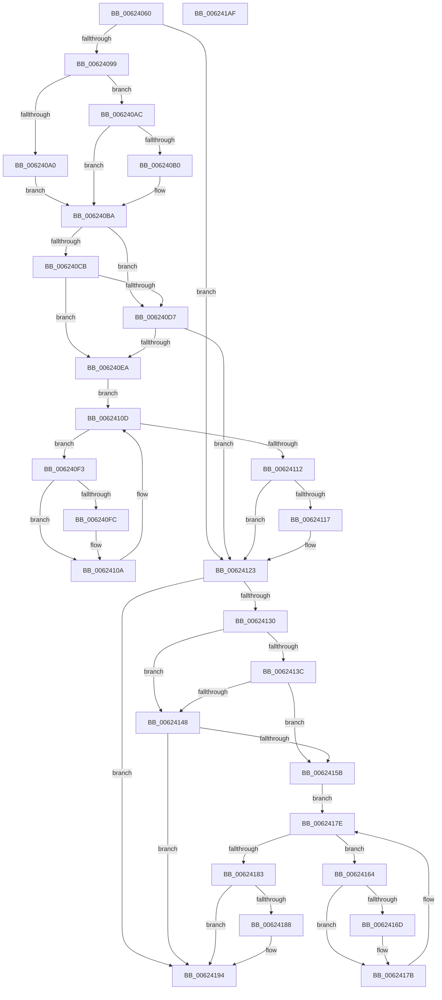

# DifExfTryToWakePushLockWrapper

- RVA: `0x00624060`–`0x006241B0` (길이 `336` bytes)
- VA: `0x0000000140624060`
- 실행 섹션: `.text`
- PDB 이름 있음: `예`; PDB Function 태그: `아니요`
- unwind 정보 RVA: `0x0005D7BC`
- 디코드: `90`개 명령, `336/336` bytes 표시
- 미해석 바이트: `0` (있으면 어셈블리에 `.byte`로 보존)

> 이 문서는 커널 이미지의 기계어와 PDB 기호를 분석해 생성했습니다. 4번과 5번은 함수 원형과 자료형을 바이너리 사용 방식에서 추정한 C 해석이며 원본 소스 복구 결과는 아닙니다.

## 1. Dependencies

- 직접 호출 지점: **9**; 고유 호출 대상: **6**
- 직접 호출자로 확인된 함수: **0**
- RIP 상대 이미지 참조: **3**

### Outgoing calls
- `0x00624088` → [DifGetAPIThunkContextById](../49/DifGetAPIThunkContextById_function_00495A34.md) (function, `0x00495A34`)
- `0x006240B0` → [DifGetReturnAddressForWrappers](../4D/DifGetReturnAddressForWrappers_function_004D3C08.md) (function, `0x004D3C08`)
- `0x006240DE` → [ExAcquireRundownProtection](../21/ExAcquireRundownProtection_function_00216620.md) (function, `0x00216620`)
- `0x00624105` → [guard_dispatch_icall](../6B/guard_dispatch_icall_function_006BAAD0.md) (function, `0x006BAAD0`)
- `0x0062411E` → [ExReleaseRundownProtection](../34/ExReleaseRundownProtection_function_00349E80.md) (function, `0x00349E80`)
- `0x00624126` → [ExfTryToWakePushLock](../26/ExfTryToWakePushLock_function_00265DD0.md) (function, `0x00265DD0`)
- `0x0062414F` → [ExAcquireRundownProtection](../21/ExAcquireRundownProtection_function_00216620.md) (function, `0x00216620`)
- `0x00624176` → [guard_dispatch_icall](../6B/guard_dispatch_icall_function_006BAAD0.md) (function, `0x006BAAD0`)
- `0x0062418F` → [ExReleaseRundownProtection](../34/ExReleaseRundownProtection_function_00349E80.md) (function, `0x00349E80`)

### Direct callers
- 이 함수 시작 RVA로 연결되는 직접 call은 확인되지 않았습니다. 간접 호출은 완전히 역산할 수 없습니다.

### Static image references
- `0x006240C2` → RVA `0x00F048B8` (`.data`; read)
- `0x006240CB` → RVA `0x00F04980` (`.data`; read)
- `0x006240D7` → RVA `0x00F03E80` (`.data`; read)

## 2. Other-region calls and transfers

- 다른 실행 섹션으로 향하는 call: **0**
- 별도 외부 분기/꼬리 이동을 확인하지 못했습니다.

## 3. Assembly (complete function range)

```asm
00624060  48 8B C4                        mov rax, rsp
00624063  48 89 58 08                     mov qword ptr [rax + 8], rbx
00624067  48 89 68 10                     mov qword ptr [rax + 0x10], rbp
0062406B  48 89 70 18                     mov qword ptr [rax + 0x18], rsi
0062406F  48 89 78 20                     mov qword ptr [rax + 0x20], rdi
00624073  41 56                           push r14
00624075  48 83 EC 30                     sub rsp, 0x30
00624079  48 8B E9                        mov rbp, rcx
0062407C  0F 57 C0                        xorps xmm0, xmm0
0062407F  B9 77 01 00 00                  mov ecx, 0x177
00624084  0F 11 40 E8                     movups xmmword ptr [rax - 0x18], xmm0
00624088  E8 A7 19 E7 FF                  call 0x140495a34
0062408D  48 8B F8                        mov rdi, rax
00624090  48 85 C0                        test rax, rax
00624093  0F 84 8A 00 00 00               je 0x140624123
00624099  8B 40 0C                        mov eax, dword ptr [rax + 0xc]
0062409C  A8 18                           test al, 0x18
0062409E  74 0C                           je 0x1406240ac
006240A0  48 8B 4C 24 38                  mov rcx, qword ptr [rsp + 0x38]
006240A5  48 89 4C 24 20                  mov qword ptr [rsp + 0x20], rcx
006240AA  EB 0E                           jmp 0x1406240ba
006240AC  A8 04                           test al, 4
006240AE  74 0A                           je 0x1406240ba
006240B0  E8 53 FB EA FF                  call 0x1404d3c08
006240B5  48 89 44 24 20                  mov qword ptr [rsp + 0x20], rax
006240BA  40 32 F6                        xor sil, sil
006240BD  48 89 6C 24 28                  mov qword ptr [rsp + 0x28], rbp
006240C2  40 38 35 EF 07 8E 00            cmp byte ptr [rip + 0x8e07ef], sil
006240C9  75 0C                           jne 0x1406240d7
006240CB  F7 05 AB 08 8E 00 00 08 00 00   test dword ptr [rip + 0x8e08ab], 0x800
006240D5  74 13                           je 0x1406240ea
006240D7  48 8D 0D A2 FD 8D 00            lea rcx, [rip + 0x8dfda2]
006240DE  E8 3D 25 BF FF                  call 0x140216620
006240E3  40 8A F0                        mov sil, al
006240E6  84 C0                           test al, al
006240E8  74 39                           je 0x140624123
006240EA  4C 8D 77 20                     lea r14, [rdi + 0x20]
006240EE  49 8B 1E                        mov rbx, qword ptr [r14]
006240F1  EB 1A                           jmp 0x14062410d
006240F3  48 8D 43 F0                     lea rax, [rbx - 0x10]
006240F7  48 85 C0                        test rax, rax
006240FA  74 0E                           je 0x14062410a
006240FC  48 8B 40 08                     mov rax, qword ptr [rax + 8]
00624100  48 8D 4C 24 20                  lea rcx, [rsp + 0x20]
00624105  E8 C6 69 09 00                  call 0x1406baad0
0062410A  48 8B 1B                        mov rbx, qword ptr [rbx]
0062410D  49 3B DE                        cmp rbx, r14
00624110  75 E1                           jne 0x1406240f3
00624112  40 84 F6                        test sil, sil
00624115  74 0C                           je 0x140624123
00624117  48 8D 0D 62 FD 8D 00            lea rcx, [rip + 0x8dfd62]
0062411E  E8 5D 5D D2 FF                  call 0x140349e80
00624123  48 8B CD                        mov rcx, rbp
00624126  E8 A5 1C C4 FF                  call 0x140265dd0
0062412B  48 85 FF                        test rdi, rdi
0062412E  74 64                           je 0x140624194
00624130  40 32 F6                        xor sil, sil
00624133  40 38 35 7E 07 8E 00            cmp byte ptr [rip + 0x8e077e], sil
0062413A  75 0C                           jne 0x140624148
0062413C  F7 05 3A 08 8E 00 00 08 00 00   test dword ptr [rip + 0x8e083a], 0x800
00624146  74 13                           je 0x14062415b
00624148  48 8D 0D 31 FD 8D 00            lea rcx, [rip + 0x8dfd31]
0062414F  E8 CC 24 BF FF                  call 0x140216620
00624154  40 8A F0                        mov sil, al
00624157  84 C0                           test al, al
00624159  74 39                           je 0x140624194
0062415B  48 83 C7 30                     add rdi, 0x30
0062415F  48 8B 1F                        mov rbx, qword ptr [rdi]
00624162  EB 1A                           jmp 0x14062417e
00624164  48 8D 43 F0                     lea rax, [rbx - 0x10]
00624168  48 85 C0                        test rax, rax
0062416B  74 0E                           je 0x14062417b
0062416D  48 8B 40 08                     mov rax, qword ptr [rax + 8]
00624171  48 8D 4C 24 20                  lea rcx, [rsp + 0x20]
00624176  E8 55 69 09 00                  call 0x1406baad0
0062417B  48 8B 1B                        mov rbx, qword ptr [rbx]
0062417E  48 3B DF                        cmp rbx, rdi
00624181  75 E1                           jne 0x140624164
00624183  40 84 F6                        test sil, sil
00624186  74 0C                           je 0x140624194
00624188  48 8D 0D F1 FC 8D 00            lea rcx, [rip + 0x8dfcf1]
0062418F  E8 EC 5C D2 FF                  call 0x140349e80
00624194  48 8B 5C 24 40                  mov rbx, qword ptr [rsp + 0x40]
00624199  48 8B 6C 24 48                  mov rbp, qword ptr [rsp + 0x48]
0062419E  48 8B 74 24 50                  mov rsi, qword ptr [rsp + 0x50]
006241A3  48 8B 7C 24 58                  mov rdi, qword ptr [rsp + 0x58]
006241A8  48 83 C4 30                     add rsp, 0x30
006241AC  41 5E                           pop r14
006241AE  C3                              ret
006241AF  CC                              int3
```

## 4. C-style interpretation (structured pseudocode)

```c
__int64 __fastcall DifExfTryToWakePushLockWrapper(__int64 a1)
{
    __int64 result;
    __int64 v_rdi;
    __int64 v_rsi;
    __int64 v_rsp;
    unsigned __int64 v_stack_m10;
    unsigned __int64 v_stack_m18;
    unsigned __int64 v_stack_p0;
    unsigned __int64 v_stack_p10;
    unsigned __int64 v_stack_p18;
    unsigned __int64 v_stack_p20;
    unsigned __int64 v_stack_p8;

    *(unsigned __int64 *)(v_rsp + 8) = v_rbx;
    *(unsigned __int64 *)(v_rsp + 16) = v_rbp;
    *(unsigned __int64 *)(v_rsp + 24) = v_rsi;
    *(unsigned __int64 *)(v_rsp + 32) = v_rdi;
    v_rsp = (v_rsp) - (48);
    *(unsigned __int64 *)(v_rsp - 24) = v_xmm0;
    result = DifGetAPIThunkContextById(375, a2, a3, a4);
    if (result == 0) goto loc_00624123;
    if ((((unsigned __int8)((unsigned int)(*(unsigned int *)(result + 12)))) & (24)) == 0) goto loc_006240AC;
    v_stack_m18 = v_stack_p0;
    goto loc_006240BA;
loc_006240AC:
    result = (unsigned int)(*(unsigned int *)(result + 12));
    if ((((unsigned __int8)((unsigned int)(*(unsigned int *)(result + 12)))) & (4)) != 0) {
        result = DifGetReturnAddressForWrappers(v_stack_p0, a2, a3, a4);
        v_stack_m18 = result;
    }
    v_rsi = 0;
    v_stack_m10 = a1;
    if ((*(unsigned __int8 *)(v_rip + 9308143)) != 0) goto loc_006240D7;
    if (((*(unsigned int *)(v_rip + 9308331)) & (0x800ULL)) == 0) goto loc_006240EA;
loc_006240D7:
    result = ExAcquireRundownProtection(v_rip + 9305506, a2, a3, a4);
    if ((unsigned __int8)(result) == 0) goto loc_00624123;
loc_006240EA:
    goto loc_0062410D;
loc_006240F3:
    result = *(unsigned __int64 *)(result + 32) - 16;
    if (*(unsigned __int64 *)(result + 32) - 16 != 0) {
        result = *(unsigned __int64 *)(*(unsigned __int64 *)(result + 32) - 16 + 8);
        a1 = v_stack_m18;
        result = guard_dispatch_icall(a1, a2, a3, a4);
    }
loc_0062410D:
    if ((*(unsigned __int64 *)(*(unsigned __int64 *)(result + 32))) != (result + 32)) goto loc_006240F3;
    if ((unsigned __int8)((unsigned __int8)(result)) != 0) {
        a1 = v_rip + 9305442;
        result = ExReleaseRundownProtection(a1, a2, a3, a4);
    }
    result = ExfTryToWakePushLock(a1, a2, a3, a4);
    if (result == 0) goto loc_00624194;
    v_rsi = 0;
    if ((*(unsigned __int8 *)(v_rip + 9308030)) != 0) goto loc_00624148;
    if (((*(unsigned int *)(v_rip + 9308218)) & (0x800ULL)) == 0) goto loc_0062415B;
loc_00624148:
    result = ExAcquireRundownProtection(v_rip + 9305393, a2, a3, a4);
    if ((unsigned __int8)(result) == 0) goto loc_00624194;
loc_0062415B:
    v_rdi = (result) + (48);
    goto loc_0062417E;
loc_00624164:
    result = *(unsigned __int64 *)(v_rdi) - 16;
    if (*(unsigned __int64 *)(v_rdi) - 16 != 0) {
        result = *(unsigned __int64 *)(*(unsigned __int64 *)(v_rdi) - 16 + 8);
        a1 = v_stack_m18;
        result = guard_dispatch_icall(a1, a2, a3, a4);
    }
loc_0062417E:
    if ((*(unsigned __int64 *)(*(unsigned __int64 *)(v_rdi))) != v_rdi) goto loc_00624164;
    if ((unsigned __int8)((unsigned __int8)(result)) != 0) {
        a1 = v_rip + 9305329;
        result = ExReleaseRundownProtection(a1, a2, a3, a4);
    }
    v_rsp = (v_rsp) + (48);
    return result;
}
```

## 5. (Beta) C Style

```c
int64_t DifExfTryToWakePushLockWrapper(int64_t Arg1)
{
    int64_t result;
    int64_t local_rdi;
    int64_t local_rsi;
    int64_t local_rsp;
    uint64_t v_stack_m10;
    uint64_t v_stack_m18;
    uint64_t v_stack_p0;
    uint64_t v_stack_p10;
    uint64_t v_stack_p18;
    uint64_t v_stack_p20;
    uint64_t v_stack_p8;

    *(uint64_t *)(local_rsp + 0x8) = local_rbx;
    *(uint64_t *)(local_rsp + 0x10) = local_rbp;
    *(uint64_t *)(local_rsp + 0x18) = local_rsi;
    *(uint64_t *)(local_rsp + 0x20) = local_rdi;
    local_rsp = (local_rsp) - (48);
    *(uint64_t *)(local_rsp - 0x18) = v_xmm0;
    result = DifGetAPIThunkContextById(375, a2, a3, a4);
    if (result == 0) goto loc_00624123;
    if ((((uint8_t)((uint32_t)(*(uint32_t *)(result + 0xC)))) & (24)) == 0) goto loc_006240AC;
    v_stack_m18 = v_stack_p0;
    goto loc_006240BA;
loc_006240AC:
    result = (uint32_t)(*(uint32_t *)(result + 0xC));
    if ((((uint8_t)((uint32_t)(*(uint32_t *)(result + 0xC)))) & (4)) != 0) {
        result = DifGetReturnAddressForWrappers(v_stack_p0, a2, a3, a4);
        v_stack_m18 = result;
    }
    local_rsi = 0;
    v_stack_m10 = Arg1;
    if ((*(uint8_t *)(v_rip + 0x8E07EF)) != 0) goto loc_006240D7;
    if (((*(uint32_t *)(v_rip + 0x8E08AB)) & (0x800ULL)) == 0) goto loc_006240EA;
loc_006240D7:
    result = ExAcquireRundownProtection(v_rip + 9305506, a2, a3, a4);
    if ((uint8_t)(result) == 0) goto loc_00624123;
loc_006240EA:
    goto loc_0062410D;
loc_006240F3:
    result = *(uint64_t *)(result + 0x20) - 16;
    if (*(uint64_t *)(result + 0x20) - 16 != 0) {
        result = *(uint64_t *)(*(uint64_t *)(result + 0x20) - 0x10 + 0x8);
        Arg1 = v_stack_m18;
        result = guard_dispatch_icall(Arg1, a2, a3, a4);
    }
loc_0062410D:
    if ((*(uint64_t *)(*(uint64_t *)(result + 0x20))) != (result + 32)) goto loc_006240F3;
    if ((uint8_t)((uint8_t)(result)) != 0) {
        Arg1 = v_rip + 9305442;
        result = ExReleaseRundownProtection(Arg1, a2, a3, a4);
    }
    result = ExfTryToWakePushLock(Arg1, a2, a3, a4);
    if (result == 0) goto loc_00624194;
    local_rsi = 0;
    if ((*(uint8_t *)(v_rip + 0x8E077E)) != 0) goto loc_00624148;
    if (((*(uint32_t *)(v_rip + 0x8E083A)) & (0x800ULL)) == 0) goto loc_0062415B;
loc_00624148:
    result = ExAcquireRundownProtection(v_rip + 9305393, a2, a3, a4);
    if ((uint8_t)(result) == 0) goto loc_00624194;
loc_0062415B:
    local_rdi = (result) + (48);
    goto loc_0062417E;
loc_00624164:
    result = *(uint64_t *)(local_rdi) - 16;
    if (*(uint64_t *)(local_rdi) - 16 != 0) {
        result = *(uint64_t *)(*(uint64_t *)(local_rdi) - 0x10 + 0x8);
        Arg1 = v_stack_m18;
        result = guard_dispatch_icall(Arg1, a2, a3, a4);
    }
loc_0062417E:
    if ((*(uint64_t *)(*(uint64_t *)(local_rdi))) != local_rdi) goto loc_00624164;
    if ((uint8_t)((uint8_t)(result)) != 0) {
        Arg1 = v_rip + 9305329;
        result = ExReleaseRundownProtection(Arg1, a2, a3, a4);
    }
    local_rsp = (local_rsp) + (48);
    return result;
}
```

## 6. Execution-region graph

[열기: 2D/3D 그래프와 함수 탐색 컨트롤 패널](../../../control-panel.html?section=text&rva=0x00624060&view=graph)

- 2D 그래프는 위에서 아래로 흐르고, 3D 그래프는 빈 공간을 드래그해 회전합니다. Shift+드래그는 이동, 휠은 확대·축소, 함수 노드 선택은 대상 보고서 이동입니다.

### Static fallback


