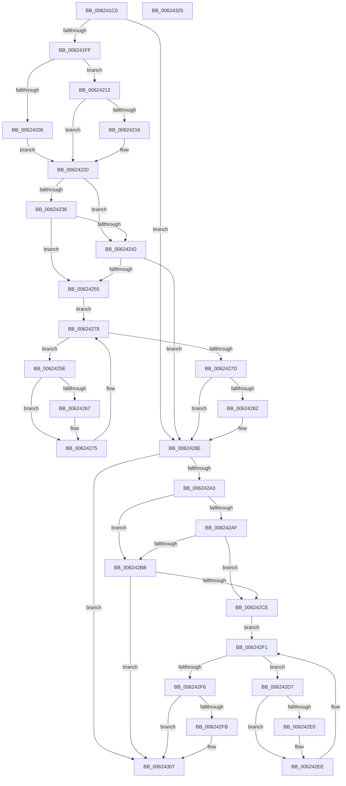

# DifHalAllocateCrashDumpRegistersWrapper

- RVA: `0x006241C0`–`0x00624326` (길이 `358` bytes)
- VA: `0x00000001406241C0`
- 실행 섹션: `.text`
- PDB 이름 있음: `예`; PDB Function 태그: `아니요`
- unwind 정보 RVA: `0x00093E28`
- 디코드: `98`개 명령, `358/358` bytes 표시
- 미해석 바이트: `0` (있으면 어셈블리에 `.byte`로 보존)

> 이 문서는 커널 이미지의 기계어와 PDB 기호를 분석해 생성했습니다. 4번과 5번은 함수 원형과 자료형을 바이너리 사용 방식에서 추정한 C 해석이며 원본 소스 복구 결과는 아닙니다.

## 1. Dependencies

- 직접 호출 지점: **9**; 고유 호출 대상: **6**
- 직접 호출자로 확인된 함수: **0**
- RIP 상대 이미지 참조: **3**

### Outgoing calls
- `0x006241EE` → [DifGetAPIThunkContextById](../49/DifGetAPIThunkContextById_function_00495A34.md) (function, `0x00495A34`)
- `0x00624216` → [DifGetReturnAddressForWrappers](../4D/DifGetReturnAddressForWrappers_function_004D3C08.md) (function, `0x004D3C08`)
- `0x00624249` → [ExAcquireRundownProtection](../21/ExAcquireRundownProtection_function_00216620.md) (function, `0x00216620`)
- `0x00624270` → [guard_dispatch_icall](../6B/guard_dispatch_icall_function_006BAAD0.md) (function, `0x006BAAD0`)
- `0x00624289` → [ExReleaseRundownProtection](../34/ExReleaseRundownProtection_function_00349E80.md) (function, `0x00349E80`)
- `0x00624294` → [HalAllocateCrashDumpRegisters](../53/HalAllocateCrashDumpRegisters_function_0053F5D0.md) (function, `0x0053F5D0`)
- `0x006242C2` → [ExAcquireRundownProtection](../21/ExAcquireRundownProtection_function_00216620.md) (function, `0x00216620`)
- `0x006242E9` → [guard_dispatch_icall](../6B/guard_dispatch_icall_function_006BAAD0.md) (function, `0x006BAAD0`)
- `0x00624302` → [ExReleaseRundownProtection](../34/ExReleaseRundownProtection_function_00349E80.md) (function, `0x00349E80`)

### Direct callers
- 이 함수 시작 RVA로 연결되는 직접 call은 확인되지 않았습니다. 간접 호출은 완전히 역산할 수 없습니다.

### Static image references
- `0x00624228` → RVA `0x00F048B8` (`.data`; read)
- `0x00624236` → RVA `0x00F04980` (`.data`; read)
- `0x00624242` → RVA `0x00F03E80` (`.data`; read)

## 2. Other-region calls and transfers

- 다른 실행 섹션으로 향하는 call: **0**
- 별도 외부 분기/꼬리 이동을 확인하지 못했습니다.

## 3. Assembly (complete function range)

```asm
006241C0  48 8B C4                        mov rax, rsp
006241C3  48 89 58 08                     mov qword ptr [rax + 8], rbx
006241C7  48 89 68 10                     mov qword ptr [rax + 0x10], rbp
006241CB  48 89 70 18                     mov qword ptr [rax + 0x18], rsi
006241CF  57                              push rdi
006241D0  41 56                           push r14
006241D2  41 57                           push r15
006241D4  48 83 EC 40                     sub rsp, 0x40
006241D8  0F 57 C0                        xorps xmm0, xmm0
006241DB  4C 8B F9                        mov r15, rcx
006241DE  B9 76 01 00 00                  mov ecx, 0x176
006241E3  4C 8B F2                        mov r14, rdx
006241E6  0F 11 40 C8                     movups xmmword ptr [rax - 0x38], xmm0
006241EA  0F 11 40 D8                     movups xmmword ptr [rax - 0x28], xmm0
006241EE  E8 41 18 E7 FF                  call 0x140495a34
006241F3  48 8B F0                        mov rsi, rax
006241F6  48 85 C0                        test rax, rax
006241F9  0F 84 8F 00 00 00               je 0x14062428e
006241FF  8B 40 0C                        mov eax, dword ptr [rax + 0xc]
00624202  A8 18                           test al, 0x18
00624204  74 0C                           je 0x140624212
00624206  48 8B 4C 24 58                  mov rcx, qword ptr [rsp + 0x58]
0062420B  48 89 4C 24 20                  mov qword ptr [rsp + 0x20], rcx
00624210  EB 0E                           jmp 0x140624220
00624212  A8 04                           test al, 4
00624214  74 0A                           je 0x140624220
00624216  E8 ED F9 EA FF                  call 0x1404d3c08
0062421B  48 89 44 24 20                  mov qword ptr [rsp + 0x20], rax
00624220  40 32 ED                        xor bpl, bpl
00624223  4C 89 7C 24 30                  mov qword ptr [rsp + 0x30], r15
00624228  40 38 2D 89 06 8E 00            cmp byte ptr [rip + 0x8e0689], bpl
0062422F  4C 89 74 24 28                  mov qword ptr [rsp + 0x28], r14
00624234  75 0C                           jne 0x140624242
00624236  F7 05 40 07 8E 00 00 08 00 00   test dword ptr [rip + 0x8e0740], 0x800
00624240  74 13                           je 0x140624255
00624242  48 8D 0D 37 FC 8D 00            lea rcx, [rip + 0x8dfc37]
00624249  E8 D2 23 BF FF                  call 0x140216620
0062424E  40 8A E8                        mov bpl, al
00624251  84 C0                           test al, al
00624253  74 39                           je 0x14062428e
00624255  48 8D 7E 20                     lea rdi, [rsi + 0x20]
00624259  48 8B 1F                        mov rbx, qword ptr [rdi]
0062425C  EB 1A                           jmp 0x140624278
0062425E  48 8D 43 F0                     lea rax, [rbx - 0x10]
00624262  48 85 C0                        test rax, rax
00624265  74 0E                           je 0x140624275
00624267  48 8B 40 08                     mov rax, qword ptr [rax + 8]
0062426B  48 8D 4C 24 20                  lea rcx, [rsp + 0x20]
00624270  E8 5B 68 09 00                  call 0x1406baad0
00624275  48 8B 1B                        mov rbx, qword ptr [rbx]
00624278  48 3B DF                        cmp rbx, rdi
0062427B  75 E1                           jne 0x14062425e
0062427D  40 84 ED                        test bpl, bpl
00624280  74 0C                           je 0x14062428e
00624282  48 8D 0D F7 FB 8D 00            lea rcx, [rip + 0x8dfbf7]
00624289  E8 F2 5B D2 FF                  call 0x140349e80
0062428E  49 8B D6                        mov rdx, r14
00624291  49 8B CF                        mov rcx, r15
00624294  E8 37 B3 F1 FF                  call 0x14053f5d0
00624299  48 89 44 24 38                  mov qword ptr [rsp + 0x38], rax
0062429E  48 85 F6                        test rsi, rsi
006242A1  74 64                           je 0x140624307
006242A3  40 32 FF                        xor dil, dil
006242A6  40 38 3D 0B 06 8E 00            cmp byte ptr [rip + 0x8e060b], dil
006242AD  75 0C                           jne 0x1406242bb
006242AF  F7 05 C7 06 8E 00 00 08 00 00   test dword ptr [rip + 0x8e06c7], 0x800
006242B9  74 13                           je 0x1406242ce
006242BB  48 8D 0D BE FB 8D 00            lea rcx, [rip + 0x8dfbbe]
006242C2  E8 59 23 BF FF                  call 0x140216620
006242C7  40 8A F8                        mov dil, al
006242CA  84 C0                           test al, al
006242CC  74 39                           je 0x140624307
006242CE  48 83 C6 30                     add rsi, 0x30
006242D2  48 8B 1E                        mov rbx, qword ptr [rsi]
006242D5  EB 1A                           jmp 0x1406242f1
006242D7  48 8D 43 F0                     lea rax, [rbx - 0x10]
006242DB  48 85 C0                        test rax, rax
006242DE  74 0E                           je 0x1406242ee
006242E0  48 8B 40 08                     mov rax, qword ptr [rax + 8]
006242E4  48 8D 4C 24 20                  lea rcx, [rsp + 0x20]
006242E9  E8 E2 67 09 00                  call 0x1406baad0
006242EE  48 8B 1B                        mov rbx, qword ptr [rbx]
006242F1  48 3B DE                        cmp rbx, rsi
006242F4  75 E1                           jne 0x1406242d7
006242F6  40 84 FF                        test dil, dil
006242F9  74 0C                           je 0x140624307
006242FB  48 8D 0D 7E FB 8D 00            lea rcx, [rip + 0x8dfb7e]
00624302  E8 79 5B D2 FF                  call 0x140349e80
00624307  48 8B 44 24 38                  mov rax, qword ptr [rsp + 0x38]
0062430C  48 8B 5C 24 60                  mov rbx, qword ptr [rsp + 0x60]
00624311  48 8B 6C 24 68                  mov rbp, qword ptr [rsp + 0x68]
00624316  48 8B 74 24 70                  mov rsi, qword ptr [rsp + 0x70]
0062431B  48 83 C4 40                     add rsp, 0x40
0062431F  41 5F                           pop r15
00624321  41 5E                           pop r14
00624323  5F                              pop rdi
00624324  C3                              ret
00624325  CC                              int3
```

## 4. C-style interpretation (structured pseudocode)

```c
__int64 __fastcall DifHalAllocateCrashDumpRegistersWrapper(__int64 a1, __int64 a2)
{
    __int64 result;
    __int64 v_rbp;
    __int64 v_rdi;
    __int64 v_rsi;
    __int64 v_rsp;
    unsigned __int64 v_stack_m20;
    unsigned __int64 v_stack_m28;
    unsigned __int64 v_stack_m30;
    unsigned __int64 v_stack_m38;
    unsigned __int64 v_stack_p0;
    unsigned __int64 v_stack_p10;
    unsigned __int64 v_stack_p18;
    unsigned __int64 v_stack_p8;

    *(unsigned __int64 *)(v_rsp + 8) = v_rbx;
    *(unsigned __int64 *)(v_rsp + 16) = v_rbp;
    *(unsigned __int64 *)(v_rsp + 24) = v_rsi;
    v_rsp = (v_rsp) - (64);
    *(unsigned __int64 *)(v_rsp - 56) = v_xmm0;
    *(unsigned __int64 *)(v_rsp - 40) = v_xmm0;
    result = DifGetAPIThunkContextById(374, a2, a3, a4);
    if (result == 0) goto loc_0062428E;
    if ((((unsigned __int8)((unsigned int)(*(unsigned int *)(result + 12)))) & (24)) == 0) goto loc_00624212;
    v_stack_m38 = v_stack_p0;
    goto loc_00624220;
loc_00624212:
    result = (unsigned int)(*(unsigned int *)(result + 12));
    if ((((unsigned __int8)((unsigned int)(*(unsigned int *)(result + 12)))) & (4)) != 0) {
        result = DifGetReturnAddressForWrappers(v_stack_p0, a2, a3, a4);
        v_stack_m38 = result;
    }
    v_rbp = 0;
    v_stack_m28 = a1;
    v_stack_m30 = a2;
    if ((*(unsigned __int8 *)(v_rip + 9307785)) != 0) goto loc_00624242;
    if (((*(unsigned int *)(v_rip + 9307968)) & (0x800ULL)) == 0) goto loc_00624255;
loc_00624242:
    result = ExAcquireRundownProtection(v_rip + 9305143, a2, a3, a4);
    if ((unsigned __int8)(result) == 0) goto loc_0062428E;
loc_00624255:
    goto loc_00624278;
loc_0062425E:
    result = *(unsigned __int64 *)(result + 32) - 16;
    if (*(unsigned __int64 *)(result + 32) - 16 != 0) {
        result = *(unsigned __int64 *)(*(unsigned __int64 *)(result + 32) - 16 + 8);
        a1 = v_stack_m38;
        result = guard_dispatch_icall(a1, a2, a3, a4);
    }
loc_00624278:
    if ((*(unsigned __int64 *)(*(unsigned __int64 *)(result + 32))) != (result + 32)) goto loc_0062425E;
    if ((unsigned __int8)((unsigned __int8)(result)) != 0) {
        a1 = v_rip + 9305079;
        result = ExReleaseRundownProtection(a1, a2, a3, a4);
    }
    result = HalAllocateCrashDumpRegisters(a1, a2, a3, a4);
    v_stack_m20 = result;
    if (result == 0) goto loc_00624307;
    v_rdi = 0;
    if ((*(unsigned __int8 *)(v_rip + 9307659)) != 0) goto loc_006242BB;
    if (((*(unsigned int *)(v_rip + 9307847)) & (0x800ULL)) == 0) goto loc_006242CE;
loc_006242BB:
    result = ExAcquireRundownProtection(v_rip + 9305022, a2, a3, a4);
    if ((unsigned __int8)(result) == 0) goto loc_00624307;
loc_006242CE:
    v_rsi = (result) + (48);
    goto loc_006242F1;
loc_006242D7:
    result = *(unsigned __int64 *)(v_rsi) - 16;
    if (*(unsigned __int64 *)(v_rsi) - 16 != 0) {
        result = *(unsigned __int64 *)(*(unsigned __int64 *)(v_rsi) - 16 + 8);
        a1 = v_stack_m38;
        result = guard_dispatch_icall(a1, a2, a3, a4);
    }
loc_006242F1:
    if ((*(unsigned __int64 *)(*(unsigned __int64 *)(v_rsi))) != v_rsi) goto loc_006242D7;
    if ((unsigned __int8)((unsigned __int8)(result)) != 0) {
        a1 = v_rip + 9304958;
        result = ExReleaseRundownProtection(a1, a2, a3, a4);
    }
    v_rsp = (v_rsp) + (64);
    return v_stack_m20;
}
```

## 5. (Beta) C Style

```c
int64_t DifHalAllocateCrashDumpRegistersWrapper(int64_t Arg1, int64_t Arg2)
{
    int64_t result;
    int64_t local_rbp;
    int64_t local_rdi;
    int64_t local_rsi;
    int64_t local_rsp;
    uint64_t v_stack_m20;
    uint64_t v_stack_m28;
    uint64_t v_stack_m30;
    uint64_t v_stack_m38;
    uint64_t v_stack_p0;
    uint64_t v_stack_p10;
    uint64_t v_stack_p18;
    uint64_t v_stack_p8;

    *(uint64_t *)(local_rsp + 0x8) = local_rbx;
    *(uint64_t *)(local_rsp + 0x10) = local_rbp;
    *(uint64_t *)(local_rsp + 0x18) = local_rsi;
    local_rsp = (local_rsp) - (64);
    *(uint64_t *)(local_rsp - 0x38) = v_xmm0;
    *(uint64_t *)(local_rsp - 0x28) = v_xmm0;
    result = DifGetAPIThunkContextById(374, Arg2, a3, a4);
    if (result == 0) goto loc_0062428E;
    if ((((uint8_t)((uint32_t)(*(uint32_t *)(result + 0xC)))) & (24)) == 0) goto loc_00624212;
    v_stack_m38 = v_stack_p0;
    goto loc_00624220;
loc_00624212:
    result = (uint32_t)(*(uint32_t *)(result + 0xC));
    if ((((uint8_t)((uint32_t)(*(uint32_t *)(result + 0xC)))) & (4)) != 0) {
        result = DifGetReturnAddressForWrappers(v_stack_p0, Arg2, a3, a4);
        v_stack_m38 = result;
    }
    local_rbp = 0;
    v_stack_m28 = Arg1;
    v_stack_m30 = Arg2;
    if ((*(uint8_t *)(v_rip + 0x8E0689)) != 0) goto loc_00624242;
    if (((*(uint32_t *)(v_rip + 0x8E0740)) & (0x800ULL)) == 0) goto loc_00624255;
loc_00624242:
    result = ExAcquireRundownProtection(v_rip + 9305143, Arg2, a3, a4);
    if ((uint8_t)(result) == 0) goto loc_0062428E;
loc_00624255:
    goto loc_00624278;
loc_0062425E:
    result = *(uint64_t *)(result + 0x20) - 16;
    if (*(uint64_t *)(result + 0x20) - 16 != 0) {
        result = *(uint64_t *)(*(uint64_t *)(result + 0x20) - 0x10 + 0x8);
        Arg1 = v_stack_m38;
        result = guard_dispatch_icall(Arg1, Arg2, a3, a4);
    }
loc_00624278:
    if ((*(uint64_t *)(*(uint64_t *)(result + 0x20))) != (result + 32)) goto loc_0062425E;
    if ((uint8_t)((uint8_t)(result)) != 0) {
        Arg1 = v_rip + 9305079;
        result = ExReleaseRundownProtection(Arg1, Arg2, a3, a4);
    }
    result = HalAllocateCrashDumpRegisters(Arg1, Arg2, a3, a4);
    v_stack_m20 = result;
    if (result == 0) goto loc_00624307;
    local_rdi = 0;
    if ((*(uint8_t *)(v_rip + 0x8E060B)) != 0) goto loc_006242BB;
    if (((*(uint32_t *)(v_rip + 0x8E06C7)) & (0x800ULL)) == 0) goto loc_006242CE;
loc_006242BB:
    result = ExAcquireRundownProtection(v_rip + 9305022, Arg2, a3, a4);
    if ((uint8_t)(result) == 0) goto loc_00624307;
loc_006242CE:
    local_rsi = (result) + (48);
    goto loc_006242F1;
loc_006242D7:
    result = *(uint64_t *)(local_rsi) - 16;
    if (*(uint64_t *)(local_rsi) - 16 != 0) {
        result = *(uint64_t *)(*(uint64_t *)(local_rsi) - 0x10 + 0x8);
        Arg1 = v_stack_m38;
        result = guard_dispatch_icall(Arg1, Arg2, a3, a4);
    }
loc_006242F1:
    if ((*(uint64_t *)(*(uint64_t *)(local_rsi))) != local_rsi) goto loc_006242D7;
    if ((uint8_t)((uint8_t)(result)) != 0) {
        Arg1 = v_rip + 9304958;
        result = ExReleaseRundownProtection(Arg1, Arg2, a3, a4);
    }
    local_rsp = (local_rsp) + (64);
    return v_stack_m20;
}
```

## 6. Execution-region graph

[열기: 2D/3D 그래프와 함수 탐색 컨트롤 패널](../../../control-panel.html?section=text&rva=0x006241C0&view=graph)

- 2D 그래프는 위에서 아래로 흐르고, 3D 그래프는 빈 공간을 드래그해 회전합니다. Shift+드래그는 이동, 휠은 확대·축소, 함수 노드 선택은 대상 보고서 이동입니다.

### Static fallback


