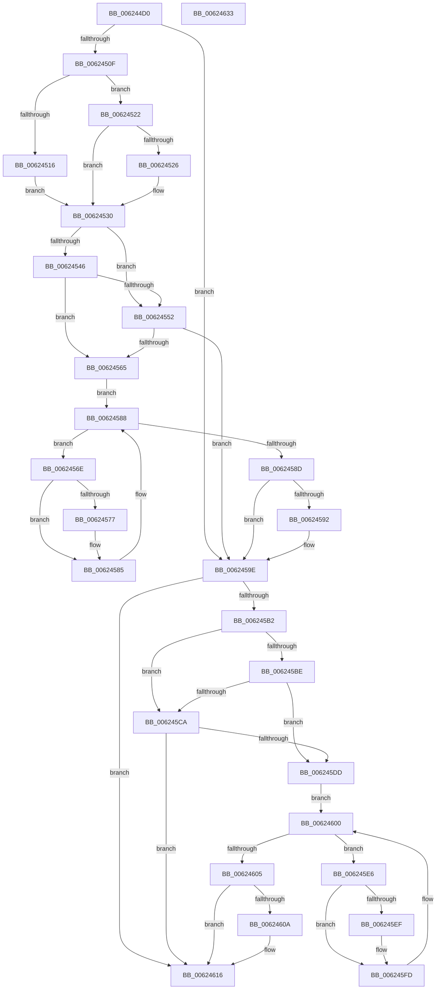

# DifHalDmaFreeCrashDumpRegistersExWrapper

- RVA: `0x006244D0`–`0x00624634` (길이 `356` bytes)
- VA: `0x00000001406244D0`
- 실행 섹션: `.text`
- PDB 이름 있음: `예`; PDB Function 태그: `아니요`
- unwind 정보 RVA: `0x00093E28`
- 디코드: `98`개 명령, `356/356` bytes 표시
- 미해석 바이트: `0` (있으면 어셈블리에 `.byte`로 보존)

> 이 문서는 커널 이미지의 기계어와 PDB 기호를 분석해 생성했습니다. 4번과 5번은 함수 원형과 자료형을 바이너리 사용 방식에서 추정한 C 해석이며 원본 소스 복구 결과는 아닙니다.

## 1. Dependencies

- 직접 호출 지점: **9**; 고유 호출 대상: **6**
- 직접 호출자로 확인된 함수: **0**
- RIP 상대 이미지 참조: **3**

### Outgoing calls
- `0x006244FE` → [DifGetAPIThunkContextById](../49/DifGetAPIThunkContextById_function_00495A34.md) (function, `0x00495A34`)
- `0x00624526` → [DifGetReturnAddressForWrappers](../4D/DifGetReturnAddressForWrappers_function_004D3C08.md) (function, `0x004D3C08`)
- `0x00624559` → [ExAcquireRundownProtection](../21/ExAcquireRundownProtection_function_00216620.md) (function, `0x00216620`)
- `0x00624580` → [guard_dispatch_icall](../6B/guard_dispatch_icall_function_006BAAD0.md) (function, `0x006BAAD0`)
- `0x00624599` → [ExReleaseRundownProtection](../34/ExReleaseRundownProtection_function_00349E80.md) (function, `0x00349E80`)
- `0x006245A4` → [HalDmaFreeCrashDumpRegistersEx](../4B/HalDmaFreeCrashDumpRegistersEx_function_004B8CE0.md) (function, `0x004B8CE0`)
- `0x006245D1` → [ExAcquireRundownProtection](../21/ExAcquireRundownProtection_function_00216620.md) (function, `0x00216620`)
- `0x006245F8` → [guard_dispatch_icall](../6B/guard_dispatch_icall_function_006BAAD0.md) (function, `0x006BAAD0`)
- `0x00624611` → [ExReleaseRundownProtection](../34/ExReleaseRundownProtection_function_00349E80.md) (function, `0x00349E80`)

### Direct callers
- 이 함수 시작 RVA로 연결되는 직접 call은 확인되지 않았습니다. 간접 호출은 완전히 역산할 수 없습니다.

### Static image references
- `0x00624538` → RVA `0x00F048B8` (`.data`; read)
- `0x00624546` → RVA `0x00F04980` (`.data`; read)
- `0x00624552` → RVA `0x00F03E80` (`.data`; read)

## 2. Other-region calls and transfers

- 다른 실행 섹션으로 향하는 call: **0**
- 별도 외부 분기/꼬리 이동을 확인하지 못했습니다.

## 3. Assembly (complete function range)

```asm
006244D0  48 8B C4                        mov rax, rsp
006244D3  48 89 58 08                     mov qword ptr [rax + 8], rbx
006244D7  48 89 68 10                     mov qword ptr [rax + 0x10], rbp
006244DB  48 89 70 18                     mov qword ptr [rax + 0x18], rsi
006244DF  57                              push rdi
006244E0  41 56                           push r14
006244E2  41 57                           push r15
006244E4  48 83 EC 40                     sub rsp, 0x40
006244E8  0F 57 C0                        xorps xmm0, xmm0
006244EB  4C 8B F9                        mov r15, rcx
006244EE  B9 74 01 00 00                  mov ecx, 0x174
006244F3  44 8B F2                        mov r14d, edx
006244F6  0F 11 40 C8                     movups xmmword ptr [rax - 0x38], xmm0
006244FA  0F 11 40 D8                     movups xmmword ptr [rax - 0x28], xmm0
006244FE  E8 31 15 E7 FF                  call 0x140495a34
00624503  48 8B F0                        mov rsi, rax
00624506  48 85 C0                        test rax, rax
00624509  0F 84 8F 00 00 00               je 0x14062459e
0062450F  8B 40 0C                        mov eax, dword ptr [rax + 0xc]
00624512  A8 18                           test al, 0x18
00624514  74 0C                           je 0x140624522
00624516  48 8B 4C 24 58                  mov rcx, qword ptr [rsp + 0x58]
0062451B  48 89 4C 24 20                  mov qword ptr [rsp + 0x20], rcx
00624520  EB 0E                           jmp 0x140624530
00624522  A8 04                           test al, 4
00624524  74 0A                           je 0x140624530
00624526  E8 DD F6 EA FF                  call 0x1404d3c08
0062452B  48 89 44 24 20                  mov qword ptr [rsp + 0x20], rax
00624530  40 32 ED                        xor bpl, bpl
00624533  4C 89 7C 24 30                  mov qword ptr [rsp + 0x30], r15
00624538  40 38 2D 79 03 8E 00            cmp byte ptr [rip + 0x8e0379], bpl
0062453F  44 89 74 24 28                  mov dword ptr [rsp + 0x28], r14d
00624544  75 0C                           jne 0x140624552
00624546  F7 05 30 04 8E 00 00 08 00 00   test dword ptr [rip + 0x8e0430], 0x800
00624550  74 13                           je 0x140624565
00624552  48 8D 0D 27 F9 8D 00            lea rcx, [rip + 0x8df927]
00624559  E8 C2 20 BF FF                  call 0x140216620
0062455E  40 8A E8                        mov bpl, al
00624561  84 C0                           test al, al
00624563  74 39                           je 0x14062459e
00624565  48 8D 7E 20                     lea rdi, [rsi + 0x20]
00624569  48 8B 1F                        mov rbx, qword ptr [rdi]
0062456C  EB 1A                           jmp 0x140624588
0062456E  48 8D 43 F0                     lea rax, [rbx - 0x10]
00624572  48 85 C0                        test rax, rax
00624575  74 0E                           je 0x140624585
00624577  48 8B 40 08                     mov rax, qword ptr [rax + 8]
0062457B  48 8D 4C 24 20                  lea rcx, [rsp + 0x20]
00624580  E8 4B 65 09 00                  call 0x1406baad0
00624585  48 8B 1B                        mov rbx, qword ptr [rbx]
00624588  48 3B DF                        cmp rbx, rdi
0062458B  75 E1                           jne 0x14062456e
0062458D  40 84 ED                        test bpl, bpl
00624590  74 0C                           je 0x14062459e
00624592  48 8D 0D E7 F8 8D 00            lea rcx, [rip + 0x8df8e7]
00624599  E8 E2 58 D2 FF                  call 0x140349e80
0062459E  41 8B D6                        mov edx, r14d
006245A1  49 8B CF                        mov rcx, r15
006245A4  E8 37 47 E9 FF                  call 0x1404b8ce0
006245A9  89 44 24 38                     mov dword ptr [rsp + 0x38], eax
006245AD  48 85 F6                        test rsi, rsi
006245B0  74 64                           je 0x140624616
006245B2  40 32 FF                        xor dil, dil
006245B5  40 38 3D FC 02 8E 00            cmp byte ptr [rip + 0x8e02fc], dil
006245BC  75 0C                           jne 0x1406245ca
006245BE  F7 05 B8 03 8E 00 00 08 00 00   test dword ptr [rip + 0x8e03b8], 0x800
006245C8  74 13                           je 0x1406245dd
006245CA  48 8D 0D AF F8 8D 00            lea rcx, [rip + 0x8df8af]
006245D1  E8 4A 20 BF FF                  call 0x140216620
006245D6  40 8A F8                        mov dil, al
006245D9  84 C0                           test al, al
006245DB  74 39                           je 0x140624616
006245DD  48 83 C6 30                     add rsi, 0x30
006245E1  48 8B 1E                        mov rbx, qword ptr [rsi]
006245E4  EB 1A                           jmp 0x140624600
006245E6  48 8D 43 F0                     lea rax, [rbx - 0x10]
006245EA  48 85 C0                        test rax, rax
006245ED  74 0E                           je 0x1406245fd
006245EF  48 8B 40 08                     mov rax, qword ptr [rax + 8]
006245F3  48 8D 4C 24 20                  lea rcx, [rsp + 0x20]
006245F8  E8 D3 64 09 00                  call 0x1406baad0
006245FD  48 8B 1B                        mov rbx, qword ptr [rbx]
00624600  48 3B DE                        cmp rbx, rsi
00624603  75 E1                           jne 0x1406245e6
00624605  40 84 FF                        test dil, dil
00624608  74 0C                           je 0x140624616
0062460A  48 8D 0D 6F F8 8D 00            lea rcx, [rip + 0x8df86f]
00624611  E8 6A 58 D2 FF                  call 0x140349e80
00624616  8B 44 24 38                     mov eax, dword ptr [rsp + 0x38]
0062461A  48 8B 5C 24 60                  mov rbx, qword ptr [rsp + 0x60]
0062461F  48 8B 6C 24 68                  mov rbp, qword ptr [rsp + 0x68]
00624624  48 8B 74 24 70                  mov rsi, qword ptr [rsp + 0x70]
00624629  48 83 C4 40                     add rsp, 0x40
0062462D  41 5F                           pop r15
0062462F  41 5E                           pop r14
00624631  5F                              pop rdi
00624632  C3                              ret
00624633  CC                              int3
```

## 4. C-style interpretation (structured pseudocode)

```c
__int64 __fastcall DifHalDmaFreeCrashDumpRegistersExWrapper(__int64 a1, int a2)
{
    __int64 result;
    __int64 v_rbp;
    __int64 v_rdi;
    __int64 v_rsi;
    __int64 v_rsp;
    unsigned int v_stack_m20;
    unsigned __int64 v_stack_m28;
    unsigned int v_stack_m30;
    unsigned __int64 v_stack_m38;
    unsigned __int64 v_stack_p0;
    unsigned __int64 v_stack_p10;
    unsigned __int64 v_stack_p18;
    unsigned __int64 v_stack_p8;

    *(unsigned __int64 *)(v_rsp + 8) = v_rbx;
    *(unsigned __int64 *)(v_rsp + 16) = v_rbp;
    *(unsigned __int64 *)(v_rsp + 24) = v_rsi;
    v_rsp = (v_rsp) - (64);
    *(unsigned __int64 *)(v_rsp - 56) = v_xmm0;
    *(unsigned __int64 *)(v_rsp - 40) = v_xmm0;
    result = DifGetAPIThunkContextById(372, a2, a3, a4);
    if (result == 0) goto loc_0062459E;
    if ((((unsigned __int8)((unsigned int)(*(unsigned int *)(result + 12)))) & (24)) == 0) goto loc_00624522;
    v_stack_m38 = v_stack_p0;
    goto loc_00624530;
loc_00624522:
    result = (unsigned int)(*(unsigned int *)(result + 12));
    if ((((unsigned __int8)((unsigned int)(*(unsigned int *)(result + 12)))) & (4)) != 0) {
        result = DifGetReturnAddressForWrappers(v_stack_p0, a2, a3, a4);
        v_stack_m38 = result;
    }
    v_rbp = 0;
    v_stack_m28 = a1;
    v_stack_m30 = (unsigned int)((unsigned int)(a2));
    if ((*(unsigned __int8 *)(v_rip + 9307001)) != 0) goto loc_00624552;
    if (((*(unsigned int *)(v_rip + 9307184)) & (0x800ULL)) == 0) goto loc_00624565;
loc_00624552:
    result = ExAcquireRundownProtection(v_rip + 9304359, a2, a3, a4);
    if ((unsigned __int8)(result) == 0) goto loc_0062459E;
loc_00624565:
    goto loc_00624588;
loc_0062456E:
    result = *(unsigned __int64 *)(result + 32) - 16;
    if (*(unsigned __int64 *)(result + 32) - 16 != 0) {
        result = *(unsigned __int64 *)(*(unsigned __int64 *)(result + 32) - 16 + 8);
        a1 = v_stack_m38;
        result = guard_dispatch_icall(a1, a2, a3, a4);
    }
loc_00624588:
    if ((*(unsigned __int64 *)(*(unsigned __int64 *)(result + 32))) != (result + 32)) goto loc_0062456E;
    if ((unsigned __int8)((unsigned __int8)(result)) != 0) {
        a1 = v_rip + 9304295;
        result = ExReleaseRundownProtection(a1, a2, a3, a4);
    }
    result = HalDmaFreeCrashDumpRegistersEx(a1, (unsigned int)((unsigned int)((unsigned int)(a2))), a3, a4);
    v_stack_m20 = (unsigned int)(result);
    if (result == 0) goto loc_00624616;
    v_rdi = 0;
    if ((*(unsigned __int8 *)(v_rip + 9306876)) != 0) goto loc_006245CA;
    if (((*(unsigned int *)(v_rip + 9307064)) & (0x800ULL)) == 0) goto loc_006245DD;
loc_006245CA:
    result = ExAcquireRundownProtection(v_rip + 9304239, (unsigned int)((unsigned int)((unsigned int)(a2))), a3, a4);
    if ((unsigned __int8)(result) == 0) goto loc_00624616;
loc_006245DD:
    v_rsi = (result) + (48);
    goto loc_00624600;
loc_006245E6:
    result = *(unsigned __int64 *)(v_rsi) - 16;
    if (*(unsigned __int64 *)(v_rsi) - 16 != 0) {
        result = *(unsigned __int64 *)(*(unsigned __int64 *)(v_rsi) - 16 + 8);
        a1 = v_stack_m38;
        result = guard_dispatch_icall(a1, (unsigned int)((unsigned int)((unsigned int)(a2))), a3, a4);
    }
loc_00624600:
    if ((*(unsigned __int64 *)(*(unsigned __int64 *)(v_rsi))) != v_rsi) goto loc_006245E6;
    if ((unsigned __int8)((unsigned __int8)(result)) != 0) {
        a1 = v_rip + 9304175;
        result = ExReleaseRundownProtection(a1, (unsigned int)((unsigned int)((unsigned int)(a2))), a3, a4);
    }
    v_rsp = (v_rsp) + (64);
    return (unsigned int)(v_stack_m20);
}
```

## 5. (Beta) C Style

```c
int64_t DifHalDmaFreeCrashDumpRegistersExWrapper(int64_t Arg1, int32_t Arg2)
{
    int64_t result;
    int64_t local_rbp;
    int64_t local_rdi;
    int64_t local_rsi;
    int64_t local_rsp;
    uint32_t v_stack_m20;
    uint64_t v_stack_m28;
    uint32_t v_stack_m30;
    uint64_t v_stack_m38;
    uint64_t v_stack_p0;
    uint64_t v_stack_p10;
    uint64_t v_stack_p18;
    uint64_t v_stack_p8;

    *(uint64_t *)(local_rsp + 0x8) = local_rbx;
    *(uint64_t *)(local_rsp + 0x10) = local_rbp;
    *(uint64_t *)(local_rsp + 0x18) = local_rsi;
    local_rsp = (local_rsp) - (64);
    *(uint64_t *)(local_rsp - 0x38) = v_xmm0;
    *(uint64_t *)(local_rsp - 0x28) = v_xmm0;
    result = DifGetAPIThunkContextById(372, Arg2, a3, a4);
    if (result == 0) goto loc_0062459E;
    if ((((uint8_t)((uint32_t)(*(uint32_t *)(result + 0xC)))) & (24)) == 0) goto loc_00624522;
    v_stack_m38 = v_stack_p0;
    goto loc_00624530;
loc_00624522:
    result = (uint32_t)(*(uint32_t *)(result + 0xC));
    if ((((uint8_t)((uint32_t)(*(uint32_t *)(result + 0xC)))) & (4)) != 0) {
        result = DifGetReturnAddressForWrappers(v_stack_p0, Arg2, a3, a4);
        v_stack_m38 = result;
    }
    local_rbp = 0;
    v_stack_m28 = Arg1;
    v_stack_m30 = (uint32_t)((uint32_t)(Arg2));
    if ((*(uint8_t *)(v_rip + 0x8E0379)) != 0) goto loc_00624552;
    if (((*(uint32_t *)(v_rip + 0x8E0430)) & (0x800ULL)) == 0) goto loc_00624565;
loc_00624552:
    result = ExAcquireRundownProtection(v_rip + 9304359, Arg2, a3, a4);
    if ((uint8_t)(result) == 0) goto loc_0062459E;
loc_00624565:
    goto loc_00624588;
loc_0062456E:
    result = *(uint64_t *)(result + 0x20) - 16;
    if (*(uint64_t *)(result + 0x20) - 16 != 0) {
        result = *(uint64_t *)(*(uint64_t *)(result + 0x20) - 0x10 + 0x8);
        Arg1 = v_stack_m38;
        result = guard_dispatch_icall(Arg1, Arg2, a3, a4);
    }
loc_00624588:
    if ((*(uint64_t *)(*(uint64_t *)(result + 0x20))) != (result + 32)) goto loc_0062456E;
    if ((uint8_t)((uint8_t)(result)) != 0) {
        Arg1 = v_rip + 9304295;
        result = ExReleaseRundownProtection(Arg1, Arg2, a3, a4);
    }
    result = HalDmaFreeCrashDumpRegistersEx(Arg1, (uint32_t)((uint32_t)((uint32_t)(Arg2))), a3, a4);
    v_stack_m20 = (uint32_t)(result);
    if (result == 0) goto loc_00624616;
    local_rdi = 0;
    if ((*(uint8_t *)(v_rip + 0x8E02FC)) != 0) goto loc_006245CA;
    if (((*(uint32_t *)(v_rip + 0x8E03B8)) & (0x800ULL)) == 0) goto loc_006245DD;
loc_006245CA:
    result = ExAcquireRundownProtection(v_rip + 9304239, (uint32_t)((uint32_t)((uint32_t)(Arg2))), a3, a4);
    if ((uint8_t)(result) == 0) goto loc_00624616;
loc_006245DD:
    local_rsi = (result) + (48);
    goto loc_00624600;
loc_006245E6:
    result = *(uint64_t *)(local_rsi) - 16;
    if (*(uint64_t *)(local_rsi) - 16 != 0) {
        result = *(uint64_t *)(*(uint64_t *)(local_rsi) - 0x10 + 0x8);
        Arg1 = v_stack_m38;
        result = guard_dispatch_icall(Arg1, (uint32_t)((uint32_t)((uint32_t)(Arg2))), a3, a4);
    }
loc_00624600:
    if ((*(uint64_t *)(*(uint64_t *)(local_rsi))) != local_rsi) goto loc_006245E6;
    if ((uint8_t)((uint8_t)(result)) != 0) {
        Arg1 = v_rip + 9304175;
        result = ExReleaseRundownProtection(Arg1, (uint32_t)((uint32_t)((uint32_t)(Arg2))), a3, a4);
    }
    local_rsp = (local_rsp) + (64);
    return (uint32_t)(v_stack_m20);
}
```

## 6. Execution-region graph

[열기: 2D/3D 그래프와 함수 탐색 컨트롤 패널](../../../control-panel.html?section=text&rva=0x006244D0&view=graph)

- 2D 그래프는 위에서 아래로 흐르고, 3D 그래프는 빈 공간을 드래그해 회전합니다. Shift+드래그는 이동, 휠은 확대·축소, 함수 노드 선택은 대상 보고서 이동입니다.

### Static fallback


