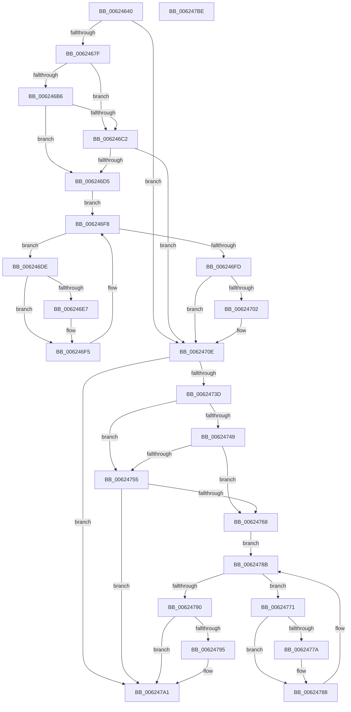

# DifIRP_MJ_CLEANUPWrapper

- RVA: `0x00624640`–`0x006247BF` (길이 `383` bytes)
- VA: `0x0000000140624640`
- 실행 섹션: `.text`
- PDB 이름 있음: `예`; PDB Function 태그: `아니요`
- unwind 정보 RVA: `0x00093E28`
- 디코드: `101`개 명령, `383/383` bytes 표시
- 미해석 바이트: `0` (있으면 어셈블리에 `.byte`로 보존)

> 이 문서는 커널 이미지의 기계어와 PDB 기호를 분석해 생성했습니다. 4번과 5번은 함수 원형과 자료형을 바이너리 사용 방식에서 추정한 C 해석이며 원본 소스 복구 결과는 아닙니다.

## 1. Dependencies

- 직접 호출 지점: **8**; 고유 호출 대상: **4**
- 직접 호출자로 확인된 함수: **0**
- RIP 상대 이미지 참조: **3**

### Outgoing calls
- `0x0062466E` → [DifGetAPIThunkContextById](../49/DifGetAPIThunkContextById_function_00495A34.md) (function, `0x00495A34`)
- `0x006246C9` → [ExAcquireRundownProtection](../21/ExAcquireRundownProtection_function_00216620.md) (function, `0x00216620`)
- `0x006246F0` → [guard_dispatch_icall](../6B/guard_dispatch_icall_function_006BAAD0.md) (function, `0x006BAAD0`)
- `0x00624709` → [ExReleaseRundownProtection](../34/ExReleaseRundownProtection_function_00349E80.md) (function, `0x00349E80`)
- `0x0062472F` → [guard_dispatch_icall](../6B/guard_dispatch_icall_function_006BAAD0.md) (function, `0x006BAAD0`)
- `0x0062475C` → [ExAcquireRundownProtection](../21/ExAcquireRundownProtection_function_00216620.md) (function, `0x00216620`)
- `0x00624783` → [guard_dispatch_icall](../6B/guard_dispatch_icall_function_006BAAD0.md) (function, `0x006BAAD0`)
- `0x0062479C` → [ExReleaseRundownProtection](../34/ExReleaseRundownProtection_function_00349E80.md) (function, `0x00349E80`)

### Direct callers
- 이 함수 시작 RVA로 연결되는 직접 call은 확인되지 않았습니다. 간접 호출은 완전히 역산할 수 없습니다.

### Static image references
- `0x00624689` → RVA `0x00F048B8` (`.data`; read)
- `0x006246B6` → RVA `0x00F04980` (`.data`; read)
- `0x006246C2` → RVA `0x00F03E80` (`.data`; read)

## 2. Other-region calls and transfers

- 다른 실행 섹션으로 향하는 call: **0**
- 별도 외부 분기/꼬리 이동을 확인하지 못했습니다.

## 3. Assembly (complete function range)

```asm
00624640  48 8B C4                        mov rax, rsp
00624643  48 89 58 08                     mov qword ptr [rax + 8], rbx
00624647  48 89 68 10                     mov qword ptr [rax + 0x10], rbp
0062464B  48 89 70 18                     mov qword ptr [rax + 0x18], rsi
0062464F  57                              push rdi
00624650  41 56                           push r14
00624652  41 57                           push r15
00624654  48 83 EC 40                     sub rsp, 0x40
00624658  0F 57 C0                        xorps xmm0, xmm0
0062465B  4C 8B F9                        mov r15, rcx
0062465E  B9 12 00 00 10                  mov ecx, 0x10000012
00624663  4C 8B F2                        mov r14, rdx
00624666  0F 11 40 C8                     movups xmmword ptr [rax - 0x38], xmm0
0062466A  0F 11 40 D8                     movups xmmword ptr [rax - 0x28], xmm0
0062466E  E8 C1 13 E7 FF                  call 0x140495a34
00624673  48 8B E8                        mov rbp, rax
00624676  48 85 C0                        test rax, rax
00624679  0F 84 8F 00 00 00               je 0x14062470e
0062467F  49 8B 96 B8 00 00 00            mov rdx, qword ptr [r14 + 0xb8]
00624686  40 32 F6                        xor sil, sil
00624689  40 38 35 28 02 8E 00            cmp byte ptr [rip + 0x8e0228], sil
00624690  49 8B 4F 08                     mov rcx, qword ptr [r15 + 8]
00624694  44 0F B6 02                     movzx r8d, byte ptr [rdx]
00624698  48 8B 51 30                     mov rdx, qword ptr [rcx + 0x30]
0062469C  48 8B 4A 40                     mov rcx, qword ptr [rdx + 0x40]
006246A0  4A 8B 54 C1 20                  mov rdx, qword ptr [rcx + r8*8 + 0x20]
006246A5  48 89 54 24 20                  mov qword ptr [rsp + 0x20], rdx
006246AA  4C 89 7C 24 30                  mov qword ptr [rsp + 0x30], r15
006246AF  4C 89 74 24 28                  mov qword ptr [rsp + 0x28], r14
006246B4  75 0C                           jne 0x1406246c2
006246B6  F7 05 C0 02 8E 00 00 08 00 00   test dword ptr [rip + 0x8e02c0], 0x800
006246C0  74 13                           je 0x1406246d5
006246C2  48 8D 0D B7 F7 8D 00            lea rcx, [rip + 0x8df7b7]
006246C9  E8 52 1F BF FF                  call 0x140216620
006246CE  40 8A F0                        mov sil, al
006246D1  84 C0                           test al, al
006246D3  74 39                           je 0x14062470e
006246D5  48 8D 7D 20                     lea rdi, [rbp + 0x20]
006246D9  48 8B 1F                        mov rbx, qword ptr [rdi]
006246DC  EB 1A                           jmp 0x1406246f8
006246DE  48 8D 43 F0                     lea rax, [rbx - 0x10]
006246E2  48 85 C0                        test rax, rax
006246E5  74 0E                           je 0x1406246f5
006246E7  48 8B 40 08                     mov rax, qword ptr [rax + 8]
006246EB  48 8D 4C 24 20                  lea rcx, [rsp + 0x20]
006246F0  E8 DB 63 09 00                  call 0x1406baad0
006246F5  48 8B 1B                        mov rbx, qword ptr [rbx]
006246F8  48 3B DF                        cmp rbx, rdi
006246FB  75 E1                           jne 0x1406246de
006246FD  40 84 F6                        test sil, sil
00624700  74 0C                           je 0x14062470e
00624702  48 8D 0D 77 F7 8D 00            lea rcx, [rip + 0x8df777]
00624709  E8 72 57 D2 FF                  call 0x140349e80
0062470E  49 8B 86 B8 00 00 00            mov rax, qword ptr [r14 + 0xb8]
00624715  0F B6 10                        movzx edx, byte ptr [rax]
00624718  49 8B 47 08                     mov rax, qword ptr [r15 + 8]
0062471C  48 8B 48 30                     mov rcx, qword ptr [rax + 0x30]
00624720  48 8B 41 40                     mov rax, qword ptr [rcx + 0x40]
00624724  49 8B CF                        mov rcx, r15
00624727  48 8B 44 D0 20                  mov rax, qword ptr [rax + rdx*8 + 0x20]
0062472C  49 8B D6                        mov rdx, r14
0062472F  E8 9C 63 09 00                  call 0x1406baad0
00624734  89 44 24 38                     mov dword ptr [rsp + 0x38], eax
00624738  48 85 ED                        test rbp, rbp
0062473B  74 64                           je 0x1406247a1
0062473D  40 32 FF                        xor dil, dil
00624740  40 38 3D 71 01 8E 00            cmp byte ptr [rip + 0x8e0171], dil
00624747  75 0C                           jne 0x140624755
00624749  F7 05 2D 02 8E 00 00 08 00 00   test dword ptr [rip + 0x8e022d], 0x800
00624753  74 13                           je 0x140624768
00624755  48 8D 0D 24 F7 8D 00            lea rcx, [rip + 0x8df724]
0062475C  E8 BF 1E BF FF                  call 0x140216620
00624761  40 8A F8                        mov dil, al
00624764  84 C0                           test al, al
00624766  74 39                           je 0x1406247a1
00624768  48 8D 75 30                     lea rsi, [rbp + 0x30]
0062476C  48 8B 1E                        mov rbx, qword ptr [rsi]
0062476F  EB 1A                           jmp 0x14062478b
00624771  48 8D 43 F0                     lea rax, [rbx - 0x10]
00624775  48 85 C0                        test rax, rax
00624778  74 0E                           je 0x140624788
0062477A  48 8B 40 08                     mov rax, qword ptr [rax + 8]
0062477E  48 8D 4C 24 20                  lea rcx, [rsp + 0x20]
00624783  E8 48 63 09 00                  call 0x1406baad0
00624788  48 8B 1B                        mov rbx, qword ptr [rbx]
0062478B  48 3B DE                        cmp rbx, rsi
0062478E  75 E1                           jne 0x140624771
00624790  40 84 FF                        test dil, dil
00624793  74 0C                           je 0x1406247a1
00624795  48 8D 0D E4 F6 8D 00            lea rcx, [rip + 0x8df6e4]
0062479C  E8 DF 56 D2 FF                  call 0x140349e80
006247A1  8B 44 24 38                     mov eax, dword ptr [rsp + 0x38]
006247A5  48 8B 5C 24 60                  mov rbx, qword ptr [rsp + 0x60]
006247AA  48 8B 6C 24 68                  mov rbp, qword ptr [rsp + 0x68]
006247AF  48 8B 74 24 70                  mov rsi, qword ptr [rsp + 0x70]
006247B4  48 83 C4 40                     add rsp, 0x40
006247B8  41 5F                           pop r15
006247BA  41 5E                           pop r14
006247BC  5F                              pop rdi
006247BD  C3                              ret
006247BE  CC                              int3
```

## 4. C-style interpretation (structured pseudocode)

```c
__int64 __fastcall DifIRP_MJ_CLEANUPWrapper(__int64 a1, __int64 a2)
{
    __int64 result;
    __int64 v_rdi;
    __int64 v_rsi;
    __int64 v_rsp;
    unsigned int v_stack_m20;
    unsigned __int64 v_stack_m28;
    unsigned __int64 v_stack_m30;
    unsigned __int64 v_stack_m38;
    unsigned __int64 v_stack_p10;
    unsigned __int64 v_stack_p18;
    unsigned __int64 v_stack_p8;

    *(unsigned __int64 *)(v_rsp + 8) = v_rbx;
    *(unsigned __int64 *)(v_rsp + 16) = v_rbp;
    *(unsigned __int64 *)(v_rsp + 24) = v_rsi;
    v_rsp = (v_rsp) - (64);
    *(unsigned __int64 *)(v_rsp - 56) = v_xmm0;
    *(unsigned __int64 *)(v_rsp - 40) = v_xmm0;
    result = DifGetAPIThunkContextById((unsigned int)(0x10000012ULL), a2, a3, a4);
    if (result == 0) goto loc_0062470E;
    v_rsi = 0;
    v_stack_m38 = *(unsigned __int64 *)(*(unsigned __int64 *)(*(unsigned __int64 *)(*(unsigned __int64 *)(a1 + 8) + 48) + 64) + *(unsigned __int8 *)(*(unsigned __int64 *)(a2 + 184)) * 8 + 32);
    v_stack_m28 = a1;
    v_stack_m30 = a2;
    if ((*(unsigned __int8 *)(v_rip + 9306664)) != 0) goto loc_006246C2;
    if (((*(unsigned int *)(v_rip + 9306816)) & (0x800ULL)) == 0) goto loc_006246D5;
loc_006246C2:
    result = ExAcquireRundownProtection(v_rip + 9303991, *(unsigned __int64 *)(*(unsigned __int64 *)(*(unsigned __int64 *)(*(unsigned __int64 *)(a1 + 8) + 48) + 64) + *(unsigned __int8 *)(*(unsigned __int64 *)(a2 + 184)) * 8 + 32), *(unsigned __int8 *)(*(unsigned __int64 *)(a2 + 184)), a4);
    if ((unsigned __int8)(result) == 0) goto loc_0062470E;
loc_006246D5:
    goto loc_006246F8;
loc_006246DE:
    result = *(unsigned __int64 *)(result + 32) - 16;
    if (*(unsigned __int64 *)(result + 32) - 16 != 0) {
        result = *(unsigned __int64 *)(*(unsigned __int64 *)(result + 32) - 16 + 8);
        a1 = v_stack_m38;
        result = guard_dispatch_icall(a1, *(unsigned __int64 *)(*(unsigned __int64 *)(*(unsigned __int64 *)(*(unsigned __int64 *)(a1 + 8) + 48) + 64) + *(unsigned __int8 *)(*(unsigned __int64 *)(a2 + 184)) * 8 + 32), *(unsigned __int8 *)(*(unsigned __int64 *)(a2 + 184)), a4);
    }
loc_006246F8:
    if ((*(unsigned __int64 *)(*(unsigned __int64 *)(result + 32))) != (result + 32)) goto loc_006246DE;
    if ((unsigned __int8)((unsigned __int8)(result)) != 0) {
        a1 = v_rip + 9303927;
        result = ExReleaseRundownProtection(a1, *(unsigned __int64 *)(*(unsigned __int64 *)(*(unsigned __int64 *)(*(unsigned __int64 *)(a1 + 8) + 48) + 64) + *(unsigned __int8 *)(*(unsigned __int64 *)(a2 + 184)) * 8 + 32), *(unsigned __int8 *)(*(unsigned __int64 *)(a2 + 184)), a4);
    }
    result = guard_dispatch_icall(a1, a2, *(unsigned __int8 *)(*(unsigned __int64 *)(a2 + 184)), a4);
    v_stack_m20 = (unsigned int)(result);
    if (result == 0) goto loc_006247A1;
    v_rdi = 0;
    if ((*(unsigned __int8 *)(v_rip + 9306481)) != 0) goto loc_00624755;
    if (((*(unsigned int *)(v_rip + 9306669)) & (0x800ULL)) == 0) goto loc_00624768;
loc_00624755:
    result = ExAcquireRundownProtection(v_rip + 9303844, a2, *(unsigned __int8 *)(*(unsigned __int64 *)(a2 + 184)), a4);
    if ((unsigned __int8)(result) == 0) goto loc_006247A1;
loc_00624768:
    goto loc_0062478B;
loc_00624771:
    result = *(unsigned __int64 *)(result + 48) - 16;
    if (*(unsigned __int64 *)(result + 48) - 16 != 0) {
        result = *(unsigned __int64 *)(*(unsigned __int64 *)(result + 48) - 16 + 8);
        a1 = v_stack_m38;
        result = guard_dispatch_icall(a1, a2, *(unsigned __int8 *)(*(unsigned __int64 *)(a2 + 184)), a4);
    }
loc_0062478B:
    if ((*(unsigned __int64 *)(*(unsigned __int64 *)(result + 48))) != (result + 48)) goto loc_00624771;
    if ((unsigned __int8)((unsigned __int8)(result)) != 0) {
        a1 = v_rip + 9303780;
        result = ExReleaseRundownProtection(a1, a2, *(unsigned __int8 *)(*(unsigned __int64 *)(a2 + 184)), a4);
    }
    v_rsp = (v_rsp) + (64);
    return (unsigned int)(v_stack_m20);
}
```

## 5. (Beta) C Style

```c
int64_t DifIRP_MJ_CLEANUPWrapper(void *Arg1, void *Arg2)
{
    uint8_t *arg1 = (uint8_t *)Arg1;
    uint8_t *arg2 = (uint8_t *)Arg2;

    int64_t result;
    int64_t local_rdi;
    int64_t local_rsi;
    int64_t local_rsp;
    uint32_t v_stack_m20;
    uint64_t v_stack_m28;
    uint64_t v_stack_m30;
    uint64_t v_stack_m38;
    uint64_t v_stack_p10;
    uint64_t v_stack_p18;
    uint64_t v_stack_p8;

    *(uint64_t *)(local_rsp + 0x8) = local_rbx;
    *(uint64_t *)(local_rsp + 0x10) = local_rbp;
    *(uint64_t *)(local_rsp + 0x18) = local_rsi;
    local_rsp = (local_rsp) - (64);
    *(uint64_t *)(local_rsp - 0x38) = v_xmm0;
    *(uint64_t *)(local_rsp - 0x28) = v_xmm0;
    result = DifGetAPIThunkContextById((uint32_t)(0x10000012ULL), Arg2, a3, a4);
    if (result == 0) goto loc_0062470E;
    local_rsi = 0;
    v_stack_m38 = *(uint64_t *)(*(uint64_t *)(*(uint64_t *)(*(uint64_t *)(arg1 + 0x8) + 0x30) + 0x40) + *(uint8_t *)(*(uint64_t *)(arg2 + 0xB8)) * 8 + 0x20);
    v_stack_m28 = Arg1;
    v_stack_m30 = Arg2;
    if ((*(uint8_t *)(v_rip + 0x8E0228)) != 0) goto loc_006246C2;
    if (((*(uint32_t *)(v_rip + 0x8E02C0)) & (0x800ULL)) == 0) goto loc_006246D5;
loc_006246C2:
    result = ExAcquireRundownProtection(v_rip + 9303991, *(uint64_t *)(*(uint64_t *)(*(uint64_t *)(*(uint64_t *)(arg1 + 0x8) + 0x30) + 0x40) + *(uint8_t *)(*(uint64_t *)(arg2 + 0xB8)) * 8 + 0x20), *(uint8_t *)(*(uint64_t *)(arg2 + 0xB8)), a4);
    if ((uint8_t)(result) == 0) goto loc_0062470E;
loc_006246D5:
    goto loc_006246F8;
loc_006246DE:
    result = *(uint64_t *)(result + 0x20) - 16;
    if (*(uint64_t *)(result + 0x20) - 16 != 0) {
        result = *(uint64_t *)(*(uint64_t *)(result + 0x20) - 0x10 + 0x8);
        Arg1 = v_stack_m38;
        result = guard_dispatch_icall(Arg1, *(uint64_t *)(*(uint64_t *)(*(uint64_t *)(*(uint64_t *)(arg1 + 0x8) + 0x30) + 0x40) + *(uint8_t *)(*(uint64_t *)(arg2 + 0xB8)) * 8 + 0x20), *(uint8_t *)(*(uint64_t *)(arg2 + 0xB8)), a4);
    }
loc_006246F8:
    if ((*(uint64_t *)(*(uint64_t *)(result + 0x20))) != (result + 32)) goto loc_006246DE;
    if ((uint8_t)((uint8_t)(result)) != 0) {
        Arg1 = v_rip + 9303927;
        result = ExReleaseRundownProtection(Arg1, *(uint64_t *)(*(uint64_t *)(*(uint64_t *)(*(uint64_t *)(arg1 + 0x8) + 0x30) + 0x40) + *(uint8_t *)(*(uint64_t *)(arg2 + 0xB8)) * 8 + 0x20), *(uint8_t *)(*(uint64_t *)(arg2 + 0xB8)), a4);
    }
    result = guard_dispatch_icall(Arg1, Arg2, *(uint8_t *)(*(uint64_t *)(arg2 + 0xB8)), a4);
    v_stack_m20 = (uint32_t)(result);
    if (result == 0) goto loc_006247A1;
    local_rdi = 0;
    if ((*(uint8_t *)(v_rip + 0x8E0171)) != 0) goto loc_00624755;
    if (((*(uint32_t *)(v_rip + 0x8E022D)) & (0x800ULL)) == 0) goto loc_00624768;
loc_00624755:
    result = ExAcquireRundownProtection(v_rip + 9303844, Arg2, *(uint8_t *)(*(uint64_t *)(arg2 + 0xB8)), a4);
    if ((uint8_t)(result) == 0) goto loc_006247A1;
loc_00624768:
    goto loc_0062478B;
loc_00624771:
    result = *(uint64_t *)(result + 0x30) - 16;
    if (*(uint64_t *)(result + 0x30) - 16 != 0) {
        result = *(uint64_t *)(*(uint64_t *)(result + 0x30) - 0x10 + 0x8);
        Arg1 = v_stack_m38;
        result = guard_dispatch_icall(Arg1, Arg2, *(uint8_t *)(*(uint64_t *)(arg2 + 0xB8)), a4);
    }
loc_0062478B:
    if ((*(uint64_t *)(*(uint64_t *)(result + 0x30))) != (result + 48)) goto loc_00624771;
    if ((uint8_t)((uint8_t)(result)) != 0) {
        Arg1 = v_rip + 9303780;
        result = ExReleaseRundownProtection(Arg1, Arg2, *(uint8_t *)(*(uint64_t *)(arg2 + 0xB8)), a4);
    }
    local_rsp = (local_rsp) + (64);
    return (uint32_t)(v_stack_m20);
}
```

### 관측된 메모리 오프셋

구조체 형식이 확인되지 않은 접근은 인자 기준의 오프셋으로만 기록했습니다.

| 기준 인자 | 오프셋 표현 | 폭 (bit) | 접근 |
|---|---:|---:|---|
| `Arg1` | `+ 0x8` | `64` | `R` |
| `Arg2` | `+ 0xB8` | `64` | `R` |

## 6. Execution-region graph

[열기: 2D/3D 그래프와 함수 탐색 컨트롤 패널](../../../control-panel.html?section=text&rva=0x00624640&view=graph)

- 2D 그래프는 위에서 아래로 흐르고, 3D 그래프는 빈 공간을 드래그해 회전합니다. Shift+드래그는 이동, 휠은 확대·축소, 함수 노드 선택은 대상 보고서 이동입니다.

### Static fallback


