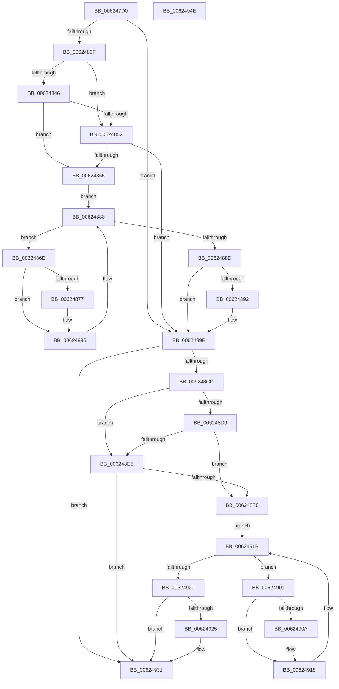

# DifIRP_MJ_CLOSEWrapper

- RVA: `0x006247D0`–`0x0062494F` (길이 `383` bytes)
- VA: `0x00000001406247D0`
- 실행 섹션: `.text`
- PDB 이름 있음: `예`; PDB Function 태그: `아니요`
- unwind 정보 RVA: `0x00093E28`
- 디코드: `101`개 명령, `383/383` bytes 표시
- 미해석 바이트: `0` (있으면 어셈블리에 `.byte`로 보존)

> 이 문서는 커널 이미지의 기계어와 PDB 기호를 분석해 생성했습니다. 4번과 5번은 함수 원형과 자료형을 바이너리 사용 방식에서 추정한 C 해석이며 원본 소스 복구 결과는 아닙니다.

## 1. Dependencies

- 직접 호출 지점: **8**; 고유 호출 대상: **4**
- 직접 호출자로 확인된 함수: **0**
- RIP 상대 이미지 참조: **3**

### Outgoing calls
- `0x006247FE` → [DifGetAPIThunkContextById](../49/DifGetAPIThunkContextById_function_00495A34.md) (function, `0x00495A34`)
- `0x00624859` → [ExAcquireRundownProtection](../21/ExAcquireRundownProtection_function_00216620.md) (function, `0x00216620`)
- `0x00624880` → [guard_dispatch_icall](../6B/guard_dispatch_icall_function_006BAAD0.md) (function, `0x006BAAD0`)
- `0x00624899` → [ExReleaseRundownProtection](../34/ExReleaseRundownProtection_function_00349E80.md) (function, `0x00349E80`)
- `0x006248BF` → [guard_dispatch_icall](../6B/guard_dispatch_icall_function_006BAAD0.md) (function, `0x006BAAD0`)
- `0x006248EC` → [ExAcquireRundownProtection](../21/ExAcquireRundownProtection_function_00216620.md) (function, `0x00216620`)
- `0x00624913` → [guard_dispatch_icall](../6B/guard_dispatch_icall_function_006BAAD0.md) (function, `0x006BAAD0`)
- `0x0062492C` → [ExReleaseRundownProtection](../34/ExReleaseRundownProtection_function_00349E80.md) (function, `0x00349E80`)

### Direct callers
- 이 함수 시작 RVA로 연결되는 직접 call은 확인되지 않았습니다. 간접 호출은 완전히 역산할 수 없습니다.

### Static image references
- `0x00624819` → RVA `0x00F048B8` (`.data`; read)
- `0x00624846` → RVA `0x00F04980` (`.data`; read)
- `0x00624852` → RVA `0x00F03E80` (`.data`; read)

## 2. Other-region calls and transfers

- 다른 실행 섹션으로 향하는 call: **0**
- 별도 외부 분기/꼬리 이동을 확인하지 못했습니다.

## 3. Assembly (complete function range)

```asm
006247D0  48 8B C4                        mov rax, rsp
006247D3  48 89 58 08                     mov qword ptr [rax + 8], rbx
006247D7  48 89 68 10                     mov qword ptr [rax + 0x10], rbp
006247DB  48 89 70 18                     mov qword ptr [rax + 0x18], rsi
006247DF  57                              push rdi
006247E0  41 56                           push r14
006247E2  41 57                           push r15
006247E4  48 83 EC 40                     sub rsp, 0x40
006247E8  0F 57 C0                        xorps xmm0, xmm0
006247EB  4C 8B F9                        mov r15, rcx
006247EE  B9 02 00 00 10                  mov ecx, 0x10000002
006247F3  4C 8B F2                        mov r14, rdx
006247F6  0F 11 40 C8                     movups xmmword ptr [rax - 0x38], xmm0
006247FA  0F 11 40 D8                     movups xmmword ptr [rax - 0x28], xmm0
006247FE  E8 31 12 E7 FF                  call 0x140495a34
00624803  48 8B E8                        mov rbp, rax
00624806  48 85 C0                        test rax, rax
00624809  0F 84 8F 00 00 00               je 0x14062489e
0062480F  49 8B 96 B8 00 00 00            mov rdx, qword ptr [r14 + 0xb8]
00624816  40 32 F6                        xor sil, sil
00624819  40 38 35 98 00 8E 00            cmp byte ptr [rip + 0x8e0098], sil
00624820  49 8B 4F 08                     mov rcx, qword ptr [r15 + 8]
00624824  44 0F B6 02                     movzx r8d, byte ptr [rdx]
00624828  48 8B 51 30                     mov rdx, qword ptr [rcx + 0x30]
0062482C  48 8B 4A 40                     mov rcx, qword ptr [rdx + 0x40]
00624830  4A 8B 54 C1 20                  mov rdx, qword ptr [rcx + r8*8 + 0x20]
00624835  48 89 54 24 20                  mov qword ptr [rsp + 0x20], rdx
0062483A  4C 89 7C 24 30                  mov qword ptr [rsp + 0x30], r15
0062483F  4C 89 74 24 28                  mov qword ptr [rsp + 0x28], r14
00624844  75 0C                           jne 0x140624852
00624846  F7 05 30 01 8E 00 00 08 00 00   test dword ptr [rip + 0x8e0130], 0x800
00624850  74 13                           je 0x140624865
00624852  48 8D 0D 27 F6 8D 00            lea rcx, [rip + 0x8df627]
00624859  E8 C2 1D BF FF                  call 0x140216620
0062485E  40 8A F0                        mov sil, al
00624861  84 C0                           test al, al
00624863  74 39                           je 0x14062489e
00624865  48 8D 7D 20                     lea rdi, [rbp + 0x20]
00624869  48 8B 1F                        mov rbx, qword ptr [rdi]
0062486C  EB 1A                           jmp 0x140624888
0062486E  48 8D 43 F0                     lea rax, [rbx - 0x10]
00624872  48 85 C0                        test rax, rax
00624875  74 0E                           je 0x140624885
00624877  48 8B 40 08                     mov rax, qword ptr [rax + 8]
0062487B  48 8D 4C 24 20                  lea rcx, [rsp + 0x20]
00624880  E8 4B 62 09 00                  call 0x1406baad0
00624885  48 8B 1B                        mov rbx, qword ptr [rbx]
00624888  48 3B DF                        cmp rbx, rdi
0062488B  75 E1                           jne 0x14062486e
0062488D  40 84 F6                        test sil, sil
00624890  74 0C                           je 0x14062489e
00624892  48 8D 0D E7 F5 8D 00            lea rcx, [rip + 0x8df5e7]
00624899  E8 E2 55 D2 FF                  call 0x140349e80
0062489E  49 8B 86 B8 00 00 00            mov rax, qword ptr [r14 + 0xb8]
006248A5  0F B6 10                        movzx edx, byte ptr [rax]
006248A8  49 8B 47 08                     mov rax, qword ptr [r15 + 8]
006248AC  48 8B 48 30                     mov rcx, qword ptr [rax + 0x30]
006248B0  48 8B 41 40                     mov rax, qword ptr [rcx + 0x40]
006248B4  49 8B CF                        mov rcx, r15
006248B7  48 8B 44 D0 20                  mov rax, qword ptr [rax + rdx*8 + 0x20]
006248BC  49 8B D6                        mov rdx, r14
006248BF  E8 0C 62 09 00                  call 0x1406baad0
006248C4  89 44 24 38                     mov dword ptr [rsp + 0x38], eax
006248C8  48 85 ED                        test rbp, rbp
006248CB  74 64                           je 0x140624931
006248CD  40 32 FF                        xor dil, dil
006248D0  40 38 3D E1 FF 8D 00            cmp byte ptr [rip + 0x8dffe1], dil
006248D7  75 0C                           jne 0x1406248e5
006248D9  F7 05 9D 00 8E 00 00 08 00 00   test dword ptr [rip + 0x8e009d], 0x800
006248E3  74 13                           je 0x1406248f8
006248E5  48 8D 0D 94 F5 8D 00            lea rcx, [rip + 0x8df594]
006248EC  E8 2F 1D BF FF                  call 0x140216620
006248F1  40 8A F8                        mov dil, al
006248F4  84 C0                           test al, al
006248F6  74 39                           je 0x140624931
006248F8  48 8D 75 30                     lea rsi, [rbp + 0x30]
006248FC  48 8B 1E                        mov rbx, qword ptr [rsi]
006248FF  EB 1A                           jmp 0x14062491b
00624901  48 8D 43 F0                     lea rax, [rbx - 0x10]
00624905  48 85 C0                        test rax, rax
00624908  74 0E                           je 0x140624918
0062490A  48 8B 40 08                     mov rax, qword ptr [rax + 8]
0062490E  48 8D 4C 24 20                  lea rcx, [rsp + 0x20]
00624913  E8 B8 61 09 00                  call 0x1406baad0
00624918  48 8B 1B                        mov rbx, qword ptr [rbx]
0062491B  48 3B DE                        cmp rbx, rsi
0062491E  75 E1                           jne 0x140624901
00624920  40 84 FF                        test dil, dil
00624923  74 0C                           je 0x140624931
00624925  48 8D 0D 54 F5 8D 00            lea rcx, [rip + 0x8df554]
0062492C  E8 4F 55 D2 FF                  call 0x140349e80
00624931  8B 44 24 38                     mov eax, dword ptr [rsp + 0x38]
00624935  48 8B 5C 24 60                  mov rbx, qword ptr [rsp + 0x60]
0062493A  48 8B 6C 24 68                  mov rbp, qword ptr [rsp + 0x68]
0062493F  48 8B 74 24 70                  mov rsi, qword ptr [rsp + 0x70]
00624944  48 83 C4 40                     add rsp, 0x40
00624948  41 5F                           pop r15
0062494A  41 5E                           pop r14
0062494C  5F                              pop rdi
0062494D  C3                              ret
0062494E  CC                              int3
```

## 4. C-style interpretation (structured pseudocode)

```c
__int64 __fastcall DifIRP_MJ_CLOSEWrapper(__int64 a1, __int64 a2)
{
    __int64 result;
    __int64 v_rdi;
    __int64 v_rsi;
    __int64 v_rsp;
    unsigned int v_stack_m20;
    unsigned __int64 v_stack_m28;
    unsigned __int64 v_stack_m30;
    unsigned __int64 v_stack_m38;
    unsigned __int64 v_stack_p10;
    unsigned __int64 v_stack_p18;
    unsigned __int64 v_stack_p8;

    *(unsigned __int64 *)(v_rsp + 8) = v_rbx;
    *(unsigned __int64 *)(v_rsp + 16) = v_rbp;
    *(unsigned __int64 *)(v_rsp + 24) = v_rsi;
    v_rsp = (v_rsp) - (64);
    *(unsigned __int64 *)(v_rsp - 56) = v_xmm0;
    *(unsigned __int64 *)(v_rsp - 40) = v_xmm0;
    result = DifGetAPIThunkContextById((unsigned int)(0x10000002ULL), a2, a3, a4);
    if (result == 0) goto loc_0062489E;
    v_rsi = 0;
    v_stack_m38 = *(unsigned __int64 *)(*(unsigned __int64 *)(*(unsigned __int64 *)(*(unsigned __int64 *)(a1 + 8) + 48) + 64) + *(unsigned __int8 *)(*(unsigned __int64 *)(a2 + 184)) * 8 + 32);
    v_stack_m28 = a1;
    v_stack_m30 = a2;
    if ((*(unsigned __int8 *)(v_rip + 9306264)) != 0) goto loc_00624852;
    if (((*(unsigned int *)(v_rip + 9306416)) & (0x800ULL)) == 0) goto loc_00624865;
loc_00624852:
    result = ExAcquireRundownProtection(v_rip + 9303591, *(unsigned __int64 *)(*(unsigned __int64 *)(*(unsigned __int64 *)(*(unsigned __int64 *)(a1 + 8) + 48) + 64) + *(unsigned __int8 *)(*(unsigned __int64 *)(a2 + 184)) * 8 + 32), *(unsigned __int8 *)(*(unsigned __int64 *)(a2 + 184)), a4);
    if ((unsigned __int8)(result) == 0) goto loc_0062489E;
loc_00624865:
    goto loc_00624888;
loc_0062486E:
    result = *(unsigned __int64 *)(result + 32) - 16;
    if (*(unsigned __int64 *)(result + 32) - 16 != 0) {
        result = *(unsigned __int64 *)(*(unsigned __int64 *)(result + 32) - 16 + 8);
        a1 = v_stack_m38;
        result = guard_dispatch_icall(a1, *(unsigned __int64 *)(*(unsigned __int64 *)(*(unsigned __int64 *)(*(unsigned __int64 *)(a1 + 8) + 48) + 64) + *(unsigned __int8 *)(*(unsigned __int64 *)(a2 + 184)) * 8 + 32), *(unsigned __int8 *)(*(unsigned __int64 *)(a2 + 184)), a4);
    }
loc_00624888:
    if ((*(unsigned __int64 *)(*(unsigned __int64 *)(result + 32))) != (result + 32)) goto loc_0062486E;
    if ((unsigned __int8)((unsigned __int8)(result)) != 0) {
        a1 = v_rip + 9303527;
        result = ExReleaseRundownProtection(a1, *(unsigned __int64 *)(*(unsigned __int64 *)(*(unsigned __int64 *)(*(unsigned __int64 *)(a1 + 8) + 48) + 64) + *(unsigned __int8 *)(*(unsigned __int64 *)(a2 + 184)) * 8 + 32), *(unsigned __int8 *)(*(unsigned __int64 *)(a2 + 184)), a4);
    }
    result = guard_dispatch_icall(a1, a2, *(unsigned __int8 *)(*(unsigned __int64 *)(a2 + 184)), a4);
    v_stack_m20 = (unsigned int)(result);
    if (result == 0) goto loc_00624931;
    v_rdi = 0;
    if ((*(unsigned __int8 *)(v_rip + 9306081)) != 0) goto loc_006248E5;
    if (((*(unsigned int *)(v_rip + 9306269)) & (0x800ULL)) == 0) goto loc_006248F8;
loc_006248E5:
    result = ExAcquireRundownProtection(v_rip + 9303444, a2, *(unsigned __int8 *)(*(unsigned __int64 *)(a2 + 184)), a4);
    if ((unsigned __int8)(result) == 0) goto loc_00624931;
loc_006248F8:
    goto loc_0062491B;
loc_00624901:
    result = *(unsigned __int64 *)(result + 48) - 16;
    if (*(unsigned __int64 *)(result + 48) - 16 != 0) {
        result = *(unsigned __int64 *)(*(unsigned __int64 *)(result + 48) - 16 + 8);
        a1 = v_stack_m38;
        result = guard_dispatch_icall(a1, a2, *(unsigned __int8 *)(*(unsigned __int64 *)(a2 + 184)), a4);
    }
loc_0062491B:
    if ((*(unsigned __int64 *)(*(unsigned __int64 *)(result + 48))) != (result + 48)) goto loc_00624901;
    if ((unsigned __int8)((unsigned __int8)(result)) != 0) {
        a1 = v_rip + 9303380;
        result = ExReleaseRundownProtection(a1, a2, *(unsigned __int8 *)(*(unsigned __int64 *)(a2 + 184)), a4);
    }
    v_rsp = (v_rsp) + (64);
    return (unsigned int)(v_stack_m20);
}
```

## 5. (Beta) C Style

```c
int64_t DifIRP_MJ_CLOSEWrapper(void *Arg1, void *Arg2)
{
    uint8_t *arg1 = (uint8_t *)Arg1;
    uint8_t *arg2 = (uint8_t *)Arg2;

    int64_t result;
    int64_t local_rdi;
    int64_t local_rsi;
    int64_t local_rsp;
    uint32_t v_stack_m20;
    uint64_t v_stack_m28;
    uint64_t v_stack_m30;
    uint64_t v_stack_m38;
    uint64_t v_stack_p10;
    uint64_t v_stack_p18;
    uint64_t v_stack_p8;

    *(uint64_t *)(local_rsp + 0x8) = local_rbx;
    *(uint64_t *)(local_rsp + 0x10) = local_rbp;
    *(uint64_t *)(local_rsp + 0x18) = local_rsi;
    local_rsp = (local_rsp) - (64);
    *(uint64_t *)(local_rsp - 0x38) = v_xmm0;
    *(uint64_t *)(local_rsp - 0x28) = v_xmm0;
    result = DifGetAPIThunkContextById((uint32_t)(0x10000002ULL), Arg2, a3, a4);
    if (result == 0) goto loc_0062489E;
    local_rsi = 0;
    v_stack_m38 = *(uint64_t *)(*(uint64_t *)(*(uint64_t *)(*(uint64_t *)(arg1 + 0x8) + 0x30) + 0x40) + *(uint8_t *)(*(uint64_t *)(arg2 + 0xB8)) * 8 + 0x20);
    v_stack_m28 = Arg1;
    v_stack_m30 = Arg2;
    if ((*(uint8_t *)(v_rip + 0x8E0098)) != 0) goto loc_00624852;
    if (((*(uint32_t *)(v_rip + 0x8E0130)) & (0x800ULL)) == 0) goto loc_00624865;
loc_00624852:
    result = ExAcquireRundownProtection(v_rip + 9303591, *(uint64_t *)(*(uint64_t *)(*(uint64_t *)(*(uint64_t *)(arg1 + 0x8) + 0x30) + 0x40) + *(uint8_t *)(*(uint64_t *)(arg2 + 0xB8)) * 8 + 0x20), *(uint8_t *)(*(uint64_t *)(arg2 + 0xB8)), a4);
    if ((uint8_t)(result) == 0) goto loc_0062489E;
loc_00624865:
    goto loc_00624888;
loc_0062486E:
    result = *(uint64_t *)(result + 0x20) - 16;
    if (*(uint64_t *)(result + 0x20) - 16 != 0) {
        result = *(uint64_t *)(*(uint64_t *)(result + 0x20) - 0x10 + 0x8);
        Arg1 = v_stack_m38;
        result = guard_dispatch_icall(Arg1, *(uint64_t *)(*(uint64_t *)(*(uint64_t *)(*(uint64_t *)(arg1 + 0x8) + 0x30) + 0x40) + *(uint8_t *)(*(uint64_t *)(arg2 + 0xB8)) * 8 + 0x20), *(uint8_t *)(*(uint64_t *)(arg2 + 0xB8)), a4);
    }
loc_00624888:
    if ((*(uint64_t *)(*(uint64_t *)(result + 0x20))) != (result + 32)) goto loc_0062486E;
    if ((uint8_t)((uint8_t)(result)) != 0) {
        Arg1 = v_rip + 9303527;
        result = ExReleaseRundownProtection(Arg1, *(uint64_t *)(*(uint64_t *)(*(uint64_t *)(*(uint64_t *)(arg1 + 0x8) + 0x30) + 0x40) + *(uint8_t *)(*(uint64_t *)(arg2 + 0xB8)) * 8 + 0x20), *(uint8_t *)(*(uint64_t *)(arg2 + 0xB8)), a4);
    }
    result = guard_dispatch_icall(Arg1, Arg2, *(uint8_t *)(*(uint64_t *)(arg2 + 0xB8)), a4);
    v_stack_m20 = (uint32_t)(result);
    if (result == 0) goto loc_00624931;
    local_rdi = 0;
    if ((*(uint8_t *)(v_rip + 0x8DFFE1)) != 0) goto loc_006248E5;
    if (((*(uint32_t *)(v_rip + 0x8E009D)) & (0x800ULL)) == 0) goto loc_006248F8;
loc_006248E5:
    result = ExAcquireRundownProtection(v_rip + 9303444, Arg2, *(uint8_t *)(*(uint64_t *)(arg2 + 0xB8)), a4);
    if ((uint8_t)(result) == 0) goto loc_00624931;
loc_006248F8:
    goto loc_0062491B;
loc_00624901:
    result = *(uint64_t *)(result + 0x30) - 16;
    if (*(uint64_t *)(result + 0x30) - 16 != 0) {
        result = *(uint64_t *)(*(uint64_t *)(result + 0x30) - 0x10 + 0x8);
        Arg1 = v_stack_m38;
        result = guard_dispatch_icall(Arg1, Arg2, *(uint8_t *)(*(uint64_t *)(arg2 + 0xB8)), a4);
    }
loc_0062491B:
    if ((*(uint64_t *)(*(uint64_t *)(result + 0x30))) != (result + 48)) goto loc_00624901;
    if ((uint8_t)((uint8_t)(result)) != 0) {
        Arg1 = v_rip + 9303380;
        result = ExReleaseRundownProtection(Arg1, Arg2, *(uint8_t *)(*(uint64_t *)(arg2 + 0xB8)), a4);
    }
    local_rsp = (local_rsp) + (64);
    return (uint32_t)(v_stack_m20);
}
```

### 관측된 메모리 오프셋

구조체 형식이 확인되지 않은 접근은 인자 기준의 오프셋으로만 기록했습니다.

| 기준 인자 | 오프셋 표현 | 폭 (bit) | 접근 |
|---|---:|---:|---|
| `Arg1` | `+ 0x8` | `64` | `R` |
| `Arg2` | `+ 0xB8` | `64` | `R` |

## 6. Execution-region graph

[열기: 2D/3D 그래프와 함수 탐색 컨트롤 패널](../../../control-panel.html?section=text&rva=0x006247D0&view=graph)

- 2D 그래프는 위에서 아래로 흐르고, 3D 그래프는 빈 공간을 드래그해 회전합니다. Shift+드래그는 이동, 휠은 확대·축소, 함수 노드 선택은 대상 보고서 이동입니다.

### Static fallback


