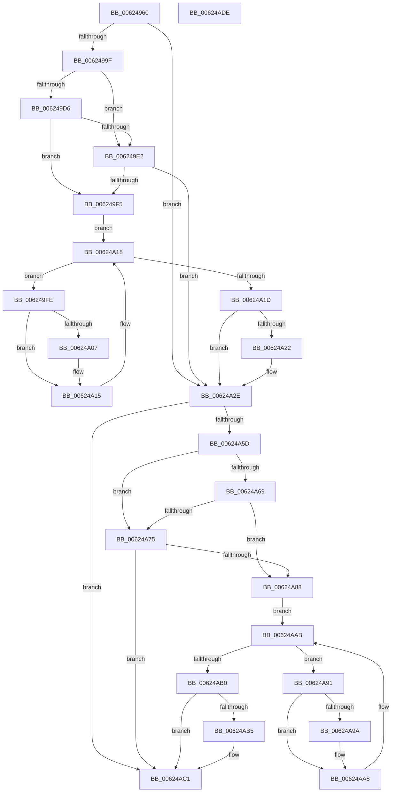

# DifIRP_MJ_CREATEWrapper

- RVA: `0x00624960`–`0x00624ADF` (길이 `383` bytes)
- VA: `0x0000000140624960`
- 실행 섹션: `.text`
- PDB 이름 있음: `예`; PDB Function 태그: `아니요`
- unwind 정보 RVA: `0x00093E28`
- 디코드: `101`개 명령, `383/383` bytes 표시
- 미해석 바이트: `0` (있으면 어셈블리에 `.byte`로 보존)

> 이 문서는 커널 이미지의 기계어와 PDB 기호를 분석해 생성했습니다. 4번과 5번은 함수 원형과 자료형을 바이너리 사용 방식에서 추정한 C 해석이며 원본 소스 복구 결과는 아닙니다.

## 1. Dependencies

- 직접 호출 지점: **8**; 고유 호출 대상: **4**
- 직접 호출자로 확인된 함수: **0**
- RIP 상대 이미지 참조: **3**

### Outgoing calls
- `0x0062498E` → [DifGetAPIThunkContextById](../49/DifGetAPIThunkContextById_function_00495A34.md) (function, `0x00495A34`)
- `0x006249E9` → [ExAcquireRundownProtection](../21/ExAcquireRundownProtection_function_00216620.md) (function, `0x00216620`)
- `0x00624A10` → [guard_dispatch_icall](../6B/guard_dispatch_icall_function_006BAAD0.md) (function, `0x006BAAD0`)
- `0x00624A29` → [ExReleaseRundownProtection](../34/ExReleaseRundownProtection_function_00349E80.md) (function, `0x00349E80`)
- `0x00624A4F` → [guard_dispatch_icall](../6B/guard_dispatch_icall_function_006BAAD0.md) (function, `0x006BAAD0`)
- `0x00624A7C` → [ExAcquireRundownProtection](../21/ExAcquireRundownProtection_function_00216620.md) (function, `0x00216620`)
- `0x00624AA3` → [guard_dispatch_icall](../6B/guard_dispatch_icall_function_006BAAD0.md) (function, `0x006BAAD0`)
- `0x00624ABC` → [ExReleaseRundownProtection](../34/ExReleaseRundownProtection_function_00349E80.md) (function, `0x00349E80`)

### Direct callers
- 이 함수 시작 RVA로 연결되는 직접 call은 확인되지 않았습니다. 간접 호출은 완전히 역산할 수 없습니다.

### Static image references
- `0x006249A9` → RVA `0x00F048B8` (`.data`; read)
- `0x006249D6` → RVA `0x00F04980` (`.data`; read)
- `0x006249E2` → RVA `0x00F03E80` (`.data`; read)

## 2. Other-region calls and transfers

- 다른 실행 섹션으로 향하는 call: **0**
- 별도 외부 분기/꼬리 이동을 확인하지 못했습니다.

## 3. Assembly (complete function range)

```asm
00624960  48 8B C4                        mov rax, rsp
00624963  48 89 58 08                     mov qword ptr [rax + 8], rbx
00624967  48 89 68 10                     mov qword ptr [rax + 0x10], rbp
0062496B  48 89 70 18                     mov qword ptr [rax + 0x18], rsi
0062496F  57                              push rdi
00624970  41 56                           push r14
00624972  41 57                           push r15
00624974  48 83 EC 40                     sub rsp, 0x40
00624978  0F 57 C0                        xorps xmm0, xmm0
0062497B  4C 8B F9                        mov r15, rcx
0062497E  B9 00 00 00 10                  mov ecx, 0x10000000
00624983  4C 8B F2                        mov r14, rdx
00624986  0F 11 40 C8                     movups xmmword ptr [rax - 0x38], xmm0
0062498A  0F 11 40 D8                     movups xmmword ptr [rax - 0x28], xmm0
0062498E  E8 A1 10 E7 FF                  call 0x140495a34
00624993  48 8B E8                        mov rbp, rax
00624996  48 85 C0                        test rax, rax
00624999  0F 84 8F 00 00 00               je 0x140624a2e
0062499F  49 8B 96 B8 00 00 00            mov rdx, qword ptr [r14 + 0xb8]
006249A6  40 32 F6                        xor sil, sil
006249A9  40 38 35 08 FF 8D 00            cmp byte ptr [rip + 0x8dff08], sil
006249B0  49 8B 4F 08                     mov rcx, qword ptr [r15 + 8]
006249B4  44 0F B6 02                     movzx r8d, byte ptr [rdx]
006249B8  48 8B 51 30                     mov rdx, qword ptr [rcx + 0x30]
006249BC  48 8B 4A 40                     mov rcx, qword ptr [rdx + 0x40]
006249C0  4A 8B 54 C1 20                  mov rdx, qword ptr [rcx + r8*8 + 0x20]
006249C5  48 89 54 24 20                  mov qword ptr [rsp + 0x20], rdx
006249CA  4C 89 7C 24 30                  mov qword ptr [rsp + 0x30], r15
006249CF  4C 89 74 24 28                  mov qword ptr [rsp + 0x28], r14
006249D4  75 0C                           jne 0x1406249e2
006249D6  F7 05 A0 FF 8D 00 00 08 00 00   test dword ptr [rip + 0x8dffa0], 0x800
006249E0  74 13                           je 0x1406249f5
006249E2  48 8D 0D 97 F4 8D 00            lea rcx, [rip + 0x8df497]
006249E9  E8 32 1C BF FF                  call 0x140216620
006249EE  40 8A F0                        mov sil, al
006249F1  84 C0                           test al, al
006249F3  74 39                           je 0x140624a2e
006249F5  48 8D 7D 20                     lea rdi, [rbp + 0x20]
006249F9  48 8B 1F                        mov rbx, qword ptr [rdi]
006249FC  EB 1A                           jmp 0x140624a18
006249FE  48 8D 43 F0                     lea rax, [rbx - 0x10]
00624A02  48 85 C0                        test rax, rax
00624A05  74 0E                           je 0x140624a15
00624A07  48 8B 40 08                     mov rax, qword ptr [rax + 8]
00624A0B  48 8D 4C 24 20                  lea rcx, [rsp + 0x20]
00624A10  E8 BB 60 09 00                  call 0x1406baad0
00624A15  48 8B 1B                        mov rbx, qword ptr [rbx]
00624A18  48 3B DF                        cmp rbx, rdi
00624A1B  75 E1                           jne 0x1406249fe
00624A1D  40 84 F6                        test sil, sil
00624A20  74 0C                           je 0x140624a2e
00624A22  48 8D 0D 57 F4 8D 00            lea rcx, [rip + 0x8df457]
00624A29  E8 52 54 D2 FF                  call 0x140349e80
00624A2E  49 8B 86 B8 00 00 00            mov rax, qword ptr [r14 + 0xb8]
00624A35  0F B6 10                        movzx edx, byte ptr [rax]
00624A38  49 8B 47 08                     mov rax, qword ptr [r15 + 8]
00624A3C  48 8B 48 30                     mov rcx, qword ptr [rax + 0x30]
00624A40  48 8B 41 40                     mov rax, qword ptr [rcx + 0x40]
00624A44  49 8B CF                        mov rcx, r15
00624A47  48 8B 44 D0 20                  mov rax, qword ptr [rax + rdx*8 + 0x20]
00624A4C  49 8B D6                        mov rdx, r14
00624A4F  E8 7C 60 09 00                  call 0x1406baad0
00624A54  89 44 24 38                     mov dword ptr [rsp + 0x38], eax
00624A58  48 85 ED                        test rbp, rbp
00624A5B  74 64                           je 0x140624ac1
00624A5D  40 32 FF                        xor dil, dil
00624A60  40 38 3D 51 FE 8D 00            cmp byte ptr [rip + 0x8dfe51], dil
00624A67  75 0C                           jne 0x140624a75
00624A69  F7 05 0D FF 8D 00 00 08 00 00   test dword ptr [rip + 0x8dff0d], 0x800
00624A73  74 13                           je 0x140624a88
00624A75  48 8D 0D 04 F4 8D 00            lea rcx, [rip + 0x8df404]
00624A7C  E8 9F 1B BF FF                  call 0x140216620
00624A81  40 8A F8                        mov dil, al
00624A84  84 C0                           test al, al
00624A86  74 39                           je 0x140624ac1
00624A88  48 8D 75 30                     lea rsi, [rbp + 0x30]
00624A8C  48 8B 1E                        mov rbx, qword ptr [rsi]
00624A8F  EB 1A                           jmp 0x140624aab
00624A91  48 8D 43 F0                     lea rax, [rbx - 0x10]
00624A95  48 85 C0                        test rax, rax
00624A98  74 0E                           je 0x140624aa8
00624A9A  48 8B 40 08                     mov rax, qword ptr [rax + 8]
00624A9E  48 8D 4C 24 20                  lea rcx, [rsp + 0x20]
00624AA3  E8 28 60 09 00                  call 0x1406baad0
00624AA8  48 8B 1B                        mov rbx, qword ptr [rbx]
00624AAB  48 3B DE                        cmp rbx, rsi
00624AAE  75 E1                           jne 0x140624a91
00624AB0  40 84 FF                        test dil, dil
00624AB3  74 0C                           je 0x140624ac1
00624AB5  48 8D 0D C4 F3 8D 00            lea rcx, [rip + 0x8df3c4]
00624ABC  E8 BF 53 D2 FF                  call 0x140349e80
00624AC1  8B 44 24 38                     mov eax, dword ptr [rsp + 0x38]
00624AC5  48 8B 5C 24 60                  mov rbx, qword ptr [rsp + 0x60]
00624ACA  48 8B 6C 24 68                  mov rbp, qword ptr [rsp + 0x68]
00624ACF  48 8B 74 24 70                  mov rsi, qword ptr [rsp + 0x70]
00624AD4  48 83 C4 40                     add rsp, 0x40
00624AD8  41 5F                           pop r15
00624ADA  41 5E                           pop r14
00624ADC  5F                              pop rdi
00624ADD  C3                              ret
00624ADE  CC                              int3
```

## 4. C-style interpretation (structured pseudocode)

```c
__int64 __fastcall DifIRP_MJ_CREATEWrapper(__int64 a1, __int64 a2)
{
    __int64 result;
    __int64 v_rdi;
    __int64 v_rsi;
    __int64 v_rsp;
    unsigned int v_stack_m20;
    unsigned __int64 v_stack_m28;
    unsigned __int64 v_stack_m30;
    unsigned __int64 v_stack_m38;
    unsigned __int64 v_stack_p10;
    unsigned __int64 v_stack_p18;
    unsigned __int64 v_stack_p8;

    *(unsigned __int64 *)(v_rsp + 8) = v_rbx;
    *(unsigned __int64 *)(v_rsp + 16) = v_rbp;
    *(unsigned __int64 *)(v_rsp + 24) = v_rsi;
    v_rsp = (v_rsp) - (64);
    *(unsigned __int64 *)(v_rsp - 56) = v_xmm0;
    *(unsigned __int64 *)(v_rsp - 40) = v_xmm0;
    result = DifGetAPIThunkContextById((unsigned int)(0x10000000ULL), a2, a3, a4);
    if (result == 0) goto loc_00624A2E;
    v_rsi = 0;
    v_stack_m38 = *(unsigned __int64 *)(*(unsigned __int64 *)(*(unsigned __int64 *)(*(unsigned __int64 *)(a1 + 8) + 48) + 64) + *(unsigned __int8 *)(*(unsigned __int64 *)(a2 + 184)) * 8 + 32);
    v_stack_m28 = a1;
    v_stack_m30 = a2;
    if ((*(unsigned __int8 *)(v_rip + 9305864)) != 0) goto loc_006249E2;
    if (((*(unsigned int *)(v_rip + 9306016)) & (0x800ULL)) == 0) goto loc_006249F5;
loc_006249E2:
    result = ExAcquireRundownProtection(v_rip + 9303191, *(unsigned __int64 *)(*(unsigned __int64 *)(*(unsigned __int64 *)(*(unsigned __int64 *)(a1 + 8) + 48) + 64) + *(unsigned __int8 *)(*(unsigned __int64 *)(a2 + 184)) * 8 + 32), *(unsigned __int8 *)(*(unsigned __int64 *)(a2 + 184)), a4);
    if ((unsigned __int8)(result) == 0) goto loc_00624A2E;
loc_006249F5:
    goto loc_00624A18;
loc_006249FE:
    result = *(unsigned __int64 *)(result + 32) - 16;
    if (*(unsigned __int64 *)(result + 32) - 16 != 0) {
        result = *(unsigned __int64 *)(*(unsigned __int64 *)(result + 32) - 16 + 8);
        a1 = v_stack_m38;
        result = guard_dispatch_icall(a1, *(unsigned __int64 *)(*(unsigned __int64 *)(*(unsigned __int64 *)(*(unsigned __int64 *)(a1 + 8) + 48) + 64) + *(unsigned __int8 *)(*(unsigned __int64 *)(a2 + 184)) * 8 + 32), *(unsigned __int8 *)(*(unsigned __int64 *)(a2 + 184)), a4);
    }
loc_00624A18:
    if ((*(unsigned __int64 *)(*(unsigned __int64 *)(result + 32))) != (result + 32)) goto loc_006249FE;
    if ((unsigned __int8)((unsigned __int8)(result)) != 0) {
        a1 = v_rip + 9303127;
        result = ExReleaseRundownProtection(a1, *(unsigned __int64 *)(*(unsigned __int64 *)(*(unsigned __int64 *)(*(unsigned __int64 *)(a1 + 8) + 48) + 64) + *(unsigned __int8 *)(*(unsigned __int64 *)(a2 + 184)) * 8 + 32), *(unsigned __int8 *)(*(unsigned __int64 *)(a2 + 184)), a4);
    }
    result = guard_dispatch_icall(a1, a2, *(unsigned __int8 *)(*(unsigned __int64 *)(a2 + 184)), a4);
    v_stack_m20 = (unsigned int)(result);
    if (result == 0) goto loc_00624AC1;
    v_rdi = 0;
    if ((*(unsigned __int8 *)(v_rip + 9305681)) != 0) goto loc_00624A75;
    if (((*(unsigned int *)(v_rip + 9305869)) & (0x800ULL)) == 0) goto loc_00624A88;
loc_00624A75:
    result = ExAcquireRundownProtection(v_rip + 9303044, a2, *(unsigned __int8 *)(*(unsigned __int64 *)(a2 + 184)), a4);
    if ((unsigned __int8)(result) == 0) goto loc_00624AC1;
loc_00624A88:
    goto loc_00624AAB;
loc_00624A91:
    result = *(unsigned __int64 *)(result + 48) - 16;
    if (*(unsigned __int64 *)(result + 48) - 16 != 0) {
        result = *(unsigned __int64 *)(*(unsigned __int64 *)(result + 48) - 16 + 8);
        a1 = v_stack_m38;
        result = guard_dispatch_icall(a1, a2, *(unsigned __int8 *)(*(unsigned __int64 *)(a2 + 184)), a4);
    }
loc_00624AAB:
    if ((*(unsigned __int64 *)(*(unsigned __int64 *)(result + 48))) != (result + 48)) goto loc_00624A91;
    if ((unsigned __int8)((unsigned __int8)(result)) != 0) {
        a1 = v_rip + 9302980;
        result = ExReleaseRundownProtection(a1, a2, *(unsigned __int8 *)(*(unsigned __int64 *)(a2 + 184)), a4);
    }
    v_rsp = (v_rsp) + (64);
    return (unsigned int)(v_stack_m20);
}
```

## 5. (Beta) C Style

```c
int64_t DifIRP_MJ_CREATEWrapper(void *Arg1, void *Arg2)
{
    uint8_t *arg1 = (uint8_t *)Arg1;
    uint8_t *arg2 = (uint8_t *)Arg2;

    int64_t result;
    int64_t local_rdi;
    int64_t local_rsi;
    int64_t local_rsp;
    uint32_t v_stack_m20;
    uint64_t v_stack_m28;
    uint64_t v_stack_m30;
    uint64_t v_stack_m38;
    uint64_t v_stack_p10;
    uint64_t v_stack_p18;
    uint64_t v_stack_p8;

    *(uint64_t *)(local_rsp + 0x8) = local_rbx;
    *(uint64_t *)(local_rsp + 0x10) = local_rbp;
    *(uint64_t *)(local_rsp + 0x18) = local_rsi;
    local_rsp = (local_rsp) - (64);
    *(uint64_t *)(local_rsp - 0x38) = v_xmm0;
    *(uint64_t *)(local_rsp - 0x28) = v_xmm0;
    result = DifGetAPIThunkContextById((uint32_t)(0x10000000ULL), Arg2, a3, a4);
    if (result == 0) goto loc_00624A2E;
    local_rsi = 0;
    v_stack_m38 = *(uint64_t *)(*(uint64_t *)(*(uint64_t *)(*(uint64_t *)(arg1 + 0x8) + 0x30) + 0x40) + *(uint8_t *)(*(uint64_t *)(arg2 + 0xB8)) * 8 + 0x20);
    v_stack_m28 = Arg1;
    v_stack_m30 = Arg2;
    if ((*(uint8_t *)(v_rip + 0x8DFF08)) != 0) goto loc_006249E2;
    if (((*(uint32_t *)(v_rip + 0x8DFFA0)) & (0x800ULL)) == 0) goto loc_006249F5;
loc_006249E2:
    result = ExAcquireRundownProtection(v_rip + 9303191, *(uint64_t *)(*(uint64_t *)(*(uint64_t *)(*(uint64_t *)(arg1 + 0x8) + 0x30) + 0x40) + *(uint8_t *)(*(uint64_t *)(arg2 + 0xB8)) * 8 + 0x20), *(uint8_t *)(*(uint64_t *)(arg2 + 0xB8)), a4);
    if ((uint8_t)(result) == 0) goto loc_00624A2E;
loc_006249F5:
    goto loc_00624A18;
loc_006249FE:
    result = *(uint64_t *)(result + 0x20) - 16;
    if (*(uint64_t *)(result + 0x20) - 16 != 0) {
        result = *(uint64_t *)(*(uint64_t *)(result + 0x20) - 0x10 + 0x8);
        Arg1 = v_stack_m38;
        result = guard_dispatch_icall(Arg1, *(uint64_t *)(*(uint64_t *)(*(uint64_t *)(*(uint64_t *)(arg1 + 0x8) + 0x30) + 0x40) + *(uint8_t *)(*(uint64_t *)(arg2 + 0xB8)) * 8 + 0x20), *(uint8_t *)(*(uint64_t *)(arg2 + 0xB8)), a4);
    }
loc_00624A18:
    if ((*(uint64_t *)(*(uint64_t *)(result + 0x20))) != (result + 32)) goto loc_006249FE;
    if ((uint8_t)((uint8_t)(result)) != 0) {
        Arg1 = v_rip + 9303127;
        result = ExReleaseRundownProtection(Arg1, *(uint64_t *)(*(uint64_t *)(*(uint64_t *)(*(uint64_t *)(arg1 + 0x8) + 0x30) + 0x40) + *(uint8_t *)(*(uint64_t *)(arg2 + 0xB8)) * 8 + 0x20), *(uint8_t *)(*(uint64_t *)(arg2 + 0xB8)), a4);
    }
    result = guard_dispatch_icall(Arg1, Arg2, *(uint8_t *)(*(uint64_t *)(arg2 + 0xB8)), a4);
    v_stack_m20 = (uint32_t)(result);
    if (result == 0) goto loc_00624AC1;
    local_rdi = 0;
    if ((*(uint8_t *)(v_rip + 0x8DFE51)) != 0) goto loc_00624A75;
    if (((*(uint32_t *)(v_rip + 0x8DFF0D)) & (0x800ULL)) == 0) goto loc_00624A88;
loc_00624A75:
    result = ExAcquireRundownProtection(v_rip + 9303044, Arg2, *(uint8_t *)(*(uint64_t *)(arg2 + 0xB8)), a4);
    if ((uint8_t)(result) == 0) goto loc_00624AC1;
loc_00624A88:
    goto loc_00624AAB;
loc_00624A91:
    result = *(uint64_t *)(result + 0x30) - 16;
    if (*(uint64_t *)(result + 0x30) - 16 != 0) {
        result = *(uint64_t *)(*(uint64_t *)(result + 0x30) - 0x10 + 0x8);
        Arg1 = v_stack_m38;
        result = guard_dispatch_icall(Arg1, Arg2, *(uint8_t *)(*(uint64_t *)(arg2 + 0xB8)), a4);
    }
loc_00624AAB:
    if ((*(uint64_t *)(*(uint64_t *)(result + 0x30))) != (result + 48)) goto loc_00624A91;
    if ((uint8_t)((uint8_t)(result)) != 0) {
        Arg1 = v_rip + 9302980;
        result = ExReleaseRundownProtection(Arg1, Arg2, *(uint8_t *)(*(uint64_t *)(arg2 + 0xB8)), a4);
    }
    local_rsp = (local_rsp) + (64);
    return (uint32_t)(v_stack_m20);
}
```

### 관측된 메모리 오프셋

구조체 형식이 확인되지 않은 접근은 인자 기준의 오프셋으로만 기록했습니다.

| 기준 인자 | 오프셋 표현 | 폭 (bit) | 접근 |
|---|---:|---:|---|
| `Arg1` | `+ 0x8` | `64` | `R` |
| `Arg2` | `+ 0xB8` | `64` | `R` |

## 6. Execution-region graph

[열기: 2D/3D 그래프와 함수 탐색 컨트롤 패널](../../../control-panel.html?section=text&rva=0x00624960&view=graph)

- 2D 그래프는 위에서 아래로 흐르고, 3D 그래프는 빈 공간을 드래그해 회전합니다. Shift+드래그는 이동, 휠은 확대·축소, 함수 노드 선택은 대상 보고서 이동입니다.

### Static fallback


