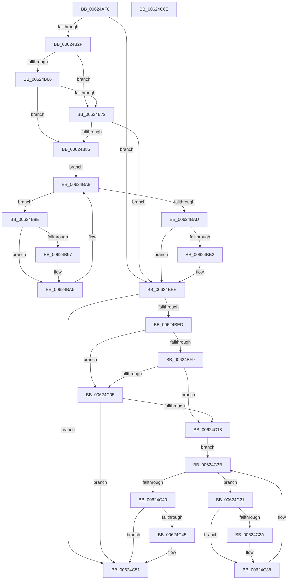

# DifIRP_MJ_CREATE_MAILSLOTWrapper

- RVA: `0x00624AF0`–`0x00624C6F` (길이 `383` bytes)
- VA: `0x0000000140624AF0`
- 실행 섹션: `.text`
- PDB 이름 있음: `예`; PDB Function 태그: `아니요`
- unwind 정보 RVA: `0x00093E28`
- 디코드: `101`개 명령, `383/383` bytes 표시
- 미해석 바이트: `0` (있으면 어셈블리에 `.byte`로 보존)

> 이 문서는 커널 이미지의 기계어와 PDB 기호를 분석해 생성했습니다. 4번과 5번은 함수 원형과 자료형을 바이너리 사용 방식에서 추정한 C 해석이며 원본 소스 복구 결과는 아닙니다.

## 1. Dependencies

- 직접 호출 지점: **8**; 고유 호출 대상: **4**
- 직접 호출자로 확인된 함수: **0**
- RIP 상대 이미지 참조: **3**

### Outgoing calls
- `0x00624B1E` → [DifGetAPIThunkContextById](../49/DifGetAPIThunkContextById_function_00495A34.md) (function, `0x00495A34`)
- `0x00624B79` → [ExAcquireRundownProtection](../21/ExAcquireRundownProtection_function_00216620.md) (function, `0x00216620`)
- `0x00624BA0` → [guard_dispatch_icall](../6B/guard_dispatch_icall_function_006BAAD0.md) (function, `0x006BAAD0`)
- `0x00624BB9` → [ExReleaseRundownProtection](../34/ExReleaseRundownProtection_function_00349E80.md) (function, `0x00349E80`)
- `0x00624BDF` → [guard_dispatch_icall](../6B/guard_dispatch_icall_function_006BAAD0.md) (function, `0x006BAAD0`)
- `0x00624C0C` → [ExAcquireRundownProtection](../21/ExAcquireRundownProtection_function_00216620.md) (function, `0x00216620`)
- `0x00624C33` → [guard_dispatch_icall](../6B/guard_dispatch_icall_function_006BAAD0.md) (function, `0x006BAAD0`)
- `0x00624C4C` → [ExReleaseRundownProtection](../34/ExReleaseRundownProtection_function_00349E80.md) (function, `0x00349E80`)

### Direct callers
- 이 함수 시작 RVA로 연결되는 직접 call은 확인되지 않았습니다. 간접 호출은 완전히 역산할 수 없습니다.

### Static image references
- `0x00624B39` → RVA `0x00F048B8` (`.data`; read)
- `0x00624B66` → RVA `0x00F04980` (`.data`; read)
- `0x00624B72` → RVA `0x00F03E80` (`.data`; read)

## 2. Other-region calls and transfers

- 다른 실행 섹션으로 향하는 call: **0**
- 별도 외부 분기/꼬리 이동을 확인하지 못했습니다.

## 3. Assembly (complete function range)

```asm
00624AF0  48 8B C4                        mov rax, rsp
00624AF3  48 89 58 08                     mov qword ptr [rax + 8], rbx
00624AF7  48 89 68 10                     mov qword ptr [rax + 0x10], rbp
00624AFB  48 89 70 18                     mov qword ptr [rax + 0x18], rsi
00624AFF  57                              push rdi
00624B00  41 56                           push r14
00624B02  41 57                           push r15
00624B04  48 83 EC 40                     sub rsp, 0x40
00624B08  0F 57 C0                        xorps xmm0, xmm0
00624B0B  4C 8B F9                        mov r15, rcx
00624B0E  B9 13 00 00 10                  mov ecx, 0x10000013
00624B13  4C 8B F2                        mov r14, rdx
00624B16  0F 11 40 C8                     movups xmmword ptr [rax - 0x38], xmm0
00624B1A  0F 11 40 D8                     movups xmmword ptr [rax - 0x28], xmm0
00624B1E  E8 11 0F E7 FF                  call 0x140495a34
00624B23  48 8B E8                        mov rbp, rax
00624B26  48 85 C0                        test rax, rax
00624B29  0F 84 8F 00 00 00               je 0x140624bbe
00624B2F  49 8B 96 B8 00 00 00            mov rdx, qword ptr [r14 + 0xb8]
00624B36  40 32 F6                        xor sil, sil
00624B39  40 38 35 78 FD 8D 00            cmp byte ptr [rip + 0x8dfd78], sil
00624B40  49 8B 4F 08                     mov rcx, qword ptr [r15 + 8]
00624B44  44 0F B6 02                     movzx r8d, byte ptr [rdx]
00624B48  48 8B 51 30                     mov rdx, qword ptr [rcx + 0x30]
00624B4C  48 8B 4A 40                     mov rcx, qword ptr [rdx + 0x40]
00624B50  4A 8B 54 C1 20                  mov rdx, qword ptr [rcx + r8*8 + 0x20]
00624B55  48 89 54 24 20                  mov qword ptr [rsp + 0x20], rdx
00624B5A  4C 89 7C 24 30                  mov qword ptr [rsp + 0x30], r15
00624B5F  4C 89 74 24 28                  mov qword ptr [rsp + 0x28], r14
00624B64  75 0C                           jne 0x140624b72
00624B66  F7 05 10 FE 8D 00 00 08 00 00   test dword ptr [rip + 0x8dfe10], 0x800
00624B70  74 13                           je 0x140624b85
00624B72  48 8D 0D 07 F3 8D 00            lea rcx, [rip + 0x8df307]
00624B79  E8 A2 1A BF FF                  call 0x140216620
00624B7E  40 8A F0                        mov sil, al
00624B81  84 C0                           test al, al
00624B83  74 39                           je 0x140624bbe
00624B85  48 8D 7D 20                     lea rdi, [rbp + 0x20]
00624B89  48 8B 1F                        mov rbx, qword ptr [rdi]
00624B8C  EB 1A                           jmp 0x140624ba8
00624B8E  48 8D 43 F0                     lea rax, [rbx - 0x10]
00624B92  48 85 C0                        test rax, rax
00624B95  74 0E                           je 0x140624ba5
00624B97  48 8B 40 08                     mov rax, qword ptr [rax + 8]
00624B9B  48 8D 4C 24 20                  lea rcx, [rsp + 0x20]
00624BA0  E8 2B 5F 09 00                  call 0x1406baad0
00624BA5  48 8B 1B                        mov rbx, qword ptr [rbx]
00624BA8  48 3B DF                        cmp rbx, rdi
00624BAB  75 E1                           jne 0x140624b8e
00624BAD  40 84 F6                        test sil, sil
00624BB0  74 0C                           je 0x140624bbe
00624BB2  48 8D 0D C7 F2 8D 00            lea rcx, [rip + 0x8df2c7]
00624BB9  E8 C2 52 D2 FF                  call 0x140349e80
00624BBE  49 8B 86 B8 00 00 00            mov rax, qword ptr [r14 + 0xb8]
00624BC5  0F B6 10                        movzx edx, byte ptr [rax]
00624BC8  49 8B 47 08                     mov rax, qword ptr [r15 + 8]
00624BCC  48 8B 48 30                     mov rcx, qword ptr [rax + 0x30]
00624BD0  48 8B 41 40                     mov rax, qword ptr [rcx + 0x40]
00624BD4  49 8B CF                        mov rcx, r15
00624BD7  48 8B 44 D0 20                  mov rax, qword ptr [rax + rdx*8 + 0x20]
00624BDC  49 8B D6                        mov rdx, r14
00624BDF  E8 EC 5E 09 00                  call 0x1406baad0
00624BE4  89 44 24 38                     mov dword ptr [rsp + 0x38], eax
00624BE8  48 85 ED                        test rbp, rbp
00624BEB  74 64                           je 0x140624c51
00624BED  40 32 FF                        xor dil, dil
00624BF0  40 38 3D C1 FC 8D 00            cmp byte ptr [rip + 0x8dfcc1], dil
00624BF7  75 0C                           jne 0x140624c05
00624BF9  F7 05 7D FD 8D 00 00 08 00 00   test dword ptr [rip + 0x8dfd7d], 0x800
00624C03  74 13                           je 0x140624c18
00624C05  48 8D 0D 74 F2 8D 00            lea rcx, [rip + 0x8df274]
00624C0C  E8 0F 1A BF FF                  call 0x140216620
00624C11  40 8A F8                        mov dil, al
00624C14  84 C0                           test al, al
00624C16  74 39                           je 0x140624c51
00624C18  48 8D 75 30                     lea rsi, [rbp + 0x30]
00624C1C  48 8B 1E                        mov rbx, qword ptr [rsi]
00624C1F  EB 1A                           jmp 0x140624c3b
00624C21  48 8D 43 F0                     lea rax, [rbx - 0x10]
00624C25  48 85 C0                        test rax, rax
00624C28  74 0E                           je 0x140624c38
00624C2A  48 8B 40 08                     mov rax, qword ptr [rax + 8]
00624C2E  48 8D 4C 24 20                  lea rcx, [rsp + 0x20]
00624C33  E8 98 5E 09 00                  call 0x1406baad0
00624C38  48 8B 1B                        mov rbx, qword ptr [rbx]
00624C3B  48 3B DE                        cmp rbx, rsi
00624C3E  75 E1                           jne 0x140624c21
00624C40  40 84 FF                        test dil, dil
00624C43  74 0C                           je 0x140624c51
00624C45  48 8D 0D 34 F2 8D 00            lea rcx, [rip + 0x8df234]
00624C4C  E8 2F 52 D2 FF                  call 0x140349e80
00624C51  8B 44 24 38                     mov eax, dword ptr [rsp + 0x38]
00624C55  48 8B 5C 24 60                  mov rbx, qword ptr [rsp + 0x60]
00624C5A  48 8B 6C 24 68                  mov rbp, qword ptr [rsp + 0x68]
00624C5F  48 8B 74 24 70                  mov rsi, qword ptr [rsp + 0x70]
00624C64  48 83 C4 40                     add rsp, 0x40
00624C68  41 5F                           pop r15
00624C6A  41 5E                           pop r14
00624C6C  5F                              pop rdi
00624C6D  C3                              ret
00624C6E  CC                              int3
```

## 4. C-style interpretation (structured pseudocode)

```c
__int64 __fastcall DifIRP_MJ_CREATE_MAILSLOTWrapper(__int64 a1, __int64 a2)
{
    __int64 result;
    __int64 v_rdi;
    __int64 v_rsi;
    __int64 v_rsp;
    unsigned int v_stack_m20;
    unsigned __int64 v_stack_m28;
    unsigned __int64 v_stack_m30;
    unsigned __int64 v_stack_m38;
    unsigned __int64 v_stack_p10;
    unsigned __int64 v_stack_p18;
    unsigned __int64 v_stack_p8;

    *(unsigned __int64 *)(v_rsp + 8) = v_rbx;
    *(unsigned __int64 *)(v_rsp + 16) = v_rbp;
    *(unsigned __int64 *)(v_rsp + 24) = v_rsi;
    v_rsp = (v_rsp) - (64);
    *(unsigned __int64 *)(v_rsp - 56) = v_xmm0;
    *(unsigned __int64 *)(v_rsp - 40) = v_xmm0;
    result = DifGetAPIThunkContextById((unsigned int)(0x10000013ULL), a2, a3, a4);
    if (result == 0) goto loc_00624BBE;
    v_rsi = 0;
    v_stack_m38 = *(unsigned __int64 *)(*(unsigned __int64 *)(*(unsigned __int64 *)(*(unsigned __int64 *)(a1 + 8) + 48) + 64) + *(unsigned __int8 *)(*(unsigned __int64 *)(a2 + 184)) * 8 + 32);
    v_stack_m28 = a1;
    v_stack_m30 = a2;
    if ((*(unsigned __int8 *)(v_rip + 9305464)) != 0) goto loc_00624B72;
    if (((*(unsigned int *)(v_rip + 9305616)) & (0x800ULL)) == 0) goto loc_00624B85;
loc_00624B72:
    result = ExAcquireRundownProtection(v_rip + 9302791, *(unsigned __int64 *)(*(unsigned __int64 *)(*(unsigned __int64 *)(*(unsigned __int64 *)(a1 + 8) + 48) + 64) + *(unsigned __int8 *)(*(unsigned __int64 *)(a2 + 184)) * 8 + 32), *(unsigned __int8 *)(*(unsigned __int64 *)(a2 + 184)), a4);
    if ((unsigned __int8)(result) == 0) goto loc_00624BBE;
loc_00624B85:
    goto loc_00624BA8;
loc_00624B8E:
    result = *(unsigned __int64 *)(result + 32) - 16;
    if (*(unsigned __int64 *)(result + 32) - 16 != 0) {
        result = *(unsigned __int64 *)(*(unsigned __int64 *)(result + 32) - 16 + 8);
        a1 = v_stack_m38;
        result = guard_dispatch_icall(a1, *(unsigned __int64 *)(*(unsigned __int64 *)(*(unsigned __int64 *)(*(unsigned __int64 *)(a1 + 8) + 48) + 64) + *(unsigned __int8 *)(*(unsigned __int64 *)(a2 + 184)) * 8 + 32), *(unsigned __int8 *)(*(unsigned __int64 *)(a2 + 184)), a4);
    }
loc_00624BA8:
    if ((*(unsigned __int64 *)(*(unsigned __int64 *)(result + 32))) != (result + 32)) goto loc_00624B8E;
    if ((unsigned __int8)((unsigned __int8)(result)) != 0) {
        a1 = v_rip + 9302727;
        result = ExReleaseRundownProtection(a1, *(unsigned __int64 *)(*(unsigned __int64 *)(*(unsigned __int64 *)(*(unsigned __int64 *)(a1 + 8) + 48) + 64) + *(unsigned __int8 *)(*(unsigned __int64 *)(a2 + 184)) * 8 + 32), *(unsigned __int8 *)(*(unsigned __int64 *)(a2 + 184)), a4);
    }
    result = guard_dispatch_icall(a1, a2, *(unsigned __int8 *)(*(unsigned __int64 *)(a2 + 184)), a4);
    v_stack_m20 = (unsigned int)(result);
    if (result == 0) goto loc_00624C51;
    v_rdi = 0;
    if ((*(unsigned __int8 *)(v_rip + 9305281)) != 0) goto loc_00624C05;
    if (((*(unsigned int *)(v_rip + 9305469)) & (0x800ULL)) == 0) goto loc_00624C18;
loc_00624C05:
    result = ExAcquireRundownProtection(v_rip + 9302644, a2, *(unsigned __int8 *)(*(unsigned __int64 *)(a2 + 184)), a4);
    if ((unsigned __int8)(result) == 0) goto loc_00624C51;
loc_00624C18:
    goto loc_00624C3B;
loc_00624C21:
    result = *(unsigned __int64 *)(result + 48) - 16;
    if (*(unsigned __int64 *)(result + 48) - 16 != 0) {
        result = *(unsigned __int64 *)(*(unsigned __int64 *)(result + 48) - 16 + 8);
        a1 = v_stack_m38;
        result = guard_dispatch_icall(a1, a2, *(unsigned __int8 *)(*(unsigned __int64 *)(a2 + 184)), a4);
    }
loc_00624C3B:
    if ((*(unsigned __int64 *)(*(unsigned __int64 *)(result + 48))) != (result + 48)) goto loc_00624C21;
    if ((unsigned __int8)((unsigned __int8)(result)) != 0) {
        a1 = v_rip + 9302580;
        result = ExReleaseRundownProtection(a1, a2, *(unsigned __int8 *)(*(unsigned __int64 *)(a2 + 184)), a4);
    }
    v_rsp = (v_rsp) + (64);
    return (unsigned int)(v_stack_m20);
}
```

## 5. (Beta) C Style

```c
int64_t DifIRP_MJ_CREATE_MAILSLOTWrapper(void *Arg1, void *Arg2)
{
    uint8_t *arg1 = (uint8_t *)Arg1;
    uint8_t *arg2 = (uint8_t *)Arg2;

    int64_t result;
    int64_t local_rdi;
    int64_t local_rsi;
    int64_t local_rsp;
    uint32_t v_stack_m20;
    uint64_t v_stack_m28;
    uint64_t v_stack_m30;
    uint64_t v_stack_m38;
    uint64_t v_stack_p10;
    uint64_t v_stack_p18;
    uint64_t v_stack_p8;

    *(uint64_t *)(local_rsp + 0x8) = local_rbx;
    *(uint64_t *)(local_rsp + 0x10) = local_rbp;
    *(uint64_t *)(local_rsp + 0x18) = local_rsi;
    local_rsp = (local_rsp) - (64);
    *(uint64_t *)(local_rsp - 0x38) = v_xmm0;
    *(uint64_t *)(local_rsp - 0x28) = v_xmm0;
    result = DifGetAPIThunkContextById((uint32_t)(0x10000013ULL), Arg2, a3, a4);
    if (result == 0) goto loc_00624BBE;
    local_rsi = 0;
    v_stack_m38 = *(uint64_t *)(*(uint64_t *)(*(uint64_t *)(*(uint64_t *)(arg1 + 0x8) + 0x30) + 0x40) + *(uint8_t *)(*(uint64_t *)(arg2 + 0xB8)) * 8 + 0x20);
    v_stack_m28 = Arg1;
    v_stack_m30 = Arg2;
    if ((*(uint8_t *)(v_rip + 0x8DFD78)) != 0) goto loc_00624B72;
    if (((*(uint32_t *)(v_rip + 0x8DFE10)) & (0x800ULL)) == 0) goto loc_00624B85;
loc_00624B72:
    result = ExAcquireRundownProtection(v_rip + 9302791, *(uint64_t *)(*(uint64_t *)(*(uint64_t *)(*(uint64_t *)(arg1 + 0x8) + 0x30) + 0x40) + *(uint8_t *)(*(uint64_t *)(arg2 + 0xB8)) * 8 + 0x20), *(uint8_t *)(*(uint64_t *)(arg2 + 0xB8)), a4);
    if ((uint8_t)(result) == 0) goto loc_00624BBE;
loc_00624B85:
    goto loc_00624BA8;
loc_00624B8E:
    result = *(uint64_t *)(result + 0x20) - 16;
    if (*(uint64_t *)(result + 0x20) - 16 != 0) {
        result = *(uint64_t *)(*(uint64_t *)(result + 0x20) - 0x10 + 0x8);
        Arg1 = v_stack_m38;
        result = guard_dispatch_icall(Arg1, *(uint64_t *)(*(uint64_t *)(*(uint64_t *)(*(uint64_t *)(arg1 + 0x8) + 0x30) + 0x40) + *(uint8_t *)(*(uint64_t *)(arg2 + 0xB8)) * 8 + 0x20), *(uint8_t *)(*(uint64_t *)(arg2 + 0xB8)), a4);
    }
loc_00624BA8:
    if ((*(uint64_t *)(*(uint64_t *)(result + 0x20))) != (result + 32)) goto loc_00624B8E;
    if ((uint8_t)((uint8_t)(result)) != 0) {
        Arg1 = v_rip + 9302727;
        result = ExReleaseRundownProtection(Arg1, *(uint64_t *)(*(uint64_t *)(*(uint64_t *)(*(uint64_t *)(arg1 + 0x8) + 0x30) + 0x40) + *(uint8_t *)(*(uint64_t *)(arg2 + 0xB8)) * 8 + 0x20), *(uint8_t *)(*(uint64_t *)(arg2 + 0xB8)), a4);
    }
    result = guard_dispatch_icall(Arg1, Arg2, *(uint8_t *)(*(uint64_t *)(arg2 + 0xB8)), a4);
    v_stack_m20 = (uint32_t)(result);
    if (result == 0) goto loc_00624C51;
    local_rdi = 0;
    if ((*(uint8_t *)(v_rip + 0x8DFCC1)) != 0) goto loc_00624C05;
    if (((*(uint32_t *)(v_rip + 0x8DFD7D)) & (0x800ULL)) == 0) goto loc_00624C18;
loc_00624C05:
    result = ExAcquireRundownProtection(v_rip + 9302644, Arg2, *(uint8_t *)(*(uint64_t *)(arg2 + 0xB8)), a4);
    if ((uint8_t)(result) == 0) goto loc_00624C51;
loc_00624C18:
    goto loc_00624C3B;
loc_00624C21:
    result = *(uint64_t *)(result + 0x30) - 16;
    if (*(uint64_t *)(result + 0x30) - 16 != 0) {
        result = *(uint64_t *)(*(uint64_t *)(result + 0x30) - 0x10 + 0x8);
        Arg1 = v_stack_m38;
        result = guard_dispatch_icall(Arg1, Arg2, *(uint8_t *)(*(uint64_t *)(arg2 + 0xB8)), a4);
    }
loc_00624C3B:
    if ((*(uint64_t *)(*(uint64_t *)(result + 0x30))) != (result + 48)) goto loc_00624C21;
    if ((uint8_t)((uint8_t)(result)) != 0) {
        Arg1 = v_rip + 9302580;
        result = ExReleaseRundownProtection(Arg1, Arg2, *(uint8_t *)(*(uint64_t *)(arg2 + 0xB8)), a4);
    }
    local_rsp = (local_rsp) + (64);
    return (uint32_t)(v_stack_m20);
}
```

### 관측된 메모리 오프셋

구조체 형식이 확인되지 않은 접근은 인자 기준의 오프셋으로만 기록했습니다.

| 기준 인자 | 오프셋 표현 | 폭 (bit) | 접근 |
|---|---:|---:|---|
| `Arg1` | `+ 0x8` | `64` | `R` |
| `Arg2` | `+ 0xB8` | `64` | `R` |

## 6. Execution-region graph

[열기: 2D/3D 그래프와 함수 탐색 컨트롤 패널](../../../control-panel.html?section=text&rva=0x00624AF0&view=graph)

- 2D 그래프는 위에서 아래로 흐르고, 3D 그래프는 빈 공간을 드래그해 회전합니다. Shift+드래그는 이동, 휠은 확대·축소, 함수 노드 선택은 대상 보고서 이동입니다.

### Static fallback


