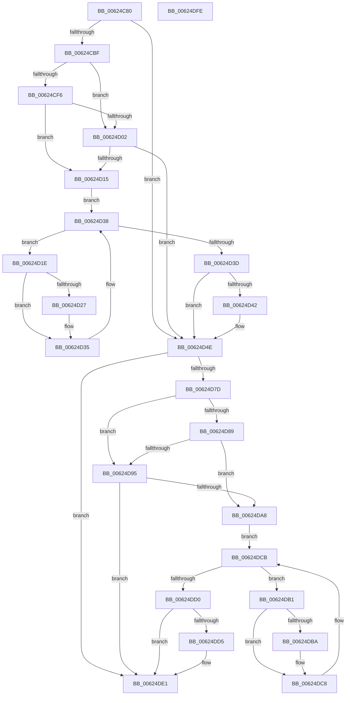

# DifIRP_MJ_CREATE_NAMED_PIPEWrapper

- RVA: `0x00624C80`–`0x00624DFF` (길이 `383` bytes)
- VA: `0x0000000140624C80`
- 실행 섹션: `.text`
- PDB 이름 있음: `예`; PDB Function 태그: `아니요`
- unwind 정보 RVA: `0x00093E28`
- 디코드: `101`개 명령, `383/383` bytes 표시
- 미해석 바이트: `0` (있으면 어셈블리에 `.byte`로 보존)

> 이 문서는 커널 이미지의 기계어와 PDB 기호를 분석해 생성했습니다. 4번과 5번은 함수 원형과 자료형을 바이너리 사용 방식에서 추정한 C 해석이며 원본 소스 복구 결과는 아닙니다.

## 1. Dependencies

- 직접 호출 지점: **8**; 고유 호출 대상: **4**
- 직접 호출자로 확인된 함수: **0**
- RIP 상대 이미지 참조: **3**

### Outgoing calls
- `0x00624CAE` → [DifGetAPIThunkContextById](../49/DifGetAPIThunkContextById_function_00495A34.md) (function, `0x00495A34`)
- `0x00624D09` → [ExAcquireRundownProtection](../21/ExAcquireRundownProtection_function_00216620.md) (function, `0x00216620`)
- `0x00624D30` → [guard_dispatch_icall](../6B/guard_dispatch_icall_function_006BAAD0.md) (function, `0x006BAAD0`)
- `0x00624D49` → [ExReleaseRundownProtection](../34/ExReleaseRundownProtection_function_00349E80.md) (function, `0x00349E80`)
- `0x00624D6F` → [guard_dispatch_icall](../6B/guard_dispatch_icall_function_006BAAD0.md) (function, `0x006BAAD0`)
- `0x00624D9C` → [ExAcquireRundownProtection](../21/ExAcquireRundownProtection_function_00216620.md) (function, `0x00216620`)
- `0x00624DC3` → [guard_dispatch_icall](../6B/guard_dispatch_icall_function_006BAAD0.md) (function, `0x006BAAD0`)
- `0x00624DDC` → [ExReleaseRundownProtection](../34/ExReleaseRundownProtection_function_00349E80.md) (function, `0x00349E80`)

### Direct callers
- 이 함수 시작 RVA로 연결되는 직접 call은 확인되지 않았습니다. 간접 호출은 완전히 역산할 수 없습니다.

### Static image references
- `0x00624CC9` → RVA `0x00F048B8` (`.data`; read)
- `0x00624CF6` → RVA `0x00F04980` (`.data`; read)
- `0x00624D02` → RVA `0x00F03E80` (`.data`; read)

## 2. Other-region calls and transfers

- 다른 실행 섹션으로 향하는 call: **0**
- 별도 외부 분기/꼬리 이동을 확인하지 못했습니다.

## 3. Assembly (complete function range)

```asm
00624C80  48 8B C4                        mov rax, rsp
00624C83  48 89 58 08                     mov qword ptr [rax + 8], rbx
00624C87  48 89 68 10                     mov qword ptr [rax + 0x10], rbp
00624C8B  48 89 70 18                     mov qword ptr [rax + 0x18], rsi
00624C8F  57                              push rdi
00624C90  41 56                           push r14
00624C92  41 57                           push r15
00624C94  48 83 EC 40                     sub rsp, 0x40
00624C98  0F 57 C0                        xorps xmm0, xmm0
00624C9B  4C 8B F9                        mov r15, rcx
00624C9E  B9 01 00 00 10                  mov ecx, 0x10000001
00624CA3  4C 8B F2                        mov r14, rdx
00624CA6  0F 11 40 C8                     movups xmmword ptr [rax - 0x38], xmm0
00624CAA  0F 11 40 D8                     movups xmmword ptr [rax - 0x28], xmm0
00624CAE  E8 81 0D E7 FF                  call 0x140495a34
00624CB3  48 8B E8                        mov rbp, rax
00624CB6  48 85 C0                        test rax, rax
00624CB9  0F 84 8F 00 00 00               je 0x140624d4e
00624CBF  49 8B 96 B8 00 00 00            mov rdx, qword ptr [r14 + 0xb8]
00624CC6  40 32 F6                        xor sil, sil
00624CC9  40 38 35 E8 FB 8D 00            cmp byte ptr [rip + 0x8dfbe8], sil
00624CD0  49 8B 4F 08                     mov rcx, qword ptr [r15 + 8]
00624CD4  44 0F B6 02                     movzx r8d, byte ptr [rdx]
00624CD8  48 8B 51 30                     mov rdx, qword ptr [rcx + 0x30]
00624CDC  48 8B 4A 40                     mov rcx, qword ptr [rdx + 0x40]
00624CE0  4A 8B 54 C1 20                  mov rdx, qword ptr [rcx + r8*8 + 0x20]
00624CE5  48 89 54 24 20                  mov qword ptr [rsp + 0x20], rdx
00624CEA  4C 89 7C 24 30                  mov qword ptr [rsp + 0x30], r15
00624CEF  4C 89 74 24 28                  mov qword ptr [rsp + 0x28], r14
00624CF4  75 0C                           jne 0x140624d02
00624CF6  F7 05 80 FC 8D 00 00 08 00 00   test dword ptr [rip + 0x8dfc80], 0x800
00624D00  74 13                           je 0x140624d15
00624D02  48 8D 0D 77 F1 8D 00            lea rcx, [rip + 0x8df177]
00624D09  E8 12 19 BF FF                  call 0x140216620
00624D0E  40 8A F0                        mov sil, al
00624D11  84 C0                           test al, al
00624D13  74 39                           je 0x140624d4e
00624D15  48 8D 7D 20                     lea rdi, [rbp + 0x20]
00624D19  48 8B 1F                        mov rbx, qword ptr [rdi]
00624D1C  EB 1A                           jmp 0x140624d38
00624D1E  48 8D 43 F0                     lea rax, [rbx - 0x10]
00624D22  48 85 C0                        test rax, rax
00624D25  74 0E                           je 0x140624d35
00624D27  48 8B 40 08                     mov rax, qword ptr [rax + 8]
00624D2B  48 8D 4C 24 20                  lea rcx, [rsp + 0x20]
00624D30  E8 9B 5D 09 00                  call 0x1406baad0
00624D35  48 8B 1B                        mov rbx, qword ptr [rbx]
00624D38  48 3B DF                        cmp rbx, rdi
00624D3B  75 E1                           jne 0x140624d1e
00624D3D  40 84 F6                        test sil, sil
00624D40  74 0C                           je 0x140624d4e
00624D42  48 8D 0D 37 F1 8D 00            lea rcx, [rip + 0x8df137]
00624D49  E8 32 51 D2 FF                  call 0x140349e80
00624D4E  49 8B 86 B8 00 00 00            mov rax, qword ptr [r14 + 0xb8]
00624D55  0F B6 10                        movzx edx, byte ptr [rax]
00624D58  49 8B 47 08                     mov rax, qword ptr [r15 + 8]
00624D5C  48 8B 48 30                     mov rcx, qword ptr [rax + 0x30]
00624D60  48 8B 41 40                     mov rax, qword ptr [rcx + 0x40]
00624D64  49 8B CF                        mov rcx, r15
00624D67  48 8B 44 D0 20                  mov rax, qword ptr [rax + rdx*8 + 0x20]
00624D6C  49 8B D6                        mov rdx, r14
00624D6F  E8 5C 5D 09 00                  call 0x1406baad0
00624D74  89 44 24 38                     mov dword ptr [rsp + 0x38], eax
00624D78  48 85 ED                        test rbp, rbp
00624D7B  74 64                           je 0x140624de1
00624D7D  40 32 FF                        xor dil, dil
00624D80  40 38 3D 31 FB 8D 00            cmp byte ptr [rip + 0x8dfb31], dil
00624D87  75 0C                           jne 0x140624d95
00624D89  F7 05 ED FB 8D 00 00 08 00 00   test dword ptr [rip + 0x8dfbed], 0x800
00624D93  74 13                           je 0x140624da8
00624D95  48 8D 0D E4 F0 8D 00            lea rcx, [rip + 0x8df0e4]
00624D9C  E8 7F 18 BF FF                  call 0x140216620
00624DA1  40 8A F8                        mov dil, al
00624DA4  84 C0                           test al, al
00624DA6  74 39                           je 0x140624de1
00624DA8  48 8D 75 30                     lea rsi, [rbp + 0x30]
00624DAC  48 8B 1E                        mov rbx, qword ptr [rsi]
00624DAF  EB 1A                           jmp 0x140624dcb
00624DB1  48 8D 43 F0                     lea rax, [rbx - 0x10]
00624DB5  48 85 C0                        test rax, rax
00624DB8  74 0E                           je 0x140624dc8
00624DBA  48 8B 40 08                     mov rax, qword ptr [rax + 8]
00624DBE  48 8D 4C 24 20                  lea rcx, [rsp + 0x20]
00624DC3  E8 08 5D 09 00                  call 0x1406baad0
00624DC8  48 8B 1B                        mov rbx, qword ptr [rbx]
00624DCB  48 3B DE                        cmp rbx, rsi
00624DCE  75 E1                           jne 0x140624db1
00624DD0  40 84 FF                        test dil, dil
00624DD3  74 0C                           je 0x140624de1
00624DD5  48 8D 0D A4 F0 8D 00            lea rcx, [rip + 0x8df0a4]
00624DDC  E8 9F 50 D2 FF                  call 0x140349e80
00624DE1  8B 44 24 38                     mov eax, dword ptr [rsp + 0x38]
00624DE5  48 8B 5C 24 60                  mov rbx, qword ptr [rsp + 0x60]
00624DEA  48 8B 6C 24 68                  mov rbp, qword ptr [rsp + 0x68]
00624DEF  48 8B 74 24 70                  mov rsi, qword ptr [rsp + 0x70]
00624DF4  48 83 C4 40                     add rsp, 0x40
00624DF8  41 5F                           pop r15
00624DFA  41 5E                           pop r14
00624DFC  5F                              pop rdi
00624DFD  C3                              ret
00624DFE  CC                              int3
```

## 4. C-style interpretation (structured pseudocode)

```c
__int64 __fastcall DifIRP_MJ_CREATE_NAMED_PIPEWrapper(__int64 a1, __int64 a2)
{
    __int64 result;
    __int64 v_rdi;
    __int64 v_rsi;
    __int64 v_rsp;
    unsigned int v_stack_m20;
    unsigned __int64 v_stack_m28;
    unsigned __int64 v_stack_m30;
    unsigned __int64 v_stack_m38;
    unsigned __int64 v_stack_p10;
    unsigned __int64 v_stack_p18;
    unsigned __int64 v_stack_p8;

    *(unsigned __int64 *)(v_rsp + 8) = v_rbx;
    *(unsigned __int64 *)(v_rsp + 16) = v_rbp;
    *(unsigned __int64 *)(v_rsp + 24) = v_rsi;
    v_rsp = (v_rsp) - (64);
    *(unsigned __int64 *)(v_rsp - 56) = v_xmm0;
    *(unsigned __int64 *)(v_rsp - 40) = v_xmm0;
    result = DifGetAPIThunkContextById((unsigned int)(0x10000001ULL), a2, a3, a4);
    if (result == 0) goto loc_00624D4E;
    v_rsi = 0;
    v_stack_m38 = *(unsigned __int64 *)(*(unsigned __int64 *)(*(unsigned __int64 *)(*(unsigned __int64 *)(a1 + 8) + 48) + 64) + *(unsigned __int8 *)(*(unsigned __int64 *)(a2 + 184)) * 8 + 32);
    v_stack_m28 = a1;
    v_stack_m30 = a2;
    if ((*(unsigned __int8 *)(v_rip + 9305064)) != 0) goto loc_00624D02;
    if (((*(unsigned int *)(v_rip + 9305216)) & (0x800ULL)) == 0) goto loc_00624D15;
loc_00624D02:
    result = ExAcquireRundownProtection(v_rip + 9302391, *(unsigned __int64 *)(*(unsigned __int64 *)(*(unsigned __int64 *)(*(unsigned __int64 *)(a1 + 8) + 48) + 64) + *(unsigned __int8 *)(*(unsigned __int64 *)(a2 + 184)) * 8 + 32), *(unsigned __int8 *)(*(unsigned __int64 *)(a2 + 184)), a4);
    if ((unsigned __int8)(result) == 0) goto loc_00624D4E;
loc_00624D15:
    goto loc_00624D38;
loc_00624D1E:
    result = *(unsigned __int64 *)(result + 32) - 16;
    if (*(unsigned __int64 *)(result + 32) - 16 != 0) {
        result = *(unsigned __int64 *)(*(unsigned __int64 *)(result + 32) - 16 + 8);
        a1 = v_stack_m38;
        result = guard_dispatch_icall(a1, *(unsigned __int64 *)(*(unsigned __int64 *)(*(unsigned __int64 *)(*(unsigned __int64 *)(a1 + 8) + 48) + 64) + *(unsigned __int8 *)(*(unsigned __int64 *)(a2 + 184)) * 8 + 32), *(unsigned __int8 *)(*(unsigned __int64 *)(a2 + 184)), a4);
    }
loc_00624D38:
    if ((*(unsigned __int64 *)(*(unsigned __int64 *)(result + 32))) != (result + 32)) goto loc_00624D1E;
    if ((unsigned __int8)((unsigned __int8)(result)) != 0) {
        a1 = v_rip + 9302327;
        result = ExReleaseRundownProtection(a1, *(unsigned __int64 *)(*(unsigned __int64 *)(*(unsigned __int64 *)(*(unsigned __int64 *)(a1 + 8) + 48) + 64) + *(unsigned __int8 *)(*(unsigned __int64 *)(a2 + 184)) * 8 + 32), *(unsigned __int8 *)(*(unsigned __int64 *)(a2 + 184)), a4);
    }
    result = guard_dispatch_icall(a1, a2, *(unsigned __int8 *)(*(unsigned __int64 *)(a2 + 184)), a4);
    v_stack_m20 = (unsigned int)(result);
    if (result == 0) goto loc_00624DE1;
    v_rdi = 0;
    if ((*(unsigned __int8 *)(v_rip + 9304881)) != 0) goto loc_00624D95;
    if (((*(unsigned int *)(v_rip + 9305069)) & (0x800ULL)) == 0) goto loc_00624DA8;
loc_00624D95:
    result = ExAcquireRundownProtection(v_rip + 9302244, a2, *(unsigned __int8 *)(*(unsigned __int64 *)(a2 + 184)), a4);
    if ((unsigned __int8)(result) == 0) goto loc_00624DE1;
loc_00624DA8:
    goto loc_00624DCB;
loc_00624DB1:
    result = *(unsigned __int64 *)(result + 48) - 16;
    if (*(unsigned __int64 *)(result + 48) - 16 != 0) {
        result = *(unsigned __int64 *)(*(unsigned __int64 *)(result + 48) - 16 + 8);
        a1 = v_stack_m38;
        result = guard_dispatch_icall(a1, a2, *(unsigned __int8 *)(*(unsigned __int64 *)(a2 + 184)), a4);
    }
loc_00624DCB:
    if ((*(unsigned __int64 *)(*(unsigned __int64 *)(result + 48))) != (result + 48)) goto loc_00624DB1;
    if ((unsigned __int8)((unsigned __int8)(result)) != 0) {
        a1 = v_rip + 9302180;
        result = ExReleaseRundownProtection(a1, a2, *(unsigned __int8 *)(*(unsigned __int64 *)(a2 + 184)), a4);
    }
    v_rsp = (v_rsp) + (64);
    return (unsigned int)(v_stack_m20);
}
```

## 5. (Beta) C Style

```c
int64_t DifIRP_MJ_CREATE_NAMED_PIPEWrapper(void *Arg1, void *Arg2)
{
    uint8_t *arg1 = (uint8_t *)Arg1;
    uint8_t *arg2 = (uint8_t *)Arg2;

    int64_t result;
    int64_t local_rdi;
    int64_t local_rsi;
    int64_t local_rsp;
    uint32_t v_stack_m20;
    uint64_t v_stack_m28;
    uint64_t v_stack_m30;
    uint64_t v_stack_m38;
    uint64_t v_stack_p10;
    uint64_t v_stack_p18;
    uint64_t v_stack_p8;

    *(uint64_t *)(local_rsp + 0x8) = local_rbx;
    *(uint64_t *)(local_rsp + 0x10) = local_rbp;
    *(uint64_t *)(local_rsp + 0x18) = local_rsi;
    local_rsp = (local_rsp) - (64);
    *(uint64_t *)(local_rsp - 0x38) = v_xmm0;
    *(uint64_t *)(local_rsp - 0x28) = v_xmm0;
    result = DifGetAPIThunkContextById((uint32_t)(0x10000001ULL), Arg2, a3, a4);
    if (result == 0) goto loc_00624D4E;
    local_rsi = 0;
    v_stack_m38 = *(uint64_t *)(*(uint64_t *)(*(uint64_t *)(*(uint64_t *)(arg1 + 0x8) + 0x30) + 0x40) + *(uint8_t *)(*(uint64_t *)(arg2 + 0xB8)) * 8 + 0x20);
    v_stack_m28 = Arg1;
    v_stack_m30 = Arg2;
    if ((*(uint8_t *)(v_rip + 0x8DFBE8)) != 0) goto loc_00624D02;
    if (((*(uint32_t *)(v_rip + 0x8DFC80)) & (0x800ULL)) == 0) goto loc_00624D15;
loc_00624D02:
    result = ExAcquireRundownProtection(v_rip + 9302391, *(uint64_t *)(*(uint64_t *)(*(uint64_t *)(*(uint64_t *)(arg1 + 0x8) + 0x30) + 0x40) + *(uint8_t *)(*(uint64_t *)(arg2 + 0xB8)) * 8 + 0x20), *(uint8_t *)(*(uint64_t *)(arg2 + 0xB8)), a4);
    if ((uint8_t)(result) == 0) goto loc_00624D4E;
loc_00624D15:
    goto loc_00624D38;
loc_00624D1E:
    result = *(uint64_t *)(result + 0x20) - 16;
    if (*(uint64_t *)(result + 0x20) - 16 != 0) {
        result = *(uint64_t *)(*(uint64_t *)(result + 0x20) - 0x10 + 0x8);
        Arg1 = v_stack_m38;
        result = guard_dispatch_icall(Arg1, *(uint64_t *)(*(uint64_t *)(*(uint64_t *)(*(uint64_t *)(arg1 + 0x8) + 0x30) + 0x40) + *(uint8_t *)(*(uint64_t *)(arg2 + 0xB8)) * 8 + 0x20), *(uint8_t *)(*(uint64_t *)(arg2 + 0xB8)), a4);
    }
loc_00624D38:
    if ((*(uint64_t *)(*(uint64_t *)(result + 0x20))) != (result + 32)) goto loc_00624D1E;
    if ((uint8_t)((uint8_t)(result)) != 0) {
        Arg1 = v_rip + 9302327;
        result = ExReleaseRundownProtection(Arg1, *(uint64_t *)(*(uint64_t *)(*(uint64_t *)(*(uint64_t *)(arg1 + 0x8) + 0x30) + 0x40) + *(uint8_t *)(*(uint64_t *)(arg2 + 0xB8)) * 8 + 0x20), *(uint8_t *)(*(uint64_t *)(arg2 + 0xB8)), a4);
    }
    result = guard_dispatch_icall(Arg1, Arg2, *(uint8_t *)(*(uint64_t *)(arg2 + 0xB8)), a4);
    v_stack_m20 = (uint32_t)(result);
    if (result == 0) goto loc_00624DE1;
    local_rdi = 0;
    if ((*(uint8_t *)(v_rip + 0x8DFB31)) != 0) goto loc_00624D95;
    if (((*(uint32_t *)(v_rip + 0x8DFBED)) & (0x800ULL)) == 0) goto loc_00624DA8;
loc_00624D95:
    result = ExAcquireRundownProtection(v_rip + 9302244, Arg2, *(uint8_t *)(*(uint64_t *)(arg2 + 0xB8)), a4);
    if ((uint8_t)(result) == 0) goto loc_00624DE1;
loc_00624DA8:
    goto loc_00624DCB;
loc_00624DB1:
    result = *(uint64_t *)(result + 0x30) - 16;
    if (*(uint64_t *)(result + 0x30) - 16 != 0) {
        result = *(uint64_t *)(*(uint64_t *)(result + 0x30) - 0x10 + 0x8);
        Arg1 = v_stack_m38;
        result = guard_dispatch_icall(Arg1, Arg2, *(uint8_t *)(*(uint64_t *)(arg2 + 0xB8)), a4);
    }
loc_00624DCB:
    if ((*(uint64_t *)(*(uint64_t *)(result + 0x30))) != (result + 48)) goto loc_00624DB1;
    if ((uint8_t)((uint8_t)(result)) != 0) {
        Arg1 = v_rip + 9302180;
        result = ExReleaseRundownProtection(Arg1, Arg2, *(uint8_t *)(*(uint64_t *)(arg2 + 0xB8)), a4);
    }
    local_rsp = (local_rsp) + (64);
    return (uint32_t)(v_stack_m20);
}
```

### 관측된 메모리 오프셋

구조체 형식이 확인되지 않은 접근은 인자 기준의 오프셋으로만 기록했습니다.

| 기준 인자 | 오프셋 표현 | 폭 (bit) | 접근 |
|---|---:|---:|---|
| `Arg1` | `+ 0x8` | `64` | `R` |
| `Arg2` | `+ 0xB8` | `64` | `R` |

## 6. Execution-region graph

[열기: 2D/3D 그래프와 함수 탐색 컨트롤 패널](../../../control-panel.html?section=text&rva=0x00624C80&view=graph)

- 2D 그래프는 위에서 아래로 흐르고, 3D 그래프는 빈 공간을 드래그해 회전합니다. Shift+드래그는 이동, 휠은 확대·축소, 함수 노드 선택은 대상 보고서 이동입니다.

### Static fallback


