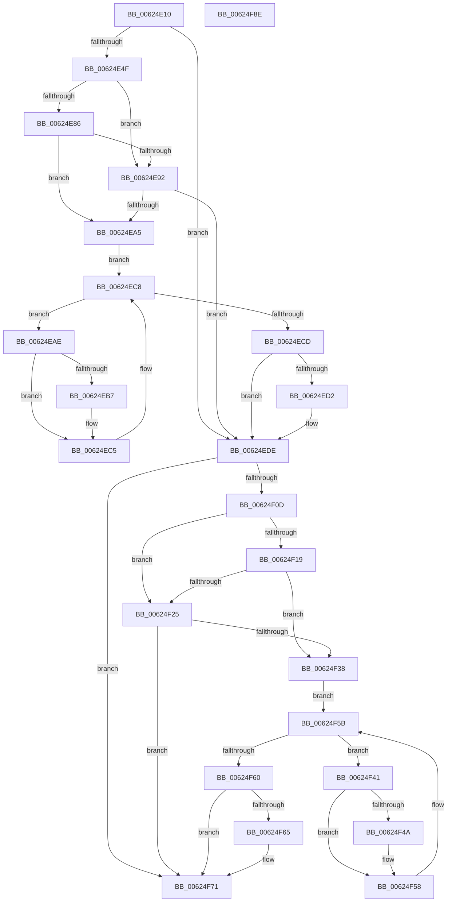

# DifIRP_MJ_DEVICE_CHANGEWrapper

- RVA: `0x00624E10`–`0x00624F8F` (길이 `383` bytes)
- VA: `0x0000000140624E10`
- 실행 섹션: `.text`
- PDB 이름 있음: `예`; PDB Function 태그: `아니요`
- unwind 정보 RVA: `0x00093E28`
- 디코드: `101`개 명령, `383/383` bytes 표시
- 미해석 바이트: `0` (있으면 어셈블리에 `.byte`로 보존)

> 이 문서는 커널 이미지의 기계어와 PDB 기호를 분석해 생성했습니다. 4번과 5번은 함수 원형과 자료형을 바이너리 사용 방식에서 추정한 C 해석이며 원본 소스 복구 결과는 아닙니다.

## 1. Dependencies

- 직접 호출 지점: **8**; 고유 호출 대상: **4**
- 직접 호출자로 확인된 함수: **0**
- RIP 상대 이미지 참조: **3**

### Outgoing calls
- `0x00624E3E` → [DifGetAPIThunkContextById](../49/DifGetAPIThunkContextById_function_00495A34.md) (function, `0x00495A34`)
- `0x00624E99` → [ExAcquireRundownProtection](../21/ExAcquireRundownProtection_function_00216620.md) (function, `0x00216620`)
- `0x00624EC0` → [guard_dispatch_icall](../6B/guard_dispatch_icall_function_006BAAD0.md) (function, `0x006BAAD0`)
- `0x00624ED9` → [ExReleaseRundownProtection](../34/ExReleaseRundownProtection_function_00349E80.md) (function, `0x00349E80`)
- `0x00624EFF` → [guard_dispatch_icall](../6B/guard_dispatch_icall_function_006BAAD0.md) (function, `0x006BAAD0`)
- `0x00624F2C` → [ExAcquireRundownProtection](../21/ExAcquireRundownProtection_function_00216620.md) (function, `0x00216620`)
- `0x00624F53` → [guard_dispatch_icall](../6B/guard_dispatch_icall_function_006BAAD0.md) (function, `0x006BAAD0`)
- `0x00624F6C` → [ExReleaseRundownProtection](../34/ExReleaseRundownProtection_function_00349E80.md) (function, `0x00349E80`)

### Direct callers
- 이 함수 시작 RVA로 연결되는 직접 call은 확인되지 않았습니다. 간접 호출은 완전히 역산할 수 없습니다.

### Static image references
- `0x00624E59` → RVA `0x00F048B8` (`.data`; read)
- `0x00624E86` → RVA `0x00F04980` (`.data`; read)
- `0x00624E92` → RVA `0x00F03E80` (`.data`; read)

## 2. Other-region calls and transfers

- 다른 실행 섹션으로 향하는 call: **0**
- 별도 외부 분기/꼬리 이동을 확인하지 못했습니다.

## 3. Assembly (complete function range)

```asm
00624E10  48 8B C4                        mov rax, rsp
00624E13  48 89 58 08                     mov qword ptr [rax + 8], rbx
00624E17  48 89 68 10                     mov qword ptr [rax + 0x10], rbp
00624E1B  48 89 70 18                     mov qword ptr [rax + 0x18], rsi
00624E1F  57                              push rdi
00624E20  41 56                           push r14
00624E22  41 57                           push r15
00624E24  48 83 EC 40                     sub rsp, 0x40
00624E28  0F 57 C0                        xorps xmm0, xmm0
00624E2B  4C 8B F9                        mov r15, rcx
00624E2E  B9 18 00 00 10                  mov ecx, 0x10000018
00624E33  4C 8B F2                        mov r14, rdx
00624E36  0F 11 40 C8                     movups xmmword ptr [rax - 0x38], xmm0
00624E3A  0F 11 40 D8                     movups xmmword ptr [rax - 0x28], xmm0
00624E3E  E8 F1 0B E7 FF                  call 0x140495a34
00624E43  48 8B E8                        mov rbp, rax
00624E46  48 85 C0                        test rax, rax
00624E49  0F 84 8F 00 00 00               je 0x140624ede
00624E4F  49 8B 96 B8 00 00 00            mov rdx, qword ptr [r14 + 0xb8]
00624E56  40 32 F6                        xor sil, sil
00624E59  40 38 35 58 FA 8D 00            cmp byte ptr [rip + 0x8dfa58], sil
00624E60  49 8B 4F 08                     mov rcx, qword ptr [r15 + 8]
00624E64  44 0F B6 02                     movzx r8d, byte ptr [rdx]
00624E68  48 8B 51 30                     mov rdx, qword ptr [rcx + 0x30]
00624E6C  48 8B 4A 40                     mov rcx, qword ptr [rdx + 0x40]
00624E70  4A 8B 54 C1 20                  mov rdx, qword ptr [rcx + r8*8 + 0x20]
00624E75  48 89 54 24 20                  mov qword ptr [rsp + 0x20], rdx
00624E7A  4C 89 7C 24 30                  mov qword ptr [rsp + 0x30], r15
00624E7F  4C 89 74 24 28                  mov qword ptr [rsp + 0x28], r14
00624E84  75 0C                           jne 0x140624e92
00624E86  F7 05 F0 FA 8D 00 00 08 00 00   test dword ptr [rip + 0x8dfaf0], 0x800
00624E90  74 13                           je 0x140624ea5
00624E92  48 8D 0D E7 EF 8D 00            lea rcx, [rip + 0x8defe7]
00624E99  E8 82 17 BF FF                  call 0x140216620
00624E9E  40 8A F0                        mov sil, al
00624EA1  84 C0                           test al, al
00624EA3  74 39                           je 0x140624ede
00624EA5  48 8D 7D 20                     lea rdi, [rbp + 0x20]
00624EA9  48 8B 1F                        mov rbx, qword ptr [rdi]
00624EAC  EB 1A                           jmp 0x140624ec8
00624EAE  48 8D 43 F0                     lea rax, [rbx - 0x10]
00624EB2  48 85 C0                        test rax, rax
00624EB5  74 0E                           je 0x140624ec5
00624EB7  48 8B 40 08                     mov rax, qword ptr [rax + 8]
00624EBB  48 8D 4C 24 20                  lea rcx, [rsp + 0x20]
00624EC0  E8 0B 5C 09 00                  call 0x1406baad0
00624EC5  48 8B 1B                        mov rbx, qword ptr [rbx]
00624EC8  48 3B DF                        cmp rbx, rdi
00624ECB  75 E1                           jne 0x140624eae
00624ECD  40 84 F6                        test sil, sil
00624ED0  74 0C                           je 0x140624ede
00624ED2  48 8D 0D A7 EF 8D 00            lea rcx, [rip + 0x8defa7]
00624ED9  E8 A2 4F D2 FF                  call 0x140349e80
00624EDE  49 8B 86 B8 00 00 00            mov rax, qword ptr [r14 + 0xb8]
00624EE5  0F B6 10                        movzx edx, byte ptr [rax]
00624EE8  49 8B 47 08                     mov rax, qword ptr [r15 + 8]
00624EEC  48 8B 48 30                     mov rcx, qword ptr [rax + 0x30]
00624EF0  48 8B 41 40                     mov rax, qword ptr [rcx + 0x40]
00624EF4  49 8B CF                        mov rcx, r15
00624EF7  48 8B 44 D0 20                  mov rax, qword ptr [rax + rdx*8 + 0x20]
00624EFC  49 8B D6                        mov rdx, r14
00624EFF  E8 CC 5B 09 00                  call 0x1406baad0
00624F04  89 44 24 38                     mov dword ptr [rsp + 0x38], eax
00624F08  48 85 ED                        test rbp, rbp
00624F0B  74 64                           je 0x140624f71
00624F0D  40 32 FF                        xor dil, dil
00624F10  40 38 3D A1 F9 8D 00            cmp byte ptr [rip + 0x8df9a1], dil
00624F17  75 0C                           jne 0x140624f25
00624F19  F7 05 5D FA 8D 00 00 08 00 00   test dword ptr [rip + 0x8dfa5d], 0x800
00624F23  74 13                           je 0x140624f38
00624F25  48 8D 0D 54 EF 8D 00            lea rcx, [rip + 0x8def54]
00624F2C  E8 EF 16 BF FF                  call 0x140216620
00624F31  40 8A F8                        mov dil, al
00624F34  84 C0                           test al, al
00624F36  74 39                           je 0x140624f71
00624F38  48 8D 75 30                     lea rsi, [rbp + 0x30]
00624F3C  48 8B 1E                        mov rbx, qword ptr [rsi]
00624F3F  EB 1A                           jmp 0x140624f5b
00624F41  48 8D 43 F0                     lea rax, [rbx - 0x10]
00624F45  48 85 C0                        test rax, rax
00624F48  74 0E                           je 0x140624f58
00624F4A  48 8B 40 08                     mov rax, qword ptr [rax + 8]
00624F4E  48 8D 4C 24 20                  lea rcx, [rsp + 0x20]
00624F53  E8 78 5B 09 00                  call 0x1406baad0
00624F58  48 8B 1B                        mov rbx, qword ptr [rbx]
00624F5B  48 3B DE                        cmp rbx, rsi
00624F5E  75 E1                           jne 0x140624f41
00624F60  40 84 FF                        test dil, dil
00624F63  74 0C                           je 0x140624f71
00624F65  48 8D 0D 14 EF 8D 00            lea rcx, [rip + 0x8def14]
00624F6C  E8 0F 4F D2 FF                  call 0x140349e80
00624F71  8B 44 24 38                     mov eax, dword ptr [rsp + 0x38]
00624F75  48 8B 5C 24 60                  mov rbx, qword ptr [rsp + 0x60]
00624F7A  48 8B 6C 24 68                  mov rbp, qword ptr [rsp + 0x68]
00624F7F  48 8B 74 24 70                  mov rsi, qword ptr [rsp + 0x70]
00624F84  48 83 C4 40                     add rsp, 0x40
00624F88  41 5F                           pop r15
00624F8A  41 5E                           pop r14
00624F8C  5F                              pop rdi
00624F8D  C3                              ret
00624F8E  CC                              int3
```

## 4. C-style interpretation (structured pseudocode)

```c
__int64 __fastcall DifIRP_MJ_DEVICE_CHANGEWrapper(__int64 a1, __int64 a2)
{
    __int64 result;
    __int64 v_rdi;
    __int64 v_rsi;
    __int64 v_rsp;
    unsigned int v_stack_m20;
    unsigned __int64 v_stack_m28;
    unsigned __int64 v_stack_m30;
    unsigned __int64 v_stack_m38;
    unsigned __int64 v_stack_p10;
    unsigned __int64 v_stack_p18;
    unsigned __int64 v_stack_p8;

    *(unsigned __int64 *)(v_rsp + 8) = v_rbx;
    *(unsigned __int64 *)(v_rsp + 16) = v_rbp;
    *(unsigned __int64 *)(v_rsp + 24) = v_rsi;
    v_rsp = (v_rsp) - (64);
    *(unsigned __int64 *)(v_rsp - 56) = v_xmm0;
    *(unsigned __int64 *)(v_rsp - 40) = v_xmm0;
    result = DifGetAPIThunkContextById((unsigned int)(0x10000018ULL), a2, a3, a4);
    if (result == 0) goto loc_00624EDE;
    v_rsi = 0;
    v_stack_m38 = *(unsigned __int64 *)(*(unsigned __int64 *)(*(unsigned __int64 *)(*(unsigned __int64 *)(a1 + 8) + 48) + 64) + *(unsigned __int8 *)(*(unsigned __int64 *)(a2 + 184)) * 8 + 32);
    v_stack_m28 = a1;
    v_stack_m30 = a2;
    if ((*(unsigned __int8 *)(v_rip + 9304664)) != 0) goto loc_00624E92;
    if (((*(unsigned int *)(v_rip + 9304816)) & (0x800ULL)) == 0) goto loc_00624EA5;
loc_00624E92:
    result = ExAcquireRundownProtection(v_rip + 9301991, *(unsigned __int64 *)(*(unsigned __int64 *)(*(unsigned __int64 *)(*(unsigned __int64 *)(a1 + 8) + 48) + 64) + *(unsigned __int8 *)(*(unsigned __int64 *)(a2 + 184)) * 8 + 32), *(unsigned __int8 *)(*(unsigned __int64 *)(a2 + 184)), a4);
    if ((unsigned __int8)(result) == 0) goto loc_00624EDE;
loc_00624EA5:
    goto loc_00624EC8;
loc_00624EAE:
    result = *(unsigned __int64 *)(result + 32) - 16;
    if (*(unsigned __int64 *)(result + 32) - 16 != 0) {
        result = *(unsigned __int64 *)(*(unsigned __int64 *)(result + 32) - 16 + 8);
        a1 = v_stack_m38;
        result = guard_dispatch_icall(a1, *(unsigned __int64 *)(*(unsigned __int64 *)(*(unsigned __int64 *)(*(unsigned __int64 *)(a1 + 8) + 48) + 64) + *(unsigned __int8 *)(*(unsigned __int64 *)(a2 + 184)) * 8 + 32), *(unsigned __int8 *)(*(unsigned __int64 *)(a2 + 184)), a4);
    }
loc_00624EC8:
    if ((*(unsigned __int64 *)(*(unsigned __int64 *)(result + 32))) != (result + 32)) goto loc_00624EAE;
    if ((unsigned __int8)((unsigned __int8)(result)) != 0) {
        a1 = v_rip + 9301927;
        result = ExReleaseRundownProtection(a1, *(unsigned __int64 *)(*(unsigned __int64 *)(*(unsigned __int64 *)(*(unsigned __int64 *)(a1 + 8) + 48) + 64) + *(unsigned __int8 *)(*(unsigned __int64 *)(a2 + 184)) * 8 + 32), *(unsigned __int8 *)(*(unsigned __int64 *)(a2 + 184)), a4);
    }
    result = guard_dispatch_icall(a1, a2, *(unsigned __int8 *)(*(unsigned __int64 *)(a2 + 184)), a4);
    v_stack_m20 = (unsigned int)(result);
    if (result == 0) goto loc_00624F71;
    v_rdi = 0;
    if ((*(unsigned __int8 *)(v_rip + 9304481)) != 0) goto loc_00624F25;
    if (((*(unsigned int *)(v_rip + 9304669)) & (0x800ULL)) == 0) goto loc_00624F38;
loc_00624F25:
    result = ExAcquireRundownProtection(v_rip + 9301844, a2, *(unsigned __int8 *)(*(unsigned __int64 *)(a2 + 184)), a4);
    if ((unsigned __int8)(result) == 0) goto loc_00624F71;
loc_00624F38:
    goto loc_00624F5B;
loc_00624F41:
    result = *(unsigned __int64 *)(result + 48) - 16;
    if (*(unsigned __int64 *)(result + 48) - 16 != 0) {
        result = *(unsigned __int64 *)(*(unsigned __int64 *)(result + 48) - 16 + 8);
        a1 = v_stack_m38;
        result = guard_dispatch_icall(a1, a2, *(unsigned __int8 *)(*(unsigned __int64 *)(a2 + 184)), a4);
    }
loc_00624F5B:
    if ((*(unsigned __int64 *)(*(unsigned __int64 *)(result + 48))) != (result + 48)) goto loc_00624F41;
    if ((unsigned __int8)((unsigned __int8)(result)) != 0) {
        a1 = v_rip + 9301780;
        result = ExReleaseRundownProtection(a1, a2, *(unsigned __int8 *)(*(unsigned __int64 *)(a2 + 184)), a4);
    }
    v_rsp = (v_rsp) + (64);
    return (unsigned int)(v_stack_m20);
}
```

## 5. (Beta) C Style

```c
int64_t DifIRP_MJ_DEVICE_CHANGEWrapper(void *Arg1, void *Arg2)
{
    uint8_t *arg1 = (uint8_t *)Arg1;
    uint8_t *arg2 = (uint8_t *)Arg2;

    int64_t result;
    int64_t local_rdi;
    int64_t local_rsi;
    int64_t local_rsp;
    uint32_t v_stack_m20;
    uint64_t v_stack_m28;
    uint64_t v_stack_m30;
    uint64_t v_stack_m38;
    uint64_t v_stack_p10;
    uint64_t v_stack_p18;
    uint64_t v_stack_p8;

    *(uint64_t *)(local_rsp + 0x8) = local_rbx;
    *(uint64_t *)(local_rsp + 0x10) = local_rbp;
    *(uint64_t *)(local_rsp + 0x18) = local_rsi;
    local_rsp = (local_rsp) - (64);
    *(uint64_t *)(local_rsp - 0x38) = v_xmm0;
    *(uint64_t *)(local_rsp - 0x28) = v_xmm0;
    result = DifGetAPIThunkContextById((uint32_t)(0x10000018ULL), Arg2, a3, a4);
    if (result == 0) goto loc_00624EDE;
    local_rsi = 0;
    v_stack_m38 = *(uint64_t *)(*(uint64_t *)(*(uint64_t *)(*(uint64_t *)(arg1 + 0x8) + 0x30) + 0x40) + *(uint8_t *)(*(uint64_t *)(arg2 + 0xB8)) * 8 + 0x20);
    v_stack_m28 = Arg1;
    v_stack_m30 = Arg2;
    if ((*(uint8_t *)(v_rip + 0x8DFA58)) != 0) goto loc_00624E92;
    if (((*(uint32_t *)(v_rip + 0x8DFAF0)) & (0x800ULL)) == 0) goto loc_00624EA5;
loc_00624E92:
    result = ExAcquireRundownProtection(v_rip + 9301991, *(uint64_t *)(*(uint64_t *)(*(uint64_t *)(*(uint64_t *)(arg1 + 0x8) + 0x30) + 0x40) + *(uint8_t *)(*(uint64_t *)(arg2 + 0xB8)) * 8 + 0x20), *(uint8_t *)(*(uint64_t *)(arg2 + 0xB8)), a4);
    if ((uint8_t)(result) == 0) goto loc_00624EDE;
loc_00624EA5:
    goto loc_00624EC8;
loc_00624EAE:
    result = *(uint64_t *)(result + 0x20) - 16;
    if (*(uint64_t *)(result + 0x20) - 16 != 0) {
        result = *(uint64_t *)(*(uint64_t *)(result + 0x20) - 0x10 + 0x8);
        Arg1 = v_stack_m38;
        result = guard_dispatch_icall(Arg1, *(uint64_t *)(*(uint64_t *)(*(uint64_t *)(*(uint64_t *)(arg1 + 0x8) + 0x30) + 0x40) + *(uint8_t *)(*(uint64_t *)(arg2 + 0xB8)) * 8 + 0x20), *(uint8_t *)(*(uint64_t *)(arg2 + 0xB8)), a4);
    }
loc_00624EC8:
    if ((*(uint64_t *)(*(uint64_t *)(result + 0x20))) != (result + 32)) goto loc_00624EAE;
    if ((uint8_t)((uint8_t)(result)) != 0) {
        Arg1 = v_rip + 9301927;
        result = ExReleaseRundownProtection(Arg1, *(uint64_t *)(*(uint64_t *)(*(uint64_t *)(*(uint64_t *)(arg1 + 0x8) + 0x30) + 0x40) + *(uint8_t *)(*(uint64_t *)(arg2 + 0xB8)) * 8 + 0x20), *(uint8_t *)(*(uint64_t *)(arg2 + 0xB8)), a4);
    }
    result = guard_dispatch_icall(Arg1, Arg2, *(uint8_t *)(*(uint64_t *)(arg2 + 0xB8)), a4);
    v_stack_m20 = (uint32_t)(result);
    if (result == 0) goto loc_00624F71;
    local_rdi = 0;
    if ((*(uint8_t *)(v_rip + 0x8DF9A1)) != 0) goto loc_00624F25;
    if (((*(uint32_t *)(v_rip + 0x8DFA5D)) & (0x800ULL)) == 0) goto loc_00624F38;
loc_00624F25:
    result = ExAcquireRundownProtection(v_rip + 9301844, Arg2, *(uint8_t *)(*(uint64_t *)(arg2 + 0xB8)), a4);
    if ((uint8_t)(result) == 0) goto loc_00624F71;
loc_00624F38:
    goto loc_00624F5B;
loc_00624F41:
    result = *(uint64_t *)(result + 0x30) - 16;
    if (*(uint64_t *)(result + 0x30) - 16 != 0) {
        result = *(uint64_t *)(*(uint64_t *)(result + 0x30) - 0x10 + 0x8);
        Arg1 = v_stack_m38;
        result = guard_dispatch_icall(Arg1, Arg2, *(uint8_t *)(*(uint64_t *)(arg2 + 0xB8)), a4);
    }
loc_00624F5B:
    if ((*(uint64_t *)(*(uint64_t *)(result + 0x30))) != (result + 48)) goto loc_00624F41;
    if ((uint8_t)((uint8_t)(result)) != 0) {
        Arg1 = v_rip + 9301780;
        result = ExReleaseRundownProtection(Arg1, Arg2, *(uint8_t *)(*(uint64_t *)(arg2 + 0xB8)), a4);
    }
    local_rsp = (local_rsp) + (64);
    return (uint32_t)(v_stack_m20);
}
```

### 관측된 메모리 오프셋

구조체 형식이 확인되지 않은 접근은 인자 기준의 오프셋으로만 기록했습니다.

| 기준 인자 | 오프셋 표현 | 폭 (bit) | 접근 |
|---|---:|---:|---|
| `Arg1` | `+ 0x8` | `64` | `R` |
| `Arg2` | `+ 0xB8` | `64` | `R` |

## 6. Execution-region graph

[열기: 2D/3D 그래프와 함수 탐색 컨트롤 패널](../../../control-panel.html?section=text&rva=0x00624E10&view=graph)

- 2D 그래프는 위에서 아래로 흐르고, 3D 그래프는 빈 공간을 드래그해 회전합니다. Shift+드래그는 이동, 휠은 확대·축소, 함수 노드 선택은 대상 보고서 이동입니다.

### Static fallback


