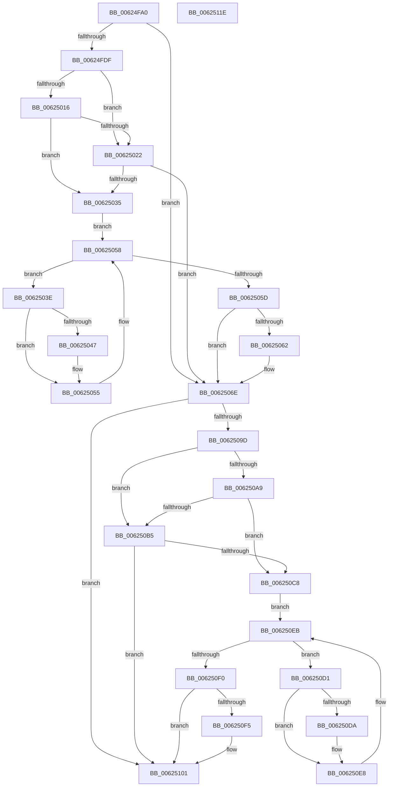

# DifIRP_MJ_DEVICE_CONTROLWrapper

- RVA: `0x00624FA0`–`0x0062511F` (길이 `383` bytes)
- VA: `0x0000000140624FA0`
- 실행 섹션: `.text`
- PDB 이름 있음: `예`; PDB Function 태그: `아니요`
- unwind 정보 RVA: `0x00093E28`
- 디코드: `101`개 명령, `383/383` bytes 표시
- 미해석 바이트: `0` (있으면 어셈블리에 `.byte`로 보존)

> 이 문서는 커널 이미지의 기계어와 PDB 기호를 분석해 생성했습니다. 4번과 5번은 함수 원형과 자료형을 바이너리 사용 방식에서 추정한 C 해석이며 원본 소스 복구 결과는 아닙니다.

## 1. Dependencies

- 직접 호출 지점: **8**; 고유 호출 대상: **4**
- 직접 호출자로 확인된 함수: **0**
- RIP 상대 이미지 참조: **3**

### Outgoing calls
- `0x00624FCE` → [DifGetAPIThunkContextById](../49/DifGetAPIThunkContextById_function_00495A34.md) (function, `0x00495A34`)
- `0x00625029` → [ExAcquireRundownProtection](../21/ExAcquireRundownProtection_function_00216620.md) (function, `0x00216620`)
- `0x00625050` → [guard_dispatch_icall](../6B/guard_dispatch_icall_function_006BAAD0.md) (function, `0x006BAAD0`)
- `0x00625069` → [ExReleaseRundownProtection](../34/ExReleaseRundownProtection_function_00349E80.md) (function, `0x00349E80`)
- `0x0062508F` → [guard_dispatch_icall](../6B/guard_dispatch_icall_function_006BAAD0.md) (function, `0x006BAAD0`)
- `0x006250BC` → [ExAcquireRundownProtection](../21/ExAcquireRundownProtection_function_00216620.md) (function, `0x00216620`)
- `0x006250E3` → [guard_dispatch_icall](../6B/guard_dispatch_icall_function_006BAAD0.md) (function, `0x006BAAD0`)
- `0x006250FC` → [ExReleaseRundownProtection](../34/ExReleaseRundownProtection_function_00349E80.md) (function, `0x00349E80`)

### Direct callers
- 이 함수 시작 RVA로 연결되는 직접 call은 확인되지 않았습니다. 간접 호출은 완전히 역산할 수 없습니다.

### Static image references
- `0x00624FE9` → RVA `0x00F048B8` (`.data`; read)
- `0x00625016` → RVA `0x00F04980` (`.data`; read)
- `0x00625022` → RVA `0x00F03E80` (`.data`; read)

## 2. Other-region calls and transfers

- 다른 실행 섹션으로 향하는 call: **0**
- 별도 외부 분기/꼬리 이동을 확인하지 못했습니다.

## 3. Assembly (complete function range)

```asm
00624FA0  48 8B C4                        mov rax, rsp
00624FA3  48 89 58 08                     mov qword ptr [rax + 8], rbx
00624FA7  48 89 68 10                     mov qword ptr [rax + 0x10], rbp
00624FAB  48 89 70 18                     mov qword ptr [rax + 0x18], rsi
00624FAF  57                              push rdi
00624FB0  41 56                           push r14
00624FB2  41 57                           push r15
00624FB4  48 83 EC 40                     sub rsp, 0x40
00624FB8  0F 57 C0                        xorps xmm0, xmm0
00624FBB  4C 8B F9                        mov r15, rcx
00624FBE  B9 0E 00 00 10                  mov ecx, 0x1000000e
00624FC3  4C 8B F2                        mov r14, rdx
00624FC6  0F 11 40 C8                     movups xmmword ptr [rax - 0x38], xmm0
00624FCA  0F 11 40 D8                     movups xmmword ptr [rax - 0x28], xmm0
00624FCE  E8 61 0A E7 FF                  call 0x140495a34
00624FD3  48 8B E8                        mov rbp, rax
00624FD6  48 85 C0                        test rax, rax
00624FD9  0F 84 8F 00 00 00               je 0x14062506e
00624FDF  49 8B 96 B8 00 00 00            mov rdx, qword ptr [r14 + 0xb8]
00624FE6  40 32 F6                        xor sil, sil
00624FE9  40 38 35 C8 F8 8D 00            cmp byte ptr [rip + 0x8df8c8], sil
00624FF0  49 8B 4F 08                     mov rcx, qword ptr [r15 + 8]
00624FF4  44 0F B6 02                     movzx r8d, byte ptr [rdx]
00624FF8  48 8B 51 30                     mov rdx, qword ptr [rcx + 0x30]
00624FFC  48 8B 4A 40                     mov rcx, qword ptr [rdx + 0x40]
00625000  4A 8B 54 C1 20                  mov rdx, qword ptr [rcx + r8*8 + 0x20]
00625005  48 89 54 24 20                  mov qword ptr [rsp + 0x20], rdx
0062500A  4C 89 7C 24 30                  mov qword ptr [rsp + 0x30], r15
0062500F  4C 89 74 24 28                  mov qword ptr [rsp + 0x28], r14
00625014  75 0C                           jne 0x140625022
00625016  F7 05 60 F9 8D 00 00 08 00 00   test dword ptr [rip + 0x8df960], 0x800
00625020  74 13                           je 0x140625035
00625022  48 8D 0D 57 EE 8D 00            lea rcx, [rip + 0x8dee57]
00625029  E8 F2 15 BF FF                  call 0x140216620
0062502E  40 8A F0                        mov sil, al
00625031  84 C0                           test al, al
00625033  74 39                           je 0x14062506e
00625035  48 8D 7D 20                     lea rdi, [rbp + 0x20]
00625039  48 8B 1F                        mov rbx, qword ptr [rdi]
0062503C  EB 1A                           jmp 0x140625058
0062503E  48 8D 43 F0                     lea rax, [rbx - 0x10]
00625042  48 85 C0                        test rax, rax
00625045  74 0E                           je 0x140625055
00625047  48 8B 40 08                     mov rax, qword ptr [rax + 8]
0062504B  48 8D 4C 24 20                  lea rcx, [rsp + 0x20]
00625050  E8 7B 5A 09 00                  call 0x1406baad0
00625055  48 8B 1B                        mov rbx, qword ptr [rbx]
00625058  48 3B DF                        cmp rbx, rdi
0062505B  75 E1                           jne 0x14062503e
0062505D  40 84 F6                        test sil, sil
00625060  74 0C                           je 0x14062506e
00625062  48 8D 0D 17 EE 8D 00            lea rcx, [rip + 0x8dee17]
00625069  E8 12 4E D2 FF                  call 0x140349e80
0062506E  49 8B 86 B8 00 00 00            mov rax, qword ptr [r14 + 0xb8]
00625075  0F B6 10                        movzx edx, byte ptr [rax]
00625078  49 8B 47 08                     mov rax, qword ptr [r15 + 8]
0062507C  48 8B 48 30                     mov rcx, qword ptr [rax + 0x30]
00625080  48 8B 41 40                     mov rax, qword ptr [rcx + 0x40]
00625084  49 8B CF                        mov rcx, r15
00625087  48 8B 44 D0 20                  mov rax, qword ptr [rax + rdx*8 + 0x20]
0062508C  49 8B D6                        mov rdx, r14
0062508F  E8 3C 5A 09 00                  call 0x1406baad0
00625094  89 44 24 38                     mov dword ptr [rsp + 0x38], eax
00625098  48 85 ED                        test rbp, rbp
0062509B  74 64                           je 0x140625101
0062509D  40 32 FF                        xor dil, dil
006250A0  40 38 3D 11 F8 8D 00            cmp byte ptr [rip + 0x8df811], dil
006250A7  75 0C                           jne 0x1406250b5
006250A9  F7 05 CD F8 8D 00 00 08 00 00   test dword ptr [rip + 0x8df8cd], 0x800
006250B3  74 13                           je 0x1406250c8
006250B5  48 8D 0D C4 ED 8D 00            lea rcx, [rip + 0x8dedc4]
006250BC  E8 5F 15 BF FF                  call 0x140216620
006250C1  40 8A F8                        mov dil, al
006250C4  84 C0                           test al, al
006250C6  74 39                           je 0x140625101
006250C8  48 8D 75 30                     lea rsi, [rbp + 0x30]
006250CC  48 8B 1E                        mov rbx, qword ptr [rsi]
006250CF  EB 1A                           jmp 0x1406250eb
006250D1  48 8D 43 F0                     lea rax, [rbx - 0x10]
006250D5  48 85 C0                        test rax, rax
006250D8  74 0E                           je 0x1406250e8
006250DA  48 8B 40 08                     mov rax, qword ptr [rax + 8]
006250DE  48 8D 4C 24 20                  lea rcx, [rsp + 0x20]
006250E3  E8 E8 59 09 00                  call 0x1406baad0
006250E8  48 8B 1B                        mov rbx, qword ptr [rbx]
006250EB  48 3B DE                        cmp rbx, rsi
006250EE  75 E1                           jne 0x1406250d1
006250F0  40 84 FF                        test dil, dil
006250F3  74 0C                           je 0x140625101
006250F5  48 8D 0D 84 ED 8D 00            lea rcx, [rip + 0x8ded84]
006250FC  E8 7F 4D D2 FF                  call 0x140349e80
00625101  8B 44 24 38                     mov eax, dword ptr [rsp + 0x38]
00625105  48 8B 5C 24 60                  mov rbx, qword ptr [rsp + 0x60]
0062510A  48 8B 6C 24 68                  mov rbp, qword ptr [rsp + 0x68]
0062510F  48 8B 74 24 70                  mov rsi, qword ptr [rsp + 0x70]
00625114  48 83 C4 40                     add rsp, 0x40
00625118  41 5F                           pop r15
0062511A  41 5E                           pop r14
0062511C  5F                              pop rdi
0062511D  C3                              ret
0062511E  CC                              int3
```

## 4. C-style interpretation (structured pseudocode)

```c
__int64 __fastcall DifIRP_MJ_DEVICE_CONTROLWrapper(__int64 a1, __int64 a2)
{
    __int64 result;
    __int64 v_rdi;
    __int64 v_rsi;
    __int64 v_rsp;
    unsigned int v_stack_m20;
    unsigned __int64 v_stack_m28;
    unsigned __int64 v_stack_m30;
    unsigned __int64 v_stack_m38;
    unsigned __int64 v_stack_p10;
    unsigned __int64 v_stack_p18;
    unsigned __int64 v_stack_p8;

    *(unsigned __int64 *)(v_rsp + 8) = v_rbx;
    *(unsigned __int64 *)(v_rsp + 16) = v_rbp;
    *(unsigned __int64 *)(v_rsp + 24) = v_rsi;
    v_rsp = (v_rsp) - (64);
    *(unsigned __int64 *)(v_rsp - 56) = v_xmm0;
    *(unsigned __int64 *)(v_rsp - 40) = v_xmm0;
    result = DifGetAPIThunkContextById((unsigned int)(0x1000000EULL), a2, a3, a4);
    if (result == 0) goto loc_0062506E;
    v_rsi = 0;
    v_stack_m38 = *(unsigned __int64 *)(*(unsigned __int64 *)(*(unsigned __int64 *)(*(unsigned __int64 *)(a1 + 8) + 48) + 64) + *(unsigned __int8 *)(*(unsigned __int64 *)(a2 + 184)) * 8 + 32);
    v_stack_m28 = a1;
    v_stack_m30 = a2;
    if ((*(unsigned __int8 *)(v_rip + 9304264)) != 0) goto loc_00625022;
    if (((*(unsigned int *)(v_rip + 9304416)) & (0x800ULL)) == 0) goto loc_00625035;
loc_00625022:
    result = ExAcquireRundownProtection(v_rip + 9301591, *(unsigned __int64 *)(*(unsigned __int64 *)(*(unsigned __int64 *)(*(unsigned __int64 *)(a1 + 8) + 48) + 64) + *(unsigned __int8 *)(*(unsigned __int64 *)(a2 + 184)) * 8 + 32), *(unsigned __int8 *)(*(unsigned __int64 *)(a2 + 184)), a4);
    if ((unsigned __int8)(result) == 0) goto loc_0062506E;
loc_00625035:
    goto loc_00625058;
loc_0062503E:
    result = *(unsigned __int64 *)(result + 32) - 16;
    if (*(unsigned __int64 *)(result + 32) - 16 != 0) {
        result = *(unsigned __int64 *)(*(unsigned __int64 *)(result + 32) - 16 + 8);
        a1 = v_stack_m38;
        result = guard_dispatch_icall(a1, *(unsigned __int64 *)(*(unsigned __int64 *)(*(unsigned __int64 *)(*(unsigned __int64 *)(a1 + 8) + 48) + 64) + *(unsigned __int8 *)(*(unsigned __int64 *)(a2 + 184)) * 8 + 32), *(unsigned __int8 *)(*(unsigned __int64 *)(a2 + 184)), a4);
    }
loc_00625058:
    if ((*(unsigned __int64 *)(*(unsigned __int64 *)(result + 32))) != (result + 32)) goto loc_0062503E;
    if ((unsigned __int8)((unsigned __int8)(result)) != 0) {
        a1 = v_rip + 9301527;
        result = ExReleaseRundownProtection(a1, *(unsigned __int64 *)(*(unsigned __int64 *)(*(unsigned __int64 *)(*(unsigned __int64 *)(a1 + 8) + 48) + 64) + *(unsigned __int8 *)(*(unsigned __int64 *)(a2 + 184)) * 8 + 32), *(unsigned __int8 *)(*(unsigned __int64 *)(a2 + 184)), a4);
    }
    result = guard_dispatch_icall(a1, a2, *(unsigned __int8 *)(*(unsigned __int64 *)(a2 + 184)), a4);
    v_stack_m20 = (unsigned int)(result);
    if (result == 0) goto loc_00625101;
    v_rdi = 0;
    if ((*(unsigned __int8 *)(v_rip + 9304081)) != 0) goto loc_006250B5;
    if (((*(unsigned int *)(v_rip + 9304269)) & (0x800ULL)) == 0) goto loc_006250C8;
loc_006250B5:
    result = ExAcquireRundownProtection(v_rip + 9301444, a2, *(unsigned __int8 *)(*(unsigned __int64 *)(a2 + 184)), a4);
    if ((unsigned __int8)(result) == 0) goto loc_00625101;
loc_006250C8:
    goto loc_006250EB;
loc_006250D1:
    result = *(unsigned __int64 *)(result + 48) - 16;
    if (*(unsigned __int64 *)(result + 48) - 16 != 0) {
        result = *(unsigned __int64 *)(*(unsigned __int64 *)(result + 48) - 16 + 8);
        a1 = v_stack_m38;
        result = guard_dispatch_icall(a1, a2, *(unsigned __int8 *)(*(unsigned __int64 *)(a2 + 184)), a4);
    }
loc_006250EB:
    if ((*(unsigned __int64 *)(*(unsigned __int64 *)(result + 48))) != (result + 48)) goto loc_006250D1;
    if ((unsigned __int8)((unsigned __int8)(result)) != 0) {
        a1 = v_rip + 9301380;
        result = ExReleaseRundownProtection(a1, a2, *(unsigned __int8 *)(*(unsigned __int64 *)(a2 + 184)), a4);
    }
    v_rsp = (v_rsp) + (64);
    return (unsigned int)(v_stack_m20);
}
```

## 5. (Beta) C Style

```c
int64_t DifIRP_MJ_DEVICE_CONTROLWrapper(void *Arg1, void *Arg2)
{
    uint8_t *arg1 = (uint8_t *)Arg1;
    uint8_t *arg2 = (uint8_t *)Arg2;

    int64_t result;
    int64_t local_rdi;
    int64_t local_rsi;
    int64_t local_rsp;
    uint32_t v_stack_m20;
    uint64_t v_stack_m28;
    uint64_t v_stack_m30;
    uint64_t v_stack_m38;
    uint64_t v_stack_p10;
    uint64_t v_stack_p18;
    uint64_t v_stack_p8;

    *(uint64_t *)(local_rsp + 0x8) = local_rbx;
    *(uint64_t *)(local_rsp + 0x10) = local_rbp;
    *(uint64_t *)(local_rsp + 0x18) = local_rsi;
    local_rsp = (local_rsp) - (64);
    *(uint64_t *)(local_rsp - 0x38) = v_xmm0;
    *(uint64_t *)(local_rsp - 0x28) = v_xmm0;
    result = DifGetAPIThunkContextById((uint32_t)(0x1000000EULL), Arg2, a3, a4);
    if (result == 0) goto loc_0062506E;
    local_rsi = 0;
    v_stack_m38 = *(uint64_t *)(*(uint64_t *)(*(uint64_t *)(*(uint64_t *)(arg1 + 0x8) + 0x30) + 0x40) + *(uint8_t *)(*(uint64_t *)(arg2 + 0xB8)) * 8 + 0x20);
    v_stack_m28 = Arg1;
    v_stack_m30 = Arg2;
    if ((*(uint8_t *)(v_rip + 0x8DF8C8)) != 0) goto loc_00625022;
    if (((*(uint32_t *)(v_rip + 0x8DF960)) & (0x800ULL)) == 0) goto loc_00625035;
loc_00625022:
    result = ExAcquireRundownProtection(v_rip + 9301591, *(uint64_t *)(*(uint64_t *)(*(uint64_t *)(*(uint64_t *)(arg1 + 0x8) + 0x30) + 0x40) + *(uint8_t *)(*(uint64_t *)(arg2 + 0xB8)) * 8 + 0x20), *(uint8_t *)(*(uint64_t *)(arg2 + 0xB8)), a4);
    if ((uint8_t)(result) == 0) goto loc_0062506E;
loc_00625035:
    goto loc_00625058;
loc_0062503E:
    result = *(uint64_t *)(result + 0x20) - 16;
    if (*(uint64_t *)(result + 0x20) - 16 != 0) {
        result = *(uint64_t *)(*(uint64_t *)(result + 0x20) - 0x10 + 0x8);
        Arg1 = v_stack_m38;
        result = guard_dispatch_icall(Arg1, *(uint64_t *)(*(uint64_t *)(*(uint64_t *)(*(uint64_t *)(arg1 + 0x8) + 0x30) + 0x40) + *(uint8_t *)(*(uint64_t *)(arg2 + 0xB8)) * 8 + 0x20), *(uint8_t *)(*(uint64_t *)(arg2 + 0xB8)), a4);
    }
loc_00625058:
    if ((*(uint64_t *)(*(uint64_t *)(result + 0x20))) != (result + 32)) goto loc_0062503E;
    if ((uint8_t)((uint8_t)(result)) != 0) {
        Arg1 = v_rip + 9301527;
        result = ExReleaseRundownProtection(Arg1, *(uint64_t *)(*(uint64_t *)(*(uint64_t *)(*(uint64_t *)(arg1 + 0x8) + 0x30) + 0x40) + *(uint8_t *)(*(uint64_t *)(arg2 + 0xB8)) * 8 + 0x20), *(uint8_t *)(*(uint64_t *)(arg2 + 0xB8)), a4);
    }
    result = guard_dispatch_icall(Arg1, Arg2, *(uint8_t *)(*(uint64_t *)(arg2 + 0xB8)), a4);
    v_stack_m20 = (uint32_t)(result);
    if (result == 0) goto loc_00625101;
    local_rdi = 0;
    if ((*(uint8_t *)(v_rip + 0x8DF811)) != 0) goto loc_006250B5;
    if (((*(uint32_t *)(v_rip + 0x8DF8CD)) & (0x800ULL)) == 0) goto loc_006250C8;
loc_006250B5:
    result = ExAcquireRundownProtection(v_rip + 9301444, Arg2, *(uint8_t *)(*(uint64_t *)(arg2 + 0xB8)), a4);
    if ((uint8_t)(result) == 0) goto loc_00625101;
loc_006250C8:
    goto loc_006250EB;
loc_006250D1:
    result = *(uint64_t *)(result + 0x30) - 16;
    if (*(uint64_t *)(result + 0x30) - 16 != 0) {
        result = *(uint64_t *)(*(uint64_t *)(result + 0x30) - 0x10 + 0x8);
        Arg1 = v_stack_m38;
        result = guard_dispatch_icall(Arg1, Arg2, *(uint8_t *)(*(uint64_t *)(arg2 + 0xB8)), a4);
    }
loc_006250EB:
    if ((*(uint64_t *)(*(uint64_t *)(result + 0x30))) != (result + 48)) goto loc_006250D1;
    if ((uint8_t)((uint8_t)(result)) != 0) {
        Arg1 = v_rip + 9301380;
        result = ExReleaseRundownProtection(Arg1, Arg2, *(uint8_t *)(*(uint64_t *)(arg2 + 0xB8)), a4);
    }
    local_rsp = (local_rsp) + (64);
    return (uint32_t)(v_stack_m20);
}
```

### 관측된 메모리 오프셋

구조체 형식이 확인되지 않은 접근은 인자 기준의 오프셋으로만 기록했습니다.

| 기준 인자 | 오프셋 표현 | 폭 (bit) | 접근 |
|---|---:|---:|---|
| `Arg1` | `+ 0x8` | `64` | `R` |
| `Arg2` | `+ 0xB8` | `64` | `R` |

## 6. Execution-region graph

[열기: 2D/3D 그래프와 함수 탐색 컨트롤 패널](../../../control-panel.html?section=text&rva=0x00624FA0&view=graph)

- 2D 그래프는 위에서 아래로 흐르고, 3D 그래프는 빈 공간을 드래그해 회전합니다. Shift+드래그는 이동, 휠은 확대·축소, 함수 노드 선택은 대상 보고서 이동입니다.

### Static fallback


