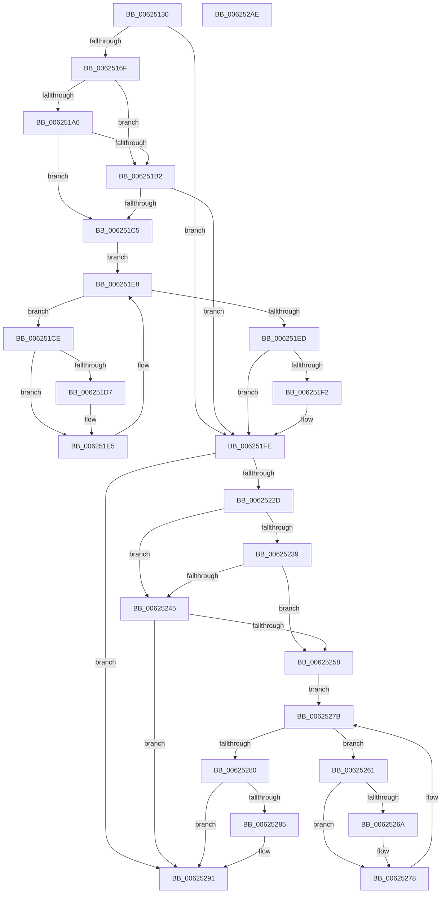

# DifIRP_MJ_DIRECTORY_CONTROLWrapper

- RVA: `0x00625130`–`0x006252AF` (길이 `383` bytes)
- VA: `0x0000000140625130`
- 실행 섹션: `.text`
- PDB 이름 있음: `예`; PDB Function 태그: `아니요`
- unwind 정보 RVA: `0x00093E28`
- 디코드: `101`개 명령, `383/383` bytes 표시
- 미해석 바이트: `0` (있으면 어셈블리에 `.byte`로 보존)

> 이 문서는 커널 이미지의 기계어와 PDB 기호를 분석해 생성했습니다. 4번과 5번은 함수 원형과 자료형을 바이너리 사용 방식에서 추정한 C 해석이며 원본 소스 복구 결과는 아닙니다.

## 1. Dependencies

- 직접 호출 지점: **8**; 고유 호출 대상: **4**
- 직접 호출자로 확인된 함수: **0**
- RIP 상대 이미지 참조: **3**

### Outgoing calls
- `0x0062515E` → [DifGetAPIThunkContextById](../49/DifGetAPIThunkContextById_function_00495A34.md) (function, `0x00495A34`)
- `0x006251B9` → [ExAcquireRundownProtection](../21/ExAcquireRundownProtection_function_00216620.md) (function, `0x00216620`)
- `0x006251E0` → [guard_dispatch_icall](../6B/guard_dispatch_icall_function_006BAAD0.md) (function, `0x006BAAD0`)
- `0x006251F9` → [ExReleaseRundownProtection](../34/ExReleaseRundownProtection_function_00349E80.md) (function, `0x00349E80`)
- `0x0062521F` → [guard_dispatch_icall](../6B/guard_dispatch_icall_function_006BAAD0.md) (function, `0x006BAAD0`)
- `0x0062524C` → [ExAcquireRundownProtection](../21/ExAcquireRundownProtection_function_00216620.md) (function, `0x00216620`)
- `0x00625273` → [guard_dispatch_icall](../6B/guard_dispatch_icall_function_006BAAD0.md) (function, `0x006BAAD0`)
- `0x0062528C` → [ExReleaseRundownProtection](../34/ExReleaseRundownProtection_function_00349E80.md) (function, `0x00349E80`)

### Direct callers
- 이 함수 시작 RVA로 연결되는 직접 call은 확인되지 않았습니다. 간접 호출은 완전히 역산할 수 없습니다.

### Static image references
- `0x00625179` → RVA `0x00F048B8` (`.data`; read)
- `0x006251A6` → RVA `0x00F04980` (`.data`; read)
- `0x006251B2` → RVA `0x00F03E80` (`.data`; read)

## 2. Other-region calls and transfers

- 다른 실행 섹션으로 향하는 call: **0**
- 별도 외부 분기/꼬리 이동을 확인하지 못했습니다.

## 3. Assembly (complete function range)

```asm
00625130  48 8B C4                        mov rax, rsp
00625133  48 89 58 08                     mov qword ptr [rax + 8], rbx
00625137  48 89 68 10                     mov qword ptr [rax + 0x10], rbp
0062513B  48 89 70 18                     mov qword ptr [rax + 0x18], rsi
0062513F  57                              push rdi
00625140  41 56                           push r14
00625142  41 57                           push r15
00625144  48 83 EC 40                     sub rsp, 0x40
00625148  0F 57 C0                        xorps xmm0, xmm0
0062514B  4C 8B F9                        mov r15, rcx
0062514E  B9 0C 00 00 10                  mov ecx, 0x1000000c
00625153  4C 8B F2                        mov r14, rdx
00625156  0F 11 40 C8                     movups xmmword ptr [rax - 0x38], xmm0
0062515A  0F 11 40 D8                     movups xmmword ptr [rax - 0x28], xmm0
0062515E  E8 D1 08 E7 FF                  call 0x140495a34
00625163  48 8B E8                        mov rbp, rax
00625166  48 85 C0                        test rax, rax
00625169  0F 84 8F 00 00 00               je 0x1406251fe
0062516F  49 8B 96 B8 00 00 00            mov rdx, qword ptr [r14 + 0xb8]
00625176  40 32 F6                        xor sil, sil
00625179  40 38 35 38 F7 8D 00            cmp byte ptr [rip + 0x8df738], sil
00625180  49 8B 4F 08                     mov rcx, qword ptr [r15 + 8]
00625184  44 0F B6 02                     movzx r8d, byte ptr [rdx]
00625188  48 8B 51 30                     mov rdx, qword ptr [rcx + 0x30]
0062518C  48 8B 4A 40                     mov rcx, qword ptr [rdx + 0x40]
00625190  4A 8B 54 C1 20                  mov rdx, qword ptr [rcx + r8*8 + 0x20]
00625195  48 89 54 24 20                  mov qword ptr [rsp + 0x20], rdx
0062519A  4C 89 7C 24 30                  mov qword ptr [rsp + 0x30], r15
0062519F  4C 89 74 24 28                  mov qword ptr [rsp + 0x28], r14
006251A4  75 0C                           jne 0x1406251b2
006251A6  F7 05 D0 F7 8D 00 00 08 00 00   test dword ptr [rip + 0x8df7d0], 0x800
006251B0  74 13                           je 0x1406251c5
006251B2  48 8D 0D C7 EC 8D 00            lea rcx, [rip + 0x8decc7]
006251B9  E8 62 14 BF FF                  call 0x140216620
006251BE  40 8A F0                        mov sil, al
006251C1  84 C0                           test al, al
006251C3  74 39                           je 0x1406251fe
006251C5  48 8D 7D 20                     lea rdi, [rbp + 0x20]
006251C9  48 8B 1F                        mov rbx, qword ptr [rdi]
006251CC  EB 1A                           jmp 0x1406251e8
006251CE  48 8D 43 F0                     lea rax, [rbx - 0x10]
006251D2  48 85 C0                        test rax, rax
006251D5  74 0E                           je 0x1406251e5
006251D7  48 8B 40 08                     mov rax, qword ptr [rax + 8]
006251DB  48 8D 4C 24 20                  lea rcx, [rsp + 0x20]
006251E0  E8 EB 58 09 00                  call 0x1406baad0
006251E5  48 8B 1B                        mov rbx, qword ptr [rbx]
006251E8  48 3B DF                        cmp rbx, rdi
006251EB  75 E1                           jne 0x1406251ce
006251ED  40 84 F6                        test sil, sil
006251F0  74 0C                           je 0x1406251fe
006251F2  48 8D 0D 87 EC 8D 00            lea rcx, [rip + 0x8dec87]
006251F9  E8 82 4C D2 FF                  call 0x140349e80
006251FE  49 8B 86 B8 00 00 00            mov rax, qword ptr [r14 + 0xb8]
00625205  0F B6 10                        movzx edx, byte ptr [rax]
00625208  49 8B 47 08                     mov rax, qword ptr [r15 + 8]
0062520C  48 8B 48 30                     mov rcx, qword ptr [rax + 0x30]
00625210  48 8B 41 40                     mov rax, qword ptr [rcx + 0x40]
00625214  49 8B CF                        mov rcx, r15
00625217  48 8B 44 D0 20                  mov rax, qword ptr [rax + rdx*8 + 0x20]
0062521C  49 8B D6                        mov rdx, r14
0062521F  E8 AC 58 09 00                  call 0x1406baad0
00625224  89 44 24 38                     mov dword ptr [rsp + 0x38], eax
00625228  48 85 ED                        test rbp, rbp
0062522B  74 64                           je 0x140625291
0062522D  40 32 FF                        xor dil, dil
00625230  40 38 3D 81 F6 8D 00            cmp byte ptr [rip + 0x8df681], dil
00625237  75 0C                           jne 0x140625245
00625239  F7 05 3D F7 8D 00 00 08 00 00   test dword ptr [rip + 0x8df73d], 0x800
00625243  74 13                           je 0x140625258
00625245  48 8D 0D 34 EC 8D 00            lea rcx, [rip + 0x8dec34]
0062524C  E8 CF 13 BF FF                  call 0x140216620
00625251  40 8A F8                        mov dil, al
00625254  84 C0                           test al, al
00625256  74 39                           je 0x140625291
00625258  48 8D 75 30                     lea rsi, [rbp + 0x30]
0062525C  48 8B 1E                        mov rbx, qword ptr [rsi]
0062525F  EB 1A                           jmp 0x14062527b
00625261  48 8D 43 F0                     lea rax, [rbx - 0x10]
00625265  48 85 C0                        test rax, rax
00625268  74 0E                           je 0x140625278
0062526A  48 8B 40 08                     mov rax, qword ptr [rax + 8]
0062526E  48 8D 4C 24 20                  lea rcx, [rsp + 0x20]
00625273  E8 58 58 09 00                  call 0x1406baad0
00625278  48 8B 1B                        mov rbx, qword ptr [rbx]
0062527B  48 3B DE                        cmp rbx, rsi
0062527E  75 E1                           jne 0x140625261
00625280  40 84 FF                        test dil, dil
00625283  74 0C                           je 0x140625291
00625285  48 8D 0D F4 EB 8D 00            lea rcx, [rip + 0x8debf4]
0062528C  E8 EF 4B D2 FF                  call 0x140349e80
00625291  8B 44 24 38                     mov eax, dword ptr [rsp + 0x38]
00625295  48 8B 5C 24 60                  mov rbx, qword ptr [rsp + 0x60]
0062529A  48 8B 6C 24 68                  mov rbp, qword ptr [rsp + 0x68]
0062529F  48 8B 74 24 70                  mov rsi, qword ptr [rsp + 0x70]
006252A4  48 83 C4 40                     add rsp, 0x40
006252A8  41 5F                           pop r15
006252AA  41 5E                           pop r14
006252AC  5F                              pop rdi
006252AD  C3                              ret
006252AE  CC                              int3
```

## 4. C-style interpretation (structured pseudocode)

```c
__int64 __fastcall DifIRP_MJ_DIRECTORY_CONTROLWrapper(__int64 a1, __int64 a2)
{
    __int64 result;
    __int64 v_rdi;
    __int64 v_rsi;
    __int64 v_rsp;
    unsigned int v_stack_m20;
    unsigned __int64 v_stack_m28;
    unsigned __int64 v_stack_m30;
    unsigned __int64 v_stack_m38;
    unsigned __int64 v_stack_p10;
    unsigned __int64 v_stack_p18;
    unsigned __int64 v_stack_p8;

    *(unsigned __int64 *)(v_rsp + 8) = v_rbx;
    *(unsigned __int64 *)(v_rsp + 16) = v_rbp;
    *(unsigned __int64 *)(v_rsp + 24) = v_rsi;
    v_rsp = (v_rsp) - (64);
    *(unsigned __int64 *)(v_rsp - 56) = v_xmm0;
    *(unsigned __int64 *)(v_rsp - 40) = v_xmm0;
    result = DifGetAPIThunkContextById((unsigned int)(0x1000000CULL), a2, a3, a4);
    if (result == 0) goto loc_006251FE;
    v_rsi = 0;
    v_stack_m38 = *(unsigned __int64 *)(*(unsigned __int64 *)(*(unsigned __int64 *)(*(unsigned __int64 *)(a1 + 8) + 48) + 64) + *(unsigned __int8 *)(*(unsigned __int64 *)(a2 + 184)) * 8 + 32);
    v_stack_m28 = a1;
    v_stack_m30 = a2;
    if ((*(unsigned __int8 *)(v_rip + 9303864)) != 0) goto loc_006251B2;
    if (((*(unsigned int *)(v_rip + 9304016)) & (0x800ULL)) == 0) goto loc_006251C5;
loc_006251B2:
    result = ExAcquireRundownProtection(v_rip + 9301191, *(unsigned __int64 *)(*(unsigned __int64 *)(*(unsigned __int64 *)(*(unsigned __int64 *)(a1 + 8) + 48) + 64) + *(unsigned __int8 *)(*(unsigned __int64 *)(a2 + 184)) * 8 + 32), *(unsigned __int8 *)(*(unsigned __int64 *)(a2 + 184)), a4);
    if ((unsigned __int8)(result) == 0) goto loc_006251FE;
loc_006251C5:
    goto loc_006251E8;
loc_006251CE:
    result = *(unsigned __int64 *)(result + 32) - 16;
    if (*(unsigned __int64 *)(result + 32) - 16 != 0) {
        result = *(unsigned __int64 *)(*(unsigned __int64 *)(result + 32) - 16 + 8);
        a1 = v_stack_m38;
        result = guard_dispatch_icall(a1, *(unsigned __int64 *)(*(unsigned __int64 *)(*(unsigned __int64 *)(*(unsigned __int64 *)(a1 + 8) + 48) + 64) + *(unsigned __int8 *)(*(unsigned __int64 *)(a2 + 184)) * 8 + 32), *(unsigned __int8 *)(*(unsigned __int64 *)(a2 + 184)), a4);
    }
loc_006251E8:
    if ((*(unsigned __int64 *)(*(unsigned __int64 *)(result + 32))) != (result + 32)) goto loc_006251CE;
    if ((unsigned __int8)((unsigned __int8)(result)) != 0) {
        a1 = v_rip + 9301127;
        result = ExReleaseRundownProtection(a1, *(unsigned __int64 *)(*(unsigned __int64 *)(*(unsigned __int64 *)(*(unsigned __int64 *)(a1 + 8) + 48) + 64) + *(unsigned __int8 *)(*(unsigned __int64 *)(a2 + 184)) * 8 + 32), *(unsigned __int8 *)(*(unsigned __int64 *)(a2 + 184)), a4);
    }
    result = guard_dispatch_icall(a1, a2, *(unsigned __int8 *)(*(unsigned __int64 *)(a2 + 184)), a4);
    v_stack_m20 = (unsigned int)(result);
    if (result == 0) goto loc_00625291;
    v_rdi = 0;
    if ((*(unsigned __int8 *)(v_rip + 9303681)) != 0) goto loc_00625245;
    if (((*(unsigned int *)(v_rip + 9303869)) & (0x800ULL)) == 0) goto loc_00625258;
loc_00625245:
    result = ExAcquireRundownProtection(v_rip + 9301044, a2, *(unsigned __int8 *)(*(unsigned __int64 *)(a2 + 184)), a4);
    if ((unsigned __int8)(result) == 0) goto loc_00625291;
loc_00625258:
    goto loc_0062527B;
loc_00625261:
    result = *(unsigned __int64 *)(result + 48) - 16;
    if (*(unsigned __int64 *)(result + 48) - 16 != 0) {
        result = *(unsigned __int64 *)(*(unsigned __int64 *)(result + 48) - 16 + 8);
        a1 = v_stack_m38;
        result = guard_dispatch_icall(a1, a2, *(unsigned __int8 *)(*(unsigned __int64 *)(a2 + 184)), a4);
    }
loc_0062527B:
    if ((*(unsigned __int64 *)(*(unsigned __int64 *)(result + 48))) != (result + 48)) goto loc_00625261;
    if ((unsigned __int8)((unsigned __int8)(result)) != 0) {
        a1 = v_rip + 9300980;
        result = ExReleaseRundownProtection(a1, a2, *(unsigned __int8 *)(*(unsigned __int64 *)(a2 + 184)), a4);
    }
    v_rsp = (v_rsp) + (64);
    return (unsigned int)(v_stack_m20);
}
```

## 5. (Beta) C Style

```c
int64_t DifIRP_MJ_DIRECTORY_CONTROLWrapper(void *Arg1, void *Arg2)
{
    uint8_t *arg1 = (uint8_t *)Arg1;
    uint8_t *arg2 = (uint8_t *)Arg2;

    int64_t result;
    int64_t local_rdi;
    int64_t local_rsi;
    int64_t local_rsp;
    uint32_t v_stack_m20;
    uint64_t v_stack_m28;
    uint64_t v_stack_m30;
    uint64_t v_stack_m38;
    uint64_t v_stack_p10;
    uint64_t v_stack_p18;
    uint64_t v_stack_p8;

    *(uint64_t *)(local_rsp + 0x8) = local_rbx;
    *(uint64_t *)(local_rsp + 0x10) = local_rbp;
    *(uint64_t *)(local_rsp + 0x18) = local_rsi;
    local_rsp = (local_rsp) - (64);
    *(uint64_t *)(local_rsp - 0x38) = v_xmm0;
    *(uint64_t *)(local_rsp - 0x28) = v_xmm0;
    result = DifGetAPIThunkContextById((uint32_t)(0x1000000CULL), Arg2, a3, a4);
    if (result == 0) goto loc_006251FE;
    local_rsi = 0;
    v_stack_m38 = *(uint64_t *)(*(uint64_t *)(*(uint64_t *)(*(uint64_t *)(arg1 + 0x8) + 0x30) + 0x40) + *(uint8_t *)(*(uint64_t *)(arg2 + 0xB8)) * 8 + 0x20);
    v_stack_m28 = Arg1;
    v_stack_m30 = Arg2;
    if ((*(uint8_t *)(v_rip + 0x8DF738)) != 0) goto loc_006251B2;
    if (((*(uint32_t *)(v_rip + 0x8DF7D0)) & (0x800ULL)) == 0) goto loc_006251C5;
loc_006251B2:
    result = ExAcquireRundownProtection(v_rip + 9301191, *(uint64_t *)(*(uint64_t *)(*(uint64_t *)(*(uint64_t *)(arg1 + 0x8) + 0x30) + 0x40) + *(uint8_t *)(*(uint64_t *)(arg2 + 0xB8)) * 8 + 0x20), *(uint8_t *)(*(uint64_t *)(arg2 + 0xB8)), a4);
    if ((uint8_t)(result) == 0) goto loc_006251FE;
loc_006251C5:
    goto loc_006251E8;
loc_006251CE:
    result = *(uint64_t *)(result + 0x20) - 16;
    if (*(uint64_t *)(result + 0x20) - 16 != 0) {
        result = *(uint64_t *)(*(uint64_t *)(result + 0x20) - 0x10 + 0x8);
        Arg1 = v_stack_m38;
        result = guard_dispatch_icall(Arg1, *(uint64_t *)(*(uint64_t *)(*(uint64_t *)(*(uint64_t *)(arg1 + 0x8) + 0x30) + 0x40) + *(uint8_t *)(*(uint64_t *)(arg2 + 0xB8)) * 8 + 0x20), *(uint8_t *)(*(uint64_t *)(arg2 + 0xB8)), a4);
    }
loc_006251E8:
    if ((*(uint64_t *)(*(uint64_t *)(result + 0x20))) != (result + 32)) goto loc_006251CE;
    if ((uint8_t)((uint8_t)(result)) != 0) {
        Arg1 = v_rip + 9301127;
        result = ExReleaseRundownProtection(Arg1, *(uint64_t *)(*(uint64_t *)(*(uint64_t *)(*(uint64_t *)(arg1 + 0x8) + 0x30) + 0x40) + *(uint8_t *)(*(uint64_t *)(arg2 + 0xB8)) * 8 + 0x20), *(uint8_t *)(*(uint64_t *)(arg2 + 0xB8)), a4);
    }
    result = guard_dispatch_icall(Arg1, Arg2, *(uint8_t *)(*(uint64_t *)(arg2 + 0xB8)), a4);
    v_stack_m20 = (uint32_t)(result);
    if (result == 0) goto loc_00625291;
    local_rdi = 0;
    if ((*(uint8_t *)(v_rip + 0x8DF681)) != 0) goto loc_00625245;
    if (((*(uint32_t *)(v_rip + 0x8DF73D)) & (0x800ULL)) == 0) goto loc_00625258;
loc_00625245:
    result = ExAcquireRundownProtection(v_rip + 9301044, Arg2, *(uint8_t *)(*(uint64_t *)(arg2 + 0xB8)), a4);
    if ((uint8_t)(result) == 0) goto loc_00625291;
loc_00625258:
    goto loc_0062527B;
loc_00625261:
    result = *(uint64_t *)(result + 0x30) - 16;
    if (*(uint64_t *)(result + 0x30) - 16 != 0) {
        result = *(uint64_t *)(*(uint64_t *)(result + 0x30) - 0x10 + 0x8);
        Arg1 = v_stack_m38;
        result = guard_dispatch_icall(Arg1, Arg2, *(uint8_t *)(*(uint64_t *)(arg2 + 0xB8)), a4);
    }
loc_0062527B:
    if ((*(uint64_t *)(*(uint64_t *)(result + 0x30))) != (result + 48)) goto loc_00625261;
    if ((uint8_t)((uint8_t)(result)) != 0) {
        Arg1 = v_rip + 9300980;
        result = ExReleaseRundownProtection(Arg1, Arg2, *(uint8_t *)(*(uint64_t *)(arg2 + 0xB8)), a4);
    }
    local_rsp = (local_rsp) + (64);
    return (uint32_t)(v_stack_m20);
}
```

### 관측된 메모리 오프셋

구조체 형식이 확인되지 않은 접근은 인자 기준의 오프셋으로만 기록했습니다.

| 기준 인자 | 오프셋 표현 | 폭 (bit) | 접근 |
|---|---:|---:|---|
| `Arg1` | `+ 0x8` | `64` | `R` |
| `Arg2` | `+ 0xB8` | `64` | `R` |

## 6. Execution-region graph

[열기: 2D/3D 그래프와 함수 탐색 컨트롤 패널](../../../control-panel.html?section=text&rva=0x00625130&view=graph)

- 2D 그래프는 위에서 아래로 흐르고, 3D 그래프는 빈 공간을 드래그해 회전합니다. Shift+드래그는 이동, 휠은 확대·축소, 함수 노드 선택은 대상 보고서 이동입니다.

### Static fallback


