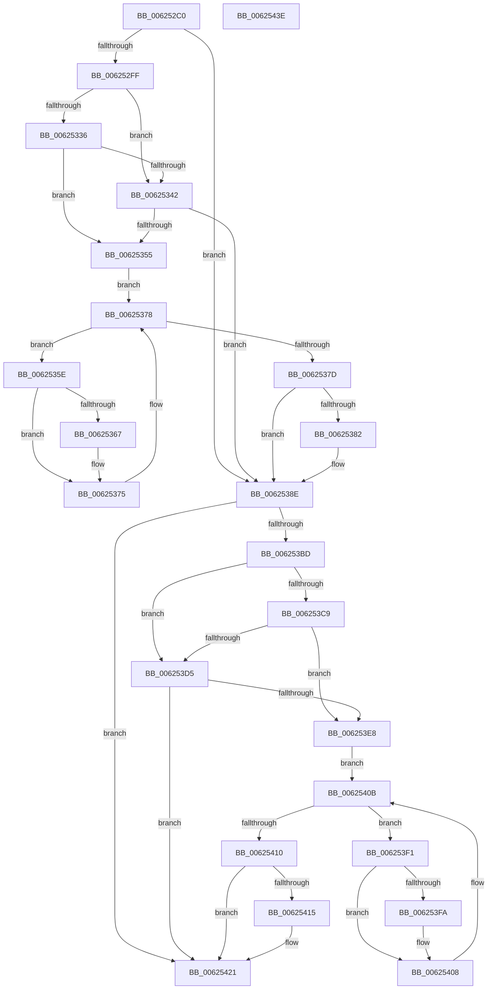

# DifIRP_MJ_FILE_SYSTEM_CONTROLWrapper

- RVA: `0x006252C0`–`0x0062543F` (길이 `383` bytes)
- VA: `0x00000001406252C0`
- 실행 섹션: `.text`
- PDB 이름 있음: `예`; PDB Function 태그: `아니요`
- unwind 정보 RVA: `0x00093E28`
- 디코드: `101`개 명령, `383/383` bytes 표시
- 미해석 바이트: `0` (있으면 어셈블리에 `.byte`로 보존)

> 이 문서는 커널 이미지의 기계어와 PDB 기호를 분석해 생성했습니다. 4번과 5번은 함수 원형과 자료형을 바이너리 사용 방식에서 추정한 C 해석이며 원본 소스 복구 결과는 아닙니다.

## 1. Dependencies

- 직접 호출 지점: **8**; 고유 호출 대상: **4**
- 직접 호출자로 확인된 함수: **0**
- RIP 상대 이미지 참조: **3**

### Outgoing calls
- `0x006252EE` → [DifGetAPIThunkContextById](../49/DifGetAPIThunkContextById_function_00495A34.md) (function, `0x00495A34`)
- `0x00625349` → [ExAcquireRundownProtection](../21/ExAcquireRundownProtection_function_00216620.md) (function, `0x00216620`)
- `0x00625370` → [guard_dispatch_icall](../6B/guard_dispatch_icall_function_006BAAD0.md) (function, `0x006BAAD0`)
- `0x00625389` → [ExReleaseRundownProtection](../34/ExReleaseRundownProtection_function_00349E80.md) (function, `0x00349E80`)
- `0x006253AF` → [guard_dispatch_icall](../6B/guard_dispatch_icall_function_006BAAD0.md) (function, `0x006BAAD0`)
- `0x006253DC` → [ExAcquireRundownProtection](../21/ExAcquireRundownProtection_function_00216620.md) (function, `0x00216620`)
- `0x00625403` → [guard_dispatch_icall](../6B/guard_dispatch_icall_function_006BAAD0.md) (function, `0x006BAAD0`)
- `0x0062541C` → [ExReleaseRundownProtection](../34/ExReleaseRundownProtection_function_00349E80.md) (function, `0x00349E80`)

### Direct callers
- 이 함수 시작 RVA로 연결되는 직접 call은 확인되지 않았습니다. 간접 호출은 완전히 역산할 수 없습니다.

### Static image references
- `0x00625309` → RVA `0x00F048B8` (`.data`; read)
- `0x00625336` → RVA `0x00F04980` (`.data`; read)
- `0x00625342` → RVA `0x00F03E80` (`.data`; read)

## 2. Other-region calls and transfers

- 다른 실행 섹션으로 향하는 call: **0**
- 별도 외부 분기/꼬리 이동을 확인하지 못했습니다.

## 3. Assembly (complete function range)

```asm
006252C0  48 8B C4                        mov rax, rsp
006252C3  48 89 58 08                     mov qword ptr [rax + 8], rbx
006252C7  48 89 68 10                     mov qword ptr [rax + 0x10], rbp
006252CB  48 89 70 18                     mov qword ptr [rax + 0x18], rsi
006252CF  57                              push rdi
006252D0  41 56                           push r14
006252D2  41 57                           push r15
006252D4  48 83 EC 40                     sub rsp, 0x40
006252D8  0F 57 C0                        xorps xmm0, xmm0
006252DB  4C 8B F9                        mov r15, rcx
006252DE  B9 0D 00 00 10                  mov ecx, 0x1000000d
006252E3  4C 8B F2                        mov r14, rdx
006252E6  0F 11 40 C8                     movups xmmword ptr [rax - 0x38], xmm0
006252EA  0F 11 40 D8                     movups xmmword ptr [rax - 0x28], xmm0
006252EE  E8 41 07 E7 FF                  call 0x140495a34
006252F3  48 8B E8                        mov rbp, rax
006252F6  48 85 C0                        test rax, rax
006252F9  0F 84 8F 00 00 00               je 0x14062538e
006252FF  49 8B 96 B8 00 00 00            mov rdx, qword ptr [r14 + 0xb8]
00625306  40 32 F6                        xor sil, sil
00625309  40 38 35 A8 F5 8D 00            cmp byte ptr [rip + 0x8df5a8], sil
00625310  49 8B 4F 08                     mov rcx, qword ptr [r15 + 8]
00625314  44 0F B6 02                     movzx r8d, byte ptr [rdx]
00625318  48 8B 51 30                     mov rdx, qword ptr [rcx + 0x30]
0062531C  48 8B 4A 40                     mov rcx, qword ptr [rdx + 0x40]
00625320  4A 8B 54 C1 20                  mov rdx, qword ptr [rcx + r8*8 + 0x20]
00625325  48 89 54 24 20                  mov qword ptr [rsp + 0x20], rdx
0062532A  4C 89 7C 24 30                  mov qword ptr [rsp + 0x30], r15
0062532F  4C 89 74 24 28                  mov qword ptr [rsp + 0x28], r14
00625334  75 0C                           jne 0x140625342
00625336  F7 05 40 F6 8D 00 00 08 00 00   test dword ptr [rip + 0x8df640], 0x800
00625340  74 13                           je 0x140625355
00625342  48 8D 0D 37 EB 8D 00            lea rcx, [rip + 0x8deb37]
00625349  E8 D2 12 BF FF                  call 0x140216620
0062534E  40 8A F0                        mov sil, al
00625351  84 C0                           test al, al
00625353  74 39                           je 0x14062538e
00625355  48 8D 7D 20                     lea rdi, [rbp + 0x20]
00625359  48 8B 1F                        mov rbx, qword ptr [rdi]
0062535C  EB 1A                           jmp 0x140625378
0062535E  48 8D 43 F0                     lea rax, [rbx - 0x10]
00625362  48 85 C0                        test rax, rax
00625365  74 0E                           je 0x140625375
00625367  48 8B 40 08                     mov rax, qword ptr [rax + 8]
0062536B  48 8D 4C 24 20                  lea rcx, [rsp + 0x20]
00625370  E8 5B 57 09 00                  call 0x1406baad0
00625375  48 8B 1B                        mov rbx, qword ptr [rbx]
00625378  48 3B DF                        cmp rbx, rdi
0062537B  75 E1                           jne 0x14062535e
0062537D  40 84 F6                        test sil, sil
00625380  74 0C                           je 0x14062538e
00625382  48 8D 0D F7 EA 8D 00            lea rcx, [rip + 0x8deaf7]
00625389  E8 F2 4A D2 FF                  call 0x140349e80
0062538E  49 8B 86 B8 00 00 00            mov rax, qword ptr [r14 + 0xb8]
00625395  0F B6 10                        movzx edx, byte ptr [rax]
00625398  49 8B 47 08                     mov rax, qword ptr [r15 + 8]
0062539C  48 8B 48 30                     mov rcx, qword ptr [rax + 0x30]
006253A0  48 8B 41 40                     mov rax, qword ptr [rcx + 0x40]
006253A4  49 8B CF                        mov rcx, r15
006253A7  48 8B 44 D0 20                  mov rax, qword ptr [rax + rdx*8 + 0x20]
006253AC  49 8B D6                        mov rdx, r14
006253AF  E8 1C 57 09 00                  call 0x1406baad0
006253B4  89 44 24 38                     mov dword ptr [rsp + 0x38], eax
006253B8  48 85 ED                        test rbp, rbp
006253BB  74 64                           je 0x140625421
006253BD  40 32 FF                        xor dil, dil
006253C0  40 38 3D F1 F4 8D 00            cmp byte ptr [rip + 0x8df4f1], dil
006253C7  75 0C                           jne 0x1406253d5
006253C9  F7 05 AD F5 8D 00 00 08 00 00   test dword ptr [rip + 0x8df5ad], 0x800
006253D3  74 13                           je 0x1406253e8
006253D5  48 8D 0D A4 EA 8D 00            lea rcx, [rip + 0x8deaa4]
006253DC  E8 3F 12 BF FF                  call 0x140216620
006253E1  40 8A F8                        mov dil, al
006253E4  84 C0                           test al, al
006253E6  74 39                           je 0x140625421
006253E8  48 8D 75 30                     lea rsi, [rbp + 0x30]
006253EC  48 8B 1E                        mov rbx, qword ptr [rsi]
006253EF  EB 1A                           jmp 0x14062540b
006253F1  48 8D 43 F0                     lea rax, [rbx - 0x10]
006253F5  48 85 C0                        test rax, rax
006253F8  74 0E                           je 0x140625408
006253FA  48 8B 40 08                     mov rax, qword ptr [rax + 8]
006253FE  48 8D 4C 24 20                  lea rcx, [rsp + 0x20]
00625403  E8 C8 56 09 00                  call 0x1406baad0
00625408  48 8B 1B                        mov rbx, qword ptr [rbx]
0062540B  48 3B DE                        cmp rbx, rsi
0062540E  75 E1                           jne 0x1406253f1
00625410  40 84 FF                        test dil, dil
00625413  74 0C                           je 0x140625421
00625415  48 8D 0D 64 EA 8D 00            lea rcx, [rip + 0x8dea64]
0062541C  E8 5F 4A D2 FF                  call 0x140349e80
00625421  8B 44 24 38                     mov eax, dword ptr [rsp + 0x38]
00625425  48 8B 5C 24 60                  mov rbx, qword ptr [rsp + 0x60]
0062542A  48 8B 6C 24 68                  mov rbp, qword ptr [rsp + 0x68]
0062542F  48 8B 74 24 70                  mov rsi, qword ptr [rsp + 0x70]
00625434  48 83 C4 40                     add rsp, 0x40
00625438  41 5F                           pop r15
0062543A  41 5E                           pop r14
0062543C  5F                              pop rdi
0062543D  C3                              ret
0062543E  CC                              int3
```

## 4. C-style interpretation (structured pseudocode)

```c
__int64 __fastcall DifIRP_MJ_FILE_SYSTEM_CONTROLWrapper(__int64 a1, __int64 a2)
{
    __int64 result;
    __int64 v_rdi;
    __int64 v_rsi;
    __int64 v_rsp;
    unsigned int v_stack_m20;
    unsigned __int64 v_stack_m28;
    unsigned __int64 v_stack_m30;
    unsigned __int64 v_stack_m38;
    unsigned __int64 v_stack_p10;
    unsigned __int64 v_stack_p18;
    unsigned __int64 v_stack_p8;

    *(unsigned __int64 *)(v_rsp + 8) = v_rbx;
    *(unsigned __int64 *)(v_rsp + 16) = v_rbp;
    *(unsigned __int64 *)(v_rsp + 24) = v_rsi;
    v_rsp = (v_rsp) - (64);
    *(unsigned __int64 *)(v_rsp - 56) = v_xmm0;
    *(unsigned __int64 *)(v_rsp - 40) = v_xmm0;
    result = DifGetAPIThunkContextById((unsigned int)(0x1000000DULL), a2, a3, a4);
    if (result == 0) goto loc_0062538E;
    v_rsi = 0;
    v_stack_m38 = *(unsigned __int64 *)(*(unsigned __int64 *)(*(unsigned __int64 *)(*(unsigned __int64 *)(a1 + 8) + 48) + 64) + *(unsigned __int8 *)(*(unsigned __int64 *)(a2 + 184)) * 8 + 32);
    v_stack_m28 = a1;
    v_stack_m30 = a2;
    if ((*(unsigned __int8 *)(v_rip + 9303464)) != 0) goto loc_00625342;
    if (((*(unsigned int *)(v_rip + 9303616)) & (0x800ULL)) == 0) goto loc_00625355;
loc_00625342:
    result = ExAcquireRundownProtection(v_rip + 9300791, *(unsigned __int64 *)(*(unsigned __int64 *)(*(unsigned __int64 *)(*(unsigned __int64 *)(a1 + 8) + 48) + 64) + *(unsigned __int8 *)(*(unsigned __int64 *)(a2 + 184)) * 8 + 32), *(unsigned __int8 *)(*(unsigned __int64 *)(a2 + 184)), a4);
    if ((unsigned __int8)(result) == 0) goto loc_0062538E;
loc_00625355:
    goto loc_00625378;
loc_0062535E:
    result = *(unsigned __int64 *)(result + 32) - 16;
    if (*(unsigned __int64 *)(result + 32) - 16 != 0) {
        result = *(unsigned __int64 *)(*(unsigned __int64 *)(result + 32) - 16 + 8);
        a1 = v_stack_m38;
        result = guard_dispatch_icall(a1, *(unsigned __int64 *)(*(unsigned __int64 *)(*(unsigned __int64 *)(*(unsigned __int64 *)(a1 + 8) + 48) + 64) + *(unsigned __int8 *)(*(unsigned __int64 *)(a2 + 184)) * 8 + 32), *(unsigned __int8 *)(*(unsigned __int64 *)(a2 + 184)), a4);
    }
loc_00625378:
    if ((*(unsigned __int64 *)(*(unsigned __int64 *)(result + 32))) != (result + 32)) goto loc_0062535E;
    if ((unsigned __int8)((unsigned __int8)(result)) != 0) {
        a1 = v_rip + 9300727;
        result = ExReleaseRundownProtection(a1, *(unsigned __int64 *)(*(unsigned __int64 *)(*(unsigned __int64 *)(*(unsigned __int64 *)(a1 + 8) + 48) + 64) + *(unsigned __int8 *)(*(unsigned __int64 *)(a2 + 184)) * 8 + 32), *(unsigned __int8 *)(*(unsigned __int64 *)(a2 + 184)), a4);
    }
    result = guard_dispatch_icall(a1, a2, *(unsigned __int8 *)(*(unsigned __int64 *)(a2 + 184)), a4);
    v_stack_m20 = (unsigned int)(result);
    if (result == 0) goto loc_00625421;
    v_rdi = 0;
    if ((*(unsigned __int8 *)(v_rip + 9303281)) != 0) goto loc_006253D5;
    if (((*(unsigned int *)(v_rip + 9303469)) & (0x800ULL)) == 0) goto loc_006253E8;
loc_006253D5:
    result = ExAcquireRundownProtection(v_rip + 9300644, a2, *(unsigned __int8 *)(*(unsigned __int64 *)(a2 + 184)), a4);
    if ((unsigned __int8)(result) == 0) goto loc_00625421;
loc_006253E8:
    goto loc_0062540B;
loc_006253F1:
    result = *(unsigned __int64 *)(result + 48) - 16;
    if (*(unsigned __int64 *)(result + 48) - 16 != 0) {
        result = *(unsigned __int64 *)(*(unsigned __int64 *)(result + 48) - 16 + 8);
        a1 = v_stack_m38;
        result = guard_dispatch_icall(a1, a2, *(unsigned __int8 *)(*(unsigned __int64 *)(a2 + 184)), a4);
    }
loc_0062540B:
    if ((*(unsigned __int64 *)(*(unsigned __int64 *)(result + 48))) != (result + 48)) goto loc_006253F1;
    if ((unsigned __int8)((unsigned __int8)(result)) != 0) {
        a1 = v_rip + 9300580;
        result = ExReleaseRundownProtection(a1, a2, *(unsigned __int8 *)(*(unsigned __int64 *)(a2 + 184)), a4);
    }
    v_rsp = (v_rsp) + (64);
    return (unsigned int)(v_stack_m20);
}
```

## 5. (Beta) C Style

```c
int64_t DifIRP_MJ_FILE_SYSTEM_CONTROLWrapper(void *Arg1, void *Arg2)
{
    uint8_t *arg1 = (uint8_t *)Arg1;
    uint8_t *arg2 = (uint8_t *)Arg2;

    int64_t result;
    int64_t local_rdi;
    int64_t local_rsi;
    int64_t local_rsp;
    uint32_t v_stack_m20;
    uint64_t v_stack_m28;
    uint64_t v_stack_m30;
    uint64_t v_stack_m38;
    uint64_t v_stack_p10;
    uint64_t v_stack_p18;
    uint64_t v_stack_p8;

    *(uint64_t *)(local_rsp + 0x8) = local_rbx;
    *(uint64_t *)(local_rsp + 0x10) = local_rbp;
    *(uint64_t *)(local_rsp + 0x18) = local_rsi;
    local_rsp = (local_rsp) - (64);
    *(uint64_t *)(local_rsp - 0x38) = v_xmm0;
    *(uint64_t *)(local_rsp - 0x28) = v_xmm0;
    result = DifGetAPIThunkContextById((uint32_t)(0x1000000DULL), Arg2, a3, a4);
    if (result == 0) goto loc_0062538E;
    local_rsi = 0;
    v_stack_m38 = *(uint64_t *)(*(uint64_t *)(*(uint64_t *)(*(uint64_t *)(arg1 + 0x8) + 0x30) + 0x40) + *(uint8_t *)(*(uint64_t *)(arg2 + 0xB8)) * 8 + 0x20);
    v_stack_m28 = Arg1;
    v_stack_m30 = Arg2;
    if ((*(uint8_t *)(v_rip + 0x8DF5A8)) != 0) goto loc_00625342;
    if (((*(uint32_t *)(v_rip + 0x8DF640)) & (0x800ULL)) == 0) goto loc_00625355;
loc_00625342:
    result = ExAcquireRundownProtection(v_rip + 9300791, *(uint64_t *)(*(uint64_t *)(*(uint64_t *)(*(uint64_t *)(arg1 + 0x8) + 0x30) + 0x40) + *(uint8_t *)(*(uint64_t *)(arg2 + 0xB8)) * 8 + 0x20), *(uint8_t *)(*(uint64_t *)(arg2 + 0xB8)), a4);
    if ((uint8_t)(result) == 0) goto loc_0062538E;
loc_00625355:
    goto loc_00625378;
loc_0062535E:
    result = *(uint64_t *)(result + 0x20) - 16;
    if (*(uint64_t *)(result + 0x20) - 16 != 0) {
        result = *(uint64_t *)(*(uint64_t *)(result + 0x20) - 0x10 + 0x8);
        Arg1 = v_stack_m38;
        result = guard_dispatch_icall(Arg1, *(uint64_t *)(*(uint64_t *)(*(uint64_t *)(*(uint64_t *)(arg1 + 0x8) + 0x30) + 0x40) + *(uint8_t *)(*(uint64_t *)(arg2 + 0xB8)) * 8 + 0x20), *(uint8_t *)(*(uint64_t *)(arg2 + 0xB8)), a4);
    }
loc_00625378:
    if ((*(uint64_t *)(*(uint64_t *)(result + 0x20))) != (result + 32)) goto loc_0062535E;
    if ((uint8_t)((uint8_t)(result)) != 0) {
        Arg1 = v_rip + 9300727;
        result = ExReleaseRundownProtection(Arg1, *(uint64_t *)(*(uint64_t *)(*(uint64_t *)(*(uint64_t *)(arg1 + 0x8) + 0x30) + 0x40) + *(uint8_t *)(*(uint64_t *)(arg2 + 0xB8)) * 8 + 0x20), *(uint8_t *)(*(uint64_t *)(arg2 + 0xB8)), a4);
    }
    result = guard_dispatch_icall(Arg1, Arg2, *(uint8_t *)(*(uint64_t *)(arg2 + 0xB8)), a4);
    v_stack_m20 = (uint32_t)(result);
    if (result == 0) goto loc_00625421;
    local_rdi = 0;
    if ((*(uint8_t *)(v_rip + 0x8DF4F1)) != 0) goto loc_006253D5;
    if (((*(uint32_t *)(v_rip + 0x8DF5AD)) & (0x800ULL)) == 0) goto loc_006253E8;
loc_006253D5:
    result = ExAcquireRundownProtection(v_rip + 9300644, Arg2, *(uint8_t *)(*(uint64_t *)(arg2 + 0xB8)), a4);
    if ((uint8_t)(result) == 0) goto loc_00625421;
loc_006253E8:
    goto loc_0062540B;
loc_006253F1:
    result = *(uint64_t *)(result + 0x30) - 16;
    if (*(uint64_t *)(result + 0x30) - 16 != 0) {
        result = *(uint64_t *)(*(uint64_t *)(result + 0x30) - 0x10 + 0x8);
        Arg1 = v_stack_m38;
        result = guard_dispatch_icall(Arg1, Arg2, *(uint8_t *)(*(uint64_t *)(arg2 + 0xB8)), a4);
    }
loc_0062540B:
    if ((*(uint64_t *)(*(uint64_t *)(result + 0x30))) != (result + 48)) goto loc_006253F1;
    if ((uint8_t)((uint8_t)(result)) != 0) {
        Arg1 = v_rip + 9300580;
        result = ExReleaseRundownProtection(Arg1, Arg2, *(uint8_t *)(*(uint64_t *)(arg2 + 0xB8)), a4);
    }
    local_rsp = (local_rsp) + (64);
    return (uint32_t)(v_stack_m20);
}
```

### 관측된 메모리 오프셋

구조체 형식이 확인되지 않은 접근은 인자 기준의 오프셋으로만 기록했습니다.

| 기준 인자 | 오프셋 표현 | 폭 (bit) | 접근 |
|---|---:|---:|---|
| `Arg1` | `+ 0x8` | `64` | `R` |
| `Arg2` | `+ 0xB8` | `64` | `R` |

## 6. Execution-region graph

[열기: 2D/3D 그래프와 함수 탐색 컨트롤 패널](../../../control-panel.html?section=text&rva=0x006252C0&view=graph)

- 2D 그래프는 위에서 아래로 흐르고, 3D 그래프는 빈 공간을 드래그해 회전합니다. Shift+드래그는 이동, 휠은 확대·축소, 함수 노드 선택은 대상 보고서 이동입니다.

### Static fallback


