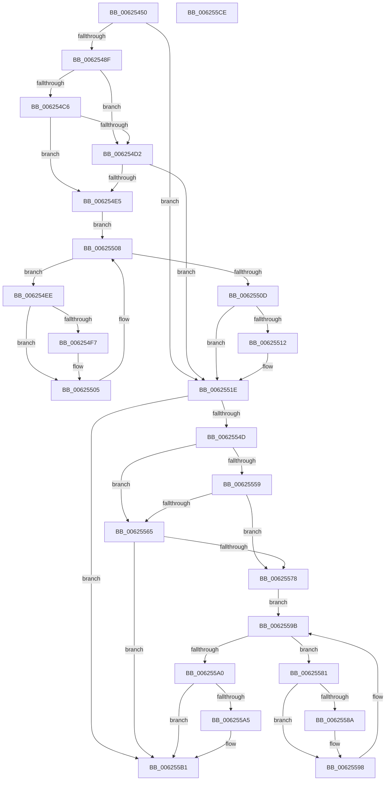

# DifIRP_MJ_FLUSH_BUFFERSWrapper

- RVA: `0x00625450`–`0x006255CF` (길이 `383` bytes)
- VA: `0x0000000140625450`
- 실행 섹션: `.text`
- PDB 이름 있음: `예`; PDB Function 태그: `아니요`
- unwind 정보 RVA: `0x00093E28`
- 디코드: `101`개 명령, `383/383` bytes 표시
- 미해석 바이트: `0` (있으면 어셈블리에 `.byte`로 보존)

> 이 문서는 커널 이미지의 기계어와 PDB 기호를 분석해 생성했습니다. 4번과 5번은 함수 원형과 자료형을 바이너리 사용 방식에서 추정한 C 해석이며 원본 소스 복구 결과는 아닙니다.

## 1. Dependencies

- 직접 호출 지점: **8**; 고유 호출 대상: **4**
- 직접 호출자로 확인된 함수: **0**
- RIP 상대 이미지 참조: **3**

### Outgoing calls
- `0x0062547E` → [DifGetAPIThunkContextById](../49/DifGetAPIThunkContextById_function_00495A34.md) (function, `0x00495A34`)
- `0x006254D9` → [ExAcquireRundownProtection](../21/ExAcquireRundownProtection_function_00216620.md) (function, `0x00216620`)
- `0x00625500` → [guard_dispatch_icall](../6B/guard_dispatch_icall_function_006BAAD0.md) (function, `0x006BAAD0`)
- `0x00625519` → [ExReleaseRundownProtection](../34/ExReleaseRundownProtection_function_00349E80.md) (function, `0x00349E80`)
- `0x0062553F` → [guard_dispatch_icall](../6B/guard_dispatch_icall_function_006BAAD0.md) (function, `0x006BAAD0`)
- `0x0062556C` → [ExAcquireRundownProtection](../21/ExAcquireRundownProtection_function_00216620.md) (function, `0x00216620`)
- `0x00625593` → [guard_dispatch_icall](../6B/guard_dispatch_icall_function_006BAAD0.md) (function, `0x006BAAD0`)
- `0x006255AC` → [ExReleaseRundownProtection](../34/ExReleaseRundownProtection_function_00349E80.md) (function, `0x00349E80`)

### Direct callers
- 이 함수 시작 RVA로 연결되는 직접 call은 확인되지 않았습니다. 간접 호출은 완전히 역산할 수 없습니다.

### Static image references
- `0x00625499` → RVA `0x00F048B8` (`.data`; read)
- `0x006254C6` → RVA `0x00F04980` (`.data`; read)
- `0x006254D2` → RVA `0x00F03E80` (`.data`; read)

## 2. Other-region calls and transfers

- 다른 실행 섹션으로 향하는 call: **0**
- 별도 외부 분기/꼬리 이동을 확인하지 못했습니다.

## 3. Assembly (complete function range)

```asm
00625450  48 8B C4                        mov rax, rsp
00625453  48 89 58 08                     mov qword ptr [rax + 8], rbx
00625457  48 89 68 10                     mov qword ptr [rax + 0x10], rbp
0062545B  48 89 70 18                     mov qword ptr [rax + 0x18], rsi
0062545F  57                              push rdi
00625460  41 56                           push r14
00625462  41 57                           push r15
00625464  48 83 EC 40                     sub rsp, 0x40
00625468  0F 57 C0                        xorps xmm0, xmm0
0062546B  4C 8B F9                        mov r15, rcx
0062546E  B9 09 00 00 10                  mov ecx, 0x10000009
00625473  4C 8B F2                        mov r14, rdx
00625476  0F 11 40 C8                     movups xmmword ptr [rax - 0x38], xmm0
0062547A  0F 11 40 D8                     movups xmmword ptr [rax - 0x28], xmm0
0062547E  E8 B1 05 E7 FF                  call 0x140495a34
00625483  48 8B E8                        mov rbp, rax
00625486  48 85 C0                        test rax, rax
00625489  0F 84 8F 00 00 00               je 0x14062551e
0062548F  49 8B 96 B8 00 00 00            mov rdx, qword ptr [r14 + 0xb8]
00625496  40 32 F6                        xor sil, sil
00625499  40 38 35 18 F4 8D 00            cmp byte ptr [rip + 0x8df418], sil
006254A0  49 8B 4F 08                     mov rcx, qword ptr [r15 + 8]
006254A4  44 0F B6 02                     movzx r8d, byte ptr [rdx]
006254A8  48 8B 51 30                     mov rdx, qword ptr [rcx + 0x30]
006254AC  48 8B 4A 40                     mov rcx, qword ptr [rdx + 0x40]
006254B0  4A 8B 54 C1 20                  mov rdx, qword ptr [rcx + r8*8 + 0x20]
006254B5  48 89 54 24 20                  mov qword ptr [rsp + 0x20], rdx
006254BA  4C 89 7C 24 30                  mov qword ptr [rsp + 0x30], r15
006254BF  4C 89 74 24 28                  mov qword ptr [rsp + 0x28], r14
006254C4  75 0C                           jne 0x1406254d2
006254C6  F7 05 B0 F4 8D 00 00 08 00 00   test dword ptr [rip + 0x8df4b0], 0x800
006254D0  74 13                           je 0x1406254e5
006254D2  48 8D 0D A7 E9 8D 00            lea rcx, [rip + 0x8de9a7]
006254D9  E8 42 11 BF FF                  call 0x140216620
006254DE  40 8A F0                        mov sil, al
006254E1  84 C0                           test al, al
006254E3  74 39                           je 0x14062551e
006254E5  48 8D 7D 20                     lea rdi, [rbp + 0x20]
006254E9  48 8B 1F                        mov rbx, qword ptr [rdi]
006254EC  EB 1A                           jmp 0x140625508
006254EE  48 8D 43 F0                     lea rax, [rbx - 0x10]
006254F2  48 85 C0                        test rax, rax
006254F5  74 0E                           je 0x140625505
006254F7  48 8B 40 08                     mov rax, qword ptr [rax + 8]
006254FB  48 8D 4C 24 20                  lea rcx, [rsp + 0x20]
00625500  E8 CB 55 09 00                  call 0x1406baad0
00625505  48 8B 1B                        mov rbx, qword ptr [rbx]
00625508  48 3B DF                        cmp rbx, rdi
0062550B  75 E1                           jne 0x1406254ee
0062550D  40 84 F6                        test sil, sil
00625510  74 0C                           je 0x14062551e
00625512  48 8D 0D 67 E9 8D 00            lea rcx, [rip + 0x8de967]
00625519  E8 62 49 D2 FF                  call 0x140349e80
0062551E  49 8B 86 B8 00 00 00            mov rax, qword ptr [r14 + 0xb8]
00625525  0F B6 10                        movzx edx, byte ptr [rax]
00625528  49 8B 47 08                     mov rax, qword ptr [r15 + 8]
0062552C  48 8B 48 30                     mov rcx, qword ptr [rax + 0x30]
00625530  48 8B 41 40                     mov rax, qword ptr [rcx + 0x40]
00625534  49 8B CF                        mov rcx, r15
00625537  48 8B 44 D0 20                  mov rax, qword ptr [rax + rdx*8 + 0x20]
0062553C  49 8B D6                        mov rdx, r14
0062553F  E8 8C 55 09 00                  call 0x1406baad0
00625544  89 44 24 38                     mov dword ptr [rsp + 0x38], eax
00625548  48 85 ED                        test rbp, rbp
0062554B  74 64                           je 0x1406255b1
0062554D  40 32 FF                        xor dil, dil
00625550  40 38 3D 61 F3 8D 00            cmp byte ptr [rip + 0x8df361], dil
00625557  75 0C                           jne 0x140625565
00625559  F7 05 1D F4 8D 00 00 08 00 00   test dword ptr [rip + 0x8df41d], 0x800
00625563  74 13                           je 0x140625578
00625565  48 8D 0D 14 E9 8D 00            lea rcx, [rip + 0x8de914]
0062556C  E8 AF 10 BF FF                  call 0x140216620
00625571  40 8A F8                        mov dil, al
00625574  84 C0                           test al, al
00625576  74 39                           je 0x1406255b1
00625578  48 8D 75 30                     lea rsi, [rbp + 0x30]
0062557C  48 8B 1E                        mov rbx, qword ptr [rsi]
0062557F  EB 1A                           jmp 0x14062559b
00625581  48 8D 43 F0                     lea rax, [rbx - 0x10]
00625585  48 85 C0                        test rax, rax
00625588  74 0E                           je 0x140625598
0062558A  48 8B 40 08                     mov rax, qword ptr [rax + 8]
0062558E  48 8D 4C 24 20                  lea rcx, [rsp + 0x20]
00625593  E8 38 55 09 00                  call 0x1406baad0
00625598  48 8B 1B                        mov rbx, qword ptr [rbx]
0062559B  48 3B DE                        cmp rbx, rsi
0062559E  75 E1                           jne 0x140625581
006255A0  40 84 FF                        test dil, dil
006255A3  74 0C                           je 0x1406255b1
006255A5  48 8D 0D D4 E8 8D 00            lea rcx, [rip + 0x8de8d4]
006255AC  E8 CF 48 D2 FF                  call 0x140349e80
006255B1  8B 44 24 38                     mov eax, dword ptr [rsp + 0x38]
006255B5  48 8B 5C 24 60                  mov rbx, qword ptr [rsp + 0x60]
006255BA  48 8B 6C 24 68                  mov rbp, qword ptr [rsp + 0x68]
006255BF  48 8B 74 24 70                  mov rsi, qword ptr [rsp + 0x70]
006255C4  48 83 C4 40                     add rsp, 0x40
006255C8  41 5F                           pop r15
006255CA  41 5E                           pop r14
006255CC  5F                              pop rdi
006255CD  C3                              ret
006255CE  CC                              int3
```

## 4. C-style interpretation (structured pseudocode)

```c
__int64 __fastcall DifIRP_MJ_FLUSH_BUFFERSWrapper(__int64 a1, __int64 a2)
{
    __int64 result;
    __int64 v_rdi;
    __int64 v_rsi;
    __int64 v_rsp;
    unsigned int v_stack_m20;
    unsigned __int64 v_stack_m28;
    unsigned __int64 v_stack_m30;
    unsigned __int64 v_stack_m38;
    unsigned __int64 v_stack_p10;
    unsigned __int64 v_stack_p18;
    unsigned __int64 v_stack_p8;

    *(unsigned __int64 *)(v_rsp + 8) = v_rbx;
    *(unsigned __int64 *)(v_rsp + 16) = v_rbp;
    *(unsigned __int64 *)(v_rsp + 24) = v_rsi;
    v_rsp = (v_rsp) - (64);
    *(unsigned __int64 *)(v_rsp - 56) = v_xmm0;
    *(unsigned __int64 *)(v_rsp - 40) = v_xmm0;
    result = DifGetAPIThunkContextById((unsigned int)(0x10000009ULL), a2, a3, a4);
    if (result == 0) goto loc_0062551E;
    v_rsi = 0;
    v_stack_m38 = *(unsigned __int64 *)(*(unsigned __int64 *)(*(unsigned __int64 *)(*(unsigned __int64 *)(a1 + 8) + 48) + 64) + *(unsigned __int8 *)(*(unsigned __int64 *)(a2 + 184)) * 8 + 32);
    v_stack_m28 = a1;
    v_stack_m30 = a2;
    if ((*(unsigned __int8 *)(v_rip + 9303064)) != 0) goto loc_006254D2;
    if (((*(unsigned int *)(v_rip + 9303216)) & (0x800ULL)) == 0) goto loc_006254E5;
loc_006254D2:
    result = ExAcquireRundownProtection(v_rip + 9300391, *(unsigned __int64 *)(*(unsigned __int64 *)(*(unsigned __int64 *)(*(unsigned __int64 *)(a1 + 8) + 48) + 64) + *(unsigned __int8 *)(*(unsigned __int64 *)(a2 + 184)) * 8 + 32), *(unsigned __int8 *)(*(unsigned __int64 *)(a2 + 184)), a4);
    if ((unsigned __int8)(result) == 0) goto loc_0062551E;
loc_006254E5:
    goto loc_00625508;
loc_006254EE:
    result = *(unsigned __int64 *)(result + 32) - 16;
    if (*(unsigned __int64 *)(result + 32) - 16 != 0) {
        result = *(unsigned __int64 *)(*(unsigned __int64 *)(result + 32) - 16 + 8);
        a1 = v_stack_m38;
        result = guard_dispatch_icall(a1, *(unsigned __int64 *)(*(unsigned __int64 *)(*(unsigned __int64 *)(*(unsigned __int64 *)(a1 + 8) + 48) + 64) + *(unsigned __int8 *)(*(unsigned __int64 *)(a2 + 184)) * 8 + 32), *(unsigned __int8 *)(*(unsigned __int64 *)(a2 + 184)), a4);
    }
loc_00625508:
    if ((*(unsigned __int64 *)(*(unsigned __int64 *)(result + 32))) != (result + 32)) goto loc_006254EE;
    if ((unsigned __int8)((unsigned __int8)(result)) != 0) {
        a1 = v_rip + 9300327;
        result = ExReleaseRundownProtection(a1, *(unsigned __int64 *)(*(unsigned __int64 *)(*(unsigned __int64 *)(*(unsigned __int64 *)(a1 + 8) + 48) + 64) + *(unsigned __int8 *)(*(unsigned __int64 *)(a2 + 184)) * 8 + 32), *(unsigned __int8 *)(*(unsigned __int64 *)(a2 + 184)), a4);
    }
    result = guard_dispatch_icall(a1, a2, *(unsigned __int8 *)(*(unsigned __int64 *)(a2 + 184)), a4);
    v_stack_m20 = (unsigned int)(result);
    if (result == 0) goto loc_006255B1;
    v_rdi = 0;
    if ((*(unsigned __int8 *)(v_rip + 9302881)) != 0) goto loc_00625565;
    if (((*(unsigned int *)(v_rip + 9303069)) & (0x800ULL)) == 0) goto loc_00625578;
loc_00625565:
    result = ExAcquireRundownProtection(v_rip + 9300244, a2, *(unsigned __int8 *)(*(unsigned __int64 *)(a2 + 184)), a4);
    if ((unsigned __int8)(result) == 0) goto loc_006255B1;
loc_00625578:
    goto loc_0062559B;
loc_00625581:
    result = *(unsigned __int64 *)(result + 48) - 16;
    if (*(unsigned __int64 *)(result + 48) - 16 != 0) {
        result = *(unsigned __int64 *)(*(unsigned __int64 *)(result + 48) - 16 + 8);
        a1 = v_stack_m38;
        result = guard_dispatch_icall(a1, a2, *(unsigned __int8 *)(*(unsigned __int64 *)(a2 + 184)), a4);
    }
loc_0062559B:
    if ((*(unsigned __int64 *)(*(unsigned __int64 *)(result + 48))) != (result + 48)) goto loc_00625581;
    if ((unsigned __int8)((unsigned __int8)(result)) != 0) {
        a1 = v_rip + 9300180;
        result = ExReleaseRundownProtection(a1, a2, *(unsigned __int8 *)(*(unsigned __int64 *)(a2 + 184)), a4);
    }
    v_rsp = (v_rsp) + (64);
    return (unsigned int)(v_stack_m20);
}
```

## 5. (Beta) C Style

```c
int64_t DifIRP_MJ_FLUSH_BUFFERSWrapper(void *Arg1, void *Arg2)
{
    uint8_t *arg1 = (uint8_t *)Arg1;
    uint8_t *arg2 = (uint8_t *)Arg2;

    int64_t result;
    int64_t local_rdi;
    int64_t local_rsi;
    int64_t local_rsp;
    uint32_t v_stack_m20;
    uint64_t v_stack_m28;
    uint64_t v_stack_m30;
    uint64_t v_stack_m38;
    uint64_t v_stack_p10;
    uint64_t v_stack_p18;
    uint64_t v_stack_p8;

    *(uint64_t *)(local_rsp + 0x8) = local_rbx;
    *(uint64_t *)(local_rsp + 0x10) = local_rbp;
    *(uint64_t *)(local_rsp + 0x18) = local_rsi;
    local_rsp = (local_rsp) - (64);
    *(uint64_t *)(local_rsp - 0x38) = v_xmm0;
    *(uint64_t *)(local_rsp - 0x28) = v_xmm0;
    result = DifGetAPIThunkContextById((uint32_t)(0x10000009ULL), Arg2, a3, a4);
    if (result == 0) goto loc_0062551E;
    local_rsi = 0;
    v_stack_m38 = *(uint64_t *)(*(uint64_t *)(*(uint64_t *)(*(uint64_t *)(arg1 + 0x8) + 0x30) + 0x40) + *(uint8_t *)(*(uint64_t *)(arg2 + 0xB8)) * 8 + 0x20);
    v_stack_m28 = Arg1;
    v_stack_m30 = Arg2;
    if ((*(uint8_t *)(v_rip + 0x8DF418)) != 0) goto loc_006254D2;
    if (((*(uint32_t *)(v_rip + 0x8DF4B0)) & (0x800ULL)) == 0) goto loc_006254E5;
loc_006254D2:
    result = ExAcquireRundownProtection(v_rip + 9300391, *(uint64_t *)(*(uint64_t *)(*(uint64_t *)(*(uint64_t *)(arg1 + 0x8) + 0x30) + 0x40) + *(uint8_t *)(*(uint64_t *)(arg2 + 0xB8)) * 8 + 0x20), *(uint8_t *)(*(uint64_t *)(arg2 + 0xB8)), a4);
    if ((uint8_t)(result) == 0) goto loc_0062551E;
loc_006254E5:
    goto loc_00625508;
loc_006254EE:
    result = *(uint64_t *)(result + 0x20) - 16;
    if (*(uint64_t *)(result + 0x20) - 16 != 0) {
        result = *(uint64_t *)(*(uint64_t *)(result + 0x20) - 0x10 + 0x8);
        Arg1 = v_stack_m38;
        result = guard_dispatch_icall(Arg1, *(uint64_t *)(*(uint64_t *)(*(uint64_t *)(*(uint64_t *)(arg1 + 0x8) + 0x30) + 0x40) + *(uint8_t *)(*(uint64_t *)(arg2 + 0xB8)) * 8 + 0x20), *(uint8_t *)(*(uint64_t *)(arg2 + 0xB8)), a4);
    }
loc_00625508:
    if ((*(uint64_t *)(*(uint64_t *)(result + 0x20))) != (result + 32)) goto loc_006254EE;
    if ((uint8_t)((uint8_t)(result)) != 0) {
        Arg1 = v_rip + 9300327;
        result = ExReleaseRundownProtection(Arg1, *(uint64_t *)(*(uint64_t *)(*(uint64_t *)(*(uint64_t *)(arg1 + 0x8) + 0x30) + 0x40) + *(uint8_t *)(*(uint64_t *)(arg2 + 0xB8)) * 8 + 0x20), *(uint8_t *)(*(uint64_t *)(arg2 + 0xB8)), a4);
    }
    result = guard_dispatch_icall(Arg1, Arg2, *(uint8_t *)(*(uint64_t *)(arg2 + 0xB8)), a4);
    v_stack_m20 = (uint32_t)(result);
    if (result == 0) goto loc_006255B1;
    local_rdi = 0;
    if ((*(uint8_t *)(v_rip + 0x8DF361)) != 0) goto loc_00625565;
    if (((*(uint32_t *)(v_rip + 0x8DF41D)) & (0x800ULL)) == 0) goto loc_00625578;
loc_00625565:
    result = ExAcquireRundownProtection(v_rip + 9300244, Arg2, *(uint8_t *)(*(uint64_t *)(arg2 + 0xB8)), a4);
    if ((uint8_t)(result) == 0) goto loc_006255B1;
loc_00625578:
    goto loc_0062559B;
loc_00625581:
    result = *(uint64_t *)(result + 0x30) - 16;
    if (*(uint64_t *)(result + 0x30) - 16 != 0) {
        result = *(uint64_t *)(*(uint64_t *)(result + 0x30) - 0x10 + 0x8);
        Arg1 = v_stack_m38;
        result = guard_dispatch_icall(Arg1, Arg2, *(uint8_t *)(*(uint64_t *)(arg2 + 0xB8)), a4);
    }
loc_0062559B:
    if ((*(uint64_t *)(*(uint64_t *)(result + 0x30))) != (result + 48)) goto loc_00625581;
    if ((uint8_t)((uint8_t)(result)) != 0) {
        Arg1 = v_rip + 9300180;
        result = ExReleaseRundownProtection(Arg1, Arg2, *(uint8_t *)(*(uint64_t *)(arg2 + 0xB8)), a4);
    }
    local_rsp = (local_rsp) + (64);
    return (uint32_t)(v_stack_m20);
}
```

### 관측된 메모리 오프셋

구조체 형식이 확인되지 않은 접근은 인자 기준의 오프셋으로만 기록했습니다.

| 기준 인자 | 오프셋 표현 | 폭 (bit) | 접근 |
|---|---:|---:|---|
| `Arg1` | `+ 0x8` | `64` | `R` |
| `Arg2` | `+ 0xB8` | `64` | `R` |

## 6. Execution-region graph

[열기: 2D/3D 그래프와 함수 탐색 컨트롤 패널](../../../control-panel.html?section=text&rva=0x00625450&view=graph)

- 2D 그래프는 위에서 아래로 흐르고, 3D 그래프는 빈 공간을 드래그해 회전합니다. Shift+드래그는 이동, 휠은 확대·축소, 함수 노드 선택은 대상 보고서 이동입니다.

### Static fallback


