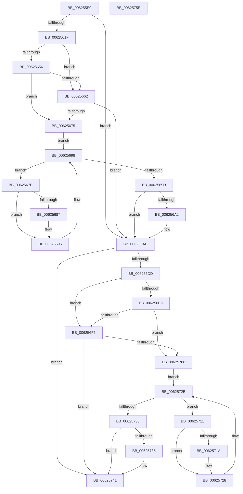

# DifIRP_MJ_INTERNAL_DEVICE_CONTROLWrapper

- RVA: `0x006255E0`–`0x0062575F` (길이 `383` bytes)
- VA: `0x00000001406255E0`
- 실행 섹션: `.text`
- PDB 이름 있음: `예`; PDB Function 태그: `아니요`
- unwind 정보 RVA: `0x00093E28`
- 디코드: `101`개 명령, `383/383` bytes 표시
- 미해석 바이트: `0` (있으면 어셈블리에 `.byte`로 보존)

> 이 문서는 커널 이미지의 기계어와 PDB 기호를 분석해 생성했습니다. 4번과 5번은 함수 원형과 자료형을 바이너리 사용 방식에서 추정한 C 해석이며 원본 소스 복구 결과는 아닙니다.

## 1. Dependencies

- 직접 호출 지점: **8**; 고유 호출 대상: **4**
- 직접 호출자로 확인된 함수: **0**
- RIP 상대 이미지 참조: **3**

### Outgoing calls
- `0x0062560E` → [DifGetAPIThunkContextById](../49/DifGetAPIThunkContextById_function_00495A34.md) (function, `0x00495A34`)
- `0x00625669` → [ExAcquireRundownProtection](../21/ExAcquireRundownProtection_function_00216620.md) (function, `0x00216620`)
- `0x00625690` → [guard_dispatch_icall](../6B/guard_dispatch_icall_function_006BAAD0.md) (function, `0x006BAAD0`)
- `0x006256A9` → [ExReleaseRundownProtection](../34/ExReleaseRundownProtection_function_00349E80.md) (function, `0x00349E80`)
- `0x006256CF` → [guard_dispatch_icall](../6B/guard_dispatch_icall_function_006BAAD0.md) (function, `0x006BAAD0`)
- `0x006256FC` → [ExAcquireRundownProtection](../21/ExAcquireRundownProtection_function_00216620.md) (function, `0x00216620`)
- `0x00625723` → [guard_dispatch_icall](../6B/guard_dispatch_icall_function_006BAAD0.md) (function, `0x006BAAD0`)
- `0x0062573C` → [ExReleaseRundownProtection](../34/ExReleaseRundownProtection_function_00349E80.md) (function, `0x00349E80`)

### Direct callers
- 이 함수 시작 RVA로 연결되는 직접 call은 확인되지 않았습니다. 간접 호출은 완전히 역산할 수 없습니다.

### Static image references
- `0x00625629` → RVA `0x00F048B8` (`.data`; read)
- `0x00625656` → RVA `0x00F04980` (`.data`; read)
- `0x00625662` → RVA `0x00F03E80` (`.data`; read)

## 2. Other-region calls and transfers

- 다른 실행 섹션으로 향하는 call: **0**
- 별도 외부 분기/꼬리 이동을 확인하지 못했습니다.

## 3. Assembly (complete function range)

```asm
006255E0  48 8B C4                        mov rax, rsp
006255E3  48 89 58 08                     mov qword ptr [rax + 8], rbx
006255E7  48 89 68 10                     mov qword ptr [rax + 0x10], rbp
006255EB  48 89 70 18                     mov qword ptr [rax + 0x18], rsi
006255EF  57                              push rdi
006255F0  41 56                           push r14
006255F2  41 57                           push r15
006255F4  48 83 EC 40                     sub rsp, 0x40
006255F8  0F 57 C0                        xorps xmm0, xmm0
006255FB  4C 8B F9                        mov r15, rcx
006255FE  B9 0F 00 00 10                  mov ecx, 0x1000000f
00625603  4C 8B F2                        mov r14, rdx
00625606  0F 11 40 C8                     movups xmmword ptr [rax - 0x38], xmm0
0062560A  0F 11 40 D8                     movups xmmword ptr [rax - 0x28], xmm0
0062560E  E8 21 04 E7 FF                  call 0x140495a34
00625613  48 8B E8                        mov rbp, rax
00625616  48 85 C0                        test rax, rax
00625619  0F 84 8F 00 00 00               je 0x1406256ae
0062561F  49 8B 96 B8 00 00 00            mov rdx, qword ptr [r14 + 0xb8]
00625626  40 32 F6                        xor sil, sil
00625629  40 38 35 88 F2 8D 00            cmp byte ptr [rip + 0x8df288], sil
00625630  49 8B 4F 08                     mov rcx, qword ptr [r15 + 8]
00625634  44 0F B6 02                     movzx r8d, byte ptr [rdx]
00625638  48 8B 51 30                     mov rdx, qword ptr [rcx + 0x30]
0062563C  48 8B 4A 40                     mov rcx, qword ptr [rdx + 0x40]
00625640  4A 8B 54 C1 20                  mov rdx, qword ptr [rcx + r8*8 + 0x20]
00625645  48 89 54 24 20                  mov qword ptr [rsp + 0x20], rdx
0062564A  4C 89 7C 24 30                  mov qword ptr [rsp + 0x30], r15
0062564F  4C 89 74 24 28                  mov qword ptr [rsp + 0x28], r14
00625654  75 0C                           jne 0x140625662
00625656  F7 05 20 F3 8D 00 00 08 00 00   test dword ptr [rip + 0x8df320], 0x800
00625660  74 13                           je 0x140625675
00625662  48 8D 0D 17 E8 8D 00            lea rcx, [rip + 0x8de817]
00625669  E8 B2 0F BF FF                  call 0x140216620
0062566E  40 8A F0                        mov sil, al
00625671  84 C0                           test al, al
00625673  74 39                           je 0x1406256ae
00625675  48 8D 7D 20                     lea rdi, [rbp + 0x20]
00625679  48 8B 1F                        mov rbx, qword ptr [rdi]
0062567C  EB 1A                           jmp 0x140625698
0062567E  48 8D 43 F0                     lea rax, [rbx - 0x10]
00625682  48 85 C0                        test rax, rax
00625685  74 0E                           je 0x140625695
00625687  48 8B 40 08                     mov rax, qword ptr [rax + 8]
0062568B  48 8D 4C 24 20                  lea rcx, [rsp + 0x20]
00625690  E8 3B 54 09 00                  call 0x1406baad0
00625695  48 8B 1B                        mov rbx, qword ptr [rbx]
00625698  48 3B DF                        cmp rbx, rdi
0062569B  75 E1                           jne 0x14062567e
0062569D  40 84 F6                        test sil, sil
006256A0  74 0C                           je 0x1406256ae
006256A2  48 8D 0D D7 E7 8D 00            lea rcx, [rip + 0x8de7d7]
006256A9  E8 D2 47 D2 FF                  call 0x140349e80
006256AE  49 8B 86 B8 00 00 00            mov rax, qword ptr [r14 + 0xb8]
006256B5  0F B6 10                        movzx edx, byte ptr [rax]
006256B8  49 8B 47 08                     mov rax, qword ptr [r15 + 8]
006256BC  48 8B 48 30                     mov rcx, qword ptr [rax + 0x30]
006256C0  48 8B 41 40                     mov rax, qword ptr [rcx + 0x40]
006256C4  49 8B CF                        mov rcx, r15
006256C7  48 8B 44 D0 20                  mov rax, qword ptr [rax + rdx*8 + 0x20]
006256CC  49 8B D6                        mov rdx, r14
006256CF  E8 FC 53 09 00                  call 0x1406baad0
006256D4  89 44 24 38                     mov dword ptr [rsp + 0x38], eax
006256D8  48 85 ED                        test rbp, rbp
006256DB  74 64                           je 0x140625741
006256DD  40 32 FF                        xor dil, dil
006256E0  40 38 3D D1 F1 8D 00            cmp byte ptr [rip + 0x8df1d1], dil
006256E7  75 0C                           jne 0x1406256f5
006256E9  F7 05 8D F2 8D 00 00 08 00 00   test dword ptr [rip + 0x8df28d], 0x800
006256F3  74 13                           je 0x140625708
006256F5  48 8D 0D 84 E7 8D 00            lea rcx, [rip + 0x8de784]
006256FC  E8 1F 0F BF FF                  call 0x140216620
00625701  40 8A F8                        mov dil, al
00625704  84 C0                           test al, al
00625706  74 39                           je 0x140625741
00625708  48 8D 75 30                     lea rsi, [rbp + 0x30]
0062570C  48 8B 1E                        mov rbx, qword ptr [rsi]
0062570F  EB 1A                           jmp 0x14062572b
00625711  48 8D 43 F0                     lea rax, [rbx - 0x10]
00625715  48 85 C0                        test rax, rax
00625718  74 0E                           je 0x140625728
0062571A  48 8B 40 08                     mov rax, qword ptr [rax + 8]
0062571E  48 8D 4C 24 20                  lea rcx, [rsp + 0x20]
00625723  E8 A8 53 09 00                  call 0x1406baad0
00625728  48 8B 1B                        mov rbx, qword ptr [rbx]
0062572B  48 3B DE                        cmp rbx, rsi
0062572E  75 E1                           jne 0x140625711
00625730  40 84 FF                        test dil, dil
00625733  74 0C                           je 0x140625741
00625735  48 8D 0D 44 E7 8D 00            lea rcx, [rip + 0x8de744]
0062573C  E8 3F 47 D2 FF                  call 0x140349e80
00625741  8B 44 24 38                     mov eax, dword ptr [rsp + 0x38]
00625745  48 8B 5C 24 60                  mov rbx, qword ptr [rsp + 0x60]
0062574A  48 8B 6C 24 68                  mov rbp, qword ptr [rsp + 0x68]
0062574F  48 8B 74 24 70                  mov rsi, qword ptr [rsp + 0x70]
00625754  48 83 C4 40                     add rsp, 0x40
00625758  41 5F                           pop r15
0062575A  41 5E                           pop r14
0062575C  5F                              pop rdi
0062575D  C3                              ret
0062575E  CC                              int3
```

## 4. C-style interpretation (structured pseudocode)

```c
__int64 __fastcall DifIRP_MJ_INTERNAL_DEVICE_CONTROLWrapper(__int64 a1, __int64 a2)
{
    __int64 result;
    __int64 v_rdi;
    __int64 v_rsi;
    __int64 v_rsp;
    unsigned int v_stack_m20;
    unsigned __int64 v_stack_m28;
    unsigned __int64 v_stack_m30;
    unsigned __int64 v_stack_m38;
    unsigned __int64 v_stack_p10;
    unsigned __int64 v_stack_p18;
    unsigned __int64 v_stack_p8;

    *(unsigned __int64 *)(v_rsp + 8) = v_rbx;
    *(unsigned __int64 *)(v_rsp + 16) = v_rbp;
    *(unsigned __int64 *)(v_rsp + 24) = v_rsi;
    v_rsp = (v_rsp) - (64);
    *(unsigned __int64 *)(v_rsp - 56) = v_xmm0;
    *(unsigned __int64 *)(v_rsp - 40) = v_xmm0;
    result = DifGetAPIThunkContextById((unsigned int)(0x1000000FULL), a2, a3, a4);
    if (result == 0) goto loc_006256AE;
    v_rsi = 0;
    v_stack_m38 = *(unsigned __int64 *)(*(unsigned __int64 *)(*(unsigned __int64 *)(*(unsigned __int64 *)(a1 + 8) + 48) + 64) + *(unsigned __int8 *)(*(unsigned __int64 *)(a2 + 184)) * 8 + 32);
    v_stack_m28 = a1;
    v_stack_m30 = a2;
    if ((*(unsigned __int8 *)(v_rip + 9302664)) != 0) goto loc_00625662;
    if (((*(unsigned int *)(v_rip + 9302816)) & (0x800ULL)) == 0) goto loc_00625675;
loc_00625662:
    result = ExAcquireRundownProtection(v_rip + 9299991, *(unsigned __int64 *)(*(unsigned __int64 *)(*(unsigned __int64 *)(*(unsigned __int64 *)(a1 + 8) + 48) + 64) + *(unsigned __int8 *)(*(unsigned __int64 *)(a2 + 184)) * 8 + 32), *(unsigned __int8 *)(*(unsigned __int64 *)(a2 + 184)), a4);
    if ((unsigned __int8)(result) == 0) goto loc_006256AE;
loc_00625675:
    goto loc_00625698;
loc_0062567E:
    result = *(unsigned __int64 *)(result + 32) - 16;
    if (*(unsigned __int64 *)(result + 32) - 16 != 0) {
        result = *(unsigned __int64 *)(*(unsigned __int64 *)(result + 32) - 16 + 8);
        a1 = v_stack_m38;
        result = guard_dispatch_icall(a1, *(unsigned __int64 *)(*(unsigned __int64 *)(*(unsigned __int64 *)(*(unsigned __int64 *)(a1 + 8) + 48) + 64) + *(unsigned __int8 *)(*(unsigned __int64 *)(a2 + 184)) * 8 + 32), *(unsigned __int8 *)(*(unsigned __int64 *)(a2 + 184)), a4);
    }
loc_00625698:
    if ((*(unsigned __int64 *)(*(unsigned __int64 *)(result + 32))) != (result + 32)) goto loc_0062567E;
    if ((unsigned __int8)((unsigned __int8)(result)) != 0) {
        a1 = v_rip + 9299927;
        result = ExReleaseRundownProtection(a1, *(unsigned __int64 *)(*(unsigned __int64 *)(*(unsigned __int64 *)(*(unsigned __int64 *)(a1 + 8) + 48) + 64) + *(unsigned __int8 *)(*(unsigned __int64 *)(a2 + 184)) * 8 + 32), *(unsigned __int8 *)(*(unsigned __int64 *)(a2 + 184)), a4);
    }
    result = guard_dispatch_icall(a1, a2, *(unsigned __int8 *)(*(unsigned __int64 *)(a2 + 184)), a4);
    v_stack_m20 = (unsigned int)(result);
    if (result == 0) goto loc_00625741;
    v_rdi = 0;
    if ((*(unsigned __int8 *)(v_rip + 9302481)) != 0) goto loc_006256F5;
    if (((*(unsigned int *)(v_rip + 9302669)) & (0x800ULL)) == 0) goto loc_00625708;
loc_006256F5:
    result = ExAcquireRundownProtection(v_rip + 9299844, a2, *(unsigned __int8 *)(*(unsigned __int64 *)(a2 + 184)), a4);
    if ((unsigned __int8)(result) == 0) goto loc_00625741;
loc_00625708:
    goto loc_0062572B;
loc_00625711:
    result = *(unsigned __int64 *)(result + 48) - 16;
    if (*(unsigned __int64 *)(result + 48) - 16 != 0) {
        result = *(unsigned __int64 *)(*(unsigned __int64 *)(result + 48) - 16 + 8);
        a1 = v_stack_m38;
        result = guard_dispatch_icall(a1, a2, *(unsigned __int8 *)(*(unsigned __int64 *)(a2 + 184)), a4);
    }
loc_0062572B:
    if ((*(unsigned __int64 *)(*(unsigned __int64 *)(result + 48))) != (result + 48)) goto loc_00625711;
    if ((unsigned __int8)((unsigned __int8)(result)) != 0) {
        a1 = v_rip + 9299780;
        result = ExReleaseRundownProtection(a1, a2, *(unsigned __int8 *)(*(unsigned __int64 *)(a2 + 184)), a4);
    }
    v_rsp = (v_rsp) + (64);
    return (unsigned int)(v_stack_m20);
}
```

## 5. (Beta) C Style

```c
int64_t DifIRP_MJ_INTERNAL_DEVICE_CONTROLWrapper(void *Arg1, void *Arg2)
{
    uint8_t *arg1 = (uint8_t *)Arg1;
    uint8_t *arg2 = (uint8_t *)Arg2;

    int64_t result;
    int64_t local_rdi;
    int64_t local_rsi;
    int64_t local_rsp;
    uint32_t v_stack_m20;
    uint64_t v_stack_m28;
    uint64_t v_stack_m30;
    uint64_t v_stack_m38;
    uint64_t v_stack_p10;
    uint64_t v_stack_p18;
    uint64_t v_stack_p8;

    *(uint64_t *)(local_rsp + 0x8) = local_rbx;
    *(uint64_t *)(local_rsp + 0x10) = local_rbp;
    *(uint64_t *)(local_rsp + 0x18) = local_rsi;
    local_rsp = (local_rsp) - (64);
    *(uint64_t *)(local_rsp - 0x38) = v_xmm0;
    *(uint64_t *)(local_rsp - 0x28) = v_xmm0;
    result = DifGetAPIThunkContextById((uint32_t)(0x1000000FULL), Arg2, a3, a4);
    if (result == 0) goto loc_006256AE;
    local_rsi = 0;
    v_stack_m38 = *(uint64_t *)(*(uint64_t *)(*(uint64_t *)(*(uint64_t *)(arg1 + 0x8) + 0x30) + 0x40) + *(uint8_t *)(*(uint64_t *)(arg2 + 0xB8)) * 8 + 0x20);
    v_stack_m28 = Arg1;
    v_stack_m30 = Arg2;
    if ((*(uint8_t *)(v_rip + 0x8DF288)) != 0) goto loc_00625662;
    if (((*(uint32_t *)(v_rip + 0x8DF320)) & (0x800ULL)) == 0) goto loc_00625675;
loc_00625662:
    result = ExAcquireRundownProtection(v_rip + 9299991, *(uint64_t *)(*(uint64_t *)(*(uint64_t *)(*(uint64_t *)(arg1 + 0x8) + 0x30) + 0x40) + *(uint8_t *)(*(uint64_t *)(arg2 + 0xB8)) * 8 + 0x20), *(uint8_t *)(*(uint64_t *)(arg2 + 0xB8)), a4);
    if ((uint8_t)(result) == 0) goto loc_006256AE;
loc_00625675:
    goto loc_00625698;
loc_0062567E:
    result = *(uint64_t *)(result + 0x20) - 16;
    if (*(uint64_t *)(result + 0x20) - 16 != 0) {
        result = *(uint64_t *)(*(uint64_t *)(result + 0x20) - 0x10 + 0x8);
        Arg1 = v_stack_m38;
        result = guard_dispatch_icall(Arg1, *(uint64_t *)(*(uint64_t *)(*(uint64_t *)(*(uint64_t *)(arg1 + 0x8) + 0x30) + 0x40) + *(uint8_t *)(*(uint64_t *)(arg2 + 0xB8)) * 8 + 0x20), *(uint8_t *)(*(uint64_t *)(arg2 + 0xB8)), a4);
    }
loc_00625698:
    if ((*(uint64_t *)(*(uint64_t *)(result + 0x20))) != (result + 32)) goto loc_0062567E;
    if ((uint8_t)((uint8_t)(result)) != 0) {
        Arg1 = v_rip + 9299927;
        result = ExReleaseRundownProtection(Arg1, *(uint64_t *)(*(uint64_t *)(*(uint64_t *)(*(uint64_t *)(arg1 + 0x8) + 0x30) + 0x40) + *(uint8_t *)(*(uint64_t *)(arg2 + 0xB8)) * 8 + 0x20), *(uint8_t *)(*(uint64_t *)(arg2 + 0xB8)), a4);
    }
    result = guard_dispatch_icall(Arg1, Arg2, *(uint8_t *)(*(uint64_t *)(arg2 + 0xB8)), a4);
    v_stack_m20 = (uint32_t)(result);
    if (result == 0) goto loc_00625741;
    local_rdi = 0;
    if ((*(uint8_t *)(v_rip + 0x8DF1D1)) != 0) goto loc_006256F5;
    if (((*(uint32_t *)(v_rip + 0x8DF28D)) & (0x800ULL)) == 0) goto loc_00625708;
loc_006256F5:
    result = ExAcquireRundownProtection(v_rip + 9299844, Arg2, *(uint8_t *)(*(uint64_t *)(arg2 + 0xB8)), a4);
    if ((uint8_t)(result) == 0) goto loc_00625741;
loc_00625708:
    goto loc_0062572B;
loc_00625711:
    result = *(uint64_t *)(result + 0x30) - 16;
    if (*(uint64_t *)(result + 0x30) - 16 != 0) {
        result = *(uint64_t *)(*(uint64_t *)(result + 0x30) - 0x10 + 0x8);
        Arg1 = v_stack_m38;
        result = guard_dispatch_icall(Arg1, Arg2, *(uint8_t *)(*(uint64_t *)(arg2 + 0xB8)), a4);
    }
loc_0062572B:
    if ((*(uint64_t *)(*(uint64_t *)(result + 0x30))) != (result + 48)) goto loc_00625711;
    if ((uint8_t)((uint8_t)(result)) != 0) {
        Arg1 = v_rip + 9299780;
        result = ExReleaseRundownProtection(Arg1, Arg2, *(uint8_t *)(*(uint64_t *)(arg2 + 0xB8)), a4);
    }
    local_rsp = (local_rsp) + (64);
    return (uint32_t)(v_stack_m20);
}
```

### 관측된 메모리 오프셋

구조체 형식이 확인되지 않은 접근은 인자 기준의 오프셋으로만 기록했습니다.

| 기준 인자 | 오프셋 표현 | 폭 (bit) | 접근 |
|---|---:|---:|---|
| `Arg1` | `+ 0x8` | `64` | `R` |
| `Arg2` | `+ 0xB8` | `64` | `R` |

## 6. Execution-region graph

[열기: 2D/3D 그래프와 함수 탐색 컨트롤 패널](../../../control-panel.html?section=text&rva=0x006255E0&view=graph)

- 2D 그래프는 위에서 아래로 흐르고, 3D 그래프는 빈 공간을 드래그해 회전합니다. Shift+드래그는 이동, 휠은 확대·축소, 함수 노드 선택은 대상 보고서 이동입니다.

### Static fallback


