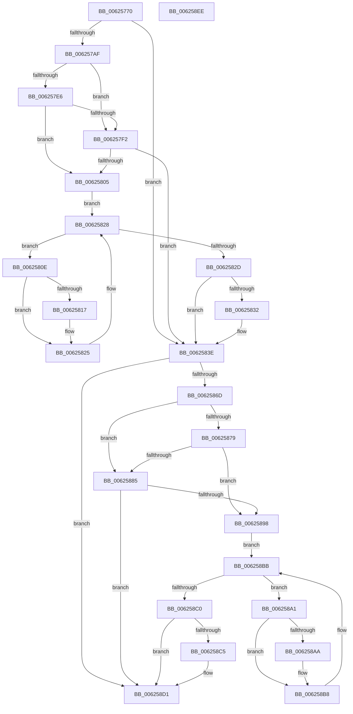

# DifIRP_MJ_LOCK_CONTROLWrapper

- RVA: `0x00625770`–`0x006258EF` (길이 `383` bytes)
- VA: `0x0000000140625770`
- 실행 섹션: `.text`
- PDB 이름 있음: `예`; PDB Function 태그: `아니요`
- unwind 정보 RVA: `0x00093E28`
- 디코드: `101`개 명령, `383/383` bytes 표시
- 미해석 바이트: `0` (있으면 어셈블리에 `.byte`로 보존)

> 이 문서는 커널 이미지의 기계어와 PDB 기호를 분석해 생성했습니다. 4번과 5번은 함수 원형과 자료형을 바이너리 사용 방식에서 추정한 C 해석이며 원본 소스 복구 결과는 아닙니다.

## 1. Dependencies

- 직접 호출 지점: **8**; 고유 호출 대상: **4**
- 직접 호출자로 확인된 함수: **0**
- RIP 상대 이미지 참조: **3**

### Outgoing calls
- `0x0062579E` → [DifGetAPIThunkContextById](../49/DifGetAPIThunkContextById_function_00495A34.md) (function, `0x00495A34`)
- `0x006257F9` → [ExAcquireRundownProtection](../21/ExAcquireRundownProtection_function_00216620.md) (function, `0x00216620`)
- `0x00625820` → [guard_dispatch_icall](../6B/guard_dispatch_icall_function_006BAAD0.md) (function, `0x006BAAD0`)
- `0x00625839` → [ExReleaseRundownProtection](../34/ExReleaseRundownProtection_function_00349E80.md) (function, `0x00349E80`)
- `0x0062585F` → [guard_dispatch_icall](../6B/guard_dispatch_icall_function_006BAAD0.md) (function, `0x006BAAD0`)
- `0x0062588C` → [ExAcquireRundownProtection](../21/ExAcquireRundownProtection_function_00216620.md) (function, `0x00216620`)
- `0x006258B3` → [guard_dispatch_icall](../6B/guard_dispatch_icall_function_006BAAD0.md) (function, `0x006BAAD0`)
- `0x006258CC` → [ExReleaseRundownProtection](../34/ExReleaseRundownProtection_function_00349E80.md) (function, `0x00349E80`)

### Direct callers
- 이 함수 시작 RVA로 연결되는 직접 call은 확인되지 않았습니다. 간접 호출은 완전히 역산할 수 없습니다.

### Static image references
- `0x006257B9` → RVA `0x00F048B8` (`.data`; read)
- `0x006257E6` → RVA `0x00F04980` (`.data`; read)
- `0x006257F2` → RVA `0x00F03E80` (`.data`; read)

## 2. Other-region calls and transfers

- 다른 실행 섹션으로 향하는 call: **0**
- 별도 외부 분기/꼬리 이동을 확인하지 못했습니다.

## 3. Assembly (complete function range)

```asm
00625770  48 8B C4                        mov rax, rsp
00625773  48 89 58 08                     mov qword ptr [rax + 8], rbx
00625777  48 89 68 10                     mov qword ptr [rax + 0x10], rbp
0062577B  48 89 70 18                     mov qword ptr [rax + 0x18], rsi
0062577F  57                              push rdi
00625780  41 56                           push r14
00625782  41 57                           push r15
00625784  48 83 EC 40                     sub rsp, 0x40
00625788  0F 57 C0                        xorps xmm0, xmm0
0062578B  4C 8B F9                        mov r15, rcx
0062578E  B9 11 00 00 10                  mov ecx, 0x10000011
00625793  4C 8B F2                        mov r14, rdx
00625796  0F 11 40 C8                     movups xmmword ptr [rax - 0x38], xmm0
0062579A  0F 11 40 D8                     movups xmmword ptr [rax - 0x28], xmm0
0062579E  E8 91 02 E7 FF                  call 0x140495a34
006257A3  48 8B E8                        mov rbp, rax
006257A6  48 85 C0                        test rax, rax
006257A9  0F 84 8F 00 00 00               je 0x14062583e
006257AF  49 8B 96 B8 00 00 00            mov rdx, qword ptr [r14 + 0xb8]
006257B6  40 32 F6                        xor sil, sil
006257B9  40 38 35 F8 F0 8D 00            cmp byte ptr [rip + 0x8df0f8], sil
006257C0  49 8B 4F 08                     mov rcx, qword ptr [r15 + 8]
006257C4  44 0F B6 02                     movzx r8d, byte ptr [rdx]
006257C8  48 8B 51 30                     mov rdx, qword ptr [rcx + 0x30]
006257CC  48 8B 4A 40                     mov rcx, qword ptr [rdx + 0x40]
006257D0  4A 8B 54 C1 20                  mov rdx, qword ptr [rcx + r8*8 + 0x20]
006257D5  48 89 54 24 20                  mov qword ptr [rsp + 0x20], rdx
006257DA  4C 89 7C 24 30                  mov qword ptr [rsp + 0x30], r15
006257DF  4C 89 74 24 28                  mov qword ptr [rsp + 0x28], r14
006257E4  75 0C                           jne 0x1406257f2
006257E6  F7 05 90 F1 8D 00 00 08 00 00   test dword ptr [rip + 0x8df190], 0x800
006257F0  74 13                           je 0x140625805
006257F2  48 8D 0D 87 E6 8D 00            lea rcx, [rip + 0x8de687]
006257F9  E8 22 0E BF FF                  call 0x140216620
006257FE  40 8A F0                        mov sil, al
00625801  84 C0                           test al, al
00625803  74 39                           je 0x14062583e
00625805  48 8D 7D 20                     lea rdi, [rbp + 0x20]
00625809  48 8B 1F                        mov rbx, qword ptr [rdi]
0062580C  EB 1A                           jmp 0x140625828
0062580E  48 8D 43 F0                     lea rax, [rbx - 0x10]
00625812  48 85 C0                        test rax, rax
00625815  74 0E                           je 0x140625825
00625817  48 8B 40 08                     mov rax, qword ptr [rax + 8]
0062581B  48 8D 4C 24 20                  lea rcx, [rsp + 0x20]
00625820  E8 AB 52 09 00                  call 0x1406baad0
00625825  48 8B 1B                        mov rbx, qword ptr [rbx]
00625828  48 3B DF                        cmp rbx, rdi
0062582B  75 E1                           jne 0x14062580e
0062582D  40 84 F6                        test sil, sil
00625830  74 0C                           je 0x14062583e
00625832  48 8D 0D 47 E6 8D 00            lea rcx, [rip + 0x8de647]
00625839  E8 42 46 D2 FF                  call 0x140349e80
0062583E  49 8B 86 B8 00 00 00            mov rax, qword ptr [r14 + 0xb8]
00625845  0F B6 10                        movzx edx, byte ptr [rax]
00625848  49 8B 47 08                     mov rax, qword ptr [r15 + 8]
0062584C  48 8B 48 30                     mov rcx, qword ptr [rax + 0x30]
00625850  48 8B 41 40                     mov rax, qword ptr [rcx + 0x40]
00625854  49 8B CF                        mov rcx, r15
00625857  48 8B 44 D0 20                  mov rax, qword ptr [rax + rdx*8 + 0x20]
0062585C  49 8B D6                        mov rdx, r14
0062585F  E8 6C 52 09 00                  call 0x1406baad0
00625864  89 44 24 38                     mov dword ptr [rsp + 0x38], eax
00625868  48 85 ED                        test rbp, rbp
0062586B  74 64                           je 0x1406258d1
0062586D  40 32 FF                        xor dil, dil
00625870  40 38 3D 41 F0 8D 00            cmp byte ptr [rip + 0x8df041], dil
00625877  75 0C                           jne 0x140625885
00625879  F7 05 FD F0 8D 00 00 08 00 00   test dword ptr [rip + 0x8df0fd], 0x800
00625883  74 13                           je 0x140625898
00625885  48 8D 0D F4 E5 8D 00            lea rcx, [rip + 0x8de5f4]
0062588C  E8 8F 0D BF FF                  call 0x140216620
00625891  40 8A F8                        mov dil, al
00625894  84 C0                           test al, al
00625896  74 39                           je 0x1406258d1
00625898  48 8D 75 30                     lea rsi, [rbp + 0x30]
0062589C  48 8B 1E                        mov rbx, qword ptr [rsi]
0062589F  EB 1A                           jmp 0x1406258bb
006258A1  48 8D 43 F0                     lea rax, [rbx - 0x10]
006258A5  48 85 C0                        test rax, rax
006258A8  74 0E                           je 0x1406258b8
006258AA  48 8B 40 08                     mov rax, qword ptr [rax + 8]
006258AE  48 8D 4C 24 20                  lea rcx, [rsp + 0x20]
006258B3  E8 18 52 09 00                  call 0x1406baad0
006258B8  48 8B 1B                        mov rbx, qword ptr [rbx]
006258BB  48 3B DE                        cmp rbx, rsi
006258BE  75 E1                           jne 0x1406258a1
006258C0  40 84 FF                        test dil, dil
006258C3  74 0C                           je 0x1406258d1
006258C5  48 8D 0D B4 E5 8D 00            lea rcx, [rip + 0x8de5b4]
006258CC  E8 AF 45 D2 FF                  call 0x140349e80
006258D1  8B 44 24 38                     mov eax, dword ptr [rsp + 0x38]
006258D5  48 8B 5C 24 60                  mov rbx, qword ptr [rsp + 0x60]
006258DA  48 8B 6C 24 68                  mov rbp, qword ptr [rsp + 0x68]
006258DF  48 8B 74 24 70                  mov rsi, qword ptr [rsp + 0x70]
006258E4  48 83 C4 40                     add rsp, 0x40
006258E8  41 5F                           pop r15
006258EA  41 5E                           pop r14
006258EC  5F                              pop rdi
006258ED  C3                              ret
006258EE  CC                              int3
```

## 4. C-style interpretation (structured pseudocode)

```c
__int64 __fastcall DifIRP_MJ_LOCK_CONTROLWrapper(__int64 a1, __int64 a2)
{
    __int64 result;
    __int64 v_rdi;
    __int64 v_rsi;
    __int64 v_rsp;
    unsigned int v_stack_m20;
    unsigned __int64 v_stack_m28;
    unsigned __int64 v_stack_m30;
    unsigned __int64 v_stack_m38;
    unsigned __int64 v_stack_p10;
    unsigned __int64 v_stack_p18;
    unsigned __int64 v_stack_p8;

    *(unsigned __int64 *)(v_rsp + 8) = v_rbx;
    *(unsigned __int64 *)(v_rsp + 16) = v_rbp;
    *(unsigned __int64 *)(v_rsp + 24) = v_rsi;
    v_rsp = (v_rsp) - (64);
    *(unsigned __int64 *)(v_rsp - 56) = v_xmm0;
    *(unsigned __int64 *)(v_rsp - 40) = v_xmm0;
    result = DifGetAPIThunkContextById((unsigned int)(0x10000011ULL), a2, a3, a4);
    if (result == 0) goto loc_0062583E;
    v_rsi = 0;
    v_stack_m38 = *(unsigned __int64 *)(*(unsigned __int64 *)(*(unsigned __int64 *)(*(unsigned __int64 *)(a1 + 8) + 48) + 64) + *(unsigned __int8 *)(*(unsigned __int64 *)(a2 + 184)) * 8 + 32);
    v_stack_m28 = a1;
    v_stack_m30 = a2;
    if ((*(unsigned __int8 *)(v_rip + 9302264)) != 0) goto loc_006257F2;
    if (((*(unsigned int *)(v_rip + 9302416)) & (0x800ULL)) == 0) goto loc_00625805;
loc_006257F2:
    result = ExAcquireRundownProtection(v_rip + 9299591, *(unsigned __int64 *)(*(unsigned __int64 *)(*(unsigned __int64 *)(*(unsigned __int64 *)(a1 + 8) + 48) + 64) + *(unsigned __int8 *)(*(unsigned __int64 *)(a2 + 184)) * 8 + 32), *(unsigned __int8 *)(*(unsigned __int64 *)(a2 + 184)), a4);
    if ((unsigned __int8)(result) == 0) goto loc_0062583E;
loc_00625805:
    goto loc_00625828;
loc_0062580E:
    result = *(unsigned __int64 *)(result + 32) - 16;
    if (*(unsigned __int64 *)(result + 32) - 16 != 0) {
        result = *(unsigned __int64 *)(*(unsigned __int64 *)(result + 32) - 16 + 8);
        a1 = v_stack_m38;
        result = guard_dispatch_icall(a1, *(unsigned __int64 *)(*(unsigned __int64 *)(*(unsigned __int64 *)(*(unsigned __int64 *)(a1 + 8) + 48) + 64) + *(unsigned __int8 *)(*(unsigned __int64 *)(a2 + 184)) * 8 + 32), *(unsigned __int8 *)(*(unsigned __int64 *)(a2 + 184)), a4);
    }
loc_00625828:
    if ((*(unsigned __int64 *)(*(unsigned __int64 *)(result + 32))) != (result + 32)) goto loc_0062580E;
    if ((unsigned __int8)((unsigned __int8)(result)) != 0) {
        a1 = v_rip + 9299527;
        result = ExReleaseRundownProtection(a1, *(unsigned __int64 *)(*(unsigned __int64 *)(*(unsigned __int64 *)(*(unsigned __int64 *)(a1 + 8) + 48) + 64) + *(unsigned __int8 *)(*(unsigned __int64 *)(a2 + 184)) * 8 + 32), *(unsigned __int8 *)(*(unsigned __int64 *)(a2 + 184)), a4);
    }
    result = guard_dispatch_icall(a1, a2, *(unsigned __int8 *)(*(unsigned __int64 *)(a2 + 184)), a4);
    v_stack_m20 = (unsigned int)(result);
    if (result == 0) goto loc_006258D1;
    v_rdi = 0;
    if ((*(unsigned __int8 *)(v_rip + 9302081)) != 0) goto loc_00625885;
    if (((*(unsigned int *)(v_rip + 9302269)) & (0x800ULL)) == 0) goto loc_00625898;
loc_00625885:
    result = ExAcquireRundownProtection(v_rip + 9299444, a2, *(unsigned __int8 *)(*(unsigned __int64 *)(a2 + 184)), a4);
    if ((unsigned __int8)(result) == 0) goto loc_006258D1;
loc_00625898:
    goto loc_006258BB;
loc_006258A1:
    result = *(unsigned __int64 *)(result + 48) - 16;
    if (*(unsigned __int64 *)(result + 48) - 16 != 0) {
        result = *(unsigned __int64 *)(*(unsigned __int64 *)(result + 48) - 16 + 8);
        a1 = v_stack_m38;
        result = guard_dispatch_icall(a1, a2, *(unsigned __int8 *)(*(unsigned __int64 *)(a2 + 184)), a4);
    }
loc_006258BB:
    if ((*(unsigned __int64 *)(*(unsigned __int64 *)(result + 48))) != (result + 48)) goto loc_006258A1;
    if ((unsigned __int8)((unsigned __int8)(result)) != 0) {
        a1 = v_rip + 9299380;
        result = ExReleaseRundownProtection(a1, a2, *(unsigned __int8 *)(*(unsigned __int64 *)(a2 + 184)), a4);
    }
    v_rsp = (v_rsp) + (64);
    return (unsigned int)(v_stack_m20);
}
```

## 5. (Beta) C Style

```c
int64_t DifIRP_MJ_LOCK_CONTROLWrapper(void *Arg1, void *Arg2)
{
    uint8_t *arg1 = (uint8_t *)Arg1;
    uint8_t *arg2 = (uint8_t *)Arg2;

    int64_t result;
    int64_t local_rdi;
    int64_t local_rsi;
    int64_t local_rsp;
    uint32_t v_stack_m20;
    uint64_t v_stack_m28;
    uint64_t v_stack_m30;
    uint64_t v_stack_m38;
    uint64_t v_stack_p10;
    uint64_t v_stack_p18;
    uint64_t v_stack_p8;

    *(uint64_t *)(local_rsp + 0x8) = local_rbx;
    *(uint64_t *)(local_rsp + 0x10) = local_rbp;
    *(uint64_t *)(local_rsp + 0x18) = local_rsi;
    local_rsp = (local_rsp) - (64);
    *(uint64_t *)(local_rsp - 0x38) = v_xmm0;
    *(uint64_t *)(local_rsp - 0x28) = v_xmm0;
    result = DifGetAPIThunkContextById((uint32_t)(0x10000011ULL), Arg2, a3, a4);
    if (result == 0) goto loc_0062583E;
    local_rsi = 0;
    v_stack_m38 = *(uint64_t *)(*(uint64_t *)(*(uint64_t *)(*(uint64_t *)(arg1 + 0x8) + 0x30) + 0x40) + *(uint8_t *)(*(uint64_t *)(arg2 + 0xB8)) * 8 + 0x20);
    v_stack_m28 = Arg1;
    v_stack_m30 = Arg2;
    if ((*(uint8_t *)(v_rip + 0x8DF0F8)) != 0) goto loc_006257F2;
    if (((*(uint32_t *)(v_rip + 0x8DF190)) & (0x800ULL)) == 0) goto loc_00625805;
loc_006257F2:
    result = ExAcquireRundownProtection(v_rip + 9299591, *(uint64_t *)(*(uint64_t *)(*(uint64_t *)(*(uint64_t *)(arg1 + 0x8) + 0x30) + 0x40) + *(uint8_t *)(*(uint64_t *)(arg2 + 0xB8)) * 8 + 0x20), *(uint8_t *)(*(uint64_t *)(arg2 + 0xB8)), a4);
    if ((uint8_t)(result) == 0) goto loc_0062583E;
loc_00625805:
    goto loc_00625828;
loc_0062580E:
    result = *(uint64_t *)(result + 0x20) - 16;
    if (*(uint64_t *)(result + 0x20) - 16 != 0) {
        result = *(uint64_t *)(*(uint64_t *)(result + 0x20) - 0x10 + 0x8);
        Arg1 = v_stack_m38;
        result = guard_dispatch_icall(Arg1, *(uint64_t *)(*(uint64_t *)(*(uint64_t *)(*(uint64_t *)(arg1 + 0x8) + 0x30) + 0x40) + *(uint8_t *)(*(uint64_t *)(arg2 + 0xB8)) * 8 + 0x20), *(uint8_t *)(*(uint64_t *)(arg2 + 0xB8)), a4);
    }
loc_00625828:
    if ((*(uint64_t *)(*(uint64_t *)(result + 0x20))) != (result + 32)) goto loc_0062580E;
    if ((uint8_t)((uint8_t)(result)) != 0) {
        Arg1 = v_rip + 9299527;
        result = ExReleaseRundownProtection(Arg1, *(uint64_t *)(*(uint64_t *)(*(uint64_t *)(*(uint64_t *)(arg1 + 0x8) + 0x30) + 0x40) + *(uint8_t *)(*(uint64_t *)(arg2 + 0xB8)) * 8 + 0x20), *(uint8_t *)(*(uint64_t *)(arg2 + 0xB8)), a4);
    }
    result = guard_dispatch_icall(Arg1, Arg2, *(uint8_t *)(*(uint64_t *)(arg2 + 0xB8)), a4);
    v_stack_m20 = (uint32_t)(result);
    if (result == 0) goto loc_006258D1;
    local_rdi = 0;
    if ((*(uint8_t *)(v_rip + 0x8DF041)) != 0) goto loc_00625885;
    if (((*(uint32_t *)(v_rip + 0x8DF0FD)) & (0x800ULL)) == 0) goto loc_00625898;
loc_00625885:
    result = ExAcquireRundownProtection(v_rip + 9299444, Arg2, *(uint8_t *)(*(uint64_t *)(arg2 + 0xB8)), a4);
    if ((uint8_t)(result) == 0) goto loc_006258D1;
loc_00625898:
    goto loc_006258BB;
loc_006258A1:
    result = *(uint64_t *)(result + 0x30) - 16;
    if (*(uint64_t *)(result + 0x30) - 16 != 0) {
        result = *(uint64_t *)(*(uint64_t *)(result + 0x30) - 0x10 + 0x8);
        Arg1 = v_stack_m38;
        result = guard_dispatch_icall(Arg1, Arg2, *(uint8_t *)(*(uint64_t *)(arg2 + 0xB8)), a4);
    }
loc_006258BB:
    if ((*(uint64_t *)(*(uint64_t *)(result + 0x30))) != (result + 48)) goto loc_006258A1;
    if ((uint8_t)((uint8_t)(result)) != 0) {
        Arg1 = v_rip + 9299380;
        result = ExReleaseRundownProtection(Arg1, Arg2, *(uint8_t *)(*(uint64_t *)(arg2 + 0xB8)), a4);
    }
    local_rsp = (local_rsp) + (64);
    return (uint32_t)(v_stack_m20);
}
```

### 관측된 메모리 오프셋

구조체 형식이 확인되지 않은 접근은 인자 기준의 오프셋으로만 기록했습니다.

| 기준 인자 | 오프셋 표현 | 폭 (bit) | 접근 |
|---|---:|---:|---|
| `Arg1` | `+ 0x8` | `64` | `R` |
| `Arg2` | `+ 0xB8` | `64` | `R` |

## 6. Execution-region graph

[열기: 2D/3D 그래프와 함수 탐색 컨트롤 패널](../../../control-panel.html?section=text&rva=0x00625770&view=graph)

- 2D 그래프는 위에서 아래로 흐르고, 3D 그래프는 빈 공간을 드래그해 회전합니다. Shift+드래그는 이동, 휠은 확대·축소, 함수 노드 선택은 대상 보고서 이동입니다.

### Static fallback


