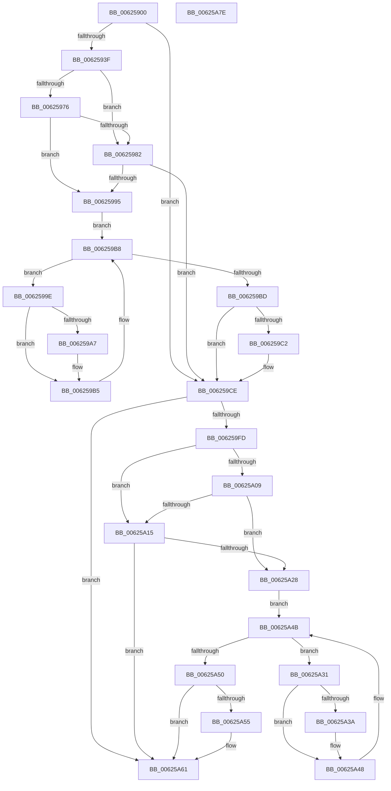

# DifIRP_MJ_PNPWrapper

- RVA: `0x00625900`–`0x00625A7F` (길이 `383` bytes)
- VA: `0x0000000140625900`
- 실행 섹션: `.text`
- PDB 이름 있음: `예`; PDB Function 태그: `아니요`
- unwind 정보 RVA: `0x00093E28`
- 디코드: `101`개 명령, `383/383` bytes 표시
- 미해석 바이트: `0` (있으면 어셈블리에 `.byte`로 보존)

> 이 문서는 커널 이미지의 기계어와 PDB 기호를 분석해 생성했습니다. 4번과 5번은 함수 원형과 자료형을 바이너리 사용 방식에서 추정한 C 해석이며 원본 소스 복구 결과는 아닙니다.

## 1. Dependencies

- 직접 호출 지점: **8**; 고유 호출 대상: **4**
- 직접 호출자로 확인된 함수: **0**
- RIP 상대 이미지 참조: **3**

### Outgoing calls
- `0x0062592E` → [DifGetAPIThunkContextById](../49/DifGetAPIThunkContextById_function_00495A34.md) (function, `0x00495A34`)
- `0x00625989` → [ExAcquireRundownProtection](../21/ExAcquireRundownProtection_function_00216620.md) (function, `0x00216620`)
- `0x006259B0` → [guard_dispatch_icall](../6B/guard_dispatch_icall_function_006BAAD0.md) (function, `0x006BAAD0`)
- `0x006259C9` → [ExReleaseRundownProtection](../34/ExReleaseRundownProtection_function_00349E80.md) (function, `0x00349E80`)
- `0x006259EF` → [guard_dispatch_icall](../6B/guard_dispatch_icall_function_006BAAD0.md) (function, `0x006BAAD0`)
- `0x00625A1C` → [ExAcquireRundownProtection](../21/ExAcquireRundownProtection_function_00216620.md) (function, `0x00216620`)
- `0x00625A43` → [guard_dispatch_icall](../6B/guard_dispatch_icall_function_006BAAD0.md) (function, `0x006BAAD0`)
- `0x00625A5C` → [ExReleaseRundownProtection](../34/ExReleaseRundownProtection_function_00349E80.md) (function, `0x00349E80`)

### Direct callers
- 이 함수 시작 RVA로 연결되는 직접 call은 확인되지 않았습니다. 간접 호출은 완전히 역산할 수 없습니다.

### Static image references
- `0x00625949` → RVA `0x00F048B8` (`.data`; read)
- `0x00625976` → RVA `0x00F04980` (`.data`; read)
- `0x00625982` → RVA `0x00F03E80` (`.data`; read)

## 2. Other-region calls and transfers

- 다른 실행 섹션으로 향하는 call: **0**
- 별도 외부 분기/꼬리 이동을 확인하지 못했습니다.

## 3. Assembly (complete function range)

```asm
00625900  48 8B C4                        mov rax, rsp
00625903  48 89 58 08                     mov qword ptr [rax + 8], rbx
00625907  48 89 68 10                     mov qword ptr [rax + 0x10], rbp
0062590B  48 89 70 18                     mov qword ptr [rax + 0x18], rsi
0062590F  57                              push rdi
00625910  41 56                           push r14
00625912  41 57                           push r15
00625914  48 83 EC 40                     sub rsp, 0x40
00625918  0F 57 C0                        xorps xmm0, xmm0
0062591B  4C 8B F9                        mov r15, rcx
0062591E  B9 1B 00 00 10                  mov ecx, 0x1000001b
00625923  4C 8B F2                        mov r14, rdx
00625926  0F 11 40 C8                     movups xmmword ptr [rax - 0x38], xmm0
0062592A  0F 11 40 D8                     movups xmmword ptr [rax - 0x28], xmm0
0062592E  E8 01 01 E7 FF                  call 0x140495a34
00625933  48 8B E8                        mov rbp, rax
00625936  48 85 C0                        test rax, rax
00625939  0F 84 8F 00 00 00               je 0x1406259ce
0062593F  49 8B 96 B8 00 00 00            mov rdx, qword ptr [r14 + 0xb8]
00625946  40 32 F6                        xor sil, sil
00625949  40 38 35 68 EF 8D 00            cmp byte ptr [rip + 0x8def68], sil
00625950  49 8B 4F 08                     mov rcx, qword ptr [r15 + 8]
00625954  44 0F B6 02                     movzx r8d, byte ptr [rdx]
00625958  48 8B 51 30                     mov rdx, qword ptr [rcx + 0x30]
0062595C  48 8B 4A 40                     mov rcx, qword ptr [rdx + 0x40]
00625960  4A 8B 54 C1 20                  mov rdx, qword ptr [rcx + r8*8 + 0x20]
00625965  48 89 54 24 20                  mov qword ptr [rsp + 0x20], rdx
0062596A  4C 89 7C 24 30                  mov qword ptr [rsp + 0x30], r15
0062596F  4C 89 74 24 28                  mov qword ptr [rsp + 0x28], r14
00625974  75 0C                           jne 0x140625982
00625976  F7 05 00 F0 8D 00 00 08 00 00   test dword ptr [rip + 0x8df000], 0x800
00625980  74 13                           je 0x140625995
00625982  48 8D 0D F7 E4 8D 00            lea rcx, [rip + 0x8de4f7]
00625989  E8 92 0C BF FF                  call 0x140216620
0062598E  40 8A F0                        mov sil, al
00625991  84 C0                           test al, al
00625993  74 39                           je 0x1406259ce
00625995  48 8D 7D 20                     lea rdi, [rbp + 0x20]
00625999  48 8B 1F                        mov rbx, qword ptr [rdi]
0062599C  EB 1A                           jmp 0x1406259b8
0062599E  48 8D 43 F0                     lea rax, [rbx - 0x10]
006259A2  48 85 C0                        test rax, rax
006259A5  74 0E                           je 0x1406259b5
006259A7  48 8B 40 08                     mov rax, qword ptr [rax + 8]
006259AB  48 8D 4C 24 20                  lea rcx, [rsp + 0x20]
006259B0  E8 1B 51 09 00                  call 0x1406baad0
006259B5  48 8B 1B                        mov rbx, qword ptr [rbx]
006259B8  48 3B DF                        cmp rbx, rdi
006259BB  75 E1                           jne 0x14062599e
006259BD  40 84 F6                        test sil, sil
006259C0  74 0C                           je 0x1406259ce
006259C2  48 8D 0D B7 E4 8D 00            lea rcx, [rip + 0x8de4b7]
006259C9  E8 B2 44 D2 FF                  call 0x140349e80
006259CE  49 8B 86 B8 00 00 00            mov rax, qword ptr [r14 + 0xb8]
006259D5  0F B6 10                        movzx edx, byte ptr [rax]
006259D8  49 8B 47 08                     mov rax, qword ptr [r15 + 8]
006259DC  48 8B 48 30                     mov rcx, qword ptr [rax + 0x30]
006259E0  48 8B 41 40                     mov rax, qword ptr [rcx + 0x40]
006259E4  49 8B CF                        mov rcx, r15
006259E7  48 8B 44 D0 20                  mov rax, qword ptr [rax + rdx*8 + 0x20]
006259EC  49 8B D6                        mov rdx, r14
006259EF  E8 DC 50 09 00                  call 0x1406baad0
006259F4  89 44 24 38                     mov dword ptr [rsp + 0x38], eax
006259F8  48 85 ED                        test rbp, rbp
006259FB  74 64                           je 0x140625a61
006259FD  40 32 FF                        xor dil, dil
00625A00  40 38 3D B1 EE 8D 00            cmp byte ptr [rip + 0x8deeb1], dil
00625A07  75 0C                           jne 0x140625a15
00625A09  F7 05 6D EF 8D 00 00 08 00 00   test dword ptr [rip + 0x8def6d], 0x800
00625A13  74 13                           je 0x140625a28
00625A15  48 8D 0D 64 E4 8D 00            lea rcx, [rip + 0x8de464]
00625A1C  E8 FF 0B BF FF                  call 0x140216620
00625A21  40 8A F8                        mov dil, al
00625A24  84 C0                           test al, al
00625A26  74 39                           je 0x140625a61
00625A28  48 8D 75 30                     lea rsi, [rbp + 0x30]
00625A2C  48 8B 1E                        mov rbx, qword ptr [rsi]
00625A2F  EB 1A                           jmp 0x140625a4b
00625A31  48 8D 43 F0                     lea rax, [rbx - 0x10]
00625A35  48 85 C0                        test rax, rax
00625A38  74 0E                           je 0x140625a48
00625A3A  48 8B 40 08                     mov rax, qword ptr [rax + 8]
00625A3E  48 8D 4C 24 20                  lea rcx, [rsp + 0x20]
00625A43  E8 88 50 09 00                  call 0x1406baad0
00625A48  48 8B 1B                        mov rbx, qword ptr [rbx]
00625A4B  48 3B DE                        cmp rbx, rsi
00625A4E  75 E1                           jne 0x140625a31
00625A50  40 84 FF                        test dil, dil
00625A53  74 0C                           je 0x140625a61
00625A55  48 8D 0D 24 E4 8D 00            lea rcx, [rip + 0x8de424]
00625A5C  E8 1F 44 D2 FF                  call 0x140349e80
00625A61  8B 44 24 38                     mov eax, dword ptr [rsp + 0x38]
00625A65  48 8B 5C 24 60                  mov rbx, qword ptr [rsp + 0x60]
00625A6A  48 8B 6C 24 68                  mov rbp, qword ptr [rsp + 0x68]
00625A6F  48 8B 74 24 70                  mov rsi, qword ptr [rsp + 0x70]
00625A74  48 83 C4 40                     add rsp, 0x40
00625A78  41 5F                           pop r15
00625A7A  41 5E                           pop r14
00625A7C  5F                              pop rdi
00625A7D  C3                              ret
00625A7E  CC                              int3
```

## 4. C-style interpretation (structured pseudocode)

```c
__int64 __fastcall DifIRP_MJ_PNPWrapper(__int64 a1, __int64 a2)
{
    __int64 result;
    __int64 v_rdi;
    __int64 v_rsi;
    __int64 v_rsp;
    unsigned int v_stack_m20;
    unsigned __int64 v_stack_m28;
    unsigned __int64 v_stack_m30;
    unsigned __int64 v_stack_m38;
    unsigned __int64 v_stack_p10;
    unsigned __int64 v_stack_p18;
    unsigned __int64 v_stack_p8;

    *(unsigned __int64 *)(v_rsp + 8) = v_rbx;
    *(unsigned __int64 *)(v_rsp + 16) = v_rbp;
    *(unsigned __int64 *)(v_rsp + 24) = v_rsi;
    v_rsp = (v_rsp) - (64);
    *(unsigned __int64 *)(v_rsp - 56) = v_xmm0;
    *(unsigned __int64 *)(v_rsp - 40) = v_xmm0;
    result = DifGetAPIThunkContextById((unsigned int)(0x1000001BULL), a2, a3, a4);
    if (result == 0) goto loc_006259CE;
    v_rsi = 0;
    v_stack_m38 = *(unsigned __int64 *)(*(unsigned __int64 *)(*(unsigned __int64 *)(*(unsigned __int64 *)(a1 + 8) + 48) + 64) + *(unsigned __int8 *)(*(unsigned __int64 *)(a2 + 184)) * 8 + 32);
    v_stack_m28 = a1;
    v_stack_m30 = a2;
    if ((*(unsigned __int8 *)(v_rip + 9301864)) != 0) goto loc_00625982;
    if (((*(unsigned int *)(v_rip + 9302016)) & (0x800ULL)) == 0) goto loc_00625995;
loc_00625982:
    result = ExAcquireRundownProtection(v_rip + 9299191, *(unsigned __int64 *)(*(unsigned __int64 *)(*(unsigned __int64 *)(*(unsigned __int64 *)(a1 + 8) + 48) + 64) + *(unsigned __int8 *)(*(unsigned __int64 *)(a2 + 184)) * 8 + 32), *(unsigned __int8 *)(*(unsigned __int64 *)(a2 + 184)), a4);
    if ((unsigned __int8)(result) == 0) goto loc_006259CE;
loc_00625995:
    goto loc_006259B8;
loc_0062599E:
    result = *(unsigned __int64 *)(result + 32) - 16;
    if (*(unsigned __int64 *)(result + 32) - 16 != 0) {
        result = *(unsigned __int64 *)(*(unsigned __int64 *)(result + 32) - 16 + 8);
        a1 = v_stack_m38;
        result = guard_dispatch_icall(a1, *(unsigned __int64 *)(*(unsigned __int64 *)(*(unsigned __int64 *)(*(unsigned __int64 *)(a1 + 8) + 48) + 64) + *(unsigned __int8 *)(*(unsigned __int64 *)(a2 + 184)) * 8 + 32), *(unsigned __int8 *)(*(unsigned __int64 *)(a2 + 184)), a4);
    }
loc_006259B8:
    if ((*(unsigned __int64 *)(*(unsigned __int64 *)(result + 32))) != (result + 32)) goto loc_0062599E;
    if ((unsigned __int8)((unsigned __int8)(result)) != 0) {
        a1 = v_rip + 9299127;
        result = ExReleaseRundownProtection(a1, *(unsigned __int64 *)(*(unsigned __int64 *)(*(unsigned __int64 *)(*(unsigned __int64 *)(a1 + 8) + 48) + 64) + *(unsigned __int8 *)(*(unsigned __int64 *)(a2 + 184)) * 8 + 32), *(unsigned __int8 *)(*(unsigned __int64 *)(a2 + 184)), a4);
    }
    result = guard_dispatch_icall(a1, a2, *(unsigned __int8 *)(*(unsigned __int64 *)(a2 + 184)), a4);
    v_stack_m20 = (unsigned int)(result);
    if (result == 0) goto loc_00625A61;
    v_rdi = 0;
    if ((*(unsigned __int8 *)(v_rip + 9301681)) != 0) goto loc_00625A15;
    if (((*(unsigned int *)(v_rip + 9301869)) & (0x800ULL)) == 0) goto loc_00625A28;
loc_00625A15:
    result = ExAcquireRundownProtection(v_rip + 9299044, a2, *(unsigned __int8 *)(*(unsigned __int64 *)(a2 + 184)), a4);
    if ((unsigned __int8)(result) == 0) goto loc_00625A61;
loc_00625A28:
    goto loc_00625A4B;
loc_00625A31:
    result = *(unsigned __int64 *)(result + 48) - 16;
    if (*(unsigned __int64 *)(result + 48) - 16 != 0) {
        result = *(unsigned __int64 *)(*(unsigned __int64 *)(result + 48) - 16 + 8);
        a1 = v_stack_m38;
        result = guard_dispatch_icall(a1, a2, *(unsigned __int8 *)(*(unsigned __int64 *)(a2 + 184)), a4);
    }
loc_00625A4B:
    if ((*(unsigned __int64 *)(*(unsigned __int64 *)(result + 48))) != (result + 48)) goto loc_00625A31;
    if ((unsigned __int8)((unsigned __int8)(result)) != 0) {
        a1 = v_rip + 9298980;
        result = ExReleaseRundownProtection(a1, a2, *(unsigned __int8 *)(*(unsigned __int64 *)(a2 + 184)), a4);
    }
    v_rsp = (v_rsp) + (64);
    return (unsigned int)(v_stack_m20);
}
```

## 5. (Beta) C Style

```c
int64_t DifIRP_MJ_PNPWrapper(void *Arg1, void *Arg2)
{
    uint8_t *arg1 = (uint8_t *)Arg1;
    uint8_t *arg2 = (uint8_t *)Arg2;

    int64_t result;
    int64_t local_rdi;
    int64_t local_rsi;
    int64_t local_rsp;
    uint32_t v_stack_m20;
    uint64_t v_stack_m28;
    uint64_t v_stack_m30;
    uint64_t v_stack_m38;
    uint64_t v_stack_p10;
    uint64_t v_stack_p18;
    uint64_t v_stack_p8;

    *(uint64_t *)(local_rsp + 0x8) = local_rbx;
    *(uint64_t *)(local_rsp + 0x10) = local_rbp;
    *(uint64_t *)(local_rsp + 0x18) = local_rsi;
    local_rsp = (local_rsp) - (64);
    *(uint64_t *)(local_rsp - 0x38) = v_xmm0;
    *(uint64_t *)(local_rsp - 0x28) = v_xmm0;
    result = DifGetAPIThunkContextById((uint32_t)(0x1000001BULL), Arg2, a3, a4);
    if (result == 0) goto loc_006259CE;
    local_rsi = 0;
    v_stack_m38 = *(uint64_t *)(*(uint64_t *)(*(uint64_t *)(*(uint64_t *)(arg1 + 0x8) + 0x30) + 0x40) + *(uint8_t *)(*(uint64_t *)(arg2 + 0xB8)) * 8 + 0x20);
    v_stack_m28 = Arg1;
    v_stack_m30 = Arg2;
    if ((*(uint8_t *)(v_rip + 0x8DEF68)) != 0) goto loc_00625982;
    if (((*(uint32_t *)(v_rip + 0x8DF000)) & (0x800ULL)) == 0) goto loc_00625995;
loc_00625982:
    result = ExAcquireRundownProtection(v_rip + 9299191, *(uint64_t *)(*(uint64_t *)(*(uint64_t *)(*(uint64_t *)(arg1 + 0x8) + 0x30) + 0x40) + *(uint8_t *)(*(uint64_t *)(arg2 + 0xB8)) * 8 + 0x20), *(uint8_t *)(*(uint64_t *)(arg2 + 0xB8)), a4);
    if ((uint8_t)(result) == 0) goto loc_006259CE;
loc_00625995:
    goto loc_006259B8;
loc_0062599E:
    result = *(uint64_t *)(result + 0x20) - 16;
    if (*(uint64_t *)(result + 0x20) - 16 != 0) {
        result = *(uint64_t *)(*(uint64_t *)(result + 0x20) - 0x10 + 0x8);
        Arg1 = v_stack_m38;
        result = guard_dispatch_icall(Arg1, *(uint64_t *)(*(uint64_t *)(*(uint64_t *)(*(uint64_t *)(arg1 + 0x8) + 0x30) + 0x40) + *(uint8_t *)(*(uint64_t *)(arg2 + 0xB8)) * 8 + 0x20), *(uint8_t *)(*(uint64_t *)(arg2 + 0xB8)), a4);
    }
loc_006259B8:
    if ((*(uint64_t *)(*(uint64_t *)(result + 0x20))) != (result + 32)) goto loc_0062599E;
    if ((uint8_t)((uint8_t)(result)) != 0) {
        Arg1 = v_rip + 9299127;
        result = ExReleaseRundownProtection(Arg1, *(uint64_t *)(*(uint64_t *)(*(uint64_t *)(*(uint64_t *)(arg1 + 0x8) + 0x30) + 0x40) + *(uint8_t *)(*(uint64_t *)(arg2 + 0xB8)) * 8 + 0x20), *(uint8_t *)(*(uint64_t *)(arg2 + 0xB8)), a4);
    }
    result = guard_dispatch_icall(Arg1, Arg2, *(uint8_t *)(*(uint64_t *)(arg2 + 0xB8)), a4);
    v_stack_m20 = (uint32_t)(result);
    if (result == 0) goto loc_00625A61;
    local_rdi = 0;
    if ((*(uint8_t *)(v_rip + 0x8DEEB1)) != 0) goto loc_00625A15;
    if (((*(uint32_t *)(v_rip + 0x8DEF6D)) & (0x800ULL)) == 0) goto loc_00625A28;
loc_00625A15:
    result = ExAcquireRundownProtection(v_rip + 9299044, Arg2, *(uint8_t *)(*(uint64_t *)(arg2 + 0xB8)), a4);
    if ((uint8_t)(result) == 0) goto loc_00625A61;
loc_00625A28:
    goto loc_00625A4B;
loc_00625A31:
    result = *(uint64_t *)(result + 0x30) - 16;
    if (*(uint64_t *)(result + 0x30) - 16 != 0) {
        result = *(uint64_t *)(*(uint64_t *)(result + 0x30) - 0x10 + 0x8);
        Arg1 = v_stack_m38;
        result = guard_dispatch_icall(Arg1, Arg2, *(uint8_t *)(*(uint64_t *)(arg2 + 0xB8)), a4);
    }
loc_00625A4B:
    if ((*(uint64_t *)(*(uint64_t *)(result + 0x30))) != (result + 48)) goto loc_00625A31;
    if ((uint8_t)((uint8_t)(result)) != 0) {
        Arg1 = v_rip + 9298980;
        result = ExReleaseRundownProtection(Arg1, Arg2, *(uint8_t *)(*(uint64_t *)(arg2 + 0xB8)), a4);
    }
    local_rsp = (local_rsp) + (64);
    return (uint32_t)(v_stack_m20);
}
```

### 관측된 메모리 오프셋

구조체 형식이 확인되지 않은 접근은 인자 기준의 오프셋으로만 기록했습니다.

| 기준 인자 | 오프셋 표현 | 폭 (bit) | 접근 |
|---|---:|---:|---|
| `Arg1` | `+ 0x8` | `64` | `R` |
| `Arg2` | `+ 0xB8` | `64` | `R` |

## 6. Execution-region graph

[열기: 2D/3D 그래프와 함수 탐색 컨트롤 패널](../../../control-panel.html?section=text&rva=0x00625900&view=graph)

- 2D 그래프는 위에서 아래로 흐르고, 3D 그래프는 빈 공간을 드래그해 회전합니다. Shift+드래그는 이동, 휠은 확대·축소, 함수 노드 선택은 대상 보고서 이동입니다.

### Static fallback


