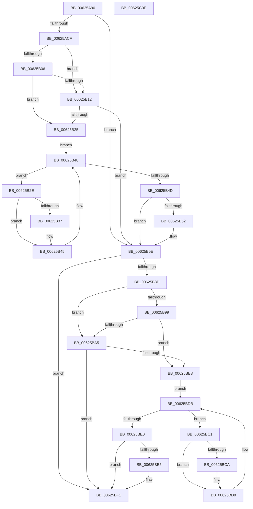

# DifIRP_MJ_POWERWrapper

- RVA: `0x00625A90`–`0x00625C0F` (길이 `383` bytes)
- VA: `0x0000000140625A90`
- 실행 섹션: `.text`
- PDB 이름 있음: `예`; PDB Function 태그: `아니요`
- unwind 정보 RVA: `0x00093E28`
- 디코드: `101`개 명령, `383/383` bytes 표시
- 미해석 바이트: `0` (있으면 어셈블리에 `.byte`로 보존)

> 이 문서는 커널 이미지의 기계어와 PDB 기호를 분석해 생성했습니다. 4번과 5번은 함수 원형과 자료형을 바이너리 사용 방식에서 추정한 C 해석이며 원본 소스 복구 결과는 아닙니다.

## 1. Dependencies

- 직접 호출 지점: **8**; 고유 호출 대상: **4**
- 직접 호출자로 확인된 함수: **0**
- RIP 상대 이미지 참조: **3**

### Outgoing calls
- `0x00625ABE` → [DifGetAPIThunkContextById](../49/DifGetAPIThunkContextById_function_00495A34.md) (function, `0x00495A34`)
- `0x00625B19` → [ExAcquireRundownProtection](../21/ExAcquireRundownProtection_function_00216620.md) (function, `0x00216620`)
- `0x00625B40` → [guard_dispatch_icall](../6B/guard_dispatch_icall_function_006BAAD0.md) (function, `0x006BAAD0`)
- `0x00625B59` → [ExReleaseRundownProtection](../34/ExReleaseRundownProtection_function_00349E80.md) (function, `0x00349E80`)
- `0x00625B7F` → [guard_dispatch_icall](../6B/guard_dispatch_icall_function_006BAAD0.md) (function, `0x006BAAD0`)
- `0x00625BAC` → [ExAcquireRundownProtection](../21/ExAcquireRundownProtection_function_00216620.md) (function, `0x00216620`)
- `0x00625BD3` → [guard_dispatch_icall](../6B/guard_dispatch_icall_function_006BAAD0.md) (function, `0x006BAAD0`)
- `0x00625BEC` → [ExReleaseRundownProtection](../34/ExReleaseRundownProtection_function_00349E80.md) (function, `0x00349E80`)

### Direct callers
- 이 함수 시작 RVA로 연결되는 직접 call은 확인되지 않았습니다. 간접 호출은 완전히 역산할 수 없습니다.

### Static image references
- `0x00625AD9` → RVA `0x00F048B8` (`.data`; read)
- `0x00625B06` → RVA `0x00F04980` (`.data`; read)
- `0x00625B12` → RVA `0x00F03E80` (`.data`; read)

## 2. Other-region calls and transfers

- 다른 실행 섹션으로 향하는 call: **0**
- 별도 외부 분기/꼬리 이동을 확인하지 못했습니다.

## 3. Assembly (complete function range)

```asm
00625A90  48 8B C4                        mov rax, rsp
00625A93  48 89 58 08                     mov qword ptr [rax + 8], rbx
00625A97  48 89 68 10                     mov qword ptr [rax + 0x10], rbp
00625A9B  48 89 70 18                     mov qword ptr [rax + 0x18], rsi
00625A9F  57                              push rdi
00625AA0  41 56                           push r14
00625AA2  41 57                           push r15
00625AA4  48 83 EC 40                     sub rsp, 0x40
00625AA8  0F 57 C0                        xorps xmm0, xmm0
00625AAB  4C 8B F9                        mov r15, rcx
00625AAE  B9 16 00 00 10                  mov ecx, 0x10000016
00625AB3  4C 8B F2                        mov r14, rdx
00625AB6  0F 11 40 C8                     movups xmmword ptr [rax - 0x38], xmm0
00625ABA  0F 11 40 D8                     movups xmmword ptr [rax - 0x28], xmm0
00625ABE  E8 71 FF E6 FF                  call 0x140495a34
00625AC3  48 8B E8                        mov rbp, rax
00625AC6  48 85 C0                        test rax, rax
00625AC9  0F 84 8F 00 00 00               je 0x140625b5e
00625ACF  49 8B 96 B8 00 00 00            mov rdx, qword ptr [r14 + 0xb8]
00625AD6  40 32 F6                        xor sil, sil
00625AD9  40 38 35 D8 ED 8D 00            cmp byte ptr [rip + 0x8dedd8], sil
00625AE0  49 8B 4F 08                     mov rcx, qword ptr [r15 + 8]
00625AE4  44 0F B6 02                     movzx r8d, byte ptr [rdx]
00625AE8  48 8B 51 30                     mov rdx, qword ptr [rcx + 0x30]
00625AEC  48 8B 4A 40                     mov rcx, qword ptr [rdx + 0x40]
00625AF0  4A 8B 54 C1 20                  mov rdx, qword ptr [rcx + r8*8 + 0x20]
00625AF5  48 89 54 24 20                  mov qword ptr [rsp + 0x20], rdx
00625AFA  4C 89 7C 24 30                  mov qword ptr [rsp + 0x30], r15
00625AFF  4C 89 74 24 28                  mov qword ptr [rsp + 0x28], r14
00625B04  75 0C                           jne 0x140625b12
00625B06  F7 05 70 EE 8D 00 00 08 00 00   test dword ptr [rip + 0x8dee70], 0x800
00625B10  74 13                           je 0x140625b25
00625B12  48 8D 0D 67 E3 8D 00            lea rcx, [rip + 0x8de367]
00625B19  E8 02 0B BF FF                  call 0x140216620
00625B1E  40 8A F0                        mov sil, al
00625B21  84 C0                           test al, al
00625B23  74 39                           je 0x140625b5e
00625B25  48 8D 7D 20                     lea rdi, [rbp + 0x20]
00625B29  48 8B 1F                        mov rbx, qword ptr [rdi]
00625B2C  EB 1A                           jmp 0x140625b48
00625B2E  48 8D 43 F0                     lea rax, [rbx - 0x10]
00625B32  48 85 C0                        test rax, rax
00625B35  74 0E                           je 0x140625b45
00625B37  48 8B 40 08                     mov rax, qword ptr [rax + 8]
00625B3B  48 8D 4C 24 20                  lea rcx, [rsp + 0x20]
00625B40  E8 8B 4F 09 00                  call 0x1406baad0
00625B45  48 8B 1B                        mov rbx, qword ptr [rbx]
00625B48  48 3B DF                        cmp rbx, rdi
00625B4B  75 E1                           jne 0x140625b2e
00625B4D  40 84 F6                        test sil, sil
00625B50  74 0C                           je 0x140625b5e
00625B52  48 8D 0D 27 E3 8D 00            lea rcx, [rip + 0x8de327]
00625B59  E8 22 43 D2 FF                  call 0x140349e80
00625B5E  49 8B 86 B8 00 00 00            mov rax, qword ptr [r14 + 0xb8]
00625B65  0F B6 10                        movzx edx, byte ptr [rax]
00625B68  49 8B 47 08                     mov rax, qword ptr [r15 + 8]
00625B6C  48 8B 48 30                     mov rcx, qword ptr [rax + 0x30]
00625B70  48 8B 41 40                     mov rax, qword ptr [rcx + 0x40]
00625B74  49 8B CF                        mov rcx, r15
00625B77  48 8B 44 D0 20                  mov rax, qword ptr [rax + rdx*8 + 0x20]
00625B7C  49 8B D6                        mov rdx, r14
00625B7F  E8 4C 4F 09 00                  call 0x1406baad0
00625B84  89 44 24 38                     mov dword ptr [rsp + 0x38], eax
00625B88  48 85 ED                        test rbp, rbp
00625B8B  74 64                           je 0x140625bf1
00625B8D  40 32 FF                        xor dil, dil
00625B90  40 38 3D 21 ED 8D 00            cmp byte ptr [rip + 0x8ded21], dil
00625B97  75 0C                           jne 0x140625ba5
00625B99  F7 05 DD ED 8D 00 00 08 00 00   test dword ptr [rip + 0x8deddd], 0x800
00625BA3  74 13                           je 0x140625bb8
00625BA5  48 8D 0D D4 E2 8D 00            lea rcx, [rip + 0x8de2d4]
00625BAC  E8 6F 0A BF FF                  call 0x140216620
00625BB1  40 8A F8                        mov dil, al
00625BB4  84 C0                           test al, al
00625BB6  74 39                           je 0x140625bf1
00625BB8  48 8D 75 30                     lea rsi, [rbp + 0x30]
00625BBC  48 8B 1E                        mov rbx, qword ptr [rsi]
00625BBF  EB 1A                           jmp 0x140625bdb
00625BC1  48 8D 43 F0                     lea rax, [rbx - 0x10]
00625BC5  48 85 C0                        test rax, rax
00625BC8  74 0E                           je 0x140625bd8
00625BCA  48 8B 40 08                     mov rax, qword ptr [rax + 8]
00625BCE  48 8D 4C 24 20                  lea rcx, [rsp + 0x20]
00625BD3  E8 F8 4E 09 00                  call 0x1406baad0
00625BD8  48 8B 1B                        mov rbx, qword ptr [rbx]
00625BDB  48 3B DE                        cmp rbx, rsi
00625BDE  75 E1                           jne 0x140625bc1
00625BE0  40 84 FF                        test dil, dil
00625BE3  74 0C                           je 0x140625bf1
00625BE5  48 8D 0D 94 E2 8D 00            lea rcx, [rip + 0x8de294]
00625BEC  E8 8F 42 D2 FF                  call 0x140349e80
00625BF1  8B 44 24 38                     mov eax, dword ptr [rsp + 0x38]
00625BF5  48 8B 5C 24 60                  mov rbx, qword ptr [rsp + 0x60]
00625BFA  48 8B 6C 24 68                  mov rbp, qword ptr [rsp + 0x68]
00625BFF  48 8B 74 24 70                  mov rsi, qword ptr [rsp + 0x70]
00625C04  48 83 C4 40                     add rsp, 0x40
00625C08  41 5F                           pop r15
00625C0A  41 5E                           pop r14
00625C0C  5F                              pop rdi
00625C0D  C3                              ret
00625C0E  CC                              int3
```

## 4. C-style interpretation (structured pseudocode)

```c
__int64 __fastcall DifIRP_MJ_POWERWrapper(__int64 a1, __int64 a2)
{
    __int64 result;
    __int64 v_rdi;
    __int64 v_rsi;
    __int64 v_rsp;
    unsigned int v_stack_m20;
    unsigned __int64 v_stack_m28;
    unsigned __int64 v_stack_m30;
    unsigned __int64 v_stack_m38;
    unsigned __int64 v_stack_p10;
    unsigned __int64 v_stack_p18;
    unsigned __int64 v_stack_p8;

    *(unsigned __int64 *)(v_rsp + 8) = v_rbx;
    *(unsigned __int64 *)(v_rsp + 16) = v_rbp;
    *(unsigned __int64 *)(v_rsp + 24) = v_rsi;
    v_rsp = (v_rsp) - (64);
    *(unsigned __int64 *)(v_rsp - 56) = v_xmm0;
    *(unsigned __int64 *)(v_rsp - 40) = v_xmm0;
    result = DifGetAPIThunkContextById((unsigned int)(0x10000016ULL), a2, a3, a4);
    if (result == 0) goto loc_00625B5E;
    v_rsi = 0;
    v_stack_m38 = *(unsigned __int64 *)(*(unsigned __int64 *)(*(unsigned __int64 *)(*(unsigned __int64 *)(a1 + 8) + 48) + 64) + *(unsigned __int8 *)(*(unsigned __int64 *)(a2 + 184)) * 8 + 32);
    v_stack_m28 = a1;
    v_stack_m30 = a2;
    if ((*(unsigned __int8 *)(v_rip + 9301464)) != 0) goto loc_00625B12;
    if (((*(unsigned int *)(v_rip + 9301616)) & (0x800ULL)) == 0) goto loc_00625B25;
loc_00625B12:
    result = ExAcquireRundownProtection(v_rip + 9298791, *(unsigned __int64 *)(*(unsigned __int64 *)(*(unsigned __int64 *)(*(unsigned __int64 *)(a1 + 8) + 48) + 64) + *(unsigned __int8 *)(*(unsigned __int64 *)(a2 + 184)) * 8 + 32), *(unsigned __int8 *)(*(unsigned __int64 *)(a2 + 184)), a4);
    if ((unsigned __int8)(result) == 0) goto loc_00625B5E;
loc_00625B25:
    goto loc_00625B48;
loc_00625B2E:
    result = *(unsigned __int64 *)(result + 32) - 16;
    if (*(unsigned __int64 *)(result + 32) - 16 != 0) {
        result = *(unsigned __int64 *)(*(unsigned __int64 *)(result + 32) - 16 + 8);
        a1 = v_stack_m38;
        result = guard_dispatch_icall(a1, *(unsigned __int64 *)(*(unsigned __int64 *)(*(unsigned __int64 *)(*(unsigned __int64 *)(a1 + 8) + 48) + 64) + *(unsigned __int8 *)(*(unsigned __int64 *)(a2 + 184)) * 8 + 32), *(unsigned __int8 *)(*(unsigned __int64 *)(a2 + 184)), a4);
    }
loc_00625B48:
    if ((*(unsigned __int64 *)(*(unsigned __int64 *)(result + 32))) != (result + 32)) goto loc_00625B2E;
    if ((unsigned __int8)((unsigned __int8)(result)) != 0) {
        a1 = v_rip + 9298727;
        result = ExReleaseRundownProtection(a1, *(unsigned __int64 *)(*(unsigned __int64 *)(*(unsigned __int64 *)(*(unsigned __int64 *)(a1 + 8) + 48) + 64) + *(unsigned __int8 *)(*(unsigned __int64 *)(a2 + 184)) * 8 + 32), *(unsigned __int8 *)(*(unsigned __int64 *)(a2 + 184)), a4);
    }
    result = guard_dispatch_icall(a1, a2, *(unsigned __int8 *)(*(unsigned __int64 *)(a2 + 184)), a4);
    v_stack_m20 = (unsigned int)(result);
    if (result == 0) goto loc_00625BF1;
    v_rdi = 0;
    if ((*(unsigned __int8 *)(v_rip + 9301281)) != 0) goto loc_00625BA5;
    if (((*(unsigned int *)(v_rip + 9301469)) & (0x800ULL)) == 0) goto loc_00625BB8;
loc_00625BA5:
    result = ExAcquireRundownProtection(v_rip + 9298644, a2, *(unsigned __int8 *)(*(unsigned __int64 *)(a2 + 184)), a4);
    if ((unsigned __int8)(result) == 0) goto loc_00625BF1;
loc_00625BB8:
    goto loc_00625BDB;
loc_00625BC1:
    result = *(unsigned __int64 *)(result + 48) - 16;
    if (*(unsigned __int64 *)(result + 48) - 16 != 0) {
        result = *(unsigned __int64 *)(*(unsigned __int64 *)(result + 48) - 16 + 8);
        a1 = v_stack_m38;
        result = guard_dispatch_icall(a1, a2, *(unsigned __int8 *)(*(unsigned __int64 *)(a2 + 184)), a4);
    }
loc_00625BDB:
    if ((*(unsigned __int64 *)(*(unsigned __int64 *)(result + 48))) != (result + 48)) goto loc_00625BC1;
    if ((unsigned __int8)((unsigned __int8)(result)) != 0) {
        a1 = v_rip + 9298580;
        result = ExReleaseRundownProtection(a1, a2, *(unsigned __int8 *)(*(unsigned __int64 *)(a2 + 184)), a4);
    }
    v_rsp = (v_rsp) + (64);
    return (unsigned int)(v_stack_m20);
}
```

## 5. (Beta) C Style

```c
int64_t DifIRP_MJ_POWERWrapper(void *Arg1, void *Arg2)
{
    uint8_t *arg1 = (uint8_t *)Arg1;
    uint8_t *arg2 = (uint8_t *)Arg2;

    int64_t result;
    int64_t local_rdi;
    int64_t local_rsi;
    int64_t local_rsp;
    uint32_t v_stack_m20;
    uint64_t v_stack_m28;
    uint64_t v_stack_m30;
    uint64_t v_stack_m38;
    uint64_t v_stack_p10;
    uint64_t v_stack_p18;
    uint64_t v_stack_p8;

    *(uint64_t *)(local_rsp + 0x8) = local_rbx;
    *(uint64_t *)(local_rsp + 0x10) = local_rbp;
    *(uint64_t *)(local_rsp + 0x18) = local_rsi;
    local_rsp = (local_rsp) - (64);
    *(uint64_t *)(local_rsp - 0x38) = v_xmm0;
    *(uint64_t *)(local_rsp - 0x28) = v_xmm0;
    result = DifGetAPIThunkContextById((uint32_t)(0x10000016ULL), Arg2, a3, a4);
    if (result == 0) goto loc_00625B5E;
    local_rsi = 0;
    v_stack_m38 = *(uint64_t *)(*(uint64_t *)(*(uint64_t *)(*(uint64_t *)(arg1 + 0x8) + 0x30) + 0x40) + *(uint8_t *)(*(uint64_t *)(arg2 + 0xB8)) * 8 + 0x20);
    v_stack_m28 = Arg1;
    v_stack_m30 = Arg2;
    if ((*(uint8_t *)(v_rip + 0x8DEDD8)) != 0) goto loc_00625B12;
    if (((*(uint32_t *)(v_rip + 0x8DEE70)) & (0x800ULL)) == 0) goto loc_00625B25;
loc_00625B12:
    result = ExAcquireRundownProtection(v_rip + 9298791, *(uint64_t *)(*(uint64_t *)(*(uint64_t *)(*(uint64_t *)(arg1 + 0x8) + 0x30) + 0x40) + *(uint8_t *)(*(uint64_t *)(arg2 + 0xB8)) * 8 + 0x20), *(uint8_t *)(*(uint64_t *)(arg2 + 0xB8)), a4);
    if ((uint8_t)(result) == 0) goto loc_00625B5E;
loc_00625B25:
    goto loc_00625B48;
loc_00625B2E:
    result = *(uint64_t *)(result + 0x20) - 16;
    if (*(uint64_t *)(result + 0x20) - 16 != 0) {
        result = *(uint64_t *)(*(uint64_t *)(result + 0x20) - 0x10 + 0x8);
        Arg1 = v_stack_m38;
        result = guard_dispatch_icall(Arg1, *(uint64_t *)(*(uint64_t *)(*(uint64_t *)(*(uint64_t *)(arg1 + 0x8) + 0x30) + 0x40) + *(uint8_t *)(*(uint64_t *)(arg2 + 0xB8)) * 8 + 0x20), *(uint8_t *)(*(uint64_t *)(arg2 + 0xB8)), a4);
    }
loc_00625B48:
    if ((*(uint64_t *)(*(uint64_t *)(result + 0x20))) != (result + 32)) goto loc_00625B2E;
    if ((uint8_t)((uint8_t)(result)) != 0) {
        Arg1 = v_rip + 9298727;
        result = ExReleaseRundownProtection(Arg1, *(uint64_t *)(*(uint64_t *)(*(uint64_t *)(*(uint64_t *)(arg1 + 0x8) + 0x30) + 0x40) + *(uint8_t *)(*(uint64_t *)(arg2 + 0xB8)) * 8 + 0x20), *(uint8_t *)(*(uint64_t *)(arg2 + 0xB8)), a4);
    }
    result = guard_dispatch_icall(Arg1, Arg2, *(uint8_t *)(*(uint64_t *)(arg2 + 0xB8)), a4);
    v_stack_m20 = (uint32_t)(result);
    if (result == 0) goto loc_00625BF1;
    local_rdi = 0;
    if ((*(uint8_t *)(v_rip + 0x8DED21)) != 0) goto loc_00625BA5;
    if (((*(uint32_t *)(v_rip + 0x8DEDDD)) & (0x800ULL)) == 0) goto loc_00625BB8;
loc_00625BA5:
    result = ExAcquireRundownProtection(v_rip + 9298644, Arg2, *(uint8_t *)(*(uint64_t *)(arg2 + 0xB8)), a4);
    if ((uint8_t)(result) == 0) goto loc_00625BF1;
loc_00625BB8:
    goto loc_00625BDB;
loc_00625BC1:
    result = *(uint64_t *)(result + 0x30) - 16;
    if (*(uint64_t *)(result + 0x30) - 16 != 0) {
        result = *(uint64_t *)(*(uint64_t *)(result + 0x30) - 0x10 + 0x8);
        Arg1 = v_stack_m38;
        result = guard_dispatch_icall(Arg1, Arg2, *(uint8_t *)(*(uint64_t *)(arg2 + 0xB8)), a4);
    }
loc_00625BDB:
    if ((*(uint64_t *)(*(uint64_t *)(result + 0x30))) != (result + 48)) goto loc_00625BC1;
    if ((uint8_t)((uint8_t)(result)) != 0) {
        Arg1 = v_rip + 9298580;
        result = ExReleaseRundownProtection(Arg1, Arg2, *(uint8_t *)(*(uint64_t *)(arg2 + 0xB8)), a4);
    }
    local_rsp = (local_rsp) + (64);
    return (uint32_t)(v_stack_m20);
}
```

### 관측된 메모리 오프셋

구조체 형식이 확인되지 않은 접근은 인자 기준의 오프셋으로만 기록했습니다.

| 기준 인자 | 오프셋 표현 | 폭 (bit) | 접근 |
|---|---:|---:|---|
| `Arg1` | `+ 0x8` | `64` | `R` |
| `Arg2` | `+ 0xB8` | `64` | `R` |

## 6. Execution-region graph

[열기: 2D/3D 그래프와 함수 탐색 컨트롤 패널](../../../control-panel.html?section=text&rva=0x00625A90&view=graph)

- 2D 그래프는 위에서 아래로 흐르고, 3D 그래프는 빈 공간을 드래그해 회전합니다. Shift+드래그는 이동, 휠은 확대·축소, 함수 노드 선택은 대상 보고서 이동입니다.

### Static fallback


