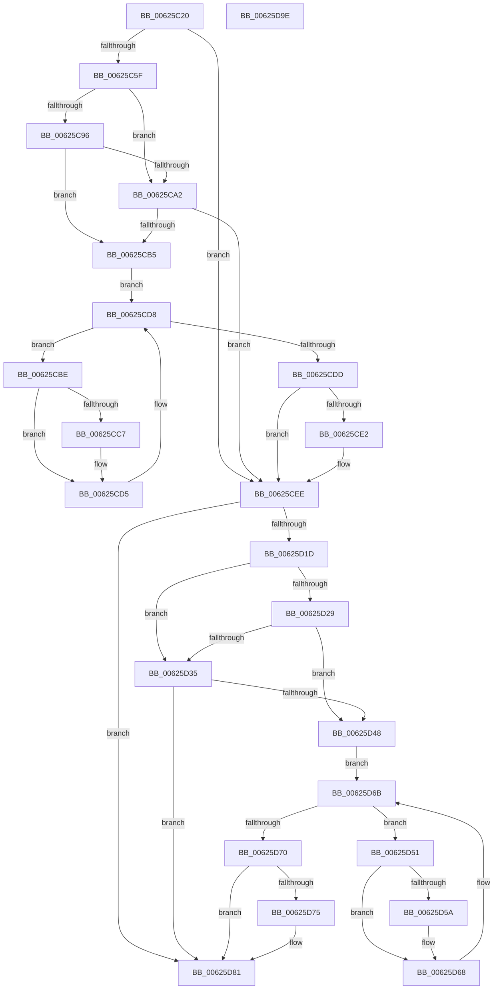

# DifIRP_MJ_QUERY_EAWrapper

- RVA: `0x00625C20`–`0x00625D9F` (길이 `383` bytes)
- VA: `0x0000000140625C20`
- 실행 섹션: `.text`
- PDB 이름 있음: `예`; PDB Function 태그: `아니요`
- unwind 정보 RVA: `0x00093E28`
- 디코드: `101`개 명령, `383/383` bytes 표시
- 미해석 바이트: `0` (있으면 어셈블리에 `.byte`로 보존)

> 이 문서는 커널 이미지의 기계어와 PDB 기호를 분석해 생성했습니다. 4번과 5번은 함수 원형과 자료형을 바이너리 사용 방식에서 추정한 C 해석이며 원본 소스 복구 결과는 아닙니다.

## 1. Dependencies

- 직접 호출 지점: **8**; 고유 호출 대상: **4**
- 직접 호출자로 확인된 함수: **0**
- RIP 상대 이미지 참조: **3**

### Outgoing calls
- `0x00625C4E` → [DifGetAPIThunkContextById](../49/DifGetAPIThunkContextById_function_00495A34.md) (function, `0x00495A34`)
- `0x00625CA9` → [ExAcquireRundownProtection](../21/ExAcquireRundownProtection_function_00216620.md) (function, `0x00216620`)
- `0x00625CD0` → [guard_dispatch_icall](../6B/guard_dispatch_icall_function_006BAAD0.md) (function, `0x006BAAD0`)
- `0x00625CE9` → [ExReleaseRundownProtection](../34/ExReleaseRundownProtection_function_00349E80.md) (function, `0x00349E80`)
- `0x00625D0F` → [guard_dispatch_icall](../6B/guard_dispatch_icall_function_006BAAD0.md) (function, `0x006BAAD0`)
- `0x00625D3C` → [ExAcquireRundownProtection](../21/ExAcquireRundownProtection_function_00216620.md) (function, `0x00216620`)
- `0x00625D63` → [guard_dispatch_icall](../6B/guard_dispatch_icall_function_006BAAD0.md) (function, `0x006BAAD0`)
- `0x00625D7C` → [ExReleaseRundownProtection](../34/ExReleaseRundownProtection_function_00349E80.md) (function, `0x00349E80`)

### Direct callers
- 이 함수 시작 RVA로 연결되는 직접 call은 확인되지 않았습니다. 간접 호출은 완전히 역산할 수 없습니다.

### Static image references
- `0x00625C69` → RVA `0x00F048B8` (`.data`; read)
- `0x00625C96` → RVA `0x00F04980` (`.data`; read)
- `0x00625CA2` → RVA `0x00F03E80` (`.data`; read)

## 2. Other-region calls and transfers

- 다른 실행 섹션으로 향하는 call: **0**
- 별도 외부 분기/꼬리 이동을 확인하지 못했습니다.

## 3. Assembly (complete function range)

```asm
00625C20  48 8B C4                        mov rax, rsp
00625C23  48 89 58 08                     mov qword ptr [rax + 8], rbx
00625C27  48 89 68 10                     mov qword ptr [rax + 0x10], rbp
00625C2B  48 89 70 18                     mov qword ptr [rax + 0x18], rsi
00625C2F  57                              push rdi
00625C30  41 56                           push r14
00625C32  41 57                           push r15
00625C34  48 83 EC 40                     sub rsp, 0x40
00625C38  0F 57 C0                        xorps xmm0, xmm0
00625C3B  4C 8B F9                        mov r15, rcx
00625C3E  B9 07 00 00 10                  mov ecx, 0x10000007
00625C43  4C 8B F2                        mov r14, rdx
00625C46  0F 11 40 C8                     movups xmmword ptr [rax - 0x38], xmm0
00625C4A  0F 11 40 D8                     movups xmmword ptr [rax - 0x28], xmm0
00625C4E  E8 E1 FD E6 FF                  call 0x140495a34
00625C53  48 8B E8                        mov rbp, rax
00625C56  48 85 C0                        test rax, rax
00625C59  0F 84 8F 00 00 00               je 0x140625cee
00625C5F  49 8B 96 B8 00 00 00            mov rdx, qword ptr [r14 + 0xb8]
00625C66  40 32 F6                        xor sil, sil
00625C69  40 38 35 48 EC 8D 00            cmp byte ptr [rip + 0x8dec48], sil
00625C70  49 8B 4F 08                     mov rcx, qword ptr [r15 + 8]
00625C74  44 0F B6 02                     movzx r8d, byte ptr [rdx]
00625C78  48 8B 51 30                     mov rdx, qword ptr [rcx + 0x30]
00625C7C  48 8B 4A 40                     mov rcx, qword ptr [rdx + 0x40]
00625C80  4A 8B 54 C1 20                  mov rdx, qword ptr [rcx + r8*8 + 0x20]
00625C85  48 89 54 24 20                  mov qword ptr [rsp + 0x20], rdx
00625C8A  4C 89 7C 24 30                  mov qword ptr [rsp + 0x30], r15
00625C8F  4C 89 74 24 28                  mov qword ptr [rsp + 0x28], r14
00625C94  75 0C                           jne 0x140625ca2
00625C96  F7 05 E0 EC 8D 00 00 08 00 00   test dword ptr [rip + 0x8dece0], 0x800
00625CA0  74 13                           je 0x140625cb5
00625CA2  48 8D 0D D7 E1 8D 00            lea rcx, [rip + 0x8de1d7]
00625CA9  E8 72 09 BF FF                  call 0x140216620
00625CAE  40 8A F0                        mov sil, al
00625CB1  84 C0                           test al, al
00625CB3  74 39                           je 0x140625cee
00625CB5  48 8D 7D 20                     lea rdi, [rbp + 0x20]
00625CB9  48 8B 1F                        mov rbx, qword ptr [rdi]
00625CBC  EB 1A                           jmp 0x140625cd8
00625CBE  48 8D 43 F0                     lea rax, [rbx - 0x10]
00625CC2  48 85 C0                        test rax, rax
00625CC5  74 0E                           je 0x140625cd5
00625CC7  48 8B 40 08                     mov rax, qword ptr [rax + 8]
00625CCB  48 8D 4C 24 20                  lea rcx, [rsp + 0x20]
00625CD0  E8 FB 4D 09 00                  call 0x1406baad0
00625CD5  48 8B 1B                        mov rbx, qword ptr [rbx]
00625CD8  48 3B DF                        cmp rbx, rdi
00625CDB  75 E1                           jne 0x140625cbe
00625CDD  40 84 F6                        test sil, sil
00625CE0  74 0C                           je 0x140625cee
00625CE2  48 8D 0D 97 E1 8D 00            lea rcx, [rip + 0x8de197]
00625CE9  E8 92 41 D2 FF                  call 0x140349e80
00625CEE  49 8B 86 B8 00 00 00            mov rax, qword ptr [r14 + 0xb8]
00625CF5  0F B6 10                        movzx edx, byte ptr [rax]
00625CF8  49 8B 47 08                     mov rax, qword ptr [r15 + 8]
00625CFC  48 8B 48 30                     mov rcx, qword ptr [rax + 0x30]
00625D00  48 8B 41 40                     mov rax, qword ptr [rcx + 0x40]
00625D04  49 8B CF                        mov rcx, r15
00625D07  48 8B 44 D0 20                  mov rax, qword ptr [rax + rdx*8 + 0x20]
00625D0C  49 8B D6                        mov rdx, r14
00625D0F  E8 BC 4D 09 00                  call 0x1406baad0
00625D14  89 44 24 38                     mov dword ptr [rsp + 0x38], eax
00625D18  48 85 ED                        test rbp, rbp
00625D1B  74 64                           je 0x140625d81
00625D1D  40 32 FF                        xor dil, dil
00625D20  40 38 3D 91 EB 8D 00            cmp byte ptr [rip + 0x8deb91], dil
00625D27  75 0C                           jne 0x140625d35
00625D29  F7 05 4D EC 8D 00 00 08 00 00   test dword ptr [rip + 0x8dec4d], 0x800
00625D33  74 13                           je 0x140625d48
00625D35  48 8D 0D 44 E1 8D 00            lea rcx, [rip + 0x8de144]
00625D3C  E8 DF 08 BF FF                  call 0x140216620
00625D41  40 8A F8                        mov dil, al
00625D44  84 C0                           test al, al
00625D46  74 39                           je 0x140625d81
00625D48  48 8D 75 30                     lea rsi, [rbp + 0x30]
00625D4C  48 8B 1E                        mov rbx, qword ptr [rsi]
00625D4F  EB 1A                           jmp 0x140625d6b
00625D51  48 8D 43 F0                     lea rax, [rbx - 0x10]
00625D55  48 85 C0                        test rax, rax
00625D58  74 0E                           je 0x140625d68
00625D5A  48 8B 40 08                     mov rax, qword ptr [rax + 8]
00625D5E  48 8D 4C 24 20                  lea rcx, [rsp + 0x20]
00625D63  E8 68 4D 09 00                  call 0x1406baad0
00625D68  48 8B 1B                        mov rbx, qword ptr [rbx]
00625D6B  48 3B DE                        cmp rbx, rsi
00625D6E  75 E1                           jne 0x140625d51
00625D70  40 84 FF                        test dil, dil
00625D73  74 0C                           je 0x140625d81
00625D75  48 8D 0D 04 E1 8D 00            lea rcx, [rip + 0x8de104]
00625D7C  E8 FF 40 D2 FF                  call 0x140349e80
00625D81  8B 44 24 38                     mov eax, dword ptr [rsp + 0x38]
00625D85  48 8B 5C 24 60                  mov rbx, qword ptr [rsp + 0x60]
00625D8A  48 8B 6C 24 68                  mov rbp, qword ptr [rsp + 0x68]
00625D8F  48 8B 74 24 70                  mov rsi, qword ptr [rsp + 0x70]
00625D94  48 83 C4 40                     add rsp, 0x40
00625D98  41 5F                           pop r15
00625D9A  41 5E                           pop r14
00625D9C  5F                              pop rdi
00625D9D  C3                              ret
00625D9E  CC                              int3
```

## 4. C-style interpretation (structured pseudocode)

```c
__int64 __fastcall DifIRP_MJ_QUERY_EAWrapper(__int64 a1, __int64 a2)
{
    __int64 result;
    __int64 v_rdi;
    __int64 v_rsi;
    __int64 v_rsp;
    unsigned int v_stack_m20;
    unsigned __int64 v_stack_m28;
    unsigned __int64 v_stack_m30;
    unsigned __int64 v_stack_m38;
    unsigned __int64 v_stack_p10;
    unsigned __int64 v_stack_p18;
    unsigned __int64 v_stack_p8;

    *(unsigned __int64 *)(v_rsp + 8) = v_rbx;
    *(unsigned __int64 *)(v_rsp + 16) = v_rbp;
    *(unsigned __int64 *)(v_rsp + 24) = v_rsi;
    v_rsp = (v_rsp) - (64);
    *(unsigned __int64 *)(v_rsp - 56) = v_xmm0;
    *(unsigned __int64 *)(v_rsp - 40) = v_xmm0;
    result = DifGetAPIThunkContextById((unsigned int)(0x10000007ULL), a2, a3, a4);
    if (result == 0) goto loc_00625CEE;
    v_rsi = 0;
    v_stack_m38 = *(unsigned __int64 *)(*(unsigned __int64 *)(*(unsigned __int64 *)(*(unsigned __int64 *)(a1 + 8) + 48) + 64) + *(unsigned __int8 *)(*(unsigned __int64 *)(a2 + 184)) * 8 + 32);
    v_stack_m28 = a1;
    v_stack_m30 = a2;
    if ((*(unsigned __int8 *)(v_rip + 9301064)) != 0) goto loc_00625CA2;
    if (((*(unsigned int *)(v_rip + 9301216)) & (0x800ULL)) == 0) goto loc_00625CB5;
loc_00625CA2:
    result = ExAcquireRundownProtection(v_rip + 9298391, *(unsigned __int64 *)(*(unsigned __int64 *)(*(unsigned __int64 *)(*(unsigned __int64 *)(a1 + 8) + 48) + 64) + *(unsigned __int8 *)(*(unsigned __int64 *)(a2 + 184)) * 8 + 32), *(unsigned __int8 *)(*(unsigned __int64 *)(a2 + 184)), a4);
    if ((unsigned __int8)(result) == 0) goto loc_00625CEE;
loc_00625CB5:
    goto loc_00625CD8;
loc_00625CBE:
    result = *(unsigned __int64 *)(result + 32) - 16;
    if (*(unsigned __int64 *)(result + 32) - 16 != 0) {
        result = *(unsigned __int64 *)(*(unsigned __int64 *)(result + 32) - 16 + 8);
        a1 = v_stack_m38;
        result = guard_dispatch_icall(a1, *(unsigned __int64 *)(*(unsigned __int64 *)(*(unsigned __int64 *)(*(unsigned __int64 *)(a1 + 8) + 48) + 64) + *(unsigned __int8 *)(*(unsigned __int64 *)(a2 + 184)) * 8 + 32), *(unsigned __int8 *)(*(unsigned __int64 *)(a2 + 184)), a4);
    }
loc_00625CD8:
    if ((*(unsigned __int64 *)(*(unsigned __int64 *)(result + 32))) != (result + 32)) goto loc_00625CBE;
    if ((unsigned __int8)((unsigned __int8)(result)) != 0) {
        a1 = v_rip + 9298327;
        result = ExReleaseRundownProtection(a1, *(unsigned __int64 *)(*(unsigned __int64 *)(*(unsigned __int64 *)(*(unsigned __int64 *)(a1 + 8) + 48) + 64) + *(unsigned __int8 *)(*(unsigned __int64 *)(a2 + 184)) * 8 + 32), *(unsigned __int8 *)(*(unsigned __int64 *)(a2 + 184)), a4);
    }
    result = guard_dispatch_icall(a1, a2, *(unsigned __int8 *)(*(unsigned __int64 *)(a2 + 184)), a4);
    v_stack_m20 = (unsigned int)(result);
    if (result == 0) goto loc_00625D81;
    v_rdi = 0;
    if ((*(unsigned __int8 *)(v_rip + 9300881)) != 0) goto loc_00625D35;
    if (((*(unsigned int *)(v_rip + 9301069)) & (0x800ULL)) == 0) goto loc_00625D48;
loc_00625D35:
    result = ExAcquireRundownProtection(v_rip + 9298244, a2, *(unsigned __int8 *)(*(unsigned __int64 *)(a2 + 184)), a4);
    if ((unsigned __int8)(result) == 0) goto loc_00625D81;
loc_00625D48:
    goto loc_00625D6B;
loc_00625D51:
    result = *(unsigned __int64 *)(result + 48) - 16;
    if (*(unsigned __int64 *)(result + 48) - 16 != 0) {
        result = *(unsigned __int64 *)(*(unsigned __int64 *)(result + 48) - 16 + 8);
        a1 = v_stack_m38;
        result = guard_dispatch_icall(a1, a2, *(unsigned __int8 *)(*(unsigned __int64 *)(a2 + 184)), a4);
    }
loc_00625D6B:
    if ((*(unsigned __int64 *)(*(unsigned __int64 *)(result + 48))) != (result + 48)) goto loc_00625D51;
    if ((unsigned __int8)((unsigned __int8)(result)) != 0) {
        a1 = v_rip + 9298180;
        result = ExReleaseRundownProtection(a1, a2, *(unsigned __int8 *)(*(unsigned __int64 *)(a2 + 184)), a4);
    }
    v_rsp = (v_rsp) + (64);
    return (unsigned int)(v_stack_m20);
}
```

## 5. (Beta) C Style

```c
int64_t DifIRP_MJ_QUERY_EAWrapper(void *Arg1, void *Arg2)
{
    uint8_t *arg1 = (uint8_t *)Arg1;
    uint8_t *arg2 = (uint8_t *)Arg2;

    int64_t result;
    int64_t local_rdi;
    int64_t local_rsi;
    int64_t local_rsp;
    uint32_t v_stack_m20;
    uint64_t v_stack_m28;
    uint64_t v_stack_m30;
    uint64_t v_stack_m38;
    uint64_t v_stack_p10;
    uint64_t v_stack_p18;
    uint64_t v_stack_p8;

    *(uint64_t *)(local_rsp + 0x8) = local_rbx;
    *(uint64_t *)(local_rsp + 0x10) = local_rbp;
    *(uint64_t *)(local_rsp + 0x18) = local_rsi;
    local_rsp = (local_rsp) - (64);
    *(uint64_t *)(local_rsp - 0x38) = v_xmm0;
    *(uint64_t *)(local_rsp - 0x28) = v_xmm0;
    result = DifGetAPIThunkContextById((uint32_t)(0x10000007ULL), Arg2, a3, a4);
    if (result == 0) goto loc_00625CEE;
    local_rsi = 0;
    v_stack_m38 = *(uint64_t *)(*(uint64_t *)(*(uint64_t *)(*(uint64_t *)(arg1 + 0x8) + 0x30) + 0x40) + *(uint8_t *)(*(uint64_t *)(arg2 + 0xB8)) * 8 + 0x20);
    v_stack_m28 = Arg1;
    v_stack_m30 = Arg2;
    if ((*(uint8_t *)(v_rip + 0x8DEC48)) != 0) goto loc_00625CA2;
    if (((*(uint32_t *)(v_rip + 0x8DECE0)) & (0x800ULL)) == 0) goto loc_00625CB5;
loc_00625CA2:
    result = ExAcquireRundownProtection(v_rip + 9298391, *(uint64_t *)(*(uint64_t *)(*(uint64_t *)(*(uint64_t *)(arg1 + 0x8) + 0x30) + 0x40) + *(uint8_t *)(*(uint64_t *)(arg2 + 0xB8)) * 8 + 0x20), *(uint8_t *)(*(uint64_t *)(arg2 + 0xB8)), a4);
    if ((uint8_t)(result) == 0) goto loc_00625CEE;
loc_00625CB5:
    goto loc_00625CD8;
loc_00625CBE:
    result = *(uint64_t *)(result + 0x20) - 16;
    if (*(uint64_t *)(result + 0x20) - 16 != 0) {
        result = *(uint64_t *)(*(uint64_t *)(result + 0x20) - 0x10 + 0x8);
        Arg1 = v_stack_m38;
        result = guard_dispatch_icall(Arg1, *(uint64_t *)(*(uint64_t *)(*(uint64_t *)(*(uint64_t *)(arg1 + 0x8) + 0x30) + 0x40) + *(uint8_t *)(*(uint64_t *)(arg2 + 0xB8)) * 8 + 0x20), *(uint8_t *)(*(uint64_t *)(arg2 + 0xB8)), a4);
    }
loc_00625CD8:
    if ((*(uint64_t *)(*(uint64_t *)(result + 0x20))) != (result + 32)) goto loc_00625CBE;
    if ((uint8_t)((uint8_t)(result)) != 0) {
        Arg1 = v_rip + 9298327;
        result = ExReleaseRundownProtection(Arg1, *(uint64_t *)(*(uint64_t *)(*(uint64_t *)(*(uint64_t *)(arg1 + 0x8) + 0x30) + 0x40) + *(uint8_t *)(*(uint64_t *)(arg2 + 0xB8)) * 8 + 0x20), *(uint8_t *)(*(uint64_t *)(arg2 + 0xB8)), a4);
    }
    result = guard_dispatch_icall(Arg1, Arg2, *(uint8_t *)(*(uint64_t *)(arg2 + 0xB8)), a4);
    v_stack_m20 = (uint32_t)(result);
    if (result == 0) goto loc_00625D81;
    local_rdi = 0;
    if ((*(uint8_t *)(v_rip + 0x8DEB91)) != 0) goto loc_00625D35;
    if (((*(uint32_t *)(v_rip + 0x8DEC4D)) & (0x800ULL)) == 0) goto loc_00625D48;
loc_00625D35:
    result = ExAcquireRundownProtection(v_rip + 9298244, Arg2, *(uint8_t *)(*(uint64_t *)(arg2 + 0xB8)), a4);
    if ((uint8_t)(result) == 0) goto loc_00625D81;
loc_00625D48:
    goto loc_00625D6B;
loc_00625D51:
    result = *(uint64_t *)(result + 0x30) - 16;
    if (*(uint64_t *)(result + 0x30) - 16 != 0) {
        result = *(uint64_t *)(*(uint64_t *)(result + 0x30) - 0x10 + 0x8);
        Arg1 = v_stack_m38;
        result = guard_dispatch_icall(Arg1, Arg2, *(uint8_t *)(*(uint64_t *)(arg2 + 0xB8)), a4);
    }
loc_00625D6B:
    if ((*(uint64_t *)(*(uint64_t *)(result + 0x30))) != (result + 48)) goto loc_00625D51;
    if ((uint8_t)((uint8_t)(result)) != 0) {
        Arg1 = v_rip + 9298180;
        result = ExReleaseRundownProtection(Arg1, Arg2, *(uint8_t *)(*(uint64_t *)(arg2 + 0xB8)), a4);
    }
    local_rsp = (local_rsp) + (64);
    return (uint32_t)(v_stack_m20);
}
```

### 관측된 메모리 오프셋

구조체 형식이 확인되지 않은 접근은 인자 기준의 오프셋으로만 기록했습니다.

| 기준 인자 | 오프셋 표현 | 폭 (bit) | 접근 |
|---|---:|---:|---|
| `Arg1` | `+ 0x8` | `64` | `R` |
| `Arg2` | `+ 0xB8` | `64` | `R` |

## 6. Execution-region graph

[열기: 2D/3D 그래프와 함수 탐색 컨트롤 패널](../../../control-panel.html?section=text&rva=0x00625C20&view=graph)

- 2D 그래프는 위에서 아래로 흐르고, 3D 그래프는 빈 공간을 드래그해 회전합니다. Shift+드래그는 이동, 휠은 확대·축소, 함수 노드 선택은 대상 보고서 이동입니다.

### Static fallback


