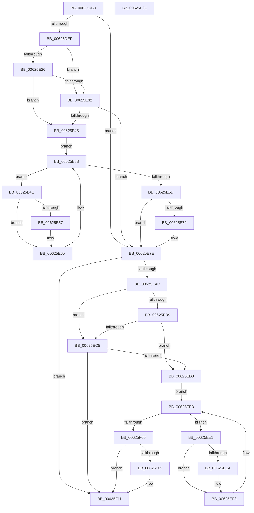

# DifIRP_MJ_QUERY_INFORMATIONWrapper

- RVA: `0x00625DB0`–`0x00625F2F` (길이 `383` bytes)
- VA: `0x0000000140625DB0`
- 실행 섹션: `.text`
- PDB 이름 있음: `예`; PDB Function 태그: `아니요`
- unwind 정보 RVA: `0x00093E28`
- 디코드: `101`개 명령, `383/383` bytes 표시
- 미해석 바이트: `0` (있으면 어셈블리에 `.byte`로 보존)

> 이 문서는 커널 이미지의 기계어와 PDB 기호를 분석해 생성했습니다. 4번과 5번은 함수 원형과 자료형을 바이너리 사용 방식에서 추정한 C 해석이며 원본 소스 복구 결과는 아닙니다.

## 1. Dependencies

- 직접 호출 지점: **8**; 고유 호출 대상: **4**
- 직접 호출자로 확인된 함수: **0**
- RIP 상대 이미지 참조: **3**

### Outgoing calls
- `0x00625DDE` → [DifGetAPIThunkContextById](../49/DifGetAPIThunkContextById_function_00495A34.md) (function, `0x00495A34`)
- `0x00625E39` → [ExAcquireRundownProtection](../21/ExAcquireRundownProtection_function_00216620.md) (function, `0x00216620`)
- `0x00625E60` → [guard_dispatch_icall](../6B/guard_dispatch_icall_function_006BAAD0.md) (function, `0x006BAAD0`)
- `0x00625E79` → [ExReleaseRundownProtection](../34/ExReleaseRundownProtection_function_00349E80.md) (function, `0x00349E80`)
- `0x00625E9F` → [guard_dispatch_icall](../6B/guard_dispatch_icall_function_006BAAD0.md) (function, `0x006BAAD0`)
- `0x00625ECC` → [ExAcquireRundownProtection](../21/ExAcquireRundownProtection_function_00216620.md) (function, `0x00216620`)
- `0x00625EF3` → [guard_dispatch_icall](../6B/guard_dispatch_icall_function_006BAAD0.md) (function, `0x006BAAD0`)
- `0x00625F0C` → [ExReleaseRundownProtection](../34/ExReleaseRundownProtection_function_00349E80.md) (function, `0x00349E80`)

### Direct callers
- 이 함수 시작 RVA로 연결되는 직접 call은 확인되지 않았습니다. 간접 호출은 완전히 역산할 수 없습니다.

### Static image references
- `0x00625DF9` → RVA `0x00F048B8` (`.data`; read)
- `0x00625E26` → RVA `0x00F04980` (`.data`; read)
- `0x00625E32` → RVA `0x00F03E80` (`.data`; read)

## 2. Other-region calls and transfers

- 다른 실행 섹션으로 향하는 call: **0**
- 별도 외부 분기/꼬리 이동을 확인하지 못했습니다.

## 3. Assembly (complete function range)

```asm
00625DB0  48 8B C4                        mov rax, rsp
00625DB3  48 89 58 08                     mov qword ptr [rax + 8], rbx
00625DB7  48 89 68 10                     mov qword ptr [rax + 0x10], rbp
00625DBB  48 89 70 18                     mov qword ptr [rax + 0x18], rsi
00625DBF  57                              push rdi
00625DC0  41 56                           push r14
00625DC2  41 57                           push r15
00625DC4  48 83 EC 40                     sub rsp, 0x40
00625DC8  0F 57 C0                        xorps xmm0, xmm0
00625DCB  4C 8B F9                        mov r15, rcx
00625DCE  B9 05 00 00 10                  mov ecx, 0x10000005
00625DD3  4C 8B F2                        mov r14, rdx
00625DD6  0F 11 40 C8                     movups xmmword ptr [rax - 0x38], xmm0
00625DDA  0F 11 40 D8                     movups xmmword ptr [rax - 0x28], xmm0
00625DDE  E8 51 FC E6 FF                  call 0x140495a34
00625DE3  48 8B E8                        mov rbp, rax
00625DE6  48 85 C0                        test rax, rax
00625DE9  0F 84 8F 00 00 00               je 0x140625e7e
00625DEF  49 8B 96 B8 00 00 00            mov rdx, qword ptr [r14 + 0xb8]
00625DF6  40 32 F6                        xor sil, sil
00625DF9  40 38 35 B8 EA 8D 00            cmp byte ptr [rip + 0x8deab8], sil
00625E00  49 8B 4F 08                     mov rcx, qword ptr [r15 + 8]
00625E04  44 0F B6 02                     movzx r8d, byte ptr [rdx]
00625E08  48 8B 51 30                     mov rdx, qword ptr [rcx + 0x30]
00625E0C  48 8B 4A 40                     mov rcx, qword ptr [rdx + 0x40]
00625E10  4A 8B 54 C1 20                  mov rdx, qword ptr [rcx + r8*8 + 0x20]
00625E15  48 89 54 24 20                  mov qword ptr [rsp + 0x20], rdx
00625E1A  4C 89 7C 24 30                  mov qword ptr [rsp + 0x30], r15
00625E1F  4C 89 74 24 28                  mov qword ptr [rsp + 0x28], r14
00625E24  75 0C                           jne 0x140625e32
00625E26  F7 05 50 EB 8D 00 00 08 00 00   test dword ptr [rip + 0x8deb50], 0x800
00625E30  74 13                           je 0x140625e45
00625E32  48 8D 0D 47 E0 8D 00            lea rcx, [rip + 0x8de047]
00625E39  E8 E2 07 BF FF                  call 0x140216620
00625E3E  40 8A F0                        mov sil, al
00625E41  84 C0                           test al, al
00625E43  74 39                           je 0x140625e7e
00625E45  48 8D 7D 20                     lea rdi, [rbp + 0x20]
00625E49  48 8B 1F                        mov rbx, qword ptr [rdi]
00625E4C  EB 1A                           jmp 0x140625e68
00625E4E  48 8D 43 F0                     lea rax, [rbx - 0x10]
00625E52  48 85 C0                        test rax, rax
00625E55  74 0E                           je 0x140625e65
00625E57  48 8B 40 08                     mov rax, qword ptr [rax + 8]
00625E5B  48 8D 4C 24 20                  lea rcx, [rsp + 0x20]
00625E60  E8 6B 4C 09 00                  call 0x1406baad0
00625E65  48 8B 1B                        mov rbx, qword ptr [rbx]
00625E68  48 3B DF                        cmp rbx, rdi
00625E6B  75 E1                           jne 0x140625e4e
00625E6D  40 84 F6                        test sil, sil
00625E70  74 0C                           je 0x140625e7e
00625E72  48 8D 0D 07 E0 8D 00            lea rcx, [rip + 0x8de007]
00625E79  E8 02 40 D2 FF                  call 0x140349e80
00625E7E  49 8B 86 B8 00 00 00            mov rax, qword ptr [r14 + 0xb8]
00625E85  0F B6 10                        movzx edx, byte ptr [rax]
00625E88  49 8B 47 08                     mov rax, qword ptr [r15 + 8]
00625E8C  48 8B 48 30                     mov rcx, qword ptr [rax + 0x30]
00625E90  48 8B 41 40                     mov rax, qword ptr [rcx + 0x40]
00625E94  49 8B CF                        mov rcx, r15
00625E97  48 8B 44 D0 20                  mov rax, qword ptr [rax + rdx*8 + 0x20]
00625E9C  49 8B D6                        mov rdx, r14
00625E9F  E8 2C 4C 09 00                  call 0x1406baad0
00625EA4  89 44 24 38                     mov dword ptr [rsp + 0x38], eax
00625EA8  48 85 ED                        test rbp, rbp
00625EAB  74 64                           je 0x140625f11
00625EAD  40 32 FF                        xor dil, dil
00625EB0  40 38 3D 01 EA 8D 00            cmp byte ptr [rip + 0x8dea01], dil
00625EB7  75 0C                           jne 0x140625ec5
00625EB9  F7 05 BD EA 8D 00 00 08 00 00   test dword ptr [rip + 0x8deabd], 0x800
00625EC3  74 13                           je 0x140625ed8
00625EC5  48 8D 0D B4 DF 8D 00            lea rcx, [rip + 0x8ddfb4]
00625ECC  E8 4F 07 BF FF                  call 0x140216620
00625ED1  40 8A F8                        mov dil, al
00625ED4  84 C0                           test al, al
00625ED6  74 39                           je 0x140625f11
00625ED8  48 8D 75 30                     lea rsi, [rbp + 0x30]
00625EDC  48 8B 1E                        mov rbx, qword ptr [rsi]
00625EDF  EB 1A                           jmp 0x140625efb
00625EE1  48 8D 43 F0                     lea rax, [rbx - 0x10]
00625EE5  48 85 C0                        test rax, rax
00625EE8  74 0E                           je 0x140625ef8
00625EEA  48 8B 40 08                     mov rax, qword ptr [rax + 8]
00625EEE  48 8D 4C 24 20                  lea rcx, [rsp + 0x20]
00625EF3  E8 D8 4B 09 00                  call 0x1406baad0
00625EF8  48 8B 1B                        mov rbx, qword ptr [rbx]
00625EFB  48 3B DE                        cmp rbx, rsi
00625EFE  75 E1                           jne 0x140625ee1
00625F00  40 84 FF                        test dil, dil
00625F03  74 0C                           je 0x140625f11
00625F05  48 8D 0D 74 DF 8D 00            lea rcx, [rip + 0x8ddf74]
00625F0C  E8 6F 3F D2 FF                  call 0x140349e80
00625F11  8B 44 24 38                     mov eax, dword ptr [rsp + 0x38]
00625F15  48 8B 5C 24 60                  mov rbx, qword ptr [rsp + 0x60]
00625F1A  48 8B 6C 24 68                  mov rbp, qword ptr [rsp + 0x68]
00625F1F  48 8B 74 24 70                  mov rsi, qword ptr [rsp + 0x70]
00625F24  48 83 C4 40                     add rsp, 0x40
00625F28  41 5F                           pop r15
00625F2A  41 5E                           pop r14
00625F2C  5F                              pop rdi
00625F2D  C3                              ret
00625F2E  CC                              int3
```

## 4. C-style interpretation (structured pseudocode)

```c
__int64 __fastcall DifIRP_MJ_QUERY_INFORMATIONWrapper(__int64 a1, __int64 a2)
{
    __int64 result;
    __int64 v_rdi;
    __int64 v_rsi;
    __int64 v_rsp;
    unsigned int v_stack_m20;
    unsigned __int64 v_stack_m28;
    unsigned __int64 v_stack_m30;
    unsigned __int64 v_stack_m38;
    unsigned __int64 v_stack_p10;
    unsigned __int64 v_stack_p18;
    unsigned __int64 v_stack_p8;

    *(unsigned __int64 *)(v_rsp + 8) = v_rbx;
    *(unsigned __int64 *)(v_rsp + 16) = v_rbp;
    *(unsigned __int64 *)(v_rsp + 24) = v_rsi;
    v_rsp = (v_rsp) - (64);
    *(unsigned __int64 *)(v_rsp - 56) = v_xmm0;
    *(unsigned __int64 *)(v_rsp - 40) = v_xmm0;
    result = DifGetAPIThunkContextById((unsigned int)(0x10000005ULL), a2, a3, a4);
    if (result == 0) goto loc_00625E7E;
    v_rsi = 0;
    v_stack_m38 = *(unsigned __int64 *)(*(unsigned __int64 *)(*(unsigned __int64 *)(*(unsigned __int64 *)(a1 + 8) + 48) + 64) + *(unsigned __int8 *)(*(unsigned __int64 *)(a2 + 184)) * 8 + 32);
    v_stack_m28 = a1;
    v_stack_m30 = a2;
    if ((*(unsigned __int8 *)(v_rip + 9300664)) != 0) goto loc_00625E32;
    if (((*(unsigned int *)(v_rip + 9300816)) & (0x800ULL)) == 0) goto loc_00625E45;
loc_00625E32:
    result = ExAcquireRundownProtection(v_rip + 9297991, *(unsigned __int64 *)(*(unsigned __int64 *)(*(unsigned __int64 *)(*(unsigned __int64 *)(a1 + 8) + 48) + 64) + *(unsigned __int8 *)(*(unsigned __int64 *)(a2 + 184)) * 8 + 32), *(unsigned __int8 *)(*(unsigned __int64 *)(a2 + 184)), a4);
    if ((unsigned __int8)(result) == 0) goto loc_00625E7E;
loc_00625E45:
    goto loc_00625E68;
loc_00625E4E:
    result = *(unsigned __int64 *)(result + 32) - 16;
    if (*(unsigned __int64 *)(result + 32) - 16 != 0) {
        result = *(unsigned __int64 *)(*(unsigned __int64 *)(result + 32) - 16 + 8);
        a1 = v_stack_m38;
        result = guard_dispatch_icall(a1, *(unsigned __int64 *)(*(unsigned __int64 *)(*(unsigned __int64 *)(*(unsigned __int64 *)(a1 + 8) + 48) + 64) + *(unsigned __int8 *)(*(unsigned __int64 *)(a2 + 184)) * 8 + 32), *(unsigned __int8 *)(*(unsigned __int64 *)(a2 + 184)), a4);
    }
loc_00625E68:
    if ((*(unsigned __int64 *)(*(unsigned __int64 *)(result + 32))) != (result + 32)) goto loc_00625E4E;
    if ((unsigned __int8)((unsigned __int8)(result)) != 0) {
        a1 = v_rip + 9297927;
        result = ExReleaseRundownProtection(a1, *(unsigned __int64 *)(*(unsigned __int64 *)(*(unsigned __int64 *)(*(unsigned __int64 *)(a1 + 8) + 48) + 64) + *(unsigned __int8 *)(*(unsigned __int64 *)(a2 + 184)) * 8 + 32), *(unsigned __int8 *)(*(unsigned __int64 *)(a2 + 184)), a4);
    }
    result = guard_dispatch_icall(a1, a2, *(unsigned __int8 *)(*(unsigned __int64 *)(a2 + 184)), a4);
    v_stack_m20 = (unsigned int)(result);
    if (result == 0) goto loc_00625F11;
    v_rdi = 0;
    if ((*(unsigned __int8 *)(v_rip + 9300481)) != 0) goto loc_00625EC5;
    if (((*(unsigned int *)(v_rip + 9300669)) & (0x800ULL)) == 0) goto loc_00625ED8;
loc_00625EC5:
    result = ExAcquireRundownProtection(v_rip + 9297844, a2, *(unsigned __int8 *)(*(unsigned __int64 *)(a2 + 184)), a4);
    if ((unsigned __int8)(result) == 0) goto loc_00625F11;
loc_00625ED8:
    goto loc_00625EFB;
loc_00625EE1:
    result = *(unsigned __int64 *)(result + 48) - 16;
    if (*(unsigned __int64 *)(result + 48) - 16 != 0) {
        result = *(unsigned __int64 *)(*(unsigned __int64 *)(result + 48) - 16 + 8);
        a1 = v_stack_m38;
        result = guard_dispatch_icall(a1, a2, *(unsigned __int8 *)(*(unsigned __int64 *)(a2 + 184)), a4);
    }
loc_00625EFB:
    if ((*(unsigned __int64 *)(*(unsigned __int64 *)(result + 48))) != (result + 48)) goto loc_00625EE1;
    if ((unsigned __int8)((unsigned __int8)(result)) != 0) {
        a1 = v_rip + 9297780;
        result = ExReleaseRundownProtection(a1, a2, *(unsigned __int8 *)(*(unsigned __int64 *)(a2 + 184)), a4);
    }
    v_rsp = (v_rsp) + (64);
    return (unsigned int)(v_stack_m20);
}
```

## 5. (Beta) C Style

```c
int64_t DifIRP_MJ_QUERY_INFORMATIONWrapper(void *Arg1, void *Arg2)
{
    uint8_t *arg1 = (uint8_t *)Arg1;
    uint8_t *arg2 = (uint8_t *)Arg2;

    int64_t result;
    int64_t local_rdi;
    int64_t local_rsi;
    int64_t local_rsp;
    uint32_t v_stack_m20;
    uint64_t v_stack_m28;
    uint64_t v_stack_m30;
    uint64_t v_stack_m38;
    uint64_t v_stack_p10;
    uint64_t v_stack_p18;
    uint64_t v_stack_p8;

    *(uint64_t *)(local_rsp + 0x8) = local_rbx;
    *(uint64_t *)(local_rsp + 0x10) = local_rbp;
    *(uint64_t *)(local_rsp + 0x18) = local_rsi;
    local_rsp = (local_rsp) - (64);
    *(uint64_t *)(local_rsp - 0x38) = v_xmm0;
    *(uint64_t *)(local_rsp - 0x28) = v_xmm0;
    result = DifGetAPIThunkContextById((uint32_t)(0x10000005ULL), Arg2, a3, a4);
    if (result == 0) goto loc_00625E7E;
    local_rsi = 0;
    v_stack_m38 = *(uint64_t *)(*(uint64_t *)(*(uint64_t *)(*(uint64_t *)(arg1 + 0x8) + 0x30) + 0x40) + *(uint8_t *)(*(uint64_t *)(arg2 + 0xB8)) * 8 + 0x20);
    v_stack_m28 = Arg1;
    v_stack_m30 = Arg2;
    if ((*(uint8_t *)(v_rip + 0x8DEAB8)) != 0) goto loc_00625E32;
    if (((*(uint32_t *)(v_rip + 0x8DEB50)) & (0x800ULL)) == 0) goto loc_00625E45;
loc_00625E32:
    result = ExAcquireRundownProtection(v_rip + 9297991, *(uint64_t *)(*(uint64_t *)(*(uint64_t *)(*(uint64_t *)(arg1 + 0x8) + 0x30) + 0x40) + *(uint8_t *)(*(uint64_t *)(arg2 + 0xB8)) * 8 + 0x20), *(uint8_t *)(*(uint64_t *)(arg2 + 0xB8)), a4);
    if ((uint8_t)(result) == 0) goto loc_00625E7E;
loc_00625E45:
    goto loc_00625E68;
loc_00625E4E:
    result = *(uint64_t *)(result + 0x20) - 16;
    if (*(uint64_t *)(result + 0x20) - 16 != 0) {
        result = *(uint64_t *)(*(uint64_t *)(result + 0x20) - 0x10 + 0x8);
        Arg1 = v_stack_m38;
        result = guard_dispatch_icall(Arg1, *(uint64_t *)(*(uint64_t *)(*(uint64_t *)(*(uint64_t *)(arg1 + 0x8) + 0x30) + 0x40) + *(uint8_t *)(*(uint64_t *)(arg2 + 0xB8)) * 8 + 0x20), *(uint8_t *)(*(uint64_t *)(arg2 + 0xB8)), a4);
    }
loc_00625E68:
    if ((*(uint64_t *)(*(uint64_t *)(result + 0x20))) != (result + 32)) goto loc_00625E4E;
    if ((uint8_t)((uint8_t)(result)) != 0) {
        Arg1 = v_rip + 9297927;
        result = ExReleaseRundownProtection(Arg1, *(uint64_t *)(*(uint64_t *)(*(uint64_t *)(*(uint64_t *)(arg1 + 0x8) + 0x30) + 0x40) + *(uint8_t *)(*(uint64_t *)(arg2 + 0xB8)) * 8 + 0x20), *(uint8_t *)(*(uint64_t *)(arg2 + 0xB8)), a4);
    }
    result = guard_dispatch_icall(Arg1, Arg2, *(uint8_t *)(*(uint64_t *)(arg2 + 0xB8)), a4);
    v_stack_m20 = (uint32_t)(result);
    if (result == 0) goto loc_00625F11;
    local_rdi = 0;
    if ((*(uint8_t *)(v_rip + 0x8DEA01)) != 0) goto loc_00625EC5;
    if (((*(uint32_t *)(v_rip + 0x8DEABD)) & (0x800ULL)) == 0) goto loc_00625ED8;
loc_00625EC5:
    result = ExAcquireRundownProtection(v_rip + 9297844, Arg2, *(uint8_t *)(*(uint64_t *)(arg2 + 0xB8)), a4);
    if ((uint8_t)(result) == 0) goto loc_00625F11;
loc_00625ED8:
    goto loc_00625EFB;
loc_00625EE1:
    result = *(uint64_t *)(result + 0x30) - 16;
    if (*(uint64_t *)(result + 0x30) - 16 != 0) {
        result = *(uint64_t *)(*(uint64_t *)(result + 0x30) - 0x10 + 0x8);
        Arg1 = v_stack_m38;
        result = guard_dispatch_icall(Arg1, Arg2, *(uint8_t *)(*(uint64_t *)(arg2 + 0xB8)), a4);
    }
loc_00625EFB:
    if ((*(uint64_t *)(*(uint64_t *)(result + 0x30))) != (result + 48)) goto loc_00625EE1;
    if ((uint8_t)((uint8_t)(result)) != 0) {
        Arg1 = v_rip + 9297780;
        result = ExReleaseRundownProtection(Arg1, Arg2, *(uint8_t *)(*(uint64_t *)(arg2 + 0xB8)), a4);
    }
    local_rsp = (local_rsp) + (64);
    return (uint32_t)(v_stack_m20);
}
```

### 관측된 메모리 오프셋

구조체 형식이 확인되지 않은 접근은 인자 기준의 오프셋으로만 기록했습니다.

| 기준 인자 | 오프셋 표현 | 폭 (bit) | 접근 |
|---|---:|---:|---|
| `Arg1` | `+ 0x8` | `64` | `R` |
| `Arg2` | `+ 0xB8` | `64` | `R` |

## 6. Execution-region graph

[열기: 2D/3D 그래프와 함수 탐색 컨트롤 패널](../../../control-panel.html?section=text&rva=0x00625DB0&view=graph)

- 2D 그래프는 위에서 아래로 흐르고, 3D 그래프는 빈 공간을 드래그해 회전합니다. Shift+드래그는 이동, 휠은 확대·축소, 함수 노드 선택은 대상 보고서 이동입니다.

### Static fallback


